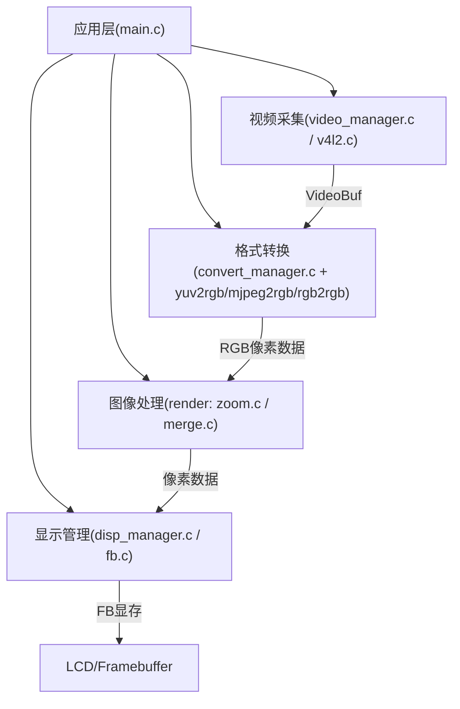
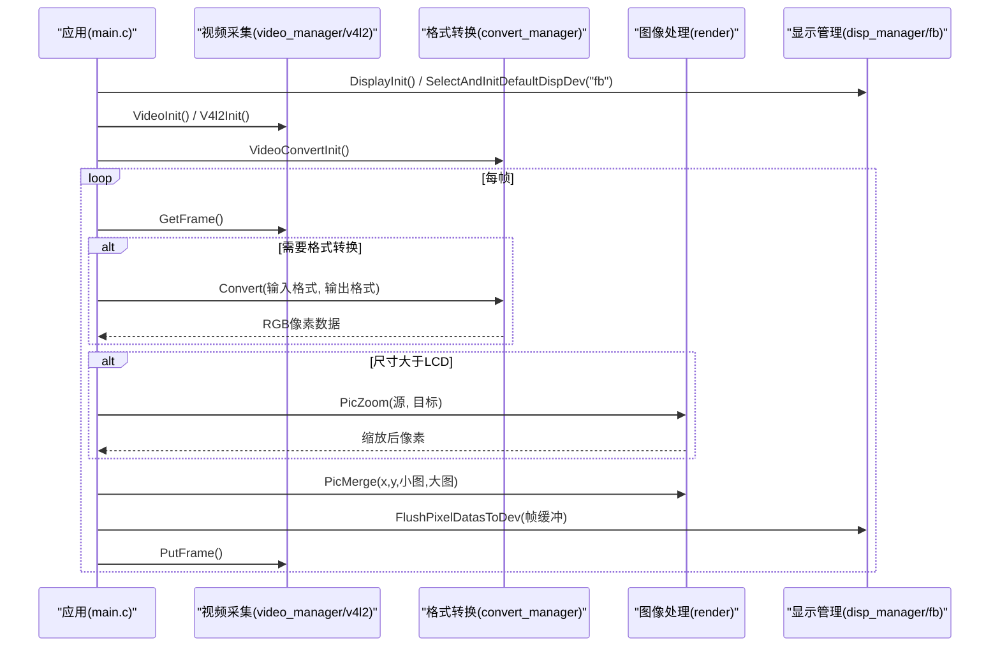
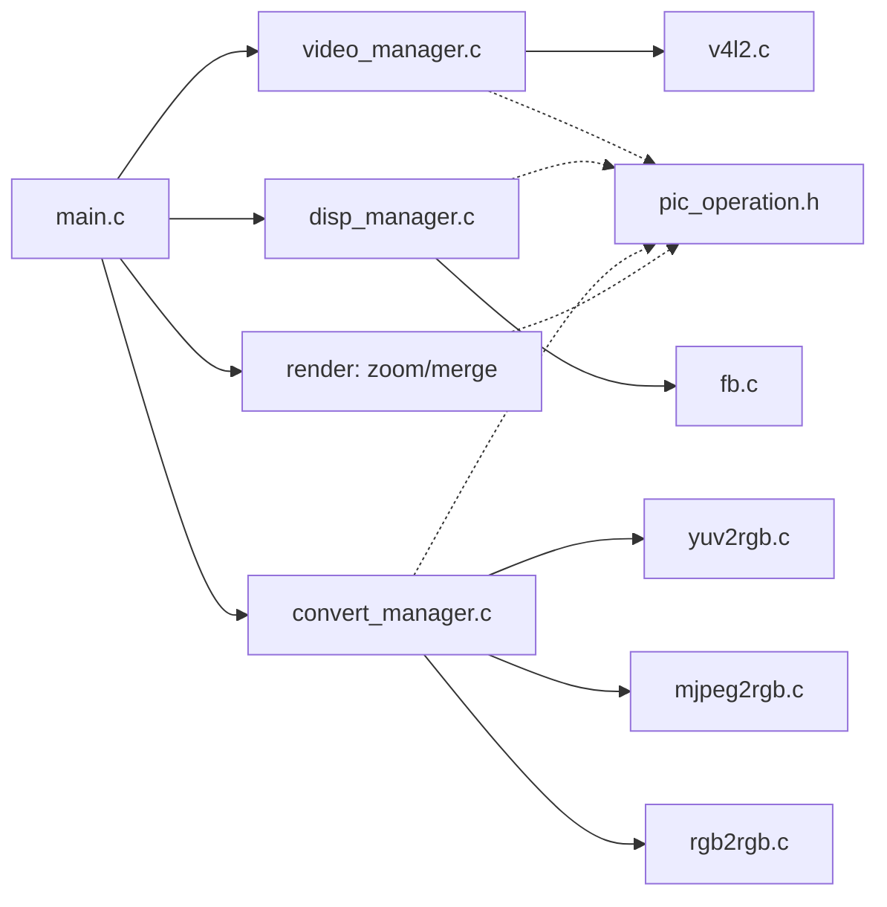

# API参考文档

<cite>
**本文引用的文件**
- [main.c](file://video2lcd/main.c)
- [config.h](file://video2lcd/include/config.h)
- [video_manager.h](file://video2lcd/include/video_manager.h)
- [video_manager.c](file://video2lcd/video/video_manager.c)
- [v4l2.c](file://video2lcd/video/v4l2.c)
- [disp_manager.h](file://video2lcd/include/disp_manager.h)
- [disp_manager.c](file://video2lcd/display/disp_manager.c)
- [fb.c](file://video2lcd/display/fb.c)
- [convert_manager.h](file://video2lcd/include/convert_manager.h)
- [convert_manager.c](file://video2lcd/convert/convert_manager.c)
- [yuv2rgb.c](file://video2lcd/convert/yuv2rgb.c)
- [mjpeg2rgb.c](file://video2lcd/convert/mjpeg2rgb.c)
- [rgb2rgb.c](file://video2lcd/convert/rgb2rgb.c)
- [render.h](file://video2lcd/include/render.h)
- [zoom.c](file://video2lcd/render/operation/zoom.c)
- [merge.c](file://video2lcd/render/operation/merge.c)
- [pic_operation.h](file://video2lcd/include/pic_operation.h)
</cite>

## 目录
1. [简介](#简介)
2. [项目结构](#项目结构)
3. [核心组件](#核心组件)
4. [架构总览](#架构总览)
5. [详细组件与API说明](#详细组件与api说明)
6. [依赖关系分析](#依赖关系分析)
7. [性能考虑](#性能考虑)
8. [故障排查指南](#故障排查指南)
9. [结论](#结论)
10. [附录：数据类型、枚举与常量](#附录：数据类型枚举与常量)

## 简介
本API参考文档面向嵌入式Linux相机项目的公共接口，覆盖视频采集、显示管理、格式转换与图像处理四大模块。文档按模块组织，提供函数参数、返回值、使用示例、线程安全注意事项、错误处理模式以及最佳实践，帮助开发者快速集成与扩展。

## 项目结构
- 视频采集模块（video）：封装V4L2设备操作，提供统一取帧/还帧接口
- 显示管理模块（display）：抽象显示设备（如framebuffer），提供显存管理与页面刷新
- 格式转换模块（convert）：注册并选择YUV/MJPEG/RGB到目标格式的转换器
- 图像处理模块（render）：提供缩放、合并等图像操作
- 公共头文件（include）：定义跨模块共享的数据结构与接口
- 主程序（main.c）：串联各模块完成“采集→转换→缩放→合并→显示”的完整流程

图表来源
- [main.c:34-192](file://video2lcd/main.c#L34-L192)
- [video_manager.c:12-75](file://video2lcd/video/video_manager.c#L12-L75)
- [v4l2.c:47-401](file://video2lcd/video/v4l2.c#L47-L401)
- [disp_manager.c:27-524](file://video2lcd/display/disp_manager.c#L27-L524)
- [fb.c:53-253](file://video2lcd/display/fb.c#L53-L253)
- [convert_manager.c:23-131](file://video2lcd/convert/convert_manager.c#L23-L131)
- [yuv2rgb.c:218-233](file://video2lcd/convert/yuv2rgb.c#L218-L233)
- [mjpeg2rgb.c:247-261](file://video2lcd/convert/mjpeg2rgb.c#L247-L261)
- [rgb2rgb.c:138-152](file://video2lcd/convert/rgb2rgb.c#L138-L152)
- [zoom.c:27-86](file://video2lcd/render/operation/zoom.c#L27-L86)
- [merge.c:20-89](file://video2lcd/render/operation/merge.c#L20-L89)

章节来源
- [main.c:34-192](file://video2lcd/main.c#L34-L192)

## 核心组件
- 视频采集：通过VideoOpr抽象摄像头驱动，支持streaming与read/write两种模式；提供GetFrame/PutFrame/StartDevice/StopDevice等接口
- 显示管理：通过DispOpr抽象显示设备，提供清屏、画点、整页显示；维护VideoMem缓冲池以加速显示
- 格式转换：通过VideoConvert抽象不同格式转换器，自动根据输入输出格式选择合适实现
- 图像处理：提供PicZoom（最近邻插值缩放）与PicMerge（区域合并）

章节来源
- [video_manager.h:14-56](file://video2lcd/include/video_manager.h#L14-L56)
- [disp_manager.h:22-96](file://video2lcd/include/disp_manager.h#L22-L96)
- [convert_manager.h:23-44](file://video2lcd/include/convert_manager.h#L23-L44)
- [render.h:15-36](file://video2lcd/include/render.h#L15-L36)

## 架构总览
系统采用“插件式”接口设计：视频、显示、转换均以“操作接口结构体+链表注册”的方式解耦，便于扩展新设备或新算法。主流程由main.c编排，将采集、转换、渲染、显示串联为稳定的流水线。

图表来源
- [main.c:63-192](file://video2lcd/main.c#L63-L192)
- [video_manager.c:67-75](file://video2lcd/video/video_manager.c#L67-L75)
- [v4l2.c:267-326](file://video2lcd/video/v4l2.c#L267-L326)
- [convert_manager.c:121-131](file://video2lcd/convert/convert_manager.c#L121-L131)
- [disp_manager.c:148-175](file://video2lcd/display/disp_manager.c#L148-L175)
- [fb.c:166-174](file://video2lcd/display/fb.c#L166-L174)

## 详细组件与API说明

### 视频采集API（video）
- 模块职责
  - 抽象摄像头设备，统一GetFrame/PutFrame/StartDevice/StopDevice接口
  - 支持V4L2 streaming与read/write两种模式
- 关键数据结构
  - VideoDevice：设备描述（fd、像素格式、分辨率、缓冲区数组、操作指针）
  - VideoOpr：操作接口（initDevice/ExitDevice/GetFrame/PutFrame/StartDevice/StopDevice）
  - VideoBuf：一帧数据载体（像素数据+像素格式）
- 主要API
  - RegisterVideoOpr(ptVideoOpr)：注册摄像头操作接口
  - ShowVideoOpr()：列出已注册的摄像头模块
  - getVideoOpr(name)：按名称获取操作接口
  - VideoInit()：初始化视频模块（注册V4L2）
  - V4l2Init()：注册V4L2具体实现
- 使用要点
  - 先调用VideoInit/V4l2Init完成驱动注册
  - 通过ptOPr->StartDevice启动采集
  - 循环GetFrame/PutFrame，注意检查返回码
  - 退出时调用ExitDevice释放资源
- 线程安全
  - 当前实现未加锁，单线程采集更安全；多线程需外部同步
- 错误处理
  - 所有ioctl/mmap/read失败均返回负值，建议打印调试信息并退出或重试
- 参考路径
  - [video_manager.c:12-75](file://video2lcd/video/video_manager.c#L12-L75)
  - [v4l2.c:47-401](file://video2lcd/video/v4l2.c#L47-L401)
  - [video_manager.h:14-56](file://video2lcd/include/video_manager.h#L14-L56)

章节来源
- [video_manager.c:12-75](file://video2lcd/video/video_manager.c#L12-L75)
- [v4l2.c:47-401](file://video2lcd/video/v4l2.c#L47-L401)
- [video_manager.h:14-56](file://video2lcd/include/video_manager.h#L14-L56)

### 显示管理API（display）
- 模块职责
  - 抽象显示设备（如framebuffer），提供清屏、画点、整页显示
  - 管理VideoMem缓冲池，用于加速显示
- 关键数据结构
  - DispOpr：显示操作接口（DeviceInir/CleanScreen/ShowPage等）
  - VideoMem：显示缓冲页（状态机：空闲/准备中/正在显示）
  - Layout：布局矩形（左上角、右下角坐标）
- 主要API
  - RegisterDispOpr(ptDispOpr)：注册显示设备
  - ShowDispOpr()：列出已注册显示设备
  - DisplayInit()：初始化显示模块（注册FB）
  - SelectAndInitDefaultDispDev(name)：选择并初始化默认显示设备
  - GetDefaultDispDev()：获取默认显示设备
  - GetDispResolution(&x,&y,&bpp)：获取分辨率与色深
  - AllocVideoMem(num)：分配多页VideoMem
  - GetVideoMem(id,bCur)/PutVideoMem(mem)：获取/归还VideoMem
  - ClearVideoMem()/ClearVideoMemRegion()：清空内存或区域
  - GetVideoBufForDisplay(&buf)：获取直接映射到LCD的帧缓冲
  - FlushPixelDatasToDev(&pixelDatas)：刷新到设备
- 使用要点
  - 必须先SelectAndInitDefaultDispDev再调用显示相关API
  - 使用GetVideoBufForDisplay获得可直接写入的帧缓冲
  - 写完后调用FlushPixelDatasToDev触发显示
- 线程安全
  - 内部无锁，避免并发访问同一VideoMem；如需多线程，请自行加锁
- 错误处理
  - 未选择默认设备时GetDispResolution返回-1；其他失败返回负值
- 参考路径
  - [disp_manager.c:27-524](file://video2lcd/display/disp_manager.c#L27-L524)
  - [fb.c:53-253](file://video2lcd/display/fb.c#L53-L253)
  - [disp_manager.h:22-236](file://video2lcd/include/disp_manager.h#L22-L236)

章节来源
- [disp_manager.c:27-524](file://video2lcd/display/disp_manager.c#L27-L524)
- [fb.c:53-253](file://video2lcd/display/fb.c#L53-L253)
- [disp_manager.h:22-236](file://video2lcd/include/disp_manager.h#L22-L236)

### 格式转换API（convert）
- 模块职责
  - 注册多种格式转换器（YUV→RGB、MJPEG→RGB、RGB→RGB）
  - 根据输入输出像素格式自动选择合适转换器
- 关键数据结构
  - VideoConvert：转换器接口（isSupport/Convert/ConvertExit）
- 主要API
  - RegisterVideoConvert(ptVideoConvert)：注册转换器
  - VideoConvertInit()：初始化所有转换器
  - GetVideoConvertForFormats(inFmt,outFmt)：按格式选择转换器
  - Yuv2RgbInit()/Mjpeg2RgbInit()/Rgb2RgbInit()：分别注册对应转换器
- 使用要点
  - 在采集前调用VideoConvertInit完成注册
  - 根据摄像头输出格式与LCD格式选择转换器
  - 转换完成后按需调用ConvertExit释放输出缓冲
- 线程安全
  - 转换器内部无锁，建议串行调用或在应用层加锁
- 错误处理
  - isSupport返回0表示不支持该格式组合；Convert返回负值表示失败
- 参考路径
  - [convert_manager.c:23-131](file://video2lcd/convert/convert_manager.c#L23-L131)
  - [yuv2rgb.c:218-233](file://video2lcd/convert/yuv2rgb.c#L218-L233)
  - [mjpeg2rgb.c:247-261](file://video2lcd/convert/mjpeg2rgb.c#L247-L261)
  - [rgb2rgb.c:138-152](file://video2lcd/convert/rgb2rgb.c#L138-L152)
  - [convert_manager.h:23-44](file://video2lcd/include/convert_manager.h#L23-L44)

章节来源
- [convert_manager.c:23-131](file://video2lcd/convert/convert_manager.c#L23-L131)
- [yuv2rgb.c:218-233](file://video2lcd/convert/yuv2rgb.c#L218-L233)
- [mjpeg2rgb.c:247-261](file://video2lcd/convert/mjpeg2rgb.c#L247-L261)
- [rgb2rgb.c:138-152](file://video2lcd/convert/rgb2rgb.c#L138-L152)
- [convert_manager.h:23-44](file://video2lcd/include/convert_manager.h#L23-L44)

### 图像处理API（render）
- 模块职责
  - 提供图像缩放（最近邻插值）与图像合并（区域复制）
- 主要API
  - PicZoom(ptOriginPic, ptZoomPic)：按目标尺寸缩放图片
  - PicMerge(iX,iY,ptSmallPic,ptBigPic)：将小图合并到大图的指定位置
  - PicMergeRegion(...)：将大图某区域复制到另一区域（内部实现）
- 使用要点
  - 调用PicZoom前需确保目标缓冲区已分配足够内存
  - 合并前需校验BPP一致且尺寸不越界
- 线程安全
  - 无锁实现，避免并发读写同一像素缓冲
- 错误处理
  - BPP不一致或尺寸越界返回负值
- 参考路径
  - [zoom.c:27-86](file://video2lcd/render/operation/zoom.c#L27-L86)
  - [merge.c:20-89](file://video2lcd/render/operation/merge.c#L20-L89)
  - [render.h:15-36](file://video2lcd/include/render.h#L15-L36)

章节来源
- [zoom.c:27-86](file://video2lcd/render/operation/zoom.c#L27-L86)
- [merge.c:20-89](file://video2lcd/render/operation/merge.c#L20-L89)
- [render.h:15-36](file://video2lcd/include/render.h#L15-L36)

### 主流程与使用示例
- 典型流程
  - 初始化显示：DisplayInit → SelectAndInitDefaultDispDev("fb") → GetDispResolution
  - 初始化视频：VideoInit → V4l2Init → 打开设备并配置格式
  - 初始化转换：VideoConvertInit → 选择转换器
  - 循环处理：GetFrame → Convert（可选）→ PicZoom（可选）→ PicMerge → FlushPixelDatasToDev → PutFrame
- 参考路径
  - [main.c:63-192](file://video2lcd/main.c#L63-L192)

章节来源
- [main.c:63-192](file://video2lcd/main.c#L63-L192)

## 依赖关系分析
- 模块耦合
  - main.c依赖所有模块，作为编排者
  - video_manager依赖pic_operation（VideoBuf中的像素数据）
  - disp_manager依赖pic_operation与video_manager（GetVideoBufForDisplay）
  - convert_manager依赖video_manager（VideoBuf）
  - render依赖pic_operation与disp_manager（用于显示时的像素结构）
- 外部依赖
  - V4L2内核接口（ioctl、poll、mmap）
  - Framebuffer设备（/dev/fb0）
  - libjpeg库（MJPEG解码）

图表来源
- [main.c:34-192](file://video2lcd/main.c#L34-L192)
- [video_manager.c:12-75](file://video2lcd/video/video_manager.c#L12-L75)
- [disp_manager.c:27-524](file://video2lcd/display/disp_manager.c#L27-L524)
- [convert_manager.c:23-131](file://video2lcd/convert/convert_manager.c#L23-L131)
- [pic_operation.h:10-18](file://video2lcd/include/pic_operation.h#L10-L18)

章节来源
- [main.c:34-192](file://video2lcd/main.c#L34-L192)
- [pic_operation.h:10-18](file://video2lcd/include/pic_operation.h#L10-L18)

## 性能考虑
- 优先使用V4L2 streaming模式，减少拷贝开销
- 使用VideoMem缓冲池进行预分配，降低频繁malloc/free
- 缩放使用最近邻插值，速度快但可能锯齿；如需高质量可替换算法
- 合并使用逐行memcpy，充分利用缓存局部性
- 合理设置NB_BUFFER数量，平衡吞吐与内存占用

[本节为通用指导，无需特定文件引用]

## 故障排查指南
- 无法打开设备
  - 检查设备路径与权限（/dev/videoX、/dev/fb0）
  - 参考：[v4l2.c:64-70](file://video2lcd/video/v4l2.c#L64-L70)、[fb.c:56-61](file://video2lcd/display/fb.c#L56-L61)
- ioctl失败
  - 检查VIDIOC_S_FMT、REQBUFS、QBUF/DQBUF等调用返回值
  - 参考：[v4l2.c:118-143](file://video2lcd/video/v4l2.c#L118-L143)、[v4l2.c:161-218](file://video2lcd/video/v4l2.c#L161-L218)
- 无合适转换器
  - 确认摄像头输出格式与LCD格式匹配，必要时启用转换
  - 参考：[main.c:91-99](file://video2lcd/main.c#L91-L99)、[convert_manager.c:98-111](file://video2lcd/convert/convert_manager.c#L98-L111)
- 显示异常
  - 确认已SelectAndInitDefaultDispDev并正确获取帧缓冲
  - 参考：[disp_manager.c:100-113](file://video2lcd/display/disp_manager.c#L100-L113)、[disp_manager.c:148-175](file://video2lcd/display/disp_manager.c#L148-L175)
- MJPEG解码错误
  - 检查libjpeg错误处理与setjmp/longjmp恢复
  - 参考：[mjpeg2rgb.c:59-70](file://video2lcd/convert/mjpeg2rgb.c#L59-L70)、[mjpeg2rgb.c:155-173](file://video2lcd/convert/mjpeg2rgb.c#L155-L173)

章节来源
- [v4l2.c:64-70](file://video2lcd/video/v4l2.c#L64-L70)
- [fb.c:56-61](file://video2lcd/display/fb.c#L56-L61)
- [v4l2.c:118-143](file://video2lcd/video/v4l2.c#L118-L143)
- [v4l2.c:161-218](file://video2lcd/video/v4l2.c#L161-L218)
- [main.c:91-99](file://video2lcd/main.c#L91-L99)
- [convert_manager.c:98-111](file://video2lcd/convert/convert_manager.c#L98-L111)
- [disp_manager.c:100-113](file://video2lcd/display/disp_manager.c#L100-L113)
- [disp_manager.c:148-175](file://video2lcd/display/disp_manager.c#L148-L175)
- [mjpeg2rgb.c:59-70](file://video2lcd/convert/mjpeg2rgb.c#L59-L70)
- [mjpeg2rgb.c:155-173](file://video2lcd/convert/mjpeg2rgb.c#L155-L173)

## 结论
本系统通过统一的接口抽象实现了视频采集、显示、转换与渲染的解耦，具备良好的可扩展性与可维护性。遵循本文档的最佳实践与错误处理模式，可稳定构建高效的嵌入式相机应用。

[本节为总结性内容，无需特定文件引用]

## 附录：数据类型、枚举与常量
- 像素数据描述
  - T_PixelDatas：包含宽、高、BPP、行字节数、总字节数与像素数据指针
  - 参考：[pic_operation.h:10-18](file://video2lcd/include/pic_operation.h#L10-L18)
- 视频采集
  - T_VideoDevice/T_VideoOpr/T_VideoBuf：设备、操作接口、帧缓冲
  - 参考：[video_manager.h:14-56](file://video2lcd/include/video_manager.h#L14-L56)
- 显示管理
  - T_Layout：布局矩形
  - E_VideoMemState：VideoMem状态（空闲/准备中/正在显示）
  - E_PicState：图像状态（空白/生成中/已生成）
  - T_VideoMem：显示缓冲页
  - T_DispOpr：显示操作接口
  - 参考：[disp_manager.h:22-96](file://video2lcd/include/disp_manager.h#L22-L96)、[disp_manager.h:30-76](file://video2lcd/include/disp_manager.h#L30-L76)
- 格式转换
  - T_VideoConvert：转换器接口
  - 参考：[convert_manager.h:23-44](file://video2lcd/include/convert_manager.h#L23-L44)
- 常量
  - FB_DEVICE_NAME：Framebuffer设备路径
  - 参考：[config.h:17-18](file://video2lcd/include/config.h#L17-L18)

章节来源
- [pic_operation.h:10-18](file://video2lcd/include/pic_operation.h#L10-L18)
- [video_manager.h:14-56](file://video2lcd/include/video_manager.h#L14-L56)
- [disp_manager.h:22-96](file://video2lcd/include/disp_manager.h#L22-L96)
- [disp_manager.h:30-76](file://video2lcd/include/disp_manager.h#L30-L76)
- [convert_manager.h:23-44](file://video2lcd/include/convert_manager.h#L23-L44)
- [config.h:17-18](file://video2lcd/include/config.h#L17-L18)