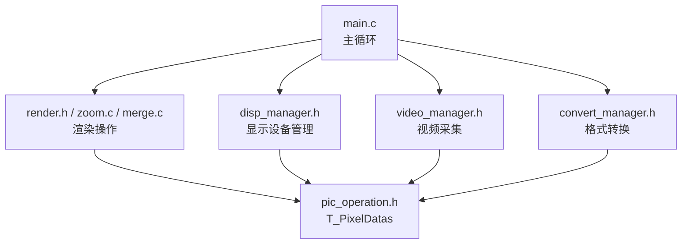
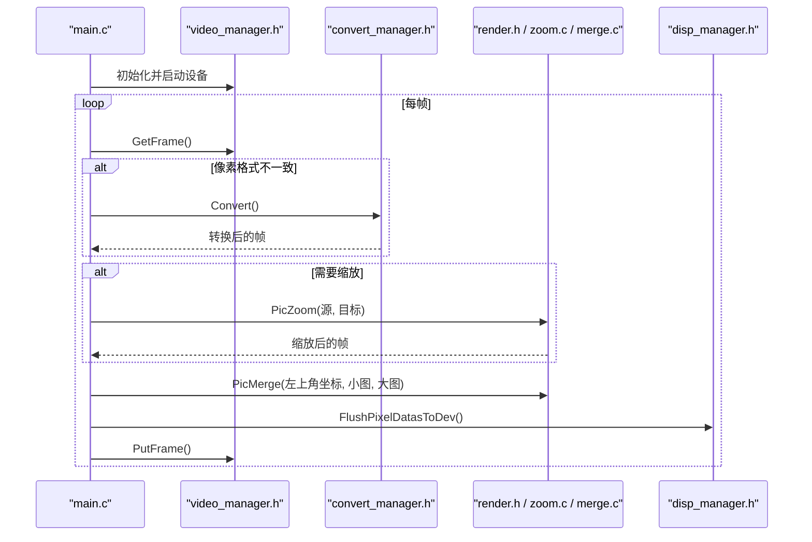
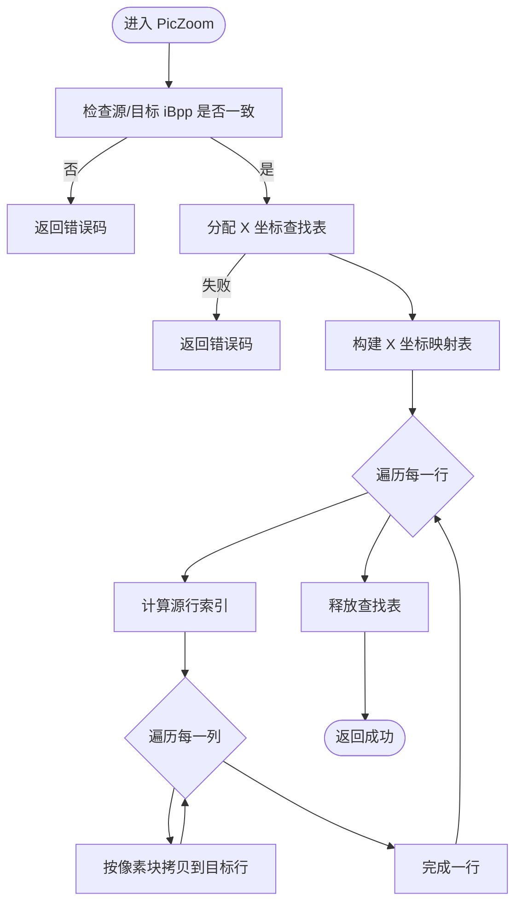
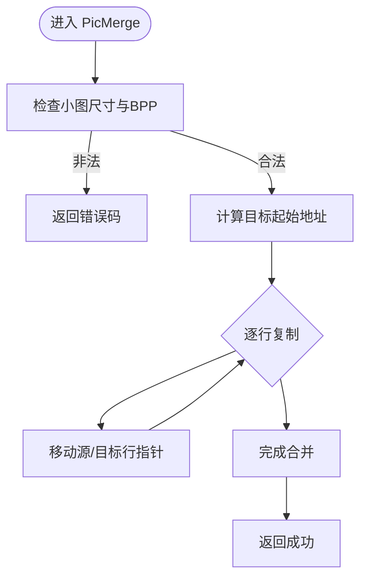
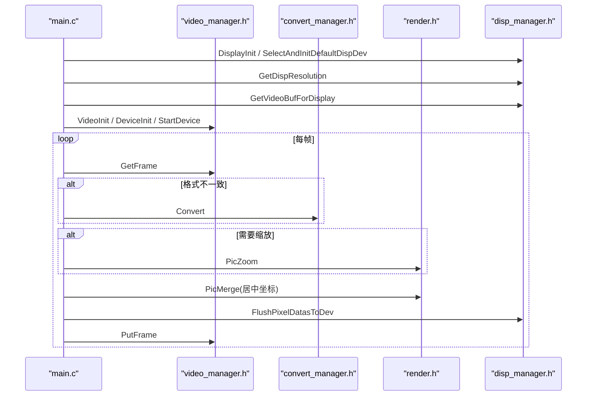
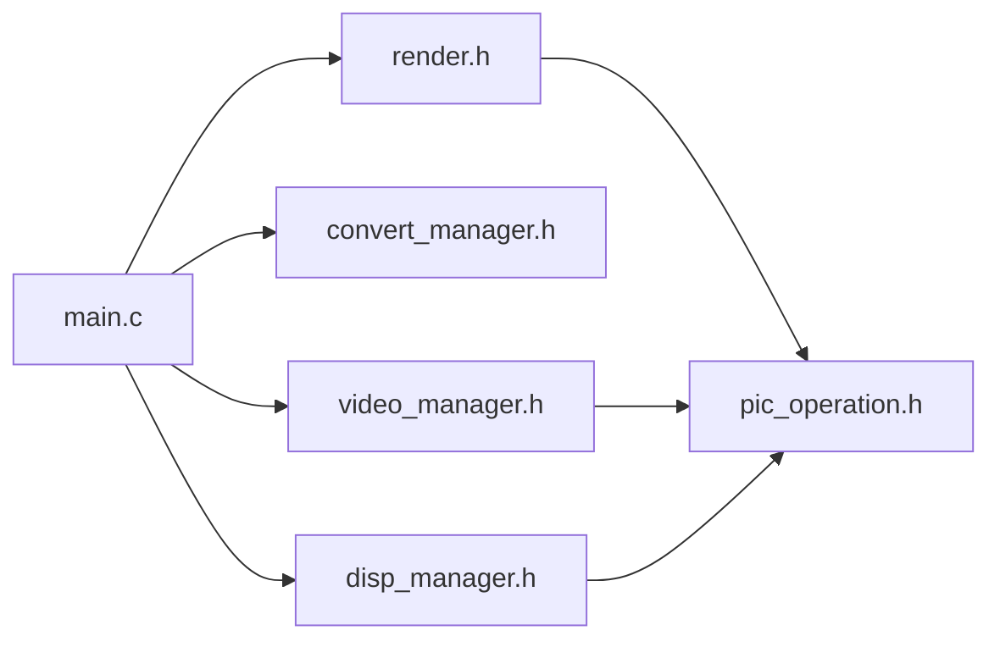

# 图像处理API

<cite>
**本文引用的文件**
- [pic_operation.h](file://video2lcd/include/pic_operation.h)
- [render.h](file://video2lcd/include/render.h)
- [zoom.c](file://video2lcd/render/operation/zoom.c)
- [merge.c](file://video2lcd/render/operation/merge.c)
- [config.h](file://video2lcd/include/config.h)
- [disp_manager.h](file://video2lcd/include/disp_manager.h)
- [video_manager.h](file://video2lcd/include/video_manager.h)
- [convert_manager.h](file://video2lcd/include/convert_manager.h)
- [main.c](file://video2lcd/main.c)
</cite>

## 目录
1. [简介](#简介)
2. [项目结构](#项目结构)
3. [核心组件](#核心组件)
4. [架构总览](#架构总览)
5. [详细组件分析](#详细组件分析)
6. [依赖关系分析](#依赖关系分析)
7. [性能与内存对齐建议](#性能与内存对齐建议)
8. [故障排查指南](#故障排查指南)
9. [结论](#结论)
10. [附录：API参考与示例](#附录api参考与示例)

## 简介
本文档面向嵌入式Linux相机项目的图像处理引擎，聚焦以下目标：
- 完整说明 T_PixelDatas 数据结构的设计与使用（像素格式、尺寸、步长等）
- 文档化图像缩放算法的API接口（缩放比例设置、插值算法选择、质量优化等参数配置）
- 说明图像合并操作的接口设计（多帧合成、图层叠加、透明度处理等扩展点）
- 提供常用场景的代码级调用流程示例（实时缩放、画中画、图像拼接）
- 给出内存对齐与性能优化注意事项
- 说明错误处理机制与调试工具使用方法

## 项目结构
本项目采用分层模块化设计：
- 视频采集层：通过V4L2获取原始帧数据
- 格式转换层：将摄像头输出格式转换为显示设备所需格式
- 渲染操作层：提供缩放、合并等通用图像处理能力
- 显示管理层：管理framebuffer等设备，负责最终刷新到LCD
- 主程序：串联采集、转换、缩放、合并、显示的完整流水线

图表来源
- [main.c:117-178](file://video2lcd/main.c#L117-L178)
- [video_manager.h:14-55](file://video2lcd/include/video_manager.h#L14-L55)
- [convert_manager.h:23-43](file://video2lcd/include/convert_manager.h#L23-L43)
- [render.h:15-36](file://video2lcd/include/render.h#L15-L36)
- [disp_manager.h:84-233](file://video2lcd/include/disp_manager.h#L84-L233)
- [pic_operation.h:10-17](file://video2lcd/include/pic_operation.h#L10-L17)

章节来源
- [main.c:17-192](file://video2lcd/main.c#L17-L192)
- [video_manager.h:14-55](file://video2lcd/include/video_manager.h#L14-L55)
- [convert_manager.h:23-43](file://video2lcd/include/convert_manager.h#L23-L43)
- [render.h:15-36](file://video2lcd/include/render.h#L15-L36)
- [disp_manager.h:84-233](file://video2lcd/include/disp_manager.h#L84-L233)
- [pic_operation.h:10-17](file://video2lcd/include/pic_operation.h#L10-L17)

## 核心组件
- T_PixelDatas：统一描述一块图像数据的元信息（宽、高、每像素位数、行字节数、总字节数、像素数据指针），是系统内所有图像数据的通用表示。
- PicZoom：按目标尺寸进行图像缩放，当前实现为最近邻插值。
- PicMerge/PicMergeRegion：将小图合并到大图指定位置，或区域复制。
- 显示与视频管理：封装了设备初始化、分辨率查询、缓冲区分配、帧获取/归还、显存映射与刷新等能力。
- 格式转换：根据输入输出像素格式自动选择合适的转换器（如YUV->RGB、MJPEG->RGB）。

章节来源
- [pic_operation.h:10-17](file://video2lcd/include/pic_operation.h#L10-L17)
- [render.h:15-36](file://video2lcd/include/render.h#L15-L36)
- [zoom.c:17-85](file://video2lcd/render/operation/zoom.c#L17-L85)
- [merge.c:11-88](file://video2lcd/render/operation/merge.c#L11-L88)
- [disp_manager.h:117-233](file://video2lcd/include/disp_manager.h#L117-L233)
- [video_manager.h:14-55](file://video2lcd/include/video_manager.h#L14-L55)
- [convert_manager.h:23-43](file://video2lcd/include/convert_manager.h#L23-L43)

## 架构总览
下图展示了从摄像头采集到LCD显示的完整数据流，以及渲染操作在其中的作用位置。

图表来源
- [main.c:117-178](file://video2lcd/main.c#L117-L178)
- [video_manager.h:35-55](file://video2lcd/include/video_manager.h#L35-L55)
- [convert_manager.h:23-43](file://video2lcd/include/convert_manager.h#L23-L43)
- [render.h:15-36](file://video2lcd/include/render.h#L15-L36)
- [zoom.c:27-85](file://video2lcd/render/operation/zoom.c#L27-L85)
- [merge.c:20-46](file://video2lcd/render/operation/merge.c#L20-L46)
- [disp_manager.h:229-233](file://video2lcd/include/disp_manager.h#L229-L233)

## 详细组件分析

### T_PixelDatas 数据结构
- 字段含义
  - iWidth/iHeight：图像宽高（像素）
  - iBpp：每像素位数（bits per pixel）
  - iLineBytes：单行字节数（步长），用于跨行访问
  - iTotalBytes：整帧字节数
  - aucPixelDatas：像素数据起始指针
- 使用要点
  - 所有渲染操作均基于该结构体进行读写
  - 行步长iLineBytes必须正确计算，避免越界和错位
  - 不同模块间传递时，需保证iBpp一致（否则缩放/合并会失败）

章节来源
- [pic_operation.h:10-17](file://video2lcd/include/pic_operation.h#L10-L17)
- [video_manager.h:52-55](file://video2lcd/include/video_manager.h#L52-L55)
- [main.c:141-166](file://video2lcd/main.c#L141-L166)

### 图像缩放 API：PicZoom
- 功能
  - 将源图像缩放到目标尺寸，当前实现为最近邻插值
- 参数
  - ptOriginPic：源图像T_PixelDatas
  - ptZoomPic：目标图像T_PixelDatas（需提前分配内存）
- 返回值
  - 0：成功；非0：失败（如BPP不一致、内存分配失败）
- 行为细节
  - 构建X坐标查找表以加速逐行缩放
  - 逐行计算源行索引，按列查表拷贝像素块
- 限制与扩展点
  - 当前仅支持最近邻插值；如需双线性/双三次插值，可在zoom.c中扩展
  - 未内置质量优化开关；可通过插值算法替换提升质量

图表来源
- [zoom.c:27-85](file://video2lcd/render/operation/zoom.c#L27-L85)

章节来源
- [render.h:15-25](file://video2lcd/include/render.h#L15-L25)
- [zoom.c:17-85](file://video2lcd/render/operation/zoom.c#L17-L85)

### 图像合并 API：PicMerge / PicMergeRegion
- PicMerge
  - 功能：将小图复制到图的指定位置（左上角坐标）
  - 参数：iX,iY（目标位置）、ptSmallPic（小图）、ptBigPic（大图）
  - 校验：大小不越界、BPP一致
- PicMergeRegion
  - 功能：将新图的某区域复制到旧图的某区域
  - 参数：起止坐标、区域宽高、新旧图结构体
  - 校验：坐标范围合法性
- 用途
  - 居中显示、画中画叠加、局部更新、拼接等

图表来源
- [merge.c:20-46](file://video2lcd/render/operation/merge.c#L20-L46)

章节来源
- [merge.c:11-88](file://video2lcd/render/operation/merge.c#L11-L88)
- [render.h:27-36](file://video2lcd/include/render.h#L27-L36)

### 显示与视频管理
- 显示设备管理
  - 注册/选择显示驱动（如fb）
  - 获取分辨率与BPP
  - 分配/获取/释放VideoMem
  - 将像素数据刷新到设备
- 视频管理
  - 抽象摄像头设备操作接口（GetFrame/PutFrame/StartDevice/StopDevice）
  - 封装一帧数据（包含T_PixelDatas与像素格式）
- 格式转换
  - 根据输入输出格式选择合适转换器（YUV/MJPEG/RGB）

章节来源
- [disp_manager.h:84-233](file://video2lcd/include/disp_manager.h#L84-L233)
- [video_manager.h:14-55](file://video2lcd/include/video_manager.h#L14-L55)
- [convert_manager.h:23-43](file://video2lcd/include/convert_manager.h#L23-L43)

### 主流程集成示例（实时缩放+居中显示）
- 步骤概览
  - 初始化显示与视频设备
  - 获取一帧，必要时进行格式转换
  - 若帧大于LCD分辨率，则等比缩放
  - 计算居中坐标，合并到帧缓冲
  - 刷新到设备，归还视频缓冲
- 关键路径
  - 缩放：PicZoom
  - 合并：PicMerge
  - 刷新：FlushPixelDatasToDev

图表来源
- [main.c:63-178](file://video2lcd/main.c#L63-L178)
- [video_manager.h:35-55](file://video2lcd/include/video_manager.h#L35-L55)
- [convert_manager.h:23-43](file://video2lcd/include/convert_manager.h#L23-L43)
- [render.h:15-36](file://video2lcd/include/render.h#L15-L36)
- [disp_manager.h:229-233](file://video2lcd/include/disp_manager.h#L229-L233)

章节来源
- [main.c:63-178](file://video2lcd/main.c#L63-L178)

## 依赖关系分析
- 模块耦合
  - main.c 依赖 video/convert/render/disp 四大模块
  - render 依赖 pic_operation 定义的数据结构
  - disp 与 video 均围绕 T_PixelDatas 进行数据流转
- 外部依赖
  - 显示设备：framebuffer（/dev/fb0）
  - 视频设备：V4L2（/dev/videoX）
- 潜在风险
  - 各模块对T_PixelDatas的iBpp/iLineBytes一致性要求严格，不一致会导致渲染异常
  - 缩放与合并未做边界保护外的二次校验，调用方需确保参数合法

图表来源
- [main.c:1-192](file://video2lcd/main.c#L1-L192)
- [video_manager.h:14-55](file://video2lcd/include/video_manager.h#L14-L55)
- [convert_manager.h:23-43](file://video2lcd/include/convert_manager.h#L23-L43)
- [render.h:15-36](file://video2lcd/include/render.h#L15-L36)
- [disp_manager.h:84-233](file://video2lcd/include/disp_manager.h#L84-L233)
- [pic_operation.h:10-17](file://video2lcd/include/pic_operation.h#L10-L17)

章节来源
- [main.c:1-192](file://video2lcd/main.c#L1-L192)
- [video_manager.h:14-55](file://video2lcd/include/video_manager.h#L14-L55)
- [convert_manager.h:23-43](file://video2lcd/include/convert_manager.h#L23-L43)
- [render.h:15-36](file://video2lcd/include/render.h#L15-L36)
- [disp_manager.h:84-233](file://video2lcd/include/disp_manager.h#L84-L233)
- [pic_operation.h:10-17](file://video2lcd/include/pic_operation.h#L10-L17)

## 性能与内存对齐建议
- 内存对齐
  - 确保iLineBytes按硬件或驱动要求对齐（例如16/32字节对齐），可显著提升memcpy效率
  - 对于ARM平台，尽量保持数据按字对齐访问，减少总线开销
- 缩放算法
  - 当前最近邻插值速度快但质量一般；如需高质量，可扩展为双线性/双三次插值
  - 可引入分块并行或SIMD指令优化热点循环
- 合并操作
  - 优先使用大块memcpy按行复制，避免逐像素拷贝
  - 对频繁小区域更新，考虑只更新受影响行以减少带宽
- 显示刷新
  - 使用双缓冲或多页缓冲减少闪烁
  - 批量刷新而非逐像素写入
- 资源管理
  - 及时释放临时内存（如查找表），避免内存泄漏
  - 复用缩放缓冲区，减少malloc/free频率

[本节为通用性能建议，不直接分析具体文件]

## 故障排查指南
- 常见问题
  - BPP不一致导致缩放/合并失败：检查源/目标T_PixelDatas的iBpp是否一致
  - 内存分配失败：检查堆空间与目标图像大小
  - 坐标越界：确保合并坐标与区域尺寸在目标范围内
- 调试手段
  - 启用调试宏DBG_PRINTF输出关键路径信息（src/dest尺寸、BPP、指针地址）
  - 打印中间结果（缩放前后、合并前后）验证数据正确性
  - 逐步缩小问题范围（先确认格式转换正确，再验证缩放，最后验证合并）
- 定位方法
  - 关注函数返回值，非0即异常
  - 结合日志定位具体阶段（采集、转换、缩放、合并、刷新）

章节来源
- [config.h:13-15](file://video2lcd/include/config.h#L13-L15)
- [zoom.c:38-55](file://video2lcd/render/operation/zoom.c#L38-L55)
- [merge.c:26-32](file://video2lcd/render/operation/merge.c#L26-L32)
- [main.c:120-178](file://video2lcd/main.c#L120-L178)

## 结论
本图像处理引擎以T_PixelDatas为核心数据载体，通过统一的渲染接口（缩放、合并）与显示/视频管理模块协作，实现了从摄像头采集到LCD显示的完整链路。当前实现简洁高效，适合嵌入式环境；后续可按需扩展更高质量的插值算法与更多合并特性（如透明度混合、多图层合成）。

[本节为总结性内容，不直接分析具体文件]

## 附录：API参考与示例

### T_PixelDatas 字段说明
- iWidth/iHeight：图像宽高
- iBpp：每像素位数
- iLineBytes：行字节数（步长）
- iTotalBytes：总字节数
- aucPixelDatas：像素数据指针

章节来源
- [pic_operation.h:10-17](file://video2lcd/include/pic_operation.h#L10-L17)

### 缩放 API
- 函数：PicZoom
- 参数：源T_PixelDatas、目标T_PixelDatas（需预先分配内存）
- 返回值：0成功，非0失败
- 注意：当前为最近邻插值；需保证iBpp一致

章节来源
- [render.h:15-25](file://video2lcd/include/render.h#L15-L25)
- [zoom.c:27-85](file://video2lcd/render/operation/zoom.c#L27-L85)

### 合并 API
- 函数：PicMerge、PicMergeRegion
- 参数：坐标、区域尺寸、新旧图结构体
- 返回值：0成功，非0失败
- 注意：需保证坐标合法、iBpp一致

章节来源
- [merge.c:20-88](file://video2lcd/render/operation/merge.c#L20-L88)
- [render.h:27-36](file://video2lcd/include/render.h#L27-L36)

### 显示与视频管理 API
- 显示
  - DisplayInit、SelectAndInitDefaultDispDev、GetDispResolution
  - GetVideoBufForDisplay、FlushPixelDatasToDev
- 视频
  - VideoInit、VideoDeviceInit、StartDevice、GetFrame、PutFrame
- 转换
  - VideoConvertInit、GetVideoConvertForFormats、Convert

章节来源
- [disp_manager.h:117-233](file://video2lcd/include/disp_manager.h#L117-L233)
- [video_manager.h:35-55](file://video2lcd/include/video_manager.h#L35-L55)
- [convert_manager.h:31-43](file://video2lcd/include/convert_manager.h#L31-L43)

### 应用场景示例（调用流程）
- 实时缩放
  - 获取帧 -> 判断是否需要缩放 -> PicZoom -> 合并到帧缓冲 -> 刷新
- 画中画效果
  - 准备背景帧与小图 -> PicMerge将小图叠加到指定位置 -> 刷新
- 图像拼接
  - 准备两张图 -> PicMergeRegion将区域A复制到区域B -> 刷新

章节来源
- [main.c:141-178](file://video2lcd/main.c#L141-L178)
- [merge.c:20-88](file://video2lcd/render/operation/merge.c#L20-L88)