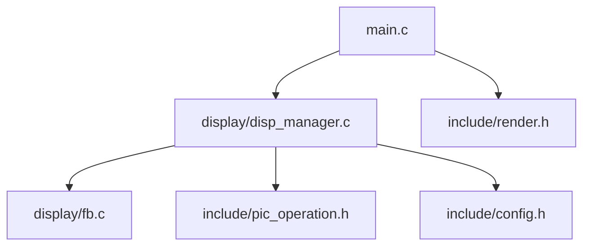
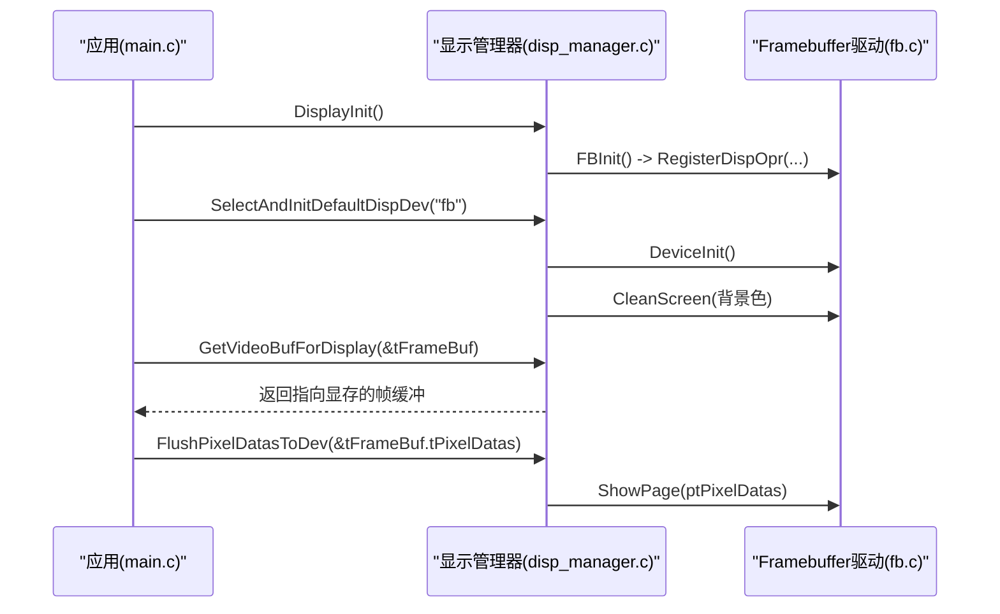
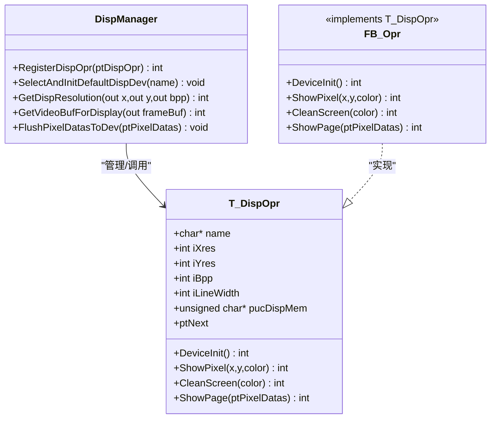
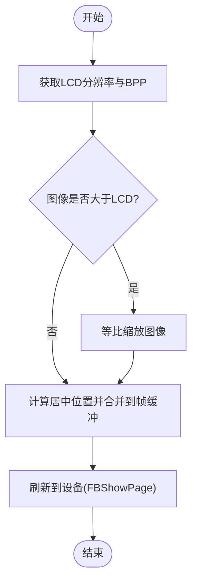
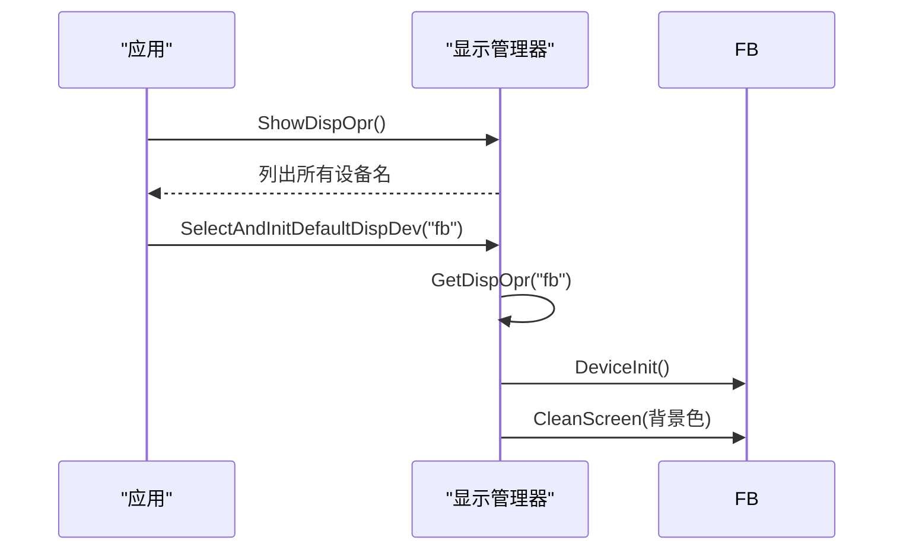
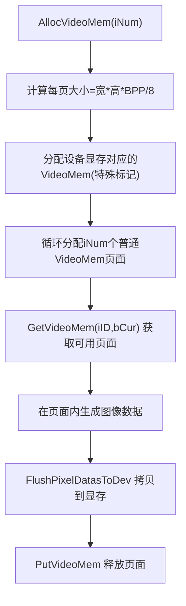
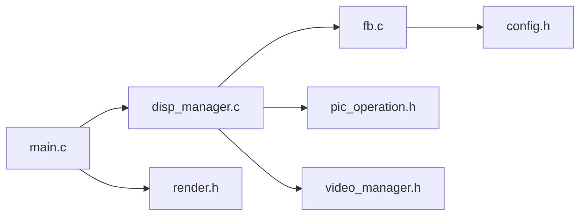

# 显示管理API

<cite>
**本文引用的文件**
- [disp_manager.c](file://video2lcd/display/disp_manager.c)
- [fb.c](file://video2lcd/display/fb.c)
- [disp_manager.h](file://video2lcd/include/disp_manager.h)
- [render.h](file://video2lcd/include/render.h)
- [pic_operation.h](file://video2lcd/include/pic_operation.h)
- [config.h](file://video2lcd/include/config.h)
- [main.c](file://video2lcd/main.c)
</cite>

## 目录
1. [简介](#简介)
2. [项目结构](#项目结构)
3. [核心组件](#核心组件)
4. [架构总览](#架构总览)
5. [详细组件分析](#详细组件分析)
6. [依赖关系分析](#依赖关系分析)
7. [性能与优化建议](#性能与优化建议)
8. [故障排查指南](#故障排查指南)
9. [结论](#结论)
10. [附录：完整使用示例流程](#附录完整使用示例流程)

## 简介
本模块提供“显示设备抽象接口 + Framebuffer驱动实现”的显示管理方案，支持多显示设备的注册、选择与切换；封装了像素数据写入、屏幕刷新、分辨率适配等核心能力；并提供VideoMem双缓冲机制以优化LCD显示性能。通过统一的DispOpr接口，上层应用无需关心底层具体显示设备细节，即可实现跨平台/跨驱动的显示逻辑。

## 项目结构
显示相关代码主要位于 display 目录，头文件在 include 目录，主程序入口在 main.c。关键组织方式如下：
- 显示设备抽象与管理：disp_manager.c/h
- Framebuffer驱动实现：fb.c
- 图像渲染接口（缩放/合并）：render.h
- 像素数据结构定义：pic_operation.h
- 全局配置（如FB设备路径）：config.h
- 应用集成示例：main.c

图表来源
- [main.c:63-74](file://video2lcd/main.c#L63-L74)
- [disp_manager.c:514-521](file://video2lcd/display/disp_manager.c#L514-L521)
- [fb.c:249-252](file://video2lcd/display/fb.c#L249-L252)

章节来源
- [main.c:63-74](file://video2lcd/main.c#L63-L74)
- [disp_manager.c:514-521](file://video2lcd/display/disp_manager.c#L514-L521)
- [fb.c:249-252](file://video2lcd/display/fb.c#L249-L252)

## 核心组件
- 显示操作接口 T_DispOpr：统一描述任意显示设备的初始化、画点、清屏、整页显示等操作函数指针，以及设备分辨率、色深、行字节数、显存基址等元信息。
- 显示管理器 disp_manager：维护已注册的显示设备链表，提供设备枚举、默认设备选择与初始化、分辨率查询、VideoMem分配与管理、像素刷新等API。
- Framebuffer驱动 fb：基于Linux /dev/fb0 的设备打开、ioctl获取屏幕信息、mmap映射显存，并实现T_DispOpr的具体方法。
- 渲染接口 render：提供图片缩放与合并到目标缓冲区的能力，配合显示模块完成画面更新。
- 像素数据结构 pic_operation：统一描述像素数据的尺寸、色深、行字节、总字节和内存指针。

章节来源
- [disp_manager.h:84-96](file://video2lcd/include/disp_manager.h#L84-L96)
- [disp_manager.c:13-18](file://video2lcd/display/disp_manager.c#L13-L18)
- [fb.c:36-43](file://video2lcd/display/fb.c#L36-L43)
- [render.h:15-36](file://video2lcd/include/render.h#L15-L36)
- [pic_operation.h:10-17](file://video2lcd/include/pic_operation.h#L10-L17)

## 架构总览
显示子系统采用“接口抽象 + 驱动实现 + 管理器调度”的分层设计：
- 上层应用通过 disp_manager 提供的统一API进行设备选择、分辨率获取、帧缓冲获取与刷新。
- 具体显示驱动（如fb）实现T_DispOpr接口并通过RegisterDispOpr注册到管理器。
- VideoMem机制在内存中准备图像，再一次性拷贝至设备显存，减少闪烁与提升吞吐。

图表来源
- [main.c:63-74](file://video2lcd/main.c#L63-L74)
- [disp_manager.c:514-521](file://video2lcd/display/disp_manager.c#L514-L521)
- [fb.c:249-252](file://video2lcd/display/fb.c#L249-L252)
- [fb.c:166-174](file://video2lcd/display/fb.c#L166-L174)

## 详细组件分析

### 显示设备抽象接口与实现机制
- T_DispOpr 定义了显示设备的统一操作集：名称、分辨率、色深、行字节、显存基址，以及DeviceInit、ShowPixel、CleanScreen、ShowPage等回调。
- 管理器维护一个DispOpr链表，支持多设备注册与按名称查找，便于扩展新的显示驱动。
- fb.c 实现了T_DispOpr，并在FBInit中调用RegisterDispOpr将自身注册为名为"fb"的显示设备。

图表来源
- [disp_manager.h:84-96](file://video2lcd/include/disp_manager.h#L84-L96)
- [disp_manager.c:27-48](file://video2lcd/display/disp_manager.c#L27-L48)
- [fb.c:36-43](file://video2lcd/display/fb.c#L36-L43)

章节来源
- [disp_manager.h:84-96](file://video2lcd/include/disp_manager.h#L84-L96)
- [disp_manager.c:27-48](file://video2lcd/display/disp_manager.c#L27-L48)
- [fb.c:36-43](file://video2lcd/display/fb.c#L36-L43)

### Framebuffer驱动：初始化、配置与销毁
- 初始化流程：
  - 打开/dev/fb0设备文件
  - 通过ioctl获取可变/固定屏幕信息（分辨率、色深、行字节等）
  - mmap映射显存到用户空间
  - 填充T_DispOpr元信息（分辨率、BPP、行字节、显存基址）
  - 注册到管理器
- 配置能力：
  - 通过GetDispResolution获取当前设备分辨率与BPP
  - 通过GetVideoBufForDisplay获取可直接写入的帧缓冲指针
- 销毁：
  - 当前代码未显式关闭设备或munmap，建议在应用退出时补充释放资源（例如关闭fd、解除映射）。

章节来源
- [fb.c:53-94](file://video2lcd/display/fb.c#L53-L94)
- [fb.c:249-252](file://video2lcd/display/fb.c#L249-L252)
- [disp_manager.c:125-138](file://video2lcd/display/disp_manager.c#L125-L138)
- [config.h:17-18](file://video2lcd/include/config.h#L17-L18)

### 像素数据写入、屏幕刷新与分辨率适配
- 像素写入：
  - 通过GetVideoBufForDisplay获取指向显存的帧缓冲，直接写入像素数据（注意格式需匹配BPP）。
  - 或通过ClearVideoMem/ClearVideoMemRegion对VideoMem区域进行颜色填充。
- 屏幕刷新：
  - 调用FlushPixelDatasToDev将像素数据输出到设备；fb实现中若源地址与显存不同则memcpy拷贝。
- 分辨率适配：
  - 先通过GetDispResolution获取LCD宽高与BPP，再根据输入图像尺寸计算缩放比例，使用PicZoom进行等比缩放，最后PicMerge居中绘制到帧缓冲。

图表来源
- [main.c:141-178](file://video2lcd/main.c#L141-L178)
- [disp_manager.c:148-175](file://video2lcd/display/disp_manager.c#L148-L175)
- [fb.c:166-174](file://video2lcd/display/fb.c#L166-L174)

章节来源
- [main.c:141-178](file://video2lcd/main.c#L141-L178)
- [disp_manager.c:148-175](file://video2lcd/display/disp_manager.c#L148-L175)
- [fb.c:166-174](file://video2lcd/display/fb.c#L166-L174)

### 多显示设备管理：枚举、选择与切换
- 设备注册：各显示驱动实现T_DispOpr后，调用RegisterDispOpr加入管理器链表。
- 设备枚举：ShowDispOpr可打印所有已注册设备名称。
- 设备选择与初始化：SelectAndInitDefaultDispDev按名称选择设备并执行DeviceInit与CleanScreen。
- 设备切换：再次调用SelectAndInitDefaultDispDev选择另一设备即可完成切换（需确保新设备已正确初始化）。

图表来源
- [disp_manager.c:58-68](file://video2lcd/display/disp_manager.c#L58-L68)
- [disp_manager.c:78-108](file://video2lcd/display/disp_manager.c#L78-L108)

章节来源
- [disp_manager.c:58-68](file://video2lcd/display/disp_manager.c#L58-L68)
- [disp_manager.c:78-108](file://video2lcd/display/disp_manager.c#L78-L108)

### VideoMem双缓冲与内存映射优化
- 分配VideoMem：AllocVideoMem根据当前LCD分辨率与BPP分配若干页面缓冲，并将设备显存也封装为一个特殊的VideoMem（标记为设备帧缓冲）。
- 获取与释放：GetVideoMem按策略从空闲链表中挑选可用页面，PutVideoMem归还状态。
- 区域/全屏清空：ClearVideoMem/ClearVideoMemRegion支持按BPP高效填充颜色。
- 最佳实践：
  - 使用双缓冲：一帧在VideoMem中生成，完成后一次性拷贝到显存，避免撕裂与闪烁。
  - 尽量批量写入：减少多次小写操作，优先使用memcpy或整页刷新。
  - 合理设置BPP：16位RGB565在多数嵌入式场景下兼顾色彩与带宽。

图表来源
- [disp_manager.c:188-259](file://video2lcd/display/disp_manager.c#L188-L259)
- [disp_manager.c:272-337](file://video2lcd/display/disp_manager.c#L272-L337)
- [disp_manager.c:370-424](file://video2lcd/display/disp_manager.c#L370-L424)
- [disp_manager.c:436-505](file://video2lcd/display/disp_manager.c#L436-L505)

章节来源
- [disp_manager.c:188-259](file://video2lcd/display/disp_manager.c#L188-L259)
- [disp_manager.c:272-337](file://video2lcd/display/disp_manager.c#L272-L337)
- [disp_manager.c:370-424](file://video2lcd/display/disp_manager.c#L370-L424)
- [disp_manager.c:436-505](file://video2lcd/display/disp_manager.c#L436-L505)

## 依赖关系分析
- main.c 依赖 disp_manager 与 video_manager、convert_manager、render 等模块，完成采集、转换、缩放、合并与显示。
- disp_manager 依赖 pic_operation（像素数据结构）、video_manager（视频缓冲类型），并调用 fb 驱动。
- fb 依赖系统接口（fcntl/ioctl/mmap/linux/fb）与 config 中的设备路径。

图表来源
- [main.c:1-9](file://video2lcd/main.c#L1-L9)
- [disp_manager.c:9-11](file://video2lcd/display/disp_manager.c#L9-L11)
- [fb.c:9-17](file://video2lcd/display/fb.c#L9-L17)

章节来源
- [main.c:1-9](file://video2lcd/main.c#L1-L9)
- [disp_manager.c:9-11](file://video2lcd/display/disp_manager.c#L9-L11)
- [fb.c:9-17](file://video2lcd/display/fb.c#L9-L17)

## 性能与优化建议
- 双缓冲与批处理：
  - 使用VideoMem在内存中构建完整帧，再一次性拷贝到显存，降低闪烁与总线开销。
  - 优先使用memset/memcpy等库函数进行大块内存操作。
- 像素格式与BPP：
  - 16位RGB565在带宽受限设备上更友好；32位RGB32色彩更好但占用更高带宽。
  - 确保转换后的像素格式与LCD一致，避免运行时格式不匹配导致的额外转换。
- 缩放与合并：
  - 仅在必要时进行缩放，保持原始宽高比，减少无效像素搬运。
  - 合并时使用PicMerge将图像居中放置，避免逐像素计算带来的CPU开销。
- I/O与系统调用：
  - 尽量减少频繁ioctl与mmap操作，初始化阶段完成一次即可。
  - 在应用退出时补充关闭设备与解除映射，避免资源泄漏。

[本节为通用性能指导，不直接分析具体文件]

## 故障排查指南
- 无法打开/dev/fb0：
  - 检查设备节点是否存在、权限是否正确。
  - 参考错误日志输出定位open失败原因。
- ioctl获取屏幕信息失败：
  - 确认内核 framebuffer 驱动已加载且设备正常。
- mmap失败：
  - 检查显存大小计算是否正确，以及是否有足够的虚拟地址空间。
- 显示异常或花屏：
  - 核对像素格式与BPP是否与LCD一致。
  - 检查行字节与总字节计算是否正确。
- 无刷新或黑屏：
  - 确认是否调用了FlushPixelDatasToDev或ShowPage。
  - 检查帧缓冲指针是否有效且未被覆盖。

章节来源
- [fb.c:53-94](file://video2lcd/display/fb.c#L53-L94)
- [fb.c:106-157](file://video2lcd/display/fb.c#L106-L157)
- [fb.c:183-240](file://video2lcd/display/fb.c#L183-L240)
- [disp_manager.c:125-138](file://video2lcd/display/disp_manager.c#L125-L138)

## 结论
本显示管理模块通过统一的T_DispOpr接口屏蔽了底层显示差异，结合VideoMem双缓冲机制与高效的像素处理流程，提供了稳定、可扩展的显示解决方案。开发者只需关注业务图像生成与布局，即可在不同硬件平台上复用同一套显示逻辑。

[本节为总结性内容，不直接分析具体文件]

## 附录：完整使用示例流程
以下流程展示了如何初始化显示设备、设置分辨率、更新画面的端到端步骤（以main.c为例）：
- 初始化显示：调用DisplayInit注册所有显示设备。
- 选择并初始化默认设备：SelectAndInitDefaultDispDev("fb")。
- 获取分辨率与帧缓冲：GetDispResolution与GetVideoBufForDisplay。
- 采集与转换：从摄像头获取帧，必要时进行格式转换。
- 缩放与合并：当图像大于LCD时进行等比缩放，然后居中合并到帧缓冲。
- 刷新显示：FlushPixelDatasToDev将帧缓冲数据输出到设备。

章节来源
- [main.c:63-74](file://video2lcd/main.c#L63-L74)
- [main.c:117-189](file://video2lcd/main.c#L117-L189)
- [disp_manager.c:148-175](file://video2lcd/display/disp_manager.c#L148-L175)