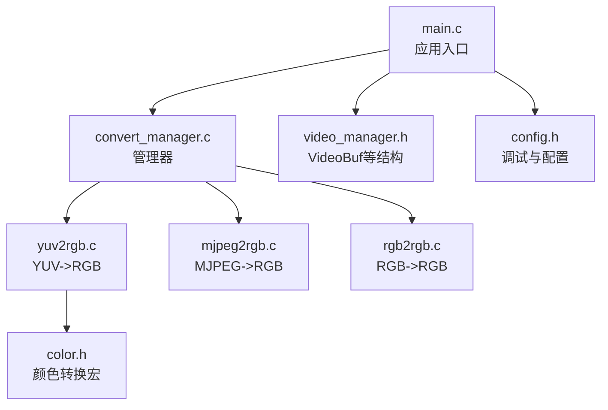
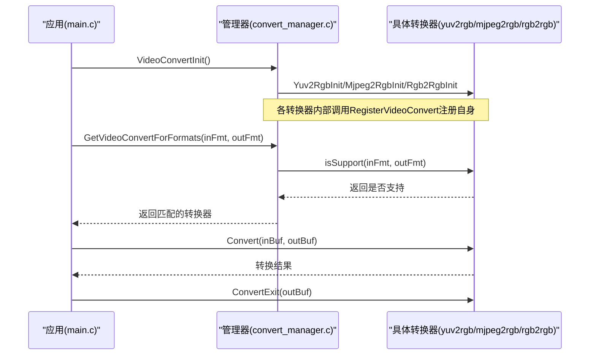
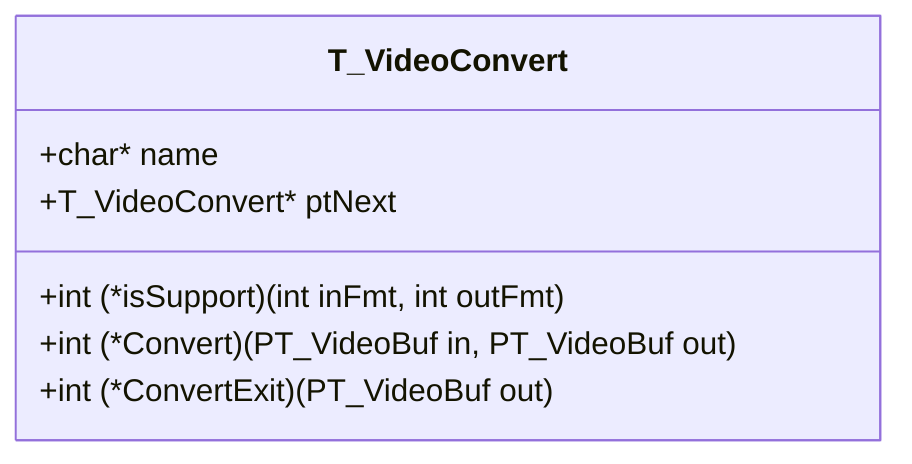
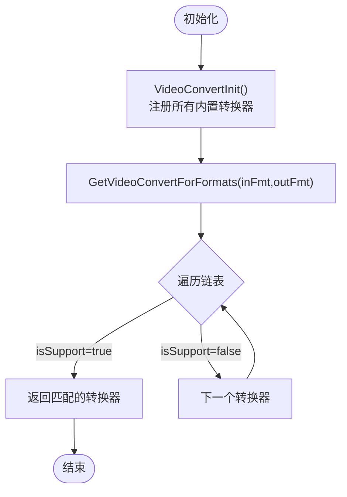
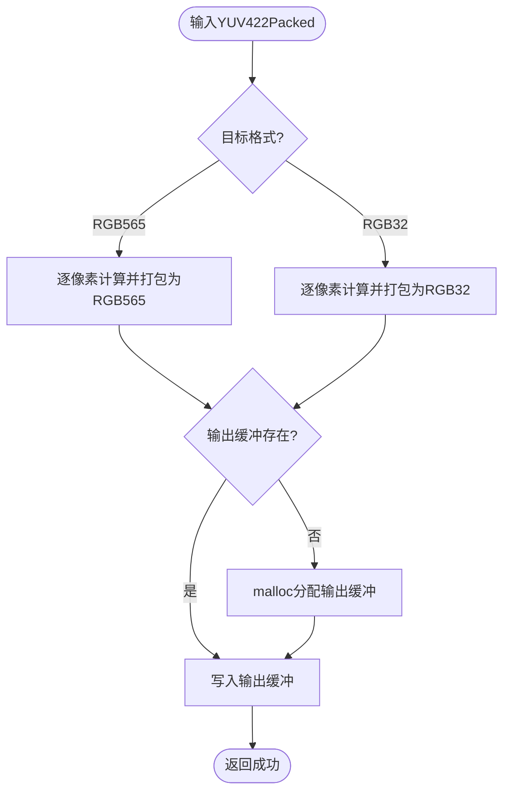
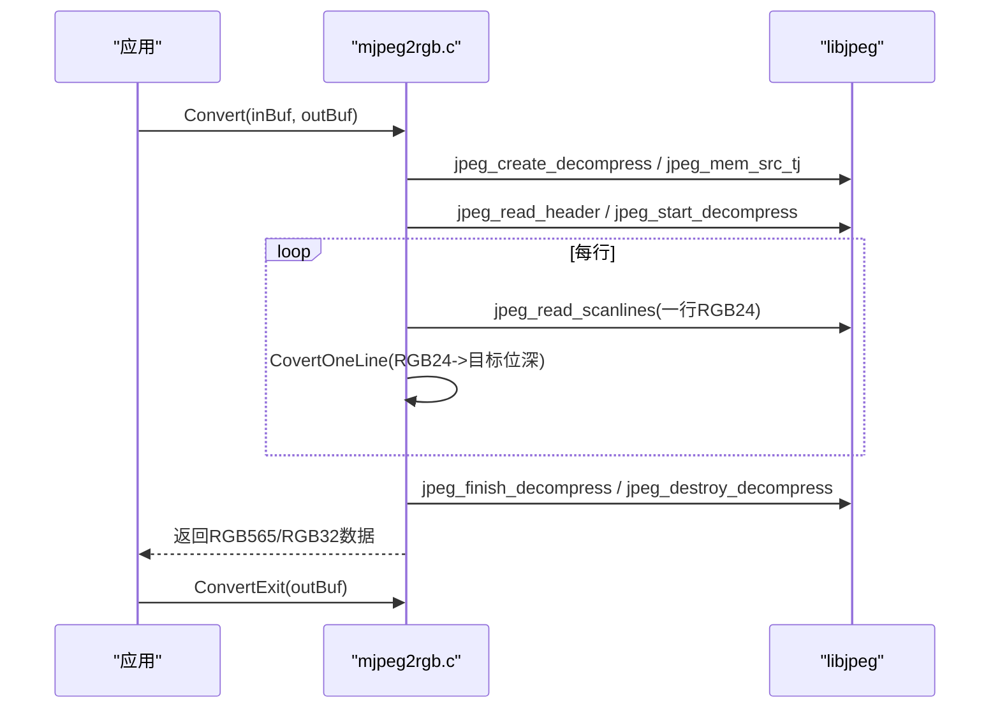
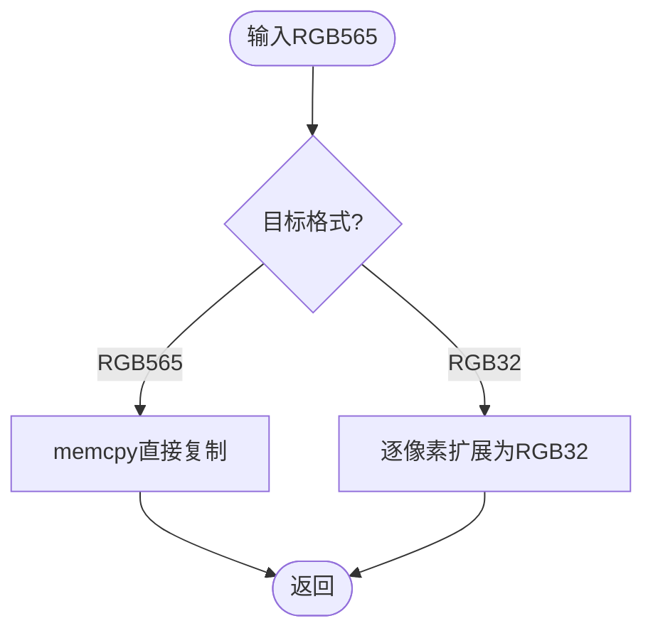
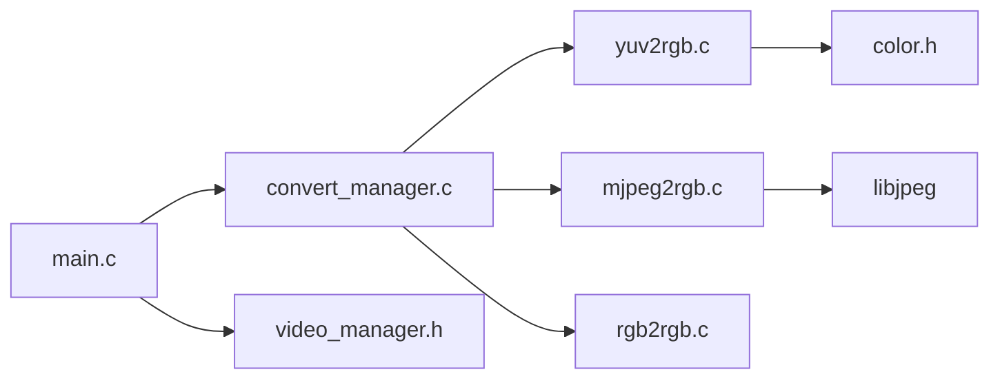

# 格式转换API

<cite>
**本文引用的文件**
- [convert_manager.h](file://video2lcd/include/convert_manager.h)
- [convert_manager.c](file://video2lcd/convert/convert_manager.c)
- [yuv2rgb.c](file://video2lcd/convert/yuv2rgb.c)
- [mjpeg2rgb.c](file://video2lcd/convert/mjpeg2rgb.c)
- [rgb2rgb.c](file://video2lcd/convert/rgb2rgb.c)
- [color.h](file://video2lcd/convert/color.h)
- [video_manager.h](file://video2lcd/include/video_manager.h)
- [config.h](file://video2lcd/include/config.h)
- [main.c](file://video2lcd/main.c)
</cite>

## 目录
1. [简介](#简介)
2. [项目结构](#项目结构)
3. [核心组件](#核心组件)
4. [架构总览](#架构总览)
5. [详细组件分析](#详细组件分析)
6. [依赖关系分析](#依赖关系分析)
7. [性能与内存优化建议](#性能与内存优化建议)
8. [故障排查与调试技巧](#故障排查与调试技巧)
9. [结论](#结论)
10. [附录：使用示例与配置选项](#附录使用示例与配置选项)

## 简介
本文件系统性地文档化嵌入式Linux相机项目中的“格式转换系统”的API与插件架构。重点包括：
- 转换器插件架构设计与注册机制
- ConvertManager的核心接口（注册、查找、执行）
- 支持的格式类型（YUV、MJPEG、RGB）及其转换函数接口
- 常见转换场景的使用示例（YUV到RGB、MJPEG解码、RGB格式调整）
- 转换参数配置（颜色空间、位深、字节序等）
- 性能优化与内存管理最佳实践
- 错误处理模式与调试技巧

## 项目结构
本项目将格式转换能力以“插件式”组织，每个转换器实现统一的接口并通过ConvertManager进行统一注册与调度。关键目录与文件如下：
- include/convert_manager.h：定义转换器接口与管理器API
- convert/convert_manager.c：管理器实现（注册、查找、初始化）
- convert/yuv2rgb.c：YUV->RGB转换器
- convert/mjpeg2rgb.c：MJPEG->RGB转换器（基于libjpeg）
- convert/rgb2rgb.c：RGB->RGB格式调整（如RGB565到RGB32）
- convert/color.h：颜色空间转换宏与工具
- include/video_manager.h：视频帧数据结构VideoBuf等
- include/config.h：调试输出宏与设备路径
- main.c：主流程，演示如何初始化并调用转换器

图表来源
- [main.c:34-192](file://video2lcd/main.c#L34-L192)
- [convert_manager.c:1-131](file://video2lcd/convert/convert_manager.c#L1-L131)
- [yuv2rgb.c:1-233](file://video2lcd/convert/yuv2rgb.c#L1-L233)
- [mjpeg2rgb.c:1-261](file://video2lcd/convert/mjpeg2rgb.c#L1-L261)
- [rgb2rgb.c:1-152](file://video2lcd/convert/rgb2rgb.c#L1-L152)
- [color.h:1-88](file://video2lcd/convert/color.h#L1-L88)
- [video_manager.h:1-56](file://video2lcd/include/video_manager.h#L1-L56)
- [config.h:1-21](file://video2lcd/include/config.h#L1-L21)

章节来源
- [main.c:34-192](file://video2lcd/main.c#L34-L192)
- [convert_manager.h:1-46](file://video2lcd/include/convert_manager.h#L1-L46)
- [convert_manager.c:1-131](file://video2lcd/convert/convert_manager.c#L1-L131)

## 核心组件
- 转换器接口 VideoConvert：包含名称、支持判断、转换、释放回调以及链表指针，用于统一抽象不同格式的转换器。
- 管理器 API：
  - RegisterVideoConvert：将转换器加入全局链表
  - GetVideoConvertForFormats：根据输入输出像素格式选择合适转换器
  - VideoConvertInit：初始化所有内置转换器
- 内置转换器：
  - Yuv2RgbInit：YUV422Packed -> RGB565/RGB32
  - Mjpeg2RgbInit：MJPEG -> RGB565/RGB32（基于libjpeg）
  - Rgb2RgbInit：RGB565 -> RGB565/RGB32（格式调整）

章节来源
- [convert_manager.h:16-46](file://video2lcd/include/convert_manager.h#L16-L46)
- [convert_manager.c:16-131](file://video2lcd/convert/convert_manager.c#L16-L131)
- [yuv2rgb.c:217-233](file://video2lcd/convert/yuv2rgb.c#L217-L233)
- [mjpeg2rgb.c:247-261](file://video2lcd/convert/mjpeg2rgb.c#L247-L261)
- [rgb2rgb.c:138-152](file://video2lcd/convert/rgb2rgb.c#L138-L152)

## 架构总览
转换器采用“插件式”设计：每个转换器实现统一的T_VideoConvert接口，并在初始化时通过RegisterVideoConvert注册到全局链表。运行时，管理器根据输入输出像素格式遍历链表，调用isSupport判断是否匹配，找到后调用Convert执行转换，最后由调用方负责释放资源（或通过ConvertExit）。

图表来源
- [main.c:91-138](file://video2lcd/main.c#L91-L138)
- [convert_manager.c:121-131](file://video2lcd/convert/convert_manager.c#L121-L131)
- [convert_manager.c:98-111](file://video2lcd/convert/convert_manager.c#L98-L111)
- [yuv2rgb.c:217-233](file://video2lcd/convert/yuv2rgb.c#L217-L233)
- [mjpeg2rgb.c:247-261](file://video2lcd/convert/mjpeg2rgb.c#L247-L261)
- [rgb2rgb.c:138-152](file://video2lcd/convert/rgb2rgb.c#L138-L152)

## 详细组件分析

### 转换器接口与数据结构
- T_VideoConvert：封装转换器元数据与函数指针
  - name：转换器名称
  - isSupport：判断是否支持指定输入输出格式
  - Convert：执行转换
  - ConvertExit：释放转换过程中分配的内存
  - ptNext：链表节点指针
- PT_VideoConvert：指向T_VideoConvert的指针

图表来源
- [convert_manager.h:16-29](file://video2lcd/include/convert_manager.h#L16-L29)

章节来源
- [convert_manager.h:16-29](file://video2lcd/include/convert_manager.h#L16-L29)

### ConvertManager核心接口
- RegisterVideoConvert：将转换器插入全局链表尾部
- GetVideoConvertForFormats：按顺序遍历已注册的转换器，调用其isSupport判断匹配
- VideoConvertInit：依次调用各内置转换器的Init函数完成注册
- ShowVideoConvert/GetVideoConvert：辅助调试与按名称查找（当前未在主流程中使用）

图表来源
- [convert_manager.c:23-44](file://video2lcd/convert/convert_manager.c#L23-L44)
- [convert_manager.c:98-111](file://video2lcd/convert/convert_manager.c#L98-L111)
- [convert_manager.c:121-131](file://video2lcd/convert/convert_manager.c#L121-L131)

章节来源
- [convert_manager.c:23-131](file://video2lcd/convert/convert_manager.c#L23-L131)

### YUV到RGB转换器（yuv2rgb.c）
- 支持输入：V4L2_PIX_FMT_YUYV（YUV422Packed）
- 支持输出：V4L2_PIX_FMT_RGB565、V4L2_PIX_FMT_RGB32
- 转换逻辑：
  - 读取YUV422Packed数据，逐对像素计算R/G/B分量
  - 根据目标位深转换为RGB565或RGB32
  - 自动分配输出缓冲区（若未分配），并在ConvertExit中释放
- 颜色转换宏来自color.h，提供高效YUV->RGB计算

图表来源
- [yuv2rgb.c:25-34](file://video2lcd/convert/yuv2rgb.c#L25-L34)
- [yuv2rgb.c:50-98](file://video2lcd/convert/yuv2rgb.c#L50-L98)
- [yuv2rgb.c:112-149](file://video2lcd/convert/yuv2rgb.c#L112-L149)
- [yuv2rgb.c:161-199](file://video2lcd/convert/yuv2rgb.c#L161-L199)
- [yuv2rgb.c:207-215](file://video2lcd/convert/yuv2rgb.c#L207-L215)

章节来源
- [yuv2rgb.c:25-233](file://video2lcd/convert/yuv2rgb.c#L25-L233)
- [color.h:65-88](file://video2lcd/convert/color.h#L65-L88)

### MJPEG到RGB转换器（mjpeg2rgb.c）
- 支持输入：V4L2_PIX_FMT_MJPEG
- 支持输出：V4L2_PIX_FMT_RGB565、V4L2_PIX_FMT_RGB32
- 转换逻辑：
  - 使用libjpeg从内存源解码JPEG帧
  - 逐行读取RGB24数据，转换为目标位深（RGB565/RGB32）
  - 自定义错误管理器MyErrorMgr，使用setjmp/longjmp恢复错误
  - 自动分配输出缓冲，ConvertExit释放
- 注意：需要链接libjpeg库

图表来源
- [mjpeg2rgb.c:38-47](file://video2lcd/convert/mjpeg2rgb.c#L38-L47)
- [mjpeg2rgb.c:59-70](file://video2lcd/convert/mjpeg2rgb.c#L59-L70)
- [mjpeg2rgb.c:83-133](file://video2lcd/convert/mjpeg2rgb.c#L83-L133)
- [mjpeg2rgb.c:145-228](file://video2lcd/convert/mjpeg2rgb.c#L145-L228)
- [mjpeg2rgb.c:237-245](file://video2lcd/convert/mjpeg2rgb.c#L237-L245)

章节来源
- [mjpeg2rgb.c:1-261](file://video2lcd/convert/mjpeg2rgb.c#L1-L261)

### RGB到RGB转换器（rgb2rgb.c）
- 支持输入：V4L2_PIX_FMT_RGB565
- 支持输出：V4L2_PIX_FMT_RGB565、V4L2_PIX_FMT_RGB32
- 转换逻辑：
  - RGB565->RGB565：直接memcpy复制
  - RGB565->RGB32：逐像素提取R/G/B分量并扩展为32位格式
  - 自动分配输出缓冲，ConvertExit释放

图表来源
- [rgb2rgb.c:20-29](file://video2lcd/convert/rgb2rgb.c#L20-L29)
- [rgb2rgb.c:46-120](file://video2lcd/convert/rgb2rgb.c#L46-L120)
- [rgb2rgb.c:128-136](file://video2lcd/convert/rgb2rgb.c#L128-L136)

章节来源
- [rgb2rgb.c:1-152](file://video2lcd/convert/rgb2rgb.c#L1-L152)

### 颜色空间与工具（color.h）
- 定义RGB16/RGB24/RGB32/YUV422/YUV444结构体
- 提供CLIP宏确保颜色值范围
- 提供YUV/RGB转换相关函数声明与宏
- 提供initLut/freeLut用于查找表初始化与释放（YUV->RGB加速）

章节来源
- [color.h:28-88](file://video2lcd/convert/color.h#L28-L88)

### 视频帧数据结构（video_manager.h）
- T_VideoDevice：摄像头设备描述（文件描述符、像素格式、分辨率、缓冲区数组、操作接口）
- T_VideoOpr：摄像头操作接口（初始化、获取帧、放置帧、启停设备）
- T_VideoBuf：视频帧数据载体（像素数据+像素格式）

章节来源
- [video_manager.h:9-56](file://video2lcd/include/video_manager.h#L9-L56)

## 依赖关系分析
- main.c依赖：
  - display模块（显示初始化与帧缓冲）
  - video_manager（摄像头设备与帧获取）
  - convert_manager（格式转换）
  - render（缩放与合并）
- convert_manager.c依赖：
  - 各转换器Init函数（Yuv2RgbInit、Mjpeg2RgbInit、Rgb2RgbInit）
  - 全局链表维护与查找
- yuv2rgb.c依赖：
  - color.h（颜色转换宏与查找表）
- mjpeg2rgb.c依赖：
  - libjpeg（jpeglib.h）
  - jdatasrc-tj.c（内存源读取）
- rgb2rgb.c依赖：
  - 标准库（stdlib/string）

图表来源
- [main.c:34-192](file://video2lcd/main.c#L34-L192)
- [convert_manager.c:121-131](file://video2lcd/convert/convert_manager.c#L121-L131)
- [yuv2rgb.c:217-233](file://video2lcd/convert/yuv2rgb.c#L217-L233)
- [mjpeg2rgb.c:247-261](file://video2lcd/convert/mjpeg2rgb.c#L247-L261)
- [rgb2rgb.c:138-152](file://video2lcd/convert/rgb2rgb.c#L138-L152)

章节来源
- [main.c:34-192](file://video2lcd/main.c#L34-L192)
- [convert_manager.c:121-131](file://video2lcd/convert/convert_manager.c#L121-L131)

## 性能与内存优化建议
- 避免重复分配：
  - 各转换器在Convert中按需分配输出缓冲；建议在循环中复用输出缓冲，减少malloc/free开销
- 批量处理：
  - 对于YUV->RGB和RGB->RGB，尽量保持连续内存访问，利用SIMD或编译器优化（如-O3）
- 查找表加速：
  - YUV->RGB使用color.h提供的查找表（initLut）可显著降低浮点运算
- 行级处理：
  - MJPEG解码采用逐行处理，适合大图像且内存占用可控
- 字节序与位深：
  - 明确目标位深（RGB565/RGB32）以减少额外转换
  - 确保平台字节序一致，必要时进行字节交换
- 错误恢复：
  - MJPEG解码使用setjmp/longjmp快速退出错误路径，避免资源泄漏

[本节为通用指导，不直接分析具体文件]

## 故障排查与调试技巧
- 调试输出：
  - 通过config.h中的DBG_PRINTF控制调试信息开关
- 常见错误：
  - 无匹配转换器：检查输入输出像素格式是否正确，确认对应转换器已初始化并注册
  - 内存不足：检查输出缓冲分配是否成功，及时释放
  - JPEG解码失败：检查MJPEG数据完整性，查看libjpeg错误消息
- 定位问题：
  - 使用ShowVideoConvert打印已注册转换器列表
  - 在GetVideoConvertForFormats前后添加日志，确认匹配过程

章节来源
- [config.h:13-18](file://video2lcd/include/config.h#L13-L18)
- [convert_manager.c:54-64](file://video2lcd/convert/convert_manager.c#L54-L64)
- [convert_manager.c:74-87](file://video2lcd/convert/convert_manager.c#L74-L87)
- [mjpeg2rgb.c:59-70](file://video2lcd/convert/mjpeg2rgb.c#L59-L70)

## 结论
该格式转换系统通过统一的T_VideoConvert接口实现了插件化的转换器架构，ConvertManager提供注册、查找与执行能力，支持YUV、MJPEG、RGB等多种格式的转换。结合颜色空间工具与libjpeg解码，能够灵活适配不同摄像头与显示需求。遵循推荐的内存管理与性能优化策略，可在嵌入式平台上稳定高效地运行。

[本节为总结性内容，不直接分析具体文件]

## 附录：使用示例与配置选项

### 使用示例
- 初始化与注册：
  - 调用VideoConvertInit初始化所有内置转换器
  - 通过GetVideoConvertForFormats根据摄像头输出格式与LCD显示格式选择转换器
- 执行转换：
  - 填充输入VideoBuf（包含像素数据与格式）
  - 设置输出VideoBuf的目标像素格式与位深
  - 调用转换器的Convert执行转换
  - 使用ConvertExit释放输出缓冲
- 典型流程（参考main.c）：
  - 启动摄像头设备，获取一帧
  - 若输入与显示格式不一致，则执行转换
  - 如需缩放，执行缩放后再合并到帧缓冲并刷新显示

章节来源
- [main.c:91-138](file://video2lcd/main.c#L91-L138)

### 支持的格式与转换函数接口
- YUV->RGB：
  - 输入：V4L2_PIX_FMT_YUYV
  - 输出：V4L2_PIX_FMT_RGB565、V4L2_PIX_FMT_RGB32
  - 接口：Yuv2RgbInit注册，isSupport判断，Convert执行，ConvertExit释放
- MJPEG->RGB：
  - 输入：V4L2_PIX_FMT_MJPEG
  - 输出：V4L2_PIX_FMT_RGB565、V4L2_PIX_FMT_RGB32
  - 接口：Mjpeg2RgbInit注册，isSupport判断，Convert执行，ConvertExit释放
- RGB->RGB：
  - 输入：V4L2_PIX_FMT_RGB565
  - 输出：V4L2_PIX_FMT_RGB565、V4L2_PIX_FMT_RGB32
  - 接口：Rgb2RgbInit注册，isSupport判断，Convert执行，ConvertExit释放

章节来源
- [yuv2rgb.c:25-34](file://video2lcd/convert/yuv2rgb.c#L25-L34)
- [mjpeg2rgb.c:38-47](file://video2lcd/convert/mjpeg2rgb.c#L38-L47)
- [rgb2rgb.c:20-29](file://video2lcd/convert/rgb2rgb.c#L20-L29)

### 转换参数配置选项
- 颜色空间：
  - YUV422Packed（YUYV）
  - RGB565、RGB32
- 位深：
  - 16位（RGB565）、32位（RGB32）
- 字节序：
  - 需与平台一致；若不一致，需在转换前/后进行字节交换
- 其他：
  - 图像尺寸（宽度、高度）影响输出缓冲大小与行字节数
  - 行字节数 = 宽度 × 位深 / 8

章节来源
- [video_manager.h:52-56](file://video2lcd/include/video_manager.h#L52-L56)
- [yuv2rgb.c:161-199](file://video2lcd/convert/yuv2rgb.c#L161-L199)
- [rgb2rgb.c:46-120](file://video2lcd/convert/rgb2rgb.c#L46-L120)