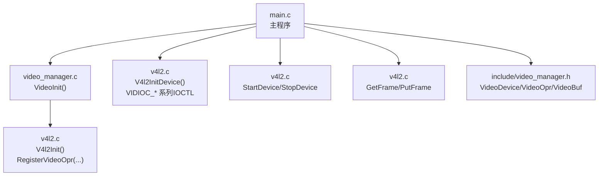
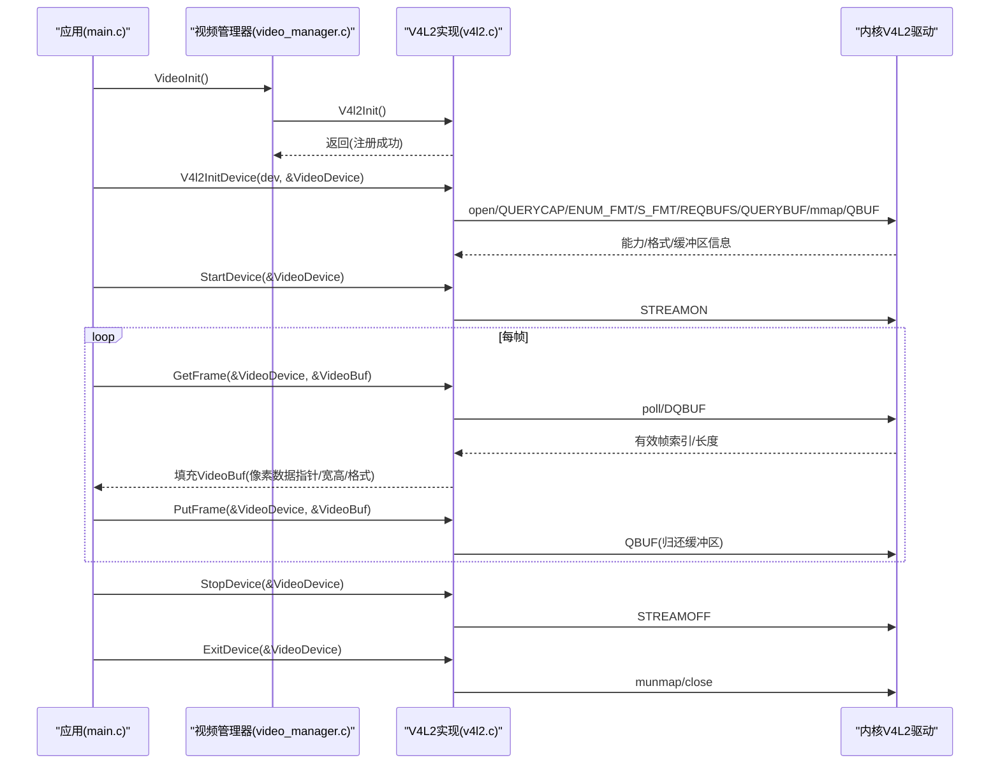
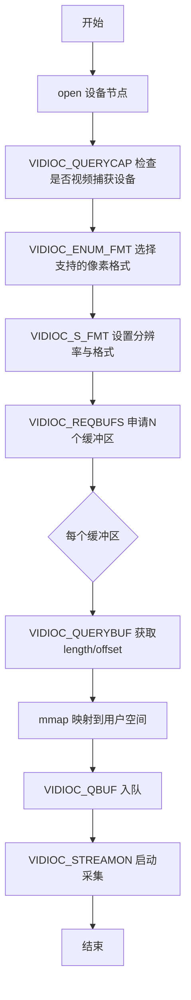
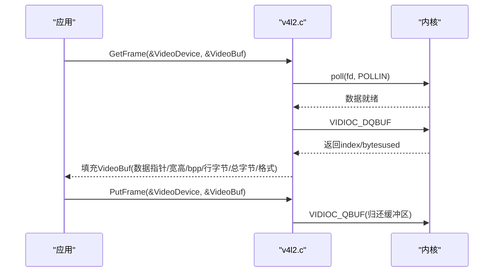
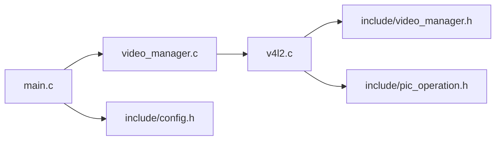

# 视频采集API

<cite>
**本文引用的文件**
- [video_manager.h](file://video2lcd/include/video_manager.h)
- [v4l2.c](file://video2lcd/video/v4l2.c)
- [video_manager.c](file://video2lcd/video/video_manager.c)
- [main.c](file://video2lcd/main.c)
- [config.h](file://video2lcd/include/config.h)
- [pic_operation.h](file://video2lcd/include/pic_operation.h)
</cite>

## 目录
1. [简介](#简介)
2. [项目结构](#项目结构)
3. [核心组件](#核心组件)
4. [架构总览](#架构总览)
5. [详细组件分析](#详细组件分析)
6. [依赖关系分析](#依赖关系分析)
7. [性能考量](#性能考量)
8. [故障排查指南](#故障排查指南)
9. [结论](#结论)
10. [附录：使用示例与最佳实践](#附录使用示例与最佳实践)

## 简介
本模块提供基于V4L2的视频采集抽象接口，通过VideoDevice描述设备状态，通过VideoOpr定义统一的设备操作函数指针（如initDevice、ExitDevice、GetFrame、PutFrame、StartDevice、StopDevice），并以V4l2Init完成V4L2驱动的注册与初始化。上层应用只需调用统一接口即可实现“打开设备—配置格式—申请并映射缓冲区—启动采集—取帧/还帧—停止/释放”的完整流程。

## 项目结构
- include/video_manager.h：定义VideoDevice、VideoOpr、VideoBuf等核心数据结构及对外接口声明。
- video/v4l2.c：V4L2驱动的具体实现，包含设备初始化、缓冲管理、取帧/还帧、启停控制以及VideoOpr实例构造与注册。
- video/video_manager.c：视频操作模块管理器，负责注册VideoOpr链表、查找与初始化入口。
- main.c：主程序示例，演示如何初始化显示、视频、转换、缩放、合并与刷新到LCD。
- include/config.h：全局配置（调试输出宏、设备路径等）。
- include/pic_operation.h：像素数据通用描述结构T_PixelDatas。

图表来源
- [main.c:76-107](file://video2lcd/main.c#L76-L107)
- [video_manager.c:67-74](file://video2lcd/video/video_manager.c#L67-L74)
- [v4l2.c:387-401](file://video2lcd/video/v4l2.c#L387-L401)
- [video_manager.h:14-45](file://video2lcd/include/video_manager.h#L14-L45)

章节来源
- [main.c:76-107](file://video2lcd/main.c#L76-L107)
- [video_manager.c:67-74](file://video2lcd/video/video_manager.c#L67-L74)
- [v4l2.c:387-401](file://video2lcd/video/v4l2.c#L387-L401)
- [video_manager.h:14-45](file://video2lcd/include/video_manager.h#L14-L45)

## 核心组件
- VideoDevice：封装单个摄像头设备的完整状态，包括设备文件描述符、像素格式、分辨率、缓冲区计数与长度、当前缓冲区索引、用户态缓冲区数组以及绑定的VideoOpr。
- VideoOpr：抽象的设备操作接口，包含名称、初始化/退出、取帧/还帧、启停控制函数指针，以及链表指针用于多驱动注册。
- VideoBuf：一帧图像数据的载体，包含像素数据描述T_PixelDatas与像素格式。
- T_PixelDatas：统一描述像素数据的尺寸、色深、行字节数、总字节数与数据指针。

章节来源
- [video_manager.h:14-56](file://video2lcd/include/video_manager.h#L14-L56)
- [pic_operation.h:10-17](file://video2lcd/include/pic_operation.h#L10-L17)

## 架构总览
V4L2采集采用Streaming模式为主（支持时），步骤为：open → QUERYCAP → ENUM_FMT/S_FMT → REQBUFS → QUERYBUF+mmap → QBUF入队 → STREAMON → 循环DQBUF处理→QBUF归还。若不支持Streaming则回退到Read/Write模式，直接read读取。

图表来源
- [v4l2.c:47-249](file://video2lcd/video/v4l2.c#L47-L249)
- [v4l2.c:267-326](file://video2lcd/video/v4l2.c#L267-L326)
- [v4l2.c:357-383](file://video2lcd/video/v4l2.c#L357-L383)
- [main.c:76-189](file://video2lcd/main.c#L76-L189)

## 详细组件分析

### VideoDevice 结构体字段说明
- iFd：设备文件描述符，指向/dev/videoX。
- iPixelFormat：选定的像素格式（如YUYV/MJPEG/RGB565）。
- iWidth/iHeight：实际设置的分辨率（由S_FMT决定，可能由驱动调整）。
- iVideoBufCnt：申请的缓冲区数量（Streaming模式下通常为NB_BUFFER）。
- iVideoBufMaxLen：单缓冲区最大长度（mmap length或read所需大小）。
- iVideoBufCurIndex：当前正在处理的缓冲区索引（DQBUF后记录）。
- pucVideBuf[NB_BUFFER]：用户态映射到的缓冲区指针数组（Streaming）或read缓冲区（ReadWrite）。
- ptOPr：指向绑定的VideoOpr，用于调用具体实现。

章节来源
- [video_manager.h:14-27](file://video2lcd/include/video_manager.h#L14-L27)
- [v4l2.c:127-241](file://video2lcd/video/v4l2.c#L127-L241)

### VideoOpr 接口函数指针规范
- name：驱动名称字符串（如"v4l2"）。
- initDevice(strDevName, ptVideoDevice)：打开设备、查询能力、枚举格式、设置格式、申请并映射缓冲区；成功返回0，失败返回负值。
- ExitDevice(ptVideoDevice)：释放mmap内存、关闭fd；返回0。
- GetFrame(ptVideoDevice, ptVideoBuf)：从队列取出一个缓冲区并填充VideoBuf（像素数据指针、宽高、bpp、行字节、总字节、像素格式）；成功返回0，失败返回负值。
- PutFrame(ptVideoDevice, ptVideoBuf)：将处理完的缓冲区重新入队；成功返回0，失败返回负值。
- StartDevice(ptVideoDevice)：启动采集（STREAMON）；成功返回0，失败返回负值。
- StopDevice(ptVideoDevice)：停止采集（STREAMOFF）；成功返回0，失败返回负值。
- ptNext：链表指针，用于多驱动注册。

章节来源
- [video_manager.h:35-45](file://video2lcd/include/video_manager.h#L35-L45)
- [v4l2.c:387-401](file://video2lcd/video/v4l2.c#L387-L401)

### V4l2Init 使用说明
- 作用：构造并注册V4L2的VideoOpr实例，使上层可通过统一接口访问V4L2设备。
- 调用时机：在VideoInit中调用，位于DisplayInit之后、VideoDeviceInit之前。
- 返回值：0表示注册成功，非0表示失败。
- 资源管理：该函数仅注册接口，不分配设备资源；设备资源在initDevice中分配，在ExitDevice中释放。

章节来源
- [video_manager.c:67-74](file://video2lcd/video/video_manager.c#L67-L74)
- [v4l2.c:387-401](file://video2lcd/video/v4l2.c#L387-L401)
- [main.c:76-87](file://video2lcd/main.c#L76-L87)

### 关键流程与错误处理

#### 设备初始化流程（Streaming模式）

图表来源
- [v4l2.c:47-249](file://video2lcd/video/v4l2.c#L47-L249)

章节来源
- [v4l2.c:47-249](file://video2lcd/video/v4l2.c#L47-L249)

#### 取帧与还帧（Streaming模式）

图表来源
- [v4l2.c:267-326](file://video2lcd/video/v4l2.c#L267-L326)

章节来源
- [v4l2.c:267-326](file://video2lcd/video/v4l2.c#L267-L326)

#### Read/Write模式回退
当设备不支持Streaming时，采用read方式：
- 初始化阶段只分配一个用户缓冲区，大小为宽×高×4（保守估计）。
- GetFrame通过read读取一帧到pucVideBuf[0]，并填充VideoBuf。
- PutFrame为空操作（无需归还）。

章节来源
- [v4l2.c:221-241](file://video2lcd/video/v4l2.c#L221-L241)
- [v4l2.c:328-355](file://video2lcd/video/v4l2.c#L328-L355)

### 线程安全性与并发访问注意事项
- 当前实现未包含内部锁机制。同一VideoDevice实例的GetFrame/PutFrame/StartDevice/StopDevice应保证串行调用，避免多线程同时访问导致状态错乱。
- 推荐做法：
  - 每个VideoDevice实例由单一工作线程独占访问。
  - 若需多线程，应在应用层加互斥锁保护对ptOPr函数的调用序列。
  - 避免在GetFrame与PutFrame之间进行长时间阻塞操作，必要时使用独立线程处理图像处理。

[本节为通用指导，不直接分析具体文件]

## 依赖关系分析
- main.c依赖video_manager.c提供的VideoInit与VideoDeviceInit（后者由上层封装调用V4l2InitDevice）。
- v4l2.c依赖内核V4L2接口（ioctl、poll、mmap、read、close）。
- video_manager.c维护VideoOpr链表，提供注册与查找能力。
- config.h提供调试输出宏与设备路径常量。
- pic_operation.h提供像素数据通用描述结构。

图表来源
- [main.c:76-107](file://video2lcd/main.c#L76-L107)
- [video_manager.c:67-74](file://video2lcd/video/video_manager.c#L67-L74)
- [v4l2.c:387-401](file://video2lcd/video/v4l2.c#L387-L401)
- [video_manager.h:14-56](file://video2lcd/include/video_manager.h#L14-L56)
- [pic_operation.h:10-17](file://video2lcd/include/pic_operation.h#L10-L17)
- [config.h:13-18](file://video2lcd/include/config.h#L13-L18)

章节来源
- [main.c:76-107](file://video2lcd/main.c#L76-L107)
- [video_manager.c:67-74](file://video2lcd/video/video_manager.c#L67-L74)
- [v4l2.c:387-401](file://video2lcd/video/v4l2.c#L387-L401)
- [video_manager.h:14-56](file://video2lcd/include/video_manager.h#L14-L56)
- [pic_operation.h:10-17](file://video2lcd/include/pic_operation.h#L10-L17)
- [config.h:13-18](file://video2lcd/include/config.h#L13-L18)

## 性能考量
- 优先使用Streaming模式：通过mmap零拷贝与队列轮转，减少数据复制与系统调用开销。
- 合理设置缓冲区数量：NB_BUFFER=4可平衡吞吐与内存占用，可根据实际负载调整。
- 像素格式选择：YUYV/RGB565适合显示，MJPEG压缩率高但解码开销大，需权衡CPU与带宽。
- 避免阻塞热点路径：GetFrame中的poll应配合超时策略或在独立线程执行，防止主循环卡顿。
- 格式转换与缩放：仅在必要时进行，尽量保持原始格式以减少转换成本。

[本节为通用指导，不直接分析具体文件]

## 故障排查指南
- 无法打开设备：检查设备节点是否存在与权限；确认传入路径正确。
- 不是视频捕获设备：QUERYCAP未返回VIDEO_CAPTURE标志，更换设备或驱动。
- 无支持格式：ENUM_FMT未找到匹配格式；调整期望格式列表或驱动配置。
- 设置格式失败：S_FMT失败，可能是分辨率不被支持；以驱动返回为准。
- 申请缓冲区失败：REQBUFS失败，检查内存与驱动能力。
- mmap失败：QUERYBUF后映射失败，检查offset与length。
- 入队失败：QBUF失败，检查缓冲区索引与类型。
- 启动失败：STREAMON失败，检查设备状态与前置步骤。
- 取帧失败：poll/DQBUF失败，检查设备是否处于流式采集状态。
- 还帧失败：QBUF失败，确保index正确且设备处于运行状态。
- 停止失败：STREAMOFF失败，确保已启动过。

章节来源
- [v4l2.c:47-249](file://video2lcd/video/v4l2.c#L47-L249)
- [v4l2.c:267-326](file://video2lcd/video/v4l2.c#L267-L326)
- [v4l2.c:357-383](file://video2lcd/video/v4l2.c#L357-L383)

## 结论
本模块通过VideoDevice与VideoOpr实现了V4L2采集的统一抽象，屏蔽了底层差异，提供清晰的初始化、取帧、还帧与启停流程。结合主程序的显示与转换管线，形成完整的“采集—处理—显示”链路。建议在生产环境中严格遵循串行访问约定，并结合性能调优策略以获得稳定高效的视频采集体验。

[本节为总结性内容，不直接分析具体文件]

## 附录：使用示例与最佳实践
以下示例展示常见操作流程（以伪代码形式描述，避免直接粘贴源码）：

- 初始化显示与视频模块
  - 调用DisplayInit与SelectAndInitDefaultDispDev初始化显示。
  - 调用VideoInit注册V4L2驱动。
  - 调用VideoDeviceInit打开设备并完成格式与缓冲区配置。

- 启动采集
  - 调用ptOPr->StartDevice启动采集。

- 主循环取帧与处理
  - 调用ptOPr->GetFrame获取一帧，得到VideoBuf。
  - 如需格式转换，调用转换器Convert将源格式转为显示格式。
  - 如需缩放，计算目标尺寸并调用PicZoom。
  - 将图像合并到帧缓冲区并刷新到设备。
  - 调用ptOPr->PutFrame归还缓冲区。

- 停止与释放
  - 调用ptOPr->StopDevice停止采集。
  - 调用ptOPr->ExitDevice释放资源（munmap/close）。

- 错误处理
  - 对每个IOCTL与系统调用返回值进行检查，出现错误时打印日志并清理已分配资源。

- 线程安全
  - 将GetFrame/PutFrame/StartDevice/StopDevice的调用限制在单一线程内，或使用互斥锁保护。

章节来源
- [main.c:76-189](file://video2lcd/main.c#L76-L189)
- [v4l2.c:47-249](file://video2lcd/video/v4l2.c#L47-L249)
- [v4l2.c:267-326](file://video2lcd/video/v4l2.c#L267-L326)
- [v4l2.c:357-383](file://video2lcd/video/v4l2.c#L357-L383)