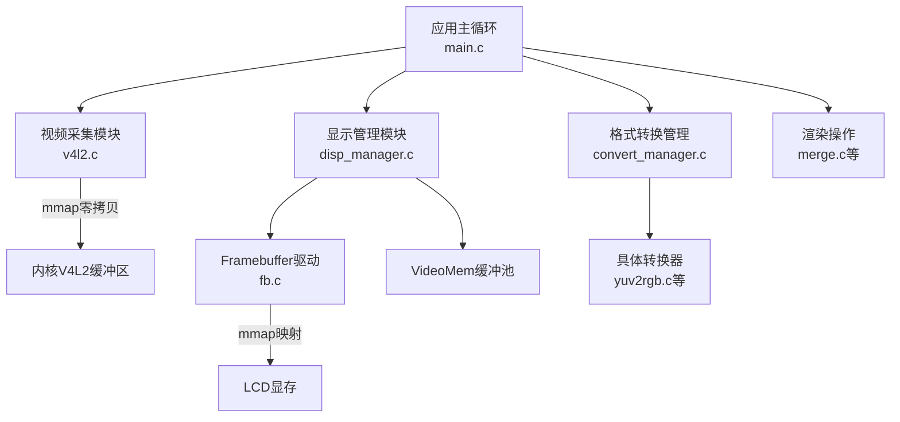
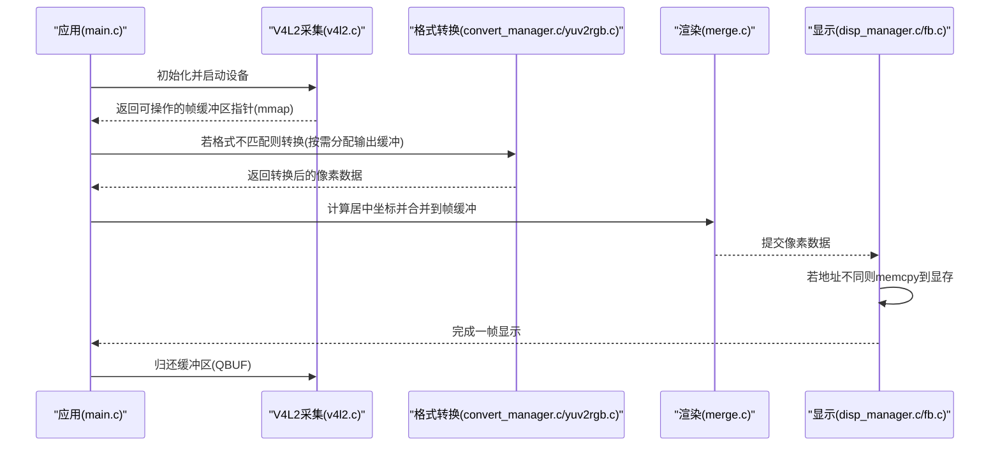
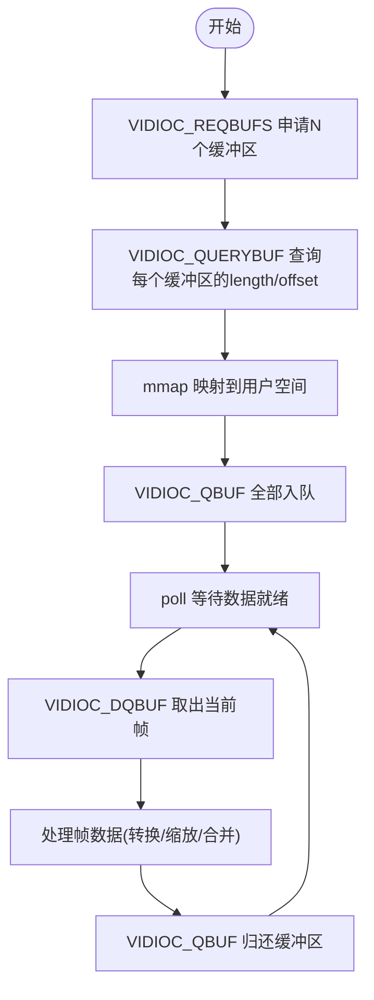
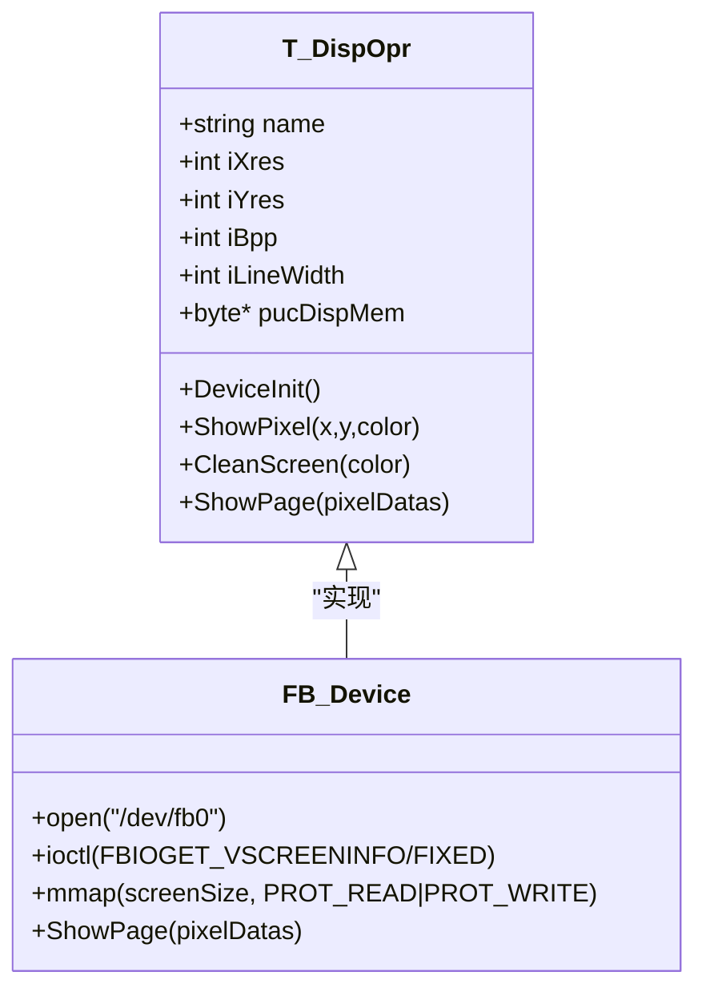
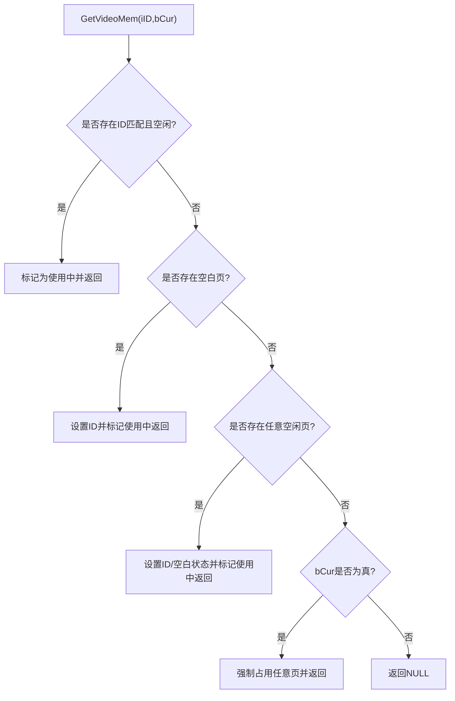
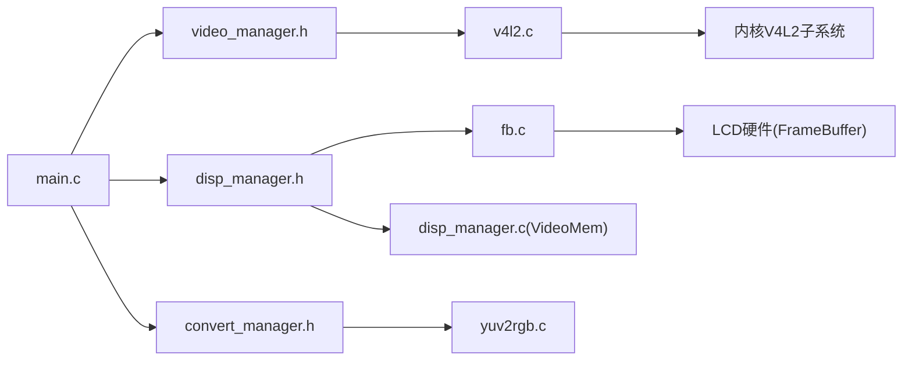

# 内存管理优化

<cite>
**本文引用的文件**
- [video_manager.c](file://video2lcd/video/video_manager.c)
- [v4l2.c](file://video2lcd/video/v4l2.c)
- [disp_manager.c](file://video2lcd/display/disp_manager.c)
- [fb.c](file://video2lcd/display/fb.c)
- [convert_manager.c](file://video2lcd/convert/convert_manager.c)
- [yuv2rgb.c](file://video2lcd/convert/yuv2rgb.c)
- [merge.c](file://video2lcd/render/operation/merge.c)
- [video_manager.h](file://video2lcd/include/video_manager.h)
- [disp_manager.h](file://video2lcd/include/disp_manager.h)
- [convert_manager.h](file://video2lcd/include/convert_manager.h)
- [pic_operation.h](file://video2lcd/include/pic_operation.h)
- [config.h](file://video2lcd/include/config.h)
- [main.c](file://video2lcd/main.c)
</cite>

## 目录
1. [简介](#简介)
2. [项目结构](#项目结构)
3. [核心组件](#核心组件)
4. [架构总览](#架构总览)
5. [详细组件分析](#详细组件分析)
6. [依赖关系分析](#依赖关系分析)
7. [性能考量](#性能考量)
8. [故障排查指南](#故障排查指南)
9. [结论](#结论)
10. [附录](#附录)

## 简介
本文件聚焦于嵌入式Linux相机项目的内存管理优化，围绕零拷贝、缓冲区池、生命周期与错误恢复、内存对齐与缓存友好设计、以及内存使用分析与监控等方面展开。系统通过V4L2的mmap流式采集、Framebuffer映射显示、VideoMem页面缓冲与复用、以及格式转换与渲染路径中的最小化复制策略，实现端到端的低延迟、低内存占用与高吞吐的视频采集到显示流水线。

## 项目结构
- 视频采集：基于V4L2的streaming模式，使用内核分配的帧缓冲区并通过mmap映射到用户空间，避免数据在用户态与内核态之间的额外拷贝。
- 显示输出：通过Framebuffer设备将显存映射到用户空间，支持直接写入或批量拷贝刷新。
- 格式转换：根据摄像头输出格式与LCD像素格式自动选择转换器（如YUV→RGB），按需分配输出缓冲并执行转换。
- 渲染合并：将处理后的图像区域合并到帧缓冲区，计算居中位置后一次性刷新至屏幕。
- 缓冲池：VideoMem链表管理多页缓冲，支持空闲回收、状态机控制与设备显存直写。

图表来源
- [main.c:63-178](file://video2lcd/main.c#L63-L178)
- [v4l2.c:127-220](file://video2lcd/video/v4l2.c#L127-L220)
- [fb.c:53-94](file://video2lcd/display/fb.c#L53-L94)
- [disp_manager.c:140-175](file://video2lcd/display/disp_manager.c#L140-L175)
- [convert_manager.c:121-130](file://video2lcd/convert/convert_manager.c#L121-L130)
- [yuv2rgb.c:161-199](file://video2lcd/convert/yuv2rgb.c#L161-L199)
- [merge.c:20-46](file://video2lcd/render/operation/merge.c#L20-L46)

章节来源
- [main.c:63-178](file://video2lcd/main.c#L63-L178)
- [v4l2.c:127-220](file://video2lcd/video/v4l2.c#L127-L220)
- [fb.c:53-94](file://video2lcd/display/fb.c#L53-L94)
- [disp_manager.c:140-175](file://video2lcd/display/disp_manager.c#L140-L175)
- [convert_manager.c:121-130](file://video2lcd/convert/convert_manager.c#L121-L130)
- [yuv2rgb.c:161-199](file://video2lcd/convert/yuv2rgb.c#L161-L199)
- [merge.c:20-46](file://video2lcd/render/operation/merge.c#L20-L46)

## 核心组件
- V4L2采集与零拷贝：通过VIDIOC_REQBUFS申请多个内核缓冲区，使用VIDIOC_QUERYBUF查询每个缓冲区的长度与偏移，再以mmap映射到用户空间；采集时通过poll等待数据就绪，VIDIOC_DQBUF取出当前帧指针，处理后VIDIOC_QBUF归还队列，形成环形缓冲。
- Framebuffer显示与零拷贝：打开/dev/fb0，获取屏幕分辨率与BPP，使用mmap将显存映射到用户空间；显示时若源缓冲与显存地址不同则memcpy一次，否则直接写入显存。
- VideoMem缓冲池：维护一个VideoMem链表，包含设备显存对应的VideoMem和若干普通内存页；提供GetVideoMem/PutVideoMem进行分配与回收，支持状态机（空闲/准备/当前）与图像生成状态（空白/生成中/已生成）。
- 格式转换与按需分配：根据输入输出像素格式选择转换器；输出缓冲首次使用时按需malloc，并在退出时释放，避免不必要的预分配。
- 渲染合并：将缩放后的图像按居中坐标逐行memcpy到帧缓冲区的指定区域，减少跨行拷贝开销。

章节来源
- [v4l2.c:127-220](file://video2lcd/video/v4l2.c#L127-L220)
- [v4l2.c:267-326](file://video2lcd/video/v4l2.c#L267-L326)
- [fb.c:53-94](file://video2lcd/display/fb.c#L53-L94)
- [fb.c:166-174](file://video2lcd/display/fb.c#L166-L174)
- [disp_manager.c:188-337](file://video2lcd/display/disp_manager.c#L188-L337)
- [yuv2rgb.c:161-199](file://video2lcd/convert/yuv2rgb.c#L161-L199)
- [merge.c:20-46](file://video2lcd/render/operation/merge.c#L20-L46)

## 架构总览
下图展示从摄像头采集到LCD显示的完整内存路径，强调零拷贝与缓冲复用策略。

图表来源
- [main.c:101-181](file://video2lcd/main.c#L101-L181)
- [v4l2.c:127-220](file://video2lcd/video/v4l2.c#L127-L220)
- [v4l2.c:267-326](file://video2lcd/video/v4l2.c#L267-L326)
- [convert_manager.c:121-130](file://video2lcd/convert/convert_manager.c#L121-L130)
- [yuv2rgb.c:161-199](file://video2lcd/convert/yuv2rgb.c#L161-L199)
- [merge.c:20-46](file://video2lcd/render/operation/merge.c#L20-L46)
- [fb.c:166-174](file://video2lcd/display/fb.c#L166-L174)

## 详细组件分析

### V4L2采集与零拷贝机制
- 缓冲区申请与映射：使用VIDIOC_REQBUFS请求NB_BUFFER个缓冲区，memory设为MMAP；对每个缓冲区调用VIDIOC_QUERYBUF获取length与offset，再用mmap映射到用户空间，得到pucVideBuf[i]指针。该指针直接指向内核分配的物理内存，后续采集无需拷贝。
- 入队与取帧：将所有缓冲区通过VIDIOC_QBUF放入内核队列；采集时poll等待POLLIN，VIDIOC_DQBUF取出当前帧索引与数据指针，填充VideoBuf结构体（像素格式、尺寸、行字节数、总字节数、数据指针）。
- 归还队列：处理完成后VIDIOC_QBUF将缓冲区放回队列，供下一帧使用，形成稳定的环形缓冲。
- ReadWrite模式备选：当设备不支持streaming时，采用read方式读取到用户malloc的缓冲区，效率较低但兼容性强。

图表来源
- [v4l2.c:127-220](file://video2lcd/video/v4l2.c#L127-L220)
- [v4l2.c:267-326](file://video2lcd/video/v4l2.c#L267-L326)

章节来源
- [v4l2.c:127-220](file://video2lcd/video/v4l2.c#L127-L220)
- [v4l2.c:267-326](file://video2lcd/video/v4l2.c#L267-L326)

### Framebuffer显示与零拷贝刷新
- 显存映射：打开/dev/fb0，ioctl获取可变与固定信息，计算屏幕大小并使用mmap映射到用户空间，得到pucDispMem指针。
- 显示策略：ShowPage函数比较源像素数据地址与显存地址，若相同则直接写入显存（零拷贝），否则memcpy一次到显存。
- 清屏与画点：针对不同BPP（8/16/32）分别处理颜色值，确保写入显存的格式正确。

图表来源
- [disp_manager.h:84-96](file://video2lcd/include/disp_manager.h#L84-L96)
- [fb.c:53-94](file://video2lcd/display/fb.c#L53-L94)
- [fb.c:166-174](file://video2lcd/display/fb.c#L166-L174)

章节来源
- [fb.c:53-94](file://video2lcd/display/fb.c#L53-L94)
- [fb.c:166-174](file://video2lcd/display/fb.c#L166-L174)

### VideoMem缓冲池与复用策略
- 分配：AllocVideoMem首先封装设备显存为一个VideoMem（bDevFrameBuffer=1），再分配若干普通内存页（紧跟结构体的连续内存），所有VideoMem加入全局链表。
- 获取：GetVideoMem优先查找ID匹配且空闲的VideoMem；若无则查找空白页；再次失败则任意空闲页；极端情况下强制占用当前页（bCur=1）。
- 释放：PutVideoMem将状态置为空闲，必要时重置图像状态为空白。
- 用途：用于加速显示，先在内存中准备图像，再一次性复制到显存；或直接操作显存VideoMem以消除中间拷贝。

图表来源
- [disp_manager.c:272-322](file://video2lcd/display/disp_manager.c#L272-L322)

章节来源
- [disp_manager.c:188-337](file://video2lcd/display/disp_manager.c#L188-L337)

### 格式转换与内存分配策略
- 自动选择：VideoConvertInit注册各转换器；GetVideoConvertForFormats遍历链表，依据isSupport判断是否支持输入输出格式组合。
- 按需分配：转换函数在输出缓冲未分配时malloc所需大小，并在转换完成后由调用方决定是否保留；Yuv2RgbConvertExit负责释放输出缓冲，避免泄漏。
- 性能优化：尽量保持输入缓冲为零拷贝（来自V4L2 mmap），输出缓冲仅在必要时分配，减少频繁malloc/free。

章节来源
- [convert_manager.c:121-130](file://video2lcd/convert/convert_manager.c#L121-L130)
- [yuv2rgb.c:161-199](file://video2lcd/convert/yuv2rgb.c#L161-L199)
- [yuv2rgb.c:207-215](file://video2lcd/convert/yuv2rgb.c#L207-L215)

### 渲染合并与内存访问模式
- PicMerge将小图按行memcpy到大图的指定起始位置，逐行推进指针，充分利用行字节对齐，减少越界与错位风险。
- PicMergeRegion支持区域复制，先校验坐标范围，再计算源/目标地址并按行复制。

章节来源
- [merge.c:20-46](file://video2lcd/render/operation/merge.c#L20-L46)
- [merge.c:60-88](file://video2lcd/render/operation/merge.c#L60-L88)

## 依赖关系分析
- 模块耦合：main.c协调视频、显示、转换与渲染；各模块通过统一接口（VideoOpr、DispOpr、VideoConvert）解耦，便于扩展新设备或转换器。
- 数据结构依赖：T_PixelDatas作为通用像素描述被广泛使用；T_VideoDevice封装V4L2设备状态；T_VideoMem管理显示缓冲池。
- 外部依赖：V4L2与Framebuffer通过系统调用（ioctl/mmap/poll/read）与内核交互；JPEG库（jpeglib.h）提供内存池抽象，但本项目主要使用自定义VideoMem与V4L2缓冲。

图表来源
- [video_manager.h:14-56](file://video2lcd/include/video_manager.h#L14-L56)
- [disp_manager.h:69-96](file://video2lcd/include/disp_manager.h#L69-L96)
- [convert_manager.h:23-43](file://video2lcd/include/convert_manager.h#L23-L43)
- [v4l2.c:127-220](file://video2lcd/video/v4l2.c#L127-L220)
- [fb.c:53-94](file://video2lcd/display/fb.c#L53-L94)

章节来源
- [video_manager.h:14-56](file://video2lcd/include/video_manager.h#L14-L56)
- [disp_manager.h:69-96](file://video2lcd/include/disp_manager.h#L69-L96)
- [convert_manager.h:23-43](file://video2lcd/include/convert_manager.h#L23-L43)

## 性能考量
- 零拷贝路径：V4L2 streaming模式下，用户空间直接访问内核缓冲区，避免read/write带来的数据拷贝；Framebuffer显示时若地址一致则直接写入显存，进一步减少拷贝。
- 缓冲池复用：VideoMem链表与状态机减少频繁分配/释放，提升显示吞吐；设备显存VideoMem可直接操作，避免中间缓冲。
- 行对齐与批量拷贝：PicMerge按行memcpy，利用iLineBytes对齐，提高内存带宽利用率；FBShowPage仅在必要时memcpy，避免冗余。
- 转换优化：按需分配输出缓冲，避免预分配浪费；颜色转换使用查表与位运算，降低CPU开销。
- 建议：
  - 合理设置NB_BUFFER数量，平衡吞吐与内存占用。
  - 在高分辨率下优先使用RGB565以减少带宽压力。
  - 对频繁分配的输出缓冲考虑引入对象池，减少malloc/free抖动。

[本节为一般性指导，不直接分析具体文件]

## 故障排查指南
- 常见问题定位：
  - 无法打开设备：检查设备路径与权限（/dev/videoX、/dev/fb0）。
  - ioctl失败：确认设备能力（STREAMING/READWRITE）与参数合法性。
  - mmap失败：检查length与offset是否正确，确认设备支持MMAP。
  - poll超时：确认设备已StartDevice且缓冲区已QBUF。
  - 显示异常：检查像素格式与BPP匹配，确认ShowPage地址比较逻辑。
- 调试技巧：
  - 启用DBG_PRINTF打印关键路径（初始化、ioctl返回值、mmap结果）。
  - 使用工具查看内存映射（/proc/<pid>/maps）与设备状态（/sys/class/video4linux）。
  - 针对VideoMem状态机，打印GetVideoMem/PutVideoMem的调用序列，确认无悬挂引用。
- 资源清理：
  - V4L2：确保ExitDevice中munmap所有缓冲区并close fd。
  - 转换输出缓冲：确保ConvertExit释放aucPixelDatas。
  - 显示：确保程序退出时关闭fd并解除mmap映射。

章节来源
- [v4l2.c:246-265](file://video2lcd/video/v4l2.c#L246-L265)
- [fb.c:53-94](file://video2lcd/display/fb.c#L53-L94)
- [yuv2rgb.c:207-215](file://video2lcd/convert/yuv2rgb.c#L207-L215)

## 结论
本项目通过V4L2 mmap零拷贝采集、Framebuffer映射显示、VideoMem缓冲池复用与按需转换策略，构建了高效的视频采集到显示流水线。零拷贝与缓冲复用显著降低了内存带宽与CPU开销，状态机与错误恢复机制提升了鲁棒性。未来可在缓冲池对象化、转换算法并行化与内存使用监控方面进一步优化。

[本节为总结性内容，不直接分析具体文件]

## 附录
- 关键数据结构
  - T_PixelDatas：统一描述像素数据的尺寸、色深、行字节数、总字节数与数据指针。
  - T_VideoDevice：封装V4L2设备状态，包括fd、像素格式、分辨率、缓冲区计数与数组、当前索引等。
  - T_VideoMem：管理显示缓冲的生命周期与状态，支持设备显存与普通内存页。
  - T_DispOpr/T_VideoOpr/T_VideoConvert：抽象设备与转换器的操作接口，支持动态注册与选择。

章节来源
- [pic_operation.h:10-17](file://video2lcd/include/pic_operation.h#L10-L17)
- [video_manager.h:14-56](file://video2lcd/include/video_manager.h#L14-L56)
- [disp_manager.h:69-96](file://video2lcd/include/disp_manager.h#L69-L96)
- [convert_manager.h:23-43](file://video2lcd/include/convert_manager.h#L23-L43)