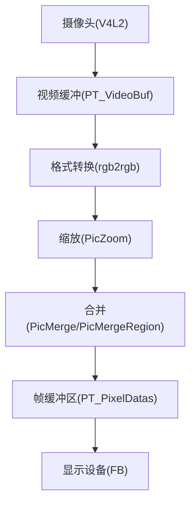
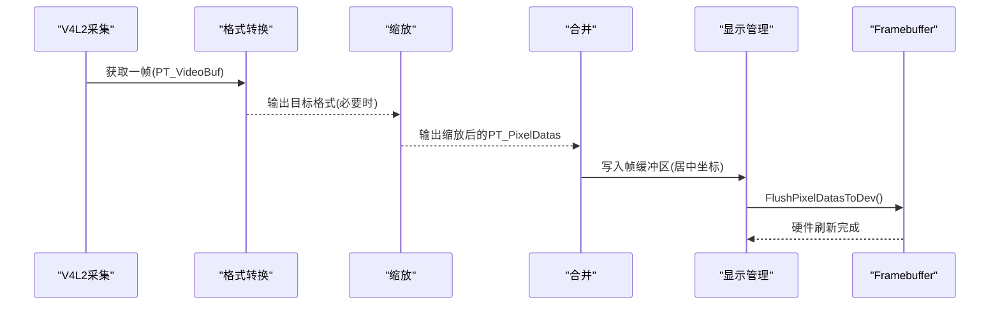
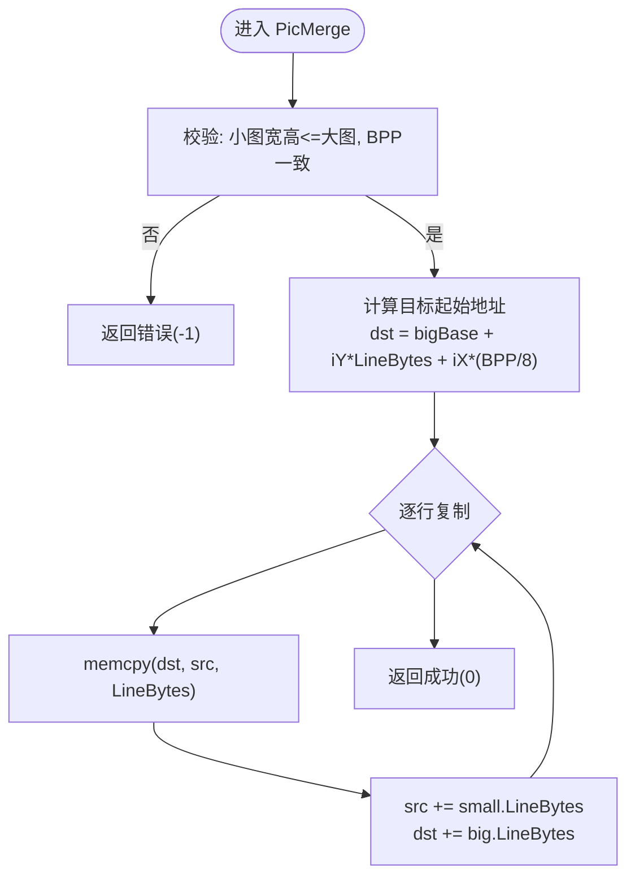
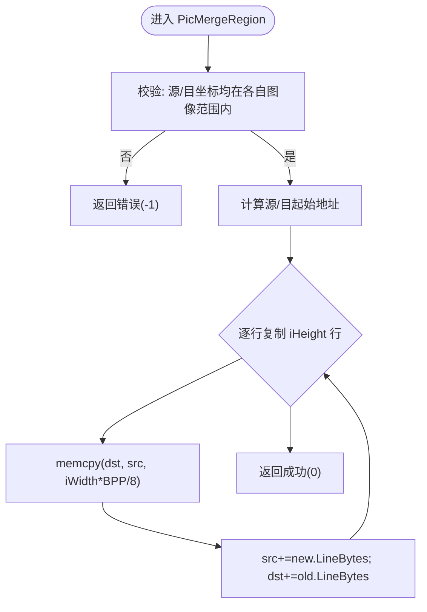
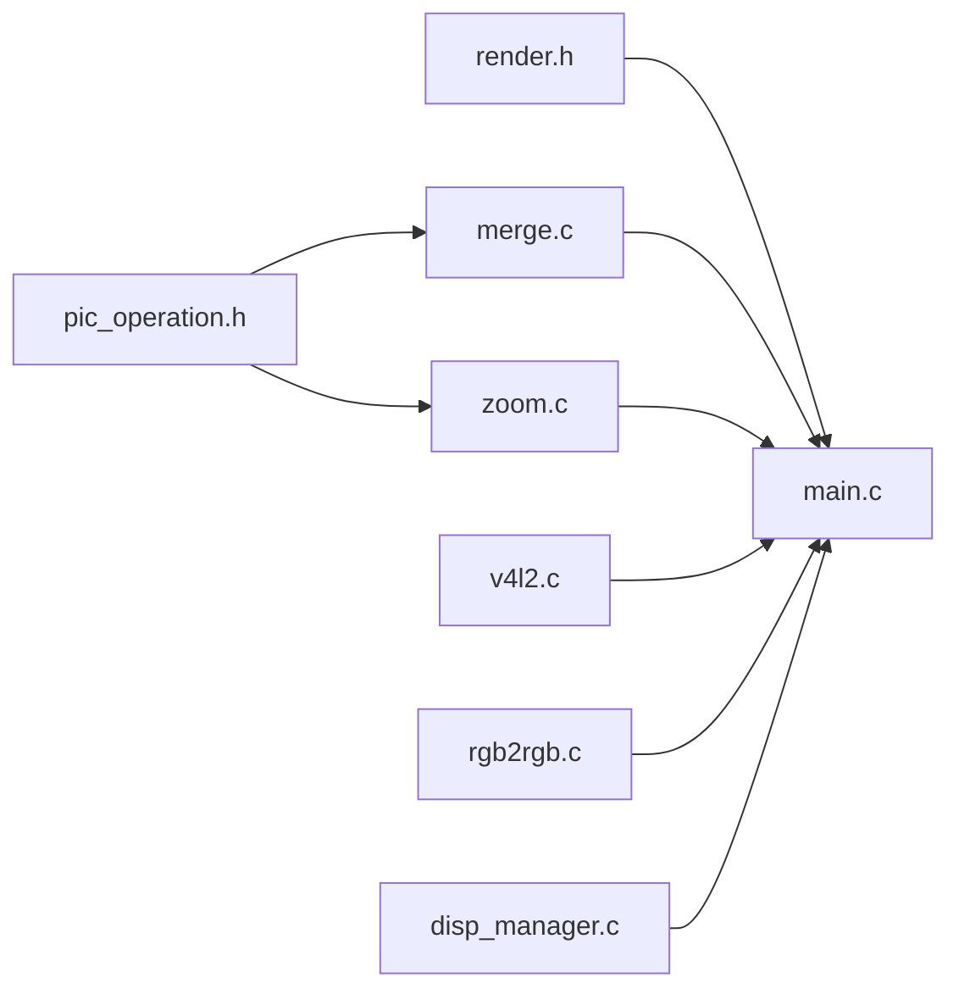

# 图像合并操作

<cite>
**本文引用的文件**
- [merge.c](file://video2lcd/render/operation/merge.c)
- [pic_operation.h](file://video2lcd/include/pic_operation.h)
- [render.h](file://video2lcd/include/render.h)
- [main.c](file://video2lcd/main.c)
- [disp_manager.c](file://video2lcd/display/disp_manager.c)
- [disp_manager.h](file://video2lcd/include/disp_manager.h)
- [zoom.c](file://video2lcd/render/operation/zoom.c)
- [rgb2rgb.c](file://video2lcd/convert/rgb2rgb.c)
- [v4l2.c](file://video2lcd/video/v4l2.c)
</cite>

## 目录
1. [简介](#简介)
2. [项目结构](#项目结构)
3. [核心组件](#核心组件)
4. [架构总览](#架构总览)
5. [详细组件分析](#详细组件分析)
6. [依赖关系分析](#依赖关系分析)
7. [性能考虑](#性能考虑)
8. [故障排查指南](#故障排查指南)
9. [结论](#结论)
10. [附录](#附录)

## 简介
本文件围绕“图像合并”这一关键渲染操作，系统阐述像素级图像合并的实现原理、算法逻辑、内存对齐与边界检测机制，解释不同图像格式与分辨率下的合并策略，说明数据完整性保证与错误处理机制。同时给出性能优化技巧（内存访问模式优化、批量数据处理）、API使用示例（参数配置、返回值处理、异常处理），并说明合并操作在视频处理流水线中的作用及与其他模块的集成方式。最后提供性能测试方法与调试工具使用指南。

## 项目结构
本项目采用分层模块化设计：
- 采集层：V4L2 驱动封装，负责从摄像头获取帧数据
- 转换层：像素格式转换（如 RGB565 -> RGB32）
- 渲染层：缩放与合并等图像处理操作
- 显示层：Framebuffer 管理，将帧缓冲区刷新到 LCD
- 主流程：串联采集、转换、缩放、合并、显示

图表来源
- [v4l2.c:131-201](file://video2lcd/video/v4l2.c#L131-L201)
- [rgb2rgb.c:46-119](file://video2lcd/convert/rgb2rgb.c#L46-L119)
- [zoom.c:27-85](file://video2lcd/render/operation/zoom.c#L27-L85)
- [merge.c:20-88](file://video2lcd/render/operation/merge.c#L20-L88)
- [disp_manager.c:148-175](file://video2lcd/display/disp_manager.c#L148-L175)

章节来源
- [main.c:117-178](file://video2lcd/main.c#L117-L178)
- [disp_manager.c:148-175](file://video2lcd/display/disp_manager.c#L148-L175)

## 核心组件
- 像素数据结构 PT_PixelDatas：统一描述图像尺寸、色深、行字节数、总字节数与像素数据指针，是跨模块共享的数据模型
- 合并接口 PicMerge / PicMergeRegion：实现小图到大图的指定位置复制，以及区域到区域的块拷贝
- 缩放接口 PicZoom：最近邻插值缩放，为后续合并提供适配分辨率的源图
- 显示管理：GetVideoBufForDisplay 获取帧缓冲区；FlushPixelDatasToDev 刷新至LCD
- 主流程：计算居中坐标，调用合并将当前帧写入帧缓冲区

章节来源
- [pic_operation.h:10-17](file://video2lcd/include/pic_operation.h#L10-L17)
- [render.h:27-36](file://video2lcd/include/render.h#L27-L36)
- [merge.c:20-88](file://video2lcd/render/operation/merge.c#L20-L88)
- [disp_manager.c:148-175](file://video2lcd/display/disp_manager.c#L148-L175)
- [main.c:169-178](file://video2lcd/main.c#L169-L178)

## 架构总览
下图展示从采集到显示的完整数据流，重点标注合并操作的输入输出与上下文。

图表来源
- [v4l2.c:267-326](file://video2lcd/video/v4l2.c#L267-L326)
- [rgb2rgb.c:46-119](file://video2lcd/convert/rgb2rgb.c#L46-L119)
- [zoom.c:27-85](file://video2lcd/render/operation/zoom.c#L27-L85)
- [merge.c:20-88](file://video2lcd/render/operation/merge.c#L20-L88)
- [disp_manager.c:148-175](file://video2lcd/display/disp_manager.c#L148-L175)

## 详细组件分析

### 像素数据结构 PT_PixelDatas
- 字段含义：宽度、高度、每像素位数(BPP)、行字节数(LineBytes)、总字节数(TotalBytes)、像素数据指针
- 作用：作为所有图像处理模块的统一数据契约，确保跨模块传递时尺寸与步长一致
- 复杂度：O(1) 访问；内存布局紧凑，利于缓存友好访问

章节来源
- [pic_operation.h:10-17](file://video2lcd/include/pic_operation.h#L10-L17)

### 合并函数 PicMerge
- 功能：将小图复制到大图指定起始坐标(iX,iY)处
- 算法要点：
  - 边界检查：小图尺寸不得大于大图，且BPP必须一致
  - 地址计算：目标起始地址 = 大图基址 + iY*LineBytes + iX*(BPP/8)
  - 逐行复制：按行使用 memcpy，行内连续内存访问，提升缓存命中率
- 时间复杂度：O(Hs * Ws)，Hs/Ws 为小图高宽
- 空间复杂度：O(1) 额外空间

图表来源
- [merge.c:20-46](file://video2lcd/render/operation/merge.c#L20-L46)

章节来源
- [merge.c:20-46](file://video2lcd/render/operation/merge.c#L20-L46)

### 区域合并函数 PicMergeRegion
- 功能：将新图的某一块区域复制到旧图的指定区域
- 算法要点：
  - 边界检查：起止坐标必须在各自图像范围内
  - 地址计算：分别计算源/目的起始地址
  - 逐行复制：按区域高度循环，行内复制 iWidth*BPP/8 字节
- 适用场景：局部更新、叠加UI元素、画中画窗口

图表来源
- [merge.c:60-88](file://video2lcd/render/operation/merge.c#L60-L88)

章节来源
- [merge.c:60-88](file://video2lcd/render/operation/merge.c#L60-L88)

### 缩放函数 PicZoom（与合并配合）
- 算法：最近邻插值，构建X坐标映射表，按行复制对应源像素
- 与合并的关系：当源图分辨率大于LCD时先缩放，再合并到帧缓冲区，避免越界与失真
- 复杂度：O(Wd*Hd)，Wd/Hd为目标尺寸

章节来源
- [zoom.c:27-85](file://video2lcd/render/operation/zoom.c#L27-L85)

### 显示与帧缓冲
- GetVideoBufForDisplay：根据BPP选择像素格式，填充帧缓冲区的尺寸、行字节、总字节，并指向显存基址
- FlushPixelDatasToDev：调用底层ShowPage将像素数据刷新到LCD

章节来源
- [disp_manager.c:148-175](file://video2lcd/display/disp_manager.c#L148-L175)

### 主流程中的合并调用
- 居中计算：iTopLeftX/Y = (LCD宽高 - 当前帧宽高)/2
- 调用合并：PicMerge(iTopLeftX, iTopLeftY, 当前帧, 帧缓冲区)
- 刷新显示：FlushPixelDatasToDev

章节来源
- [main.c:169-178](file://video2lcd/main.c#L169-L178)

## 依赖关系分析
- merge.c 依赖 pic_operation.h 提供的 PT_PixelDatas
- render.h 暴露 PicZoom/PicMerge 接口供 main.c 调用
- main.c 串联 v4l2.c（采集）、rgb2rgb.c（格式转换）、zoom.c（缩放）、merge.c（合并）、disp_manager.c（显示）
- 显示层通过 disp_manager.c 抽象出 ShowPage/CleanScreen 等操作，屏蔽具体FB驱动差异

图表来源
- [pic_operation.h:10-17](file://video2lcd/include/pic_operation.h#L10-L17)
- [render.h:27-36](file://video2lcd/include/render.h#L27-L36)
- [merge.c:8-9](file://video2lcd/render/operation/merge.c#L8-L9)
- [zoom.c:11-14](file://video2lcd/render/operation/zoom.c#L11-L14)
- [main.c:1-9](file://video2lcd/main.c#L1-L9)

章节来源
- [main.c:1-9](file://video2lcd/main.c#L1-L9)
- [merge.c:8-9](file://video2lcd/render/operation/merge.c#L8-L9)
- [zoom.c:11-14](file://video2lcd/render/operation/zoom.c#L11-L14)

## 性能考虑
- 内存访问模式优化
  - 行内连续复制：使用 memcpy 按行复制，充分利用CPU缓存预取
  - 行步长对齐：基于 LineBytes 进行行步进，避免逐像素偏移计算开销
- 批量数据处理
  - 优先整行复制而非逐像素处理，减少分支与函数调用
  - 对区域合并，尽量合并相邻小块以减少重复地址计算
- 格式与分辨率策略
  - 相同BPP直接复制，无需逐像素转换
  - 若源图分辨率大于LCD，先缩放再合并，降低合并时的裁剪与边界判断成本
- 内存分配复用
  - 缩放缓冲区可复用，避免频繁malloc/free
  - 帧缓冲区由显示层提供，避免额外拷贝

[本节为通用性能建议，不直接分析特定代码片段]

## 故障排查指南
- 常见错误码
  - 返回 -1：通常表示参数非法或边界越界（例如小图大于大图、BPP不一致、坐标越界）
- 定位步骤
  - 检查 PT_PixelDatas 各字段是否初始化正确（尤其是 iLineBytes、iBpp）
  - 确认 iX/iY 非负且不超出大图范围
  - 对于 PicMergeRegion，验证源/目起止坐标均在各自图像范围内
  - 检查缩放后目标尺寸与BPP是否与合并目标一致
- 日志与调试
  - 缩放函数包含调试打印，可用于核对源/目尺寸与指针地址
  - 在主循环中打印居中坐标与帧尺寸，辅助定位合并位置问题

章节来源
- [merge.c:27-32](file://video2lcd/render/operation/merge.c#L27-L32)
- [merge.c:67-74](file://video2lcd/render/operation/merge.c#L67-L74)
- [zoom.c:38-42](file://video2lcd/render/operation/zoom.c#L38-L42)

## 结论
本项目的图像合并操作以 PT_PixelDatas 为统一数据模型，通过 PicMerge/PicMergeRegion 实现高效的像素级复制。结合缩放与格式转换，形成完整的视频处理流水线，最终将帧数据写入帧缓冲区并刷新到LCD。该方案在保证数据完整性与边界安全的前提下，利用行级连续复制与最小化内存访问路径，达到较好的性能表现。

[本节为总结性内容，不直接分析特定代码片段]

## 附录

### API 使用示例与最佳实践
- 参数配置
  - PicMerge(iX, iY, ptSmallPic, ptBigPic)：确保 ptSmallPic 的宽高不超过 ptBigPic，且两者 iBpp 一致
  - PicMergeRegion(x1,y1,x2,y2,w,h,ptNew,ptOld)：确保坐标与尺寸合法
- 返回值处理
  - 返回 0 表示成功；返回 -1 表示失败，应回退或跳过本次合并
- 异常情况
  - 尺寸不匹配：先缩放或裁剪后再合并
  - 坐标越界：修正坐标或丢弃无效区域
  - 内存不足：复用缩放缓冲区，避免频繁分配

章节来源
- [render.h:27-36](file://video2lcd/include/render.h#L27-L36)
- [merge.c:20-88](file://video2lcd/render/operation/merge.c#L20-L88)

### 在视频处理流水线中的作用与集成
- 采集：v4l2.c 提供零拷贝帧缓冲
- 转换：rgb2rgb.c 将摄像头输出格式转换为显示所需格式
- 缩放：zoom.c 将高分辨率帧缩放到LCD分辨率
- 合并：merge.c 将当前帧居中写入帧缓冲区
- 显示：disp_manager.c 将帧缓冲区刷新到LCD

章节来源
- [v4l2.c:267-326](file://video2lcd/video/v4l2.c#L267-L326)
- [rgb2rgb.c:46-119](file://video2lcd/convert/rgb2rgb.c#L46-L119)
- [zoom.c:27-85](file://video2lcd/render/operation/zoom.c#L27-L85)
- [merge.c:20-88](file://video2lcd/render/operation/merge.c#L20-L88)
- [disp_manager.c:148-175](file://video2lcd/display/disp_manager.c#L148-L175)
- [main.c:117-178](file://video2lcd/main.c#L117-L178)

### 性能测试方法
- 基准测试
  - 统计单帧合并耗时：在调用 PicMerge 前后记录时间戳，计算差值
  - 多分辨率测试：在不同分辨率下测量合并耗时，评估线性增长特性
- 内存带宽测试
  - 观察行复制次数与总复制字节数，估算带宽占用
- 对比测试
  - 比较不同BPP（16/32位）下的合并性能
  - 比较区域合并与整图合并的性能差异

[本节为通用测试建议，不直接分析特定代码片段]

### 调试工具使用指南
- 启用缩放调试输出：查看源/目尺寸与指针地址，确认数据流向
- 打印居中坐标与帧尺寸：验证合并位置是否正确
- 断点与单步：在合并入口设置断点，检查 PT_PixelDatas 字段合法性
- 可视化验证：在合并后截取帧缓冲区内容进行比对，确认无越界与错位

章节来源
- [zoom.c:38-42](file://video2lcd/render/operation/zoom.c#L38-L42)
- [main.c:169-178](file://video2lcd/main.c#L169-L178)