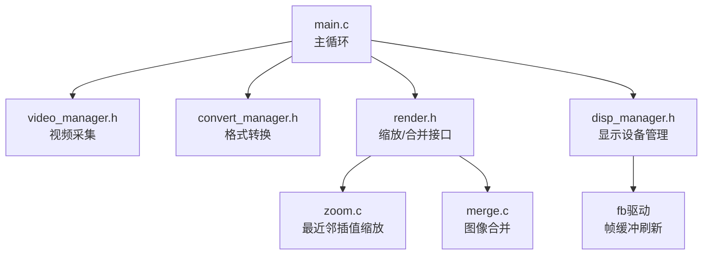
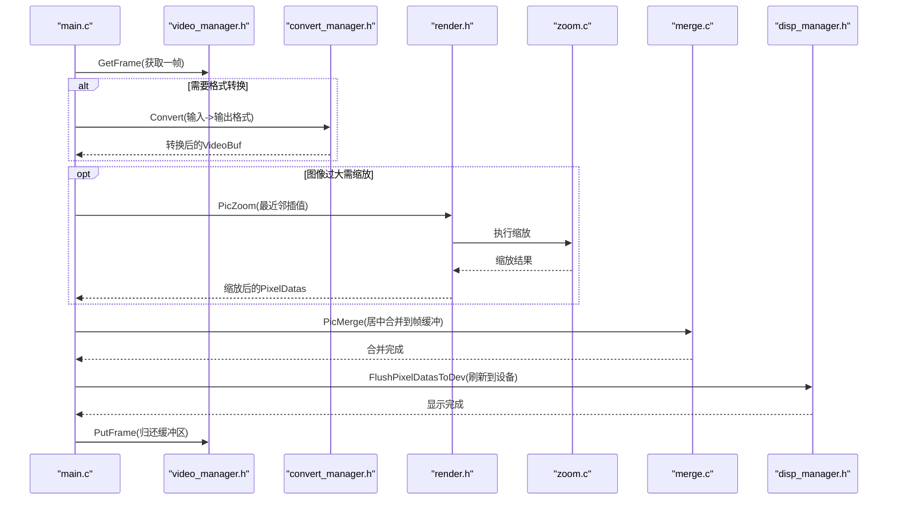
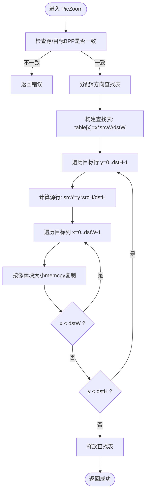
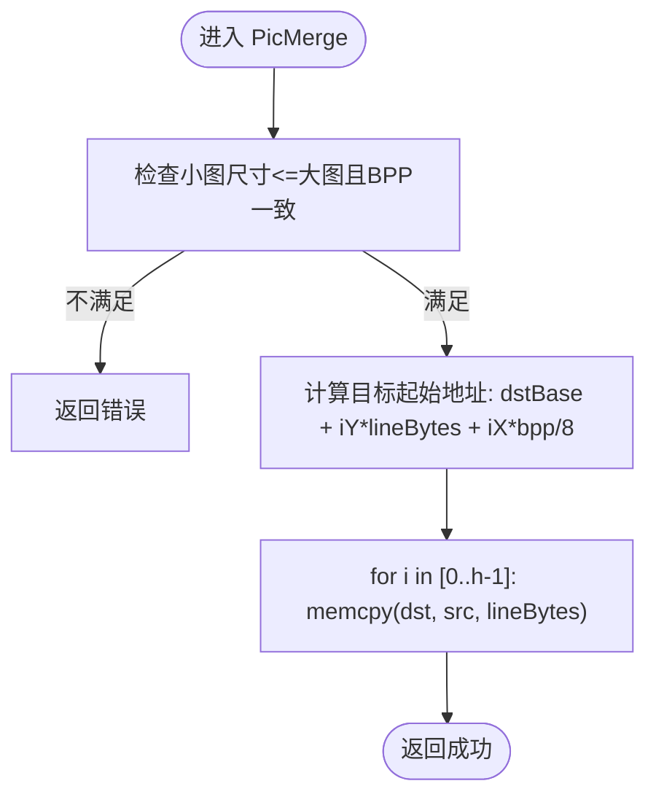
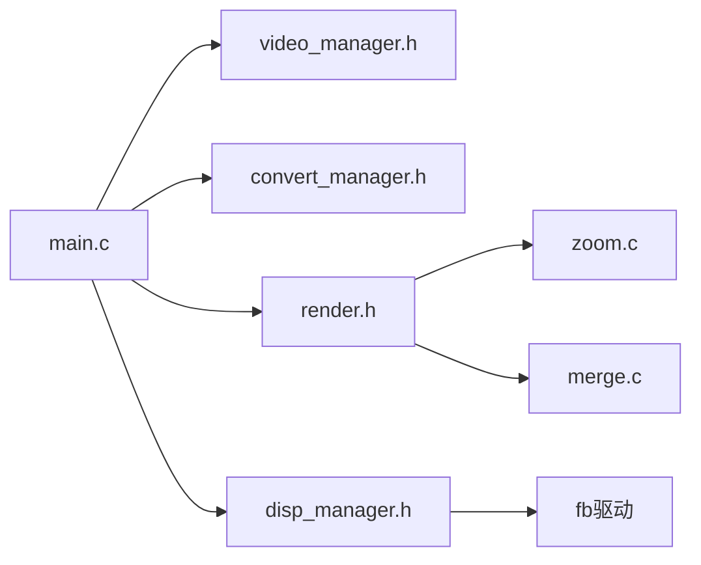

# 图像处理引擎

<cite>
**本文引用的文件**
- [zoom.c](file://video2lcd/render/operation/zoom.c)
- [merge.c](file://video2lcd/render/operation/merge.c)
- [pic_operation.h](file://video2lcd/include/pic_operation.h)
- [render.h](file://video2lcd/include/render.h)
- [main.c](file://video2lcd/main.c)
- [config.h](file://video2lcd/include/config.h)
- [disp_manager.h](file://video2lcd/include/disp_manager.h)
- [video_manager.h](file://video2lcd/include/video_manager.h)
- [convert_manager.h](file://video2lcd/include/convert_manager.h)
</cite>

## 目录
1. [简介](#简介)
2. [项目结构](#项目结构)
3. [核心组件](#核心组件)
4. [架构总览](#架构总览)
5. [详细组件分析](#详细组件分析)
6. [依赖关系分析](#依赖关系分析)
7. [性能与内存优化](#性能与内存优化)
8. [故障排查指南](#故障排查指南)
9. [结论](#结论)
10. [附录：API使用示例与最佳实践](#附录api使用示例与最佳实践)

## 简介
本图像处理引擎面向嵌入式Linux相机应用，提供从摄像头采集、格式转换、图像缩放到合并显示的一体化流程。核心算法包括：
- 最近邻插值缩放：以目标像素为中心映射回源图坐标，直接复制像素，速度快但可能出现锯齿。
- 图像合并：将小图按指定位置复制到大图或区域间拷贝，支持行对齐的批量memcpy以提升吞吐。

该引擎通过统一的数据结构描述像素数据（尺寸、色深、行字节数、缓冲区指针），在渲染层实现缩放与合并，并在主循环中完成采集、转换、缩放、居中合并与刷新显示的完整流水线。

## 项目结构
工程采用分层模块化设计：
- video：V4L2视频采集封装
- convert：格式转换（YUV/MJPEG->RGB等）
- render：图像处理操作（缩放、合并）
- display：显示设备管理（framebuffer）
- include：公共头文件（数据结构、接口声明）
- main.c：主程序编排采集、转换、缩放、合并、显示

图表来源
- [main.c:118-178](file://video2lcd/main.c#L118-L178)
- [render.h:15-36](file://video2lcd/include/render.h#L15-L36)
- [zoom.c:27-84](file://video2lcd/render/operation/zoom.c#L27-L84)
- [merge.c:20-45](file://video2lcd/render/operation/merge.c#L20-L45)
- [disp_manager.h:229-233](file://video2lcd/include/disp_manager.h#L229-L233)

章节来源
- [main.c:1-192](file://video2lcd/main.c#L1-L192)
- [render.h:1-40](file://video2lcd/include/render.h#L1-L40)
- [zoom.c:1-86](file://video2lcd/render/operation/zoom.c#L1-L86)
- [merge.c:1-89](file://video2lcd/render/operation/merge.c#L1-L89)
- [disp_manager.h:1-236](file://video2lcd/include/disp_manager.h#L1-L236)

## 核心组件
- 像素数据描述符 PT_PixelDatas：统一描述图像宽高、色深、行字节数、总字节数与像素缓冲区指针，贯穿采集、转换、缩放、合并与显示各模块。
- 缩放 PicZoom：基于最近邻插值的逐行缩放，构建X方向查找表加速映射，按行memcpy复制像素块。
- 合并 PicMerge/PicMergeRegion：将小图复制到目标图的指定位置，或区域到区域的拷贝；包含边界检测与BPP一致性校验。
- 显示刷新 FlushPixelDatasToDev：将像素数据刷新到显示设备（如framebuffer）。

章节来源
- [pic_operation.h:5-17](file://video2lcd/include/pic_operation.h#L5-L17)
- [render.h:15-36](file://video2lcd/include/render.h#L15-L36)
- [zoom.c:27-84](file://video2lcd/render/operation/zoom.c#L27-L84)
- [merge.c:20-88](file://video2lcd/render/operation/merge.c#L20-L88)
- [disp_manager.h:229-233](file://video2lcd/include/disp_manager.h#L229-L233)

## 架构总览
主循环负责协调视频采集、格式转换、缩放、合并与显示刷新。当输入分辨率大于LCD时，进行等比例缩放并居中合并到帧缓冲区，再刷新至硬件。

图表来源
- [main.c:118-178](file://video2lcd/main.c#L118-L178)
- [render.h:15-36](file://video2lcd/include/render.h#L15-L36)
- [zoom.c:27-84](file://video2lcd/render/operation/zoom.c#L27-L84)
- [merge.c:20-45](file://video2lcd/render/operation/merge.c#L20-L45)
- [disp_manager.h:229-233](file://video2lcd/include/disp_manager.h#L229-L233)

## 详细组件分析

### 最近邻插值缩放算法（PicZoom）
- 原理
  - 对每个目标像素(x,y)，计算其在源图中的对应坐标(srcX, srcY)。
  - X方向通过查找表 pdwSrcXTable[x] = x * srcWidth / dstWidth 预计算，避免重复除法。
  - Y方向按行计算：srcY = y * srcHeight / dstHeight。
  - 每行内按像素块大小（bpp/8）memcpy复制，减少函数调用开销。
- 边界处理
  - 当前实现假设dstWidth <= srcWidth且dstHeight <= srcHeight（由上层控制），未做越界保护。
  - 若存在缩放大于原图的需求，应增加边界裁剪与填充逻辑。
- 质量与性能
  - 最近邻插值速度最快，但可能产生锯齿；如需平滑可引入双线性/双三次插值。
  - 性能关键点：查找表构建O(dstWidth)、逐行memcpy O(dstWidth*dstHeight)、内存分配仅一次。
- 错误处理
  - 检查源与目标BPP一致，不一致返回错误。
  - 查找表分配失败返回错误。

图表来源
- [zoom.c:27-84](file://video2lcd/render/operation/zoom.c#L27-L84)

章节来源
- [zoom.c:1-86](file://video2lcd/render/operation/zoom.c#L1-L86)

### 图像合并（PicMerge / PicMergeRegion）
- PicMerge
  - 将小图整体复制到目标图的(iX,iY)起始位置。
  - 边界检测：确保小图尺寸不超过大图，且BPP一致。
  - 行级memcpy，步长为各自iLineBytes，保证内存对齐与高效传输。
- PicMergeRegion
  - 支持区域到区域的拷贝，参数包含新图起点、旧图起点、宽度和高度。
  - 边界检测：四个坐标均在各自图像范围内。
  - 按行拷贝宽度为 iWidth * bpp/8 的块，步长分别为新旧图的行字节数。

图表来源
- [merge.c:20-45](file://video2lcd/render/operation/merge.c#L20-L45)

章节来源
- [merge.c:1-89](file://video2lcd/render/operation/merge.c#L1-L89)

### 数据结构与缓冲区管理
- PT_PixelDatas
  - iWidth/iHeight：图像宽高
  - iBpp：每像素位数
  - iLineBytes：一行字节数（含可能的padding）
  - iTotalBytes：总字节数
  - aucPixelDatas：像素数据首地址
- 缓冲区生命周期
  - 主循环中为缩放结果分配一次性内存，复用直至进程结束。
  - 帧缓冲区通过显示管理模块获取，直接与设备显存映射。
  - 视频缓冲区通过V4L2机制获取与归还。

章节来源
- [pic_operation.h:5-17](file://video2lcd/include/pic_operation.h#L5-L17)
- [main.c:109-178](file://video2lcd/main.c#L109-L178)
- [disp_manager.h:157-197](file://video2lcd/include/disp_manager.h#L157-L197)

## 依赖关系分析
- main.c 依赖 video_manager、convert_manager、render、disp_manager。
- render 依赖 pic_operation 数据结构。
- zoom.c 与 merge.c 实现 render 接口。
- disp_manager 提供显示设备抽象与刷新接口。

图表来源
- [main.c:1-192](file://video2lcd/main.c#L1-L192)
- [render.h:1-40](file://video2lcd/include/render.h#L1-L40)
- [zoom.c:1-86](file://video2lcd/render/operation/zoom.c#L1-L86)
- [merge.c:1-89](file://video2lcd/render/operation/merge.c#L1-L89)
- [disp_manager.h:1-236](file://video2lcd/include/disp_manager.h#L1-L236)

章节来源
- [main.c:1-192](file://video2lcd/main.c#L1-L192)
- [render.h:1-40](file://video2lcd/include/render.h#L1-L40)
- [disp_manager.h:1-236](file://video2lcd/include/disp_manager.h#L1-L236)

## 性能与内存优化
- 缩放性能
  - 使用X方向查找表避免重复除法，降低CPU开销。
  - 按行memcpy整行数据，减少逐像素访问的函数调用与分支。
  - 建议：若目标分辨率较大，考虑SIMD指令或多线程分块处理。
- 合并性能
  - 行级memcpy利用内存连续性与缓存友好性。
  - 建议：对齐行字节数以提升DMA/总线效率。
- 内存管理
  - 缩放缓冲区一次性分配并复用，避免频繁malloc/free。
  - 帧缓冲区通过显示管理模块统一管理，减少用户态拷贝。
- 质量与性能的权衡
  - 最近邻插值速度快但边缘有锯齿；如需高质量，可引入双线性插值或后处理锐化。
- 调试与测量
  - 启用DBG_PRINTF打印关键路径信息，定位瓶颈。
  - 使用系统工具（perf、valgrind）分析热点与内存泄漏。

[本节为通用指导，不直接分析具体文件]

## 故障排查指南
- 常见错误
  - BPP不一致：缩放或合并前需确保源与目标像素格式一致。
  - 越界访问：合并时需严格校验坐标与尺寸，防止写入非法内存。
  - 内存分配失败：查找表或缩放缓冲区分配失败时应及时返回并清理资源。
- 调试方法
  - 打印源/目标尺寸、BPP、缓冲区地址，确认数据布局正确。
  - 逐步注释关键步骤，定位问题所在阶段（采集、转换、缩放、合并、刷新）。
- 日志开关
  - 通过配置宏控制调试输出，便于生产环境关闭冗余日志。

章节来源
- [config.h:13-18](file://video2lcd/include/config.h#L13-L18)
- [zoom.c:44-56](file://video2lcd/render/operation/zoom.c#L44-L56)
- [merge.c:26-32](file://video2lcd/render/operation/merge.c#L26-L32)
- [merge.c:67-74](file://video2lcd/render/operation/merge.c#L67-L74)

## 结论
该图像处理引擎以简洁高效的最近邻插值缩放和行级memcpy合并为核心，配合统一的像素数据描述符与显示管理模块，实现了从采集到显示的完整流水线。在嵌入式环境下，通过查找表与批量内存拷贝显著提升了性能。后续可在保持性能的前提下引入更高质量的插值算法与并行化策略，进一步优化视觉体验与吞吐能力。

[本节为总结，不直接分析具体文件]

## 附录：API使用示例与最佳实践
- 缩放 API
  - 调用前准备：确保目标PixelDatas已分配内存，设置宽高、BPP、行字节数与总字节数。
  - 调用 PicZoom 执行缩放，完成后释放目标缓冲区。
  - 参考路径：[zoom.c:27-84](file://video2lcd/render/operation/zoom.c#L27-L84)
- 合并 API
  - 调用 PicMerge 将小图合并到大图指定位置，注意边界检测与BPP一致。
  - 调用 PicMergeRegion 进行区域到区域的拷贝，确保坐标合法。
  - 参考路径：[merge.c:20-45](file://video2lcd/render/operation/merge.c#L20-L45), [merge.c:60-88](file://video2lcd/render/operation/merge.c#L60-L88)
- 主循环集成
  - 获取视频帧 -> 格式转换（可选）-> 缩放（可选）-> 居中合并到帧缓冲 -> 刷新显示 -> 归还帧。
  - 参考路径：[main.c:118-178](file://video2lcd/main.c#L118-L178)
- 最佳实践
  - 统一使用 PT_PixelDatas 描述图像，避免裸指针传递带来的歧义。
  - 尽量按行进行内存操作，减少逐像素访问。
  - 合理设置行字节数以对齐内存，提升DMA/总线效率。
  - 在生产环境关闭调试输出，减少I/O开销。

章节来源
- [main.c:118-178](file://video2lcd/main.c#L118-L178)
- [render.h:15-36](file://video2lcd/include/render.h#L15-L36)
- [zoom.c:27-84](file://video2lcd/render/operation/zoom.c#L27-L84)
- [merge.c:20-88](file://video2lcd/render/operation/merge.c#L20-L88)
- [config.h:13-18](file://video2lcd/include/config.h#L13-L18)