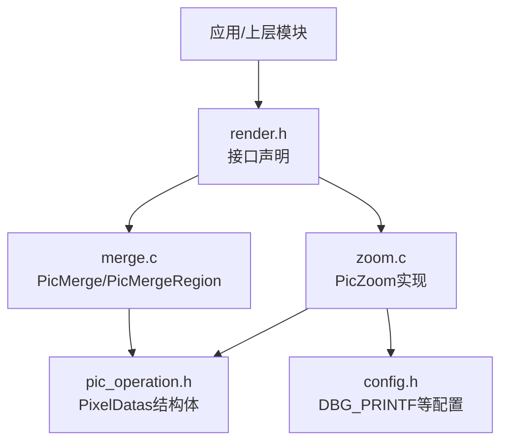
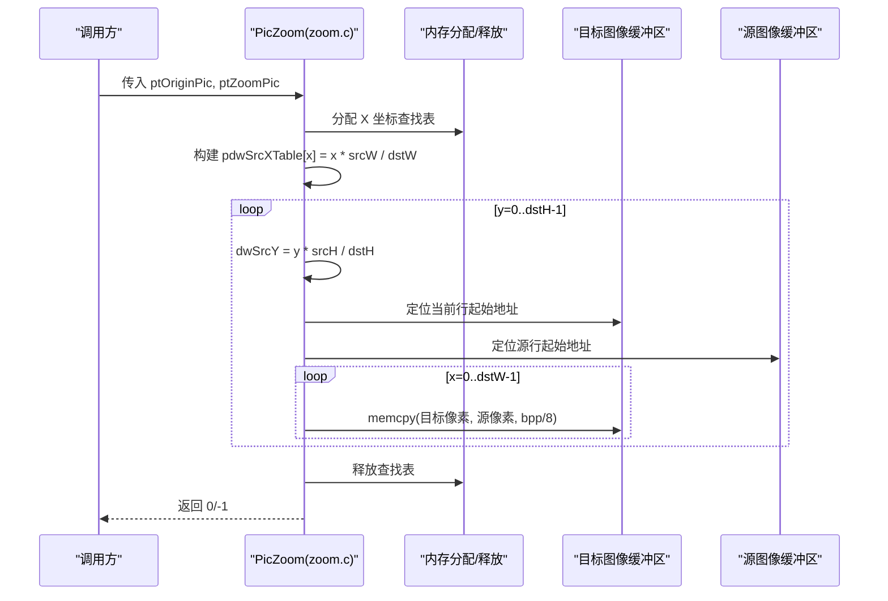
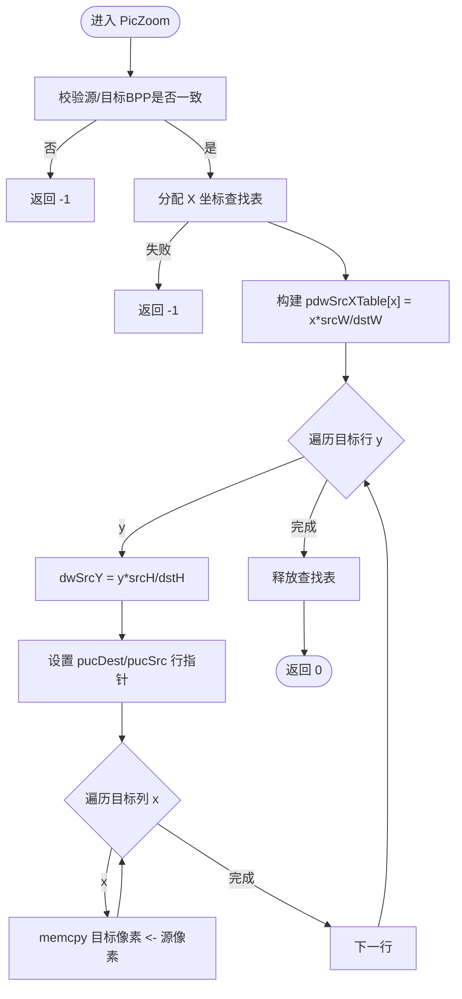
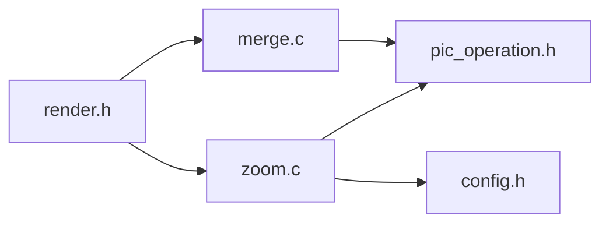

# 图像缩放算法

<cite>
**本文引用的文件**
- [zoom.c](file://video2lcd/render/operation/zoom.c)
- [pic_operation.h](file://video2lcd/include/pic_operation.h)
- [render.h](file://video2lcd/include/render.h)
- [config.h](file://video2lcd/include/config.h)
- [merge.c](file://video2lcd/render/operation/merge.c)
</cite>

## 目录
1. [简介](#简介)
2. [项目结构](#项目结构)
3. [核心组件](#核心组件)
4. [架构总览](#架构总览)
5. [详细组件分析](#详细组件分析)
6. [依赖关系分析](#依赖关系分析)
7. [性能考量](#性能考量)
8. [故障排查指南](#故障排查指南)
9. [结论](#结论)
10. [附录](#附录)

## 简介
本文件面向嵌入式Linux相机项目中“图像缩放”模块，重点解析最近邻插值算法的实现原理与工程实践。文档围绕 PicZoom 函数展开，系统说明坐标映射表的构建、逐行缩放处理、内存操作优化、边界处理机制、像素复制策略，以及质量与性能的权衡和最佳实践。同时提供使用示例（参数校验、内存分配、错误处理）、调试技巧与常见问题解决方案，帮助读者在资源受限的嵌入式环境中高效、稳定地使用缩放功能。

## 项目结构
本项目将图像处理相关能力按“渲染操作”组织，其中缩放与合并分别位于 render/operation 目录下；数据结构定义于 include 下的 pic_operation.h；接口声明于 render.h；配置与调试宏位于 config.h。

图表来源
- [render.h:15-39](file://video2lcd/include/render.h#L15-L39)
- [zoom.c:11-85](file://video2lcd/render/operation/zoom.c#L11-L85)
- [merge.c:8-46](file://video2lcd/render/operation/merge.c#L8-L46)
- [pic_operation.h:10-17](file://video2lcd/include/pic_operation.h#L10-L17)
- [config.h:13-18](file://video2lcd/include/config.h#L13-L18)

章节来源
- [render.h:15-39](file://video2lcd/include/render.h#L15-L39)
- [zoom.c:11-85](file://video2lcd/render/operation/zoom.c#L11-L85)
- [merge.c:8-46](file://video2lcd/render/operation/merge.c#L8-L46)
- [pic_operation.h:10-17](file://video2lcd/include/pic_operation.h#L10-L17)
- [config.h:13-18](file://video2lcd/include/config.h#L13-L18)

## 核心组件
- PixelDatas：统一描述图像数据的结构体，包含宽、高、色深、行字节数、总字节数及像素数据指针。所有图像操作均基于该结构进行。
- PicZoom：实现最近邻插值的图像缩放，输入源图像和目标图像结构体，输出目标图像像素数据。
- PicMerge/PicMergeRegion：用于图像区域拷贝与合并，常与缩放结果结合使用。

章节来源
- [pic_operation.h:10-17](file://video2lcd/include/pic_operation.h#L10-L17)
- [render.h:15-39](file://video2lcd/include/render.h#L15-L39)
- [zoom.c:17-85](file://video2lcd/render/operation/zoom.c#L17-L85)
- [merge.c:11-89](file://video2lcd/render/operation/merge.c#L11-L89)

## 架构总览
PicZoom 通过“X方向坐标查找表 + Y方向直接计算”的方式完成最近邻插值缩放，避免每像素重复除法运算，提升性能。整体流程如下：

图表来源
- [zoom.c:27-85](file://video2lcd/render/operation/zoom.c#L27-L85)

章节来源
- [zoom.c:27-85](file://video2lcd/render/operation/zoom.c#L27-L85)

## 详细组件分析

### PicZoom 实现细节
- 输入/输出约定
  - 输入：源图像结构体 ptOriginPic，目标图像结构体 ptZoomPic（需预先分配好目标缓冲）。
  - 输出：无；返回值 0 表示成功，非 0 表示失败。
- 关键步骤
  - 参数校验：检查源与目标的位深（BPP）是否一致，不一致则返回错误。
  - 分配临时表：为每个目标列分配一个 X 坐标映射项，大小为 dstW。
  - 构建 X 坐标查找表：pdwSrcXTable[x] = floor(x * srcW / dstW)，实现从目标X到源X的映射。
  - 逐行处理：对每一行 y，计算对应的源行 dwSrcY = floor(y * srcH / dstH)。
  - 像素复制：对目标行的每个像素 x，直接从源行 pdwSrcXTable[x] 处复制 bpp/8 字节到目标位置。
  - 释放临时表：完成后释放分配的查找表。
- 复杂度
  - 时间复杂度：O(dstW * dstH)，线性于目标像素数量。
  - 空间复杂度：O(dstW)，用于存储 X 坐标查找表。
- 边界处理
  - 由于映射公式为 floor(x * srcW / dstW)，当 dstW > srcW（放大）时，可能出现 pdwSrcXTable[x] 等于或接近 srcW-1 的情况，但不会越界；当 dstW < srcW（缩小）时，多个目标像素可能映射到同一源像素，属于正常“像素复制”。
  - 未显式做裁剪判断，依赖映射公式保证索引不越界。
- 内存与性能优化
  - 使用 memcpy 整块复制每像素（bpp/8 字节），减少循环开销。
  - 预计算 X 坐标映射表，避免内层循环中的除法与乘法。
  - 行级指针步进，利用 iLineBytes 对齐访问，提高缓存局部性。
  - 仅分配一次查找表，复用至整图缩放结束。

图表来源
- [zoom.c:27-85](file://video2lcd/render/operation/zoom.c#L27-L85)

章节来源
- [zoom.c:27-85](file://video2lcd/render/operation/zoom.c#L27-L85)

### 坐标转换关系与 X 坐标查找表
- 坐标映射
  - 目标坐标 (x, y) -> 源坐标 (floor(x * srcW / dstW), floor(y * srcH / dstH))
  - 该映射确保在缩小时多对一（像素复制），放大时一对一或近邻采样。
- X 坐标查找表作用
  - 将每列的源X坐标预计算并缓存，避免内层循环重复计算，显著降低 CPU 开销。
  - 查找表大小为目标宽度，占用 O(dstW) 额外内存。
- 构建过程
  - 对 x 从 0 到 dstW-1，计算 pdwSrcXTable[x] = x * srcW / dstW。
  - 整数除法等价于向下取整，符合最近邻采样逻辑。

章节来源
- [zoom.c:58-62](file://video2lcd/render/operation/zoom.c#L58-L62)
- [zoom.c:68-79](file://video2lcd/render/operation/zoom.c#L68-L79)

### 逐行缩放与内存操作
- 行计算
  - 对目标行 y，计算源行 dwSrcY = y * srcH / dstH。
- 指针定位
  - 目标行起始：pucDest = dest.aucPixelDatas + y * dest.iLineBytes
  - 源行起始：pucSrc = src.aucPixelDatas + dwSrcY * src.iLineBytes
- 像素复制
  - 每像素复制长度为 bpp/8 字节，使用 memcpy 批量复制，减少函数调用与分支开销。
- 行步长
  - 使用 iLineBytes 作为行步长，考虑可能的行填充对齐，确保跨行正确移动。

章节来源
- [zoom.c:64-80](file://video2lcd/render/operation/zoom.c#L64-L80)

### 边界处理与像素复制策略
- 边界安全
  - 映射公式保证 pdwSrcXTable[x] 始终小于 srcW，因此不会出现越界读取。
  - 对于放大场景，若出现 pdwSrcXTable[x] 超出有效范围（理论上不应发生），应增加边界保护；当前实现依赖数学性质保证安全。
- 像素复制
  - 最近邻插值本质是“复制”，即目标像素直接取自最近的源像素，不进行加权平均，因此速度快但可能出现锯齿。
- 行对齐与填充
  - 通过 iLineBytes 处理可能的行填充字节，确保在不同平台/驱动下都能正确访问行数据。

章节来源
- [zoom.c:44-80](file://video2lcd/render/operation/zoom.c#L44-L80)

### 使用示例（参数验证、内存分配、错误处理）
- 参数验证
  - 确保源与目标图像的 BPP 一致，否则缩放无法进行。
  - 确保目标图像已分配足够内存（iTotalBytes = iLineBytes * iHeight）。
- 内存分配要求
  - 目标缓冲由调用方负责分配与释放；PicZoom 内部仅分配临时查找表并在结束时释放。
- 错误处理
  - BPP 不一致：返回 -1。
  - 分配失败：返回 -1。
  - 成功：返回 0。
- 典型调用流程
  - 准备源图像结构体（含宽高、BPP、行字节、总字节、像素指针）。
  - 准备目标图像结构体（目标宽高、相同BPP、计算行字节与总字节、分配像素缓冲）。
  - 调用 PicZoom，检查返回值。
  - 使用完毕后释放目标缓冲。

章节来源
- [zoom.c:44-56](file://video2lcd/render/operation/zoom.c#L44-L56)
- [zoom.c:83-85](file://video2lcd/render/operation/zoom.c#L83-L85)
- [pic_operation.h:10-17](file://video2lcd/include/pic_operation.h#L10-L17)

### 缩放质量与性能权衡
- 质量
  - 最近邻插值简单快速，但在放大时可能出现明显锯齿与块状效应。
- 性能
  - 时间复杂度 O(dstW*dstH)，常数因子小；空间复杂度 O(dstW)。
  - 适合实时视频流或资源受限设备。
- 最佳实践
  - 优先选择与原分辨率相近的目标尺寸，减少放大倍数。
  - 若需要更高画质，可考虑双线性/双三次插值（需额外实现与更大计算量）。
  - 合理设置目标宽高，避免过大放大导致视觉质量下降。

章节来源
- [zoom.c:1-9](file://video2lcd/render/operation/zoom.c#L1-L9)

### 调试技巧与常见问题
- 调试输出
  - 启用 DBG_PRINTF 打印源/目标图像信息（宽高、BPP、数据指针），便于核对输入是否正确。
- 常见问题
  - 目标缓冲未分配或太小：会导致写入越界；请确保 iTotalBytes 计算正确且已分配。
  - BPP 不一致：缩放会失败；请确保源/目标格式一致。
  - 行字节计算错误：可能导致错位；请确认 iLineBytes 包含可能的行填充。
  - 放大后锯齿严重：属最近邻特性；如需平滑，考虑更高级插值算法。
- 建议
  - 在开发阶段保留 DBG_PRINTF，发布前关闭以减小开销。
  - 对异常输入（如零宽高）增加前置校验，提前返回错误。

章节来源
- [config.h:13-18](file://video2lcd/include/config.h#L13-L18)
- [zoom.c:38-43](file://video2lcd/render/operation/zoom.c#L38-L43)

## 依赖关系分析
- 模块耦合
  - zoom.c 依赖 pic_operation.h 的数据结构定义。
  - zoom.c 通过 render.h 暴露接口供上层调用。
  - merge.c 提供图像合并能力，可与缩放结果配合使用。
- 外部依赖
  - 标准库 malloc/free/memcpy/printf 用于内存与IO。
  - 配置宏 DBG_PRINTF 控制调试输出。

图表来源
- [render.h:15-39](file://video2lcd/include/render.h#L15-L39)
- [zoom.c:11-14](file://video2lcd/render/operation/zoom.c#L11-L14)
- [merge.c:8-9](file://video2lcd/render/operation/merge.c#L8-L9)
- [pic_operation.h:10-17](file://video2lcd/include/pic_operation.h#L10-L17)
- [config.h:13-18](file://video2lcd/include/config.h#L13-L18)

章节来源
- [render.h:15-39](file://video2lcd/include/render.h#L15-L39)
- [zoom.c:11-14](file://video2lcd/render/operation/zoom.c#L11-L14)
- [merge.c:8-9](file://video2lcd/render/operation/merge.c#L8-L9)
- [pic_operation.h:10-17](file://video2lcd/include/pic_operation.h#L10-L17)
- [config.h:13-18](file://video2lcd/include/config.h#L13-L18)

## 性能考量
- 时间复杂度：O(dstW*dstH)，线性增长，适合实时处理。
- 空间复杂度：O(dstW)，查找表占用随目标宽度线性增长。
- 内存访问模式：行顺序访问，利用 iLineBytes 步长，提高缓存命中率。
- 优化点
  - 预计算 X 坐标映射表，避免内层除法。
  - 使用 memcpy 批量复制像素，减少循环开销。
  - 仅在必要时启用 DBG_PRINTF，降低 I/O 开销。
- 扩展建议
  - 针对特定硬件（如 SIMD）可进一步向量化复制与映射计算。
  - 对超大图像分块处理，降低峰值内存占用。

[本节为通用性能讨论，无需具体文件引用]

## 故障排查指南
- 现象：缩放后图像模糊或锯齿严重
  - 原因：最近邻插值特性，放大倍数过大。
  - 解决：减小放大比例或改用更高质量插值算法。
- 现象：程序崩溃或段错误
  - 原因：目标缓冲未分配或 iLineBytes/iTotalBytes 计算错误。
  - 解决：确保目标缓冲分配正确，核对行字节与总字节计算。
- 现象：返回 -1
  - 原因：BPP 不一致或内存分配失败。
  - 解决：检查源/目标格式一致性，检查可用内存。
- 现象：显示错位或花屏
  - 原因：行字节未包含填充或指针步进错误。
  - 解决：确认 iLineBytes 正确设置，使用行步长而非宽度*字节数。

章节来源
- [zoom.c:44-56](file://video2lcd/render/operation/zoom.c#L44-L56)
- [merge.c:26-46](file://video2lcd/render/operation/merge.c#L26-L46)

## 结论
PicZoom 采用最近邻插值，通过 X 坐标查找表与逐行复制实现高效缩放，适用于嵌入式实时场景。其优势在于实现简单、计算量低、内存占用可控；劣势为放大时可能出现锯齿。在实际工程中，应严格校验输入参数、正确分配目标缓冲、合理使用行字节步长，并结合场景需求权衡质量与性能。对于更高画质需求，可在后续迭代中引入更复杂的插值算法。

[本节为总结性内容，无需具体文件引用]

## 附录
- 数据结构参考
  - PixelDatas：包含 iWidth、iHeight、iBpp、iLineBytes、iTotalBytes、aucPixelDatas。
- 接口参考
  - PicZoom：图像缩放接口。
  - PicMerge/PicMergeRegion：图像合并接口。
- 配置参考
  - DBG_PRINTF：调试输出宏开关。

章节来源
- [pic_operation.h:10-17](file://video2lcd/include/pic_operation.h#L10-L17)
- [render.h:15-39](file://video2lcd/include/render.h#L15-L39)
- [config.h:13-18](file://video2lcd/include/config.h#L13-L18)