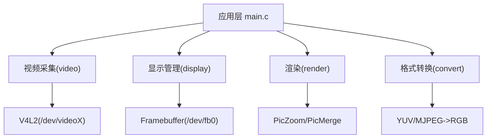
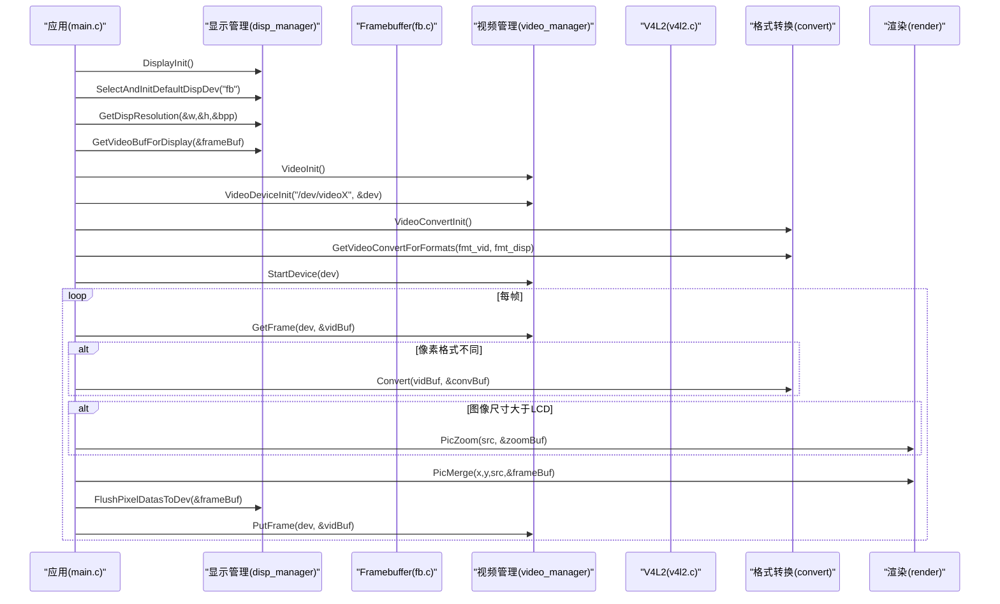
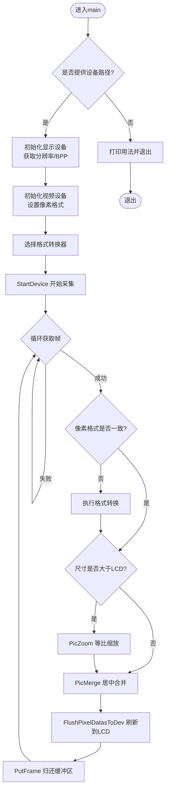
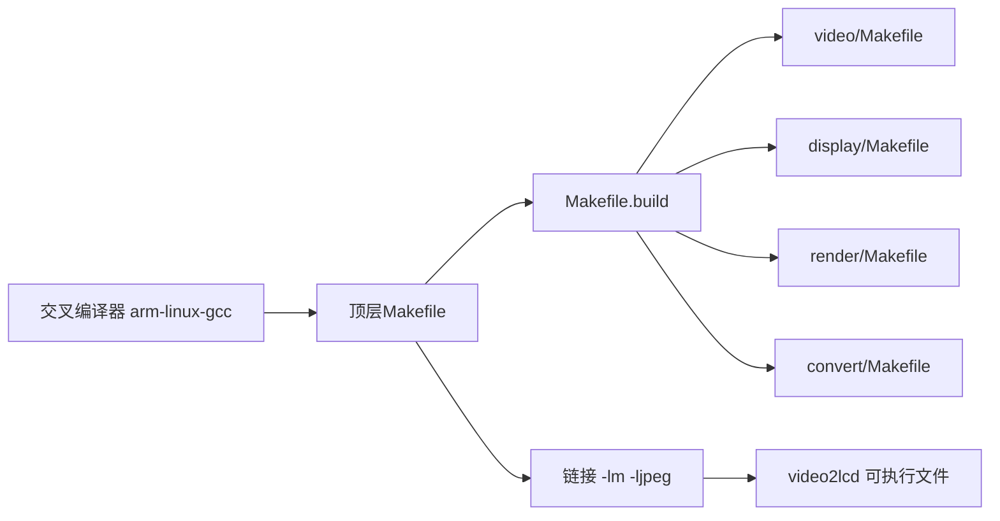

# 快速开始

<cite>
**本文引用的文件**
- [main.c](file://video2lcd/main.c)
- [Makefile](file://video2lcd/Makefile)
- [Makefile.build](file://video2lcd/Makefile.build)
- [config.h](file://video2lcd/include/config.h)
- [disp_manager.h](file://video2lcd/include/disp_manager.h)
- [video_manager.h](file://video2lcd/include/video_manager.h)
- [render.h](file://video2lcd/include/render.h)
- [pic_operation.h](file://video2lcd/include/pic_operation.h)
- [video/Makefile](file://video2lcd/video/Makefile)
- [display/Makefile](file://video2lcd/display/Makefile)
- [render/Makefile](file://video2lcd/render/Makefile)
- [convert/Makefile](file://video2lcd/convert/Makefile)
- [嵌入式Linux相机项目学习笔记.md](file://video2lcd/doc/嵌入式Linux相机项目学习笔记.md)
</cite>

## 目录
1. [简介](#简介)
2. [项目结构](#项目结构)
3. [核心组件](#核心组件)
4. [架构总览](#架构总览)
5. [详细组件分析](#详细组件分析)
6. [依赖分析](#依赖分析)
7. [性能考虑](#性能考虑)
8. [故障排除指南](#故障排除指南)
9. [结论](#结论)
10. [附录：验证与演示](#附录：验证与演示)

## 简介
本指南面向首次接触该项目的开发者，目标是帮助你在最短时间内完成开发环境准备、交叉编译、运行程序并看到摄像头画面实时显示在LCD上。项目通过V4L2从摄像头采集图像，经格式转换、缩放后，写入Framebuffer驱动对应的显存区域，最终在LCD上呈现。

## 项目结构
项目采用分层与模块化设计，顶层Makefile负责递归构建各子模块，并将所有目标链接为单一可执行文件。主要目录职责如下：
- video：视频采集抽象与V4L2实现
- display：显示设备抽象与Framebuffer实现
- render：图像渲染（缩放、合并）
- convert：像素格式转换（YUV/MJPEG到RGB等）
- include：公共头文件与配置宏
- main.c：应用主流程编排

图表来源
- [main.c:34-192](file://video2lcd/main.c#L34-L192)
- [video/Makefile:1-3](file://video2lcd/video/Makefile#L1-L3)
- [display/Makefile:1-2](file://video2lcd/display/Makefile#L1-L2)
- [render/Makefile:1-2](file://video2lcd/render/Makefile#L1-L2)
- [convert/Makefile:1-7](file://video2lcd/convert/Makefile#L1-L7)

章节来源
- [Makefile:17-43](file://video2lcd/Makefile#L17-L43)
- [Makefile.build:33-44](file://video2lcd/Makefile.build#L33-L44)

## 核心组件
- 视频采集：通过VideoOpr接口抽象摄像头操作，具体由V4L2实现；使用VideoDevice描述设备状态，VideoBuf承载一帧数据。
- 显示管理：DispOpr抽象LCD设备，fb.c提供Framebuffer实现；支持获取分辨率、分配/刷新显存。
- 渲染：PicZoom按宽高比缩放图像，PicMerge将小图合并到大图（如帧缓冲）。
- 格式转换：根据摄像头输出与LCD像素格式差异，选择合适转换器进行转换。
- 配置：config.h定义调试输出宏与Framebuffer设备路径。

章节来源
- [video_manager.h:14-56](file://video2lcd/include/video_manager.h#L14-L56)
- [disp_manager.h:84-233](file://video2lcd/include/disp_manager.h#L84-L233)
- [render.h:15-36](file://video2lcd/include/render.h#L15-L36)
- [config.h:13-18](file://video2lcd/include/config.h#L13-L18)

## 架构总览
下图展示从应用启动到画面显示的调用序列，涵盖设备初始化、帧获取、格式转换、缩放、合并与刷新。

图表来源
- [main.c:63-189](file://video2lcd/main.c#L63-L189)
- [disp_manager.h:117-233](file://video2lcd/include/disp_manager.h#L117-L233)
- [video_manager.h:35-56](file://video2lcd/include/video_manager.h#L35-L56)
- [render.h:15-36](file://video2lcd/include/render.h#L15-L36)

## 详细组件分析

### 应用主流程（main.c）
- 参数校验与用法提示：要求传入摄像头设备路径（如/dev/video0）。
- 显示初始化：注册并选择Framebuffer显示设备，获取分辨率与BPP，获取用于显示的帧缓冲区指针。
- 视频初始化：注册并初始化V4L2设备，设置像素格式与分辨率。
- 格式转换：根据摄像头输出与LCD像素格式匹配转换器。
- 主循环：获取一帧→必要时格式转换→必要时缩放→居中合并到帧缓冲→刷新到LCD→归还缓冲区。

图表来源
- [main.c:34-192](file://video2lcd/main.c#L34-L192)

章节来源
- [main.c:34-192](file://video2lcd/main.c#L34-L192)

### 显示管理（disp_manager.h / fb.c）
- 抽象DispOpr接口，支持多显示设备注册与切换。
- 提供分辨率查询、显存分配、清屏、页面显示、刷新到设备等能力。
- fb.c实现Framebuffer设备的具体操作，映射/dev/fb0到用户空间内存。

章节来源
- [disp_manager.h:84-233](file://video2lcd/include/disp_manager.h#L84-L233)

### 视频管理（video_manager.h / v4l2.c）
- 抽象VideoOpr接口，封装摄像头设备的通用操作（初始化、启停、取帧、还帧）。
- VideoDevice保存设备句柄、像素格式、分辨率、缓冲区数组等。
- v4l2.c基于V4L2标准ioctl完成设备能力查询、格式枚举、缓冲区申请与mmap映射、流式采集。

章节来源
- [video_manager.h:14-56](file://video2lcd/include/video_manager.h#L14-L56)
- [嵌入式Linux相机项目学习笔记.md:123-224](file://video2lcd/doc/嵌入式Linux相机项目学习笔记.md#L123-L224)

### 渲染（render.h / operation/*）
- PicZoom：最近邻插值缩放，保持宽高比，避免拉伸变形。
- PicMerge：将处理后的图像块拷贝到目标区域（如帧缓冲），支持指定左上角坐标。

章节来源
- [render.h:15-36](file://video2lcd/include/render.h#L15-L36)

### 格式转换（convert/*）
- 根据摄像头输出与LCD像素格式差异，选择合适的转换函数（如YUV→RGB、MJPEG→RGB）。
- 依赖libjpeg库进行JPEG解码。

章节来源
- [convert/Makefile:1-7](file://video2lcd/convert/Makefile#L1-L7)

## 依赖分析
- 交叉编译器：arm-linux-gcc（可通过CROSS_COMPILE前缀配置）
- 数学库：-lm
- JPEG库：-ljpeg（用于MJPEG解码）
- 系统接口：V4L2（/dev/videoX）、Framebuffer（/dev/fb0）

构建系统说明：
- 顶层Makefile定义工具链、编译选项、链接选项、目标名与子模块集合。
- Makefile.build递归构建各子目录，生成built-in.o并最终链接为目标二进制。

图表来源
- [Makefile:17-43](file://video2lcd/Makefile#L17-L43)
- [Makefile.build:33-44](file://video2lcd/Makefile.build#L33-L44)
- [video/Makefile:1-3](file://video2lcd/video/Makefile#L1-L3)
- [display/Makefile:1-2](file://video2lcd/display/Makefile#L1-L2)
- [render/Makefile:1-2](file://video2lcd/render/Makefile#L1-L2)
- [convert/Makefile:1-7](file://video2lcd/convert/Makefile#L1-L7)

章节来源
- [Makefile:17-43](file://video2lcd/Makefile#L17-L43)
- [Makefile.build:33-44](file://video2lcd/Makefile.build#L33-L44)

## 性能考虑
- 双缓冲机制：先在内存中准备图像，再一次性刷新到显存，减少闪烁。
- 等比缩放：避免全屏拉伸导致的失真与额外计算。
- 像素格式直转：当摄像头输出与LCD格式不一致时，仅做必要转换，减少拷贝。
- 缓冲区复用：V4L2流式模式下，mmap映射内核缓冲区，避免频繁malloc/free。

[本节为通用指导，不直接分析具体文件]

## 故障排除指南
- 权限问题
  - 现象：打开/dev/videoX或/dev/fb0失败
  - 排查：确认当前用户具备相应设备访问权限；必要时以root运行或调整设备节点权限
- 设备访问错误
  - 现象：VideoDeviceInit或GetFrame返回错误
  - 排查：检查摄像头设备是否存在且未被占用；确认V4L2驱动已加载；查看系统日志
- 显示异常
  - 现象：屏幕无显示或花屏
  - 排查：确认Framebuffer设备路径正确（/dev/fb0）；检查分辨率与BPP是否与硬件匹配；确保已调用刷新函数
- 格式不支持
  - 现象：找不到合适的格式转换器
  - 排查：确认摄像头输出格式与LCD像素格式；必要时调整摄像头输出格式或启用对应转换模块
- 编译错误
  - 缺少库：安装libjpeg与math库；确认交叉编译工具链可用
  - 头文件缺失：确保包含路径指向正确的内核头文件与库头文件

章节来源
- [config.h:13-18](file://video2lcd/include/config.h#L13-L18)
- [main.c:63-107](file://video2lcd/main.c#L63-L107)
- [嵌入式Linux相机项目学习笔记.md:123-224](file://video2lcd/doc/嵌入式Linux相机项目学习笔记.md#L123-L224)

## 结论
本项目通过清晰的模块化设计与统一的接口抽象，实现了从摄像头采集到LCD显示的完整链路。遵循本快速开始指南，你可以在目标平台上完成环境搭建、交叉编译与运行，并在LCD上实时看到摄像头画面。遇到问题时，可依据故障排除指南逐步定位与解决。

[本节为总结性内容，不直接分析具体文件]

## 附录：验证与演示

### 开发环境准备
- 系统要求
  - 宿主机：Linux发行版（用于交叉编译）
  - 目标机：嵌入式Linux系统，已启用V4L2与Framebuffer驱动
- 交叉编译器
  - 安装arm-linux-gcc工具链，并确保可在终端调用
  - 若需自定义前缀，可在顶层Makefile的CROSS_COMPILE变量中修改
- 依赖库
  - libjpeg：用于MJPEG解码
  - math库：-lm（通常随编译器自带）
- 头文件与内核接口
  - 确保能访问V4L2与Framebuffer相关头文件（通常在目标根文件系统或交叉工具链sysroot中）

### 编译步骤
- 进入工程目录：cd video2lcd
- 清理旧产物：make clean
- 执行构建：make
- 输出目标：video2lcd（位于video2lcd目录下）

说明
- 顶层Makefile定义了CFLAGS、LDFLAGS与obj-y集合，并通过Makefile.build递归构建子模块
- 如需调整优化等级或调试信息，可修改CFLAGS中的-O与-g选项

章节来源
- [Makefile:17-43](file://video2lcd/Makefile#L17-L43)
- [Makefile.build:33-44](file://video2lcd/Makefile.build#L33-L44)

### 运行方法
- 基本命令
  - ./video2lcd /dev/video0
- 参数说明
  - 第一个参数为摄像头设备路径，常见为/dev/video0、/dev/video1等
- 预期行为
  - 程序启动后，LCD上将显示摄像头实时画面；若图像尺寸大于LCD，会自动等比缩放并居中显示

章节来源
- [main.c:57-61](file://video2lcd/main.c#L57-L61)
- [main.c:63-107](file://video2lcd/main.c#L63-L107)

### 常见问题速查
- 无法打开摄像头
  - 检查设备节点是否存在与权限；尝试其他/videoX编号
- 画面黑屏或无刷新
  - 确认已调用刷新函数；检查Framebuffer设备路径与分辨率
- 画面颜色异常
  - 检查像素格式转换是否正确；确认LCD的BPP与像素布局
- 编译时报错缺少库
  - 安装libjpeg；确认交叉工具链与sysroot中包含所需库

章节来源
- [config.h:13-18](file://video2lcd/include/config.h#L13-L18)
- [main.c:129-178](file://video2lcd/main.c#L129-L178)

### 验证安装成功的测试步骤
- 步骤1：在宿主机执行make clean && make，确认生成video2lcd可执行文件
- 步骤2：将video2lcd拷贝至目标机，赋予执行权限
- 步骤3：在目标机执行./video2lcd /dev/video0
- 步骤4：观察LCD是否出现摄像头实时画面；移动摄像头，画面应同步变化
- 步骤5：若画面过大，确认是否自动缩放并居中；若颜色异常，检查像素格式与转换逻辑

[本节为操作步骤说明，不直接分析具体文件]