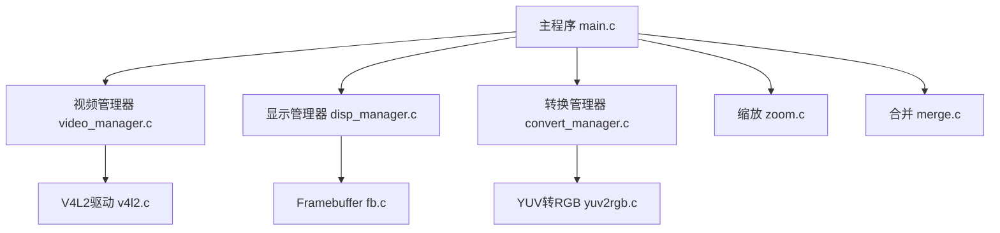
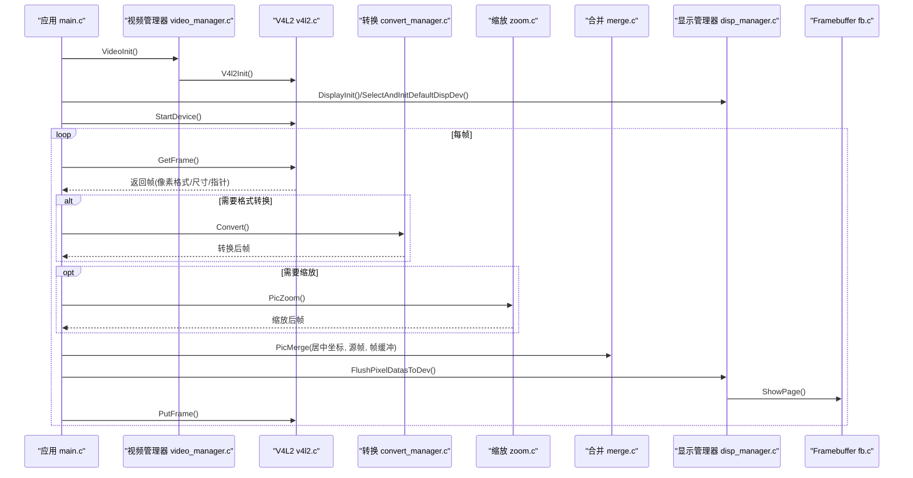
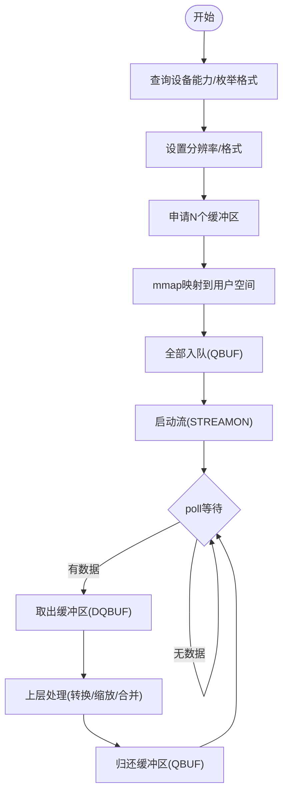
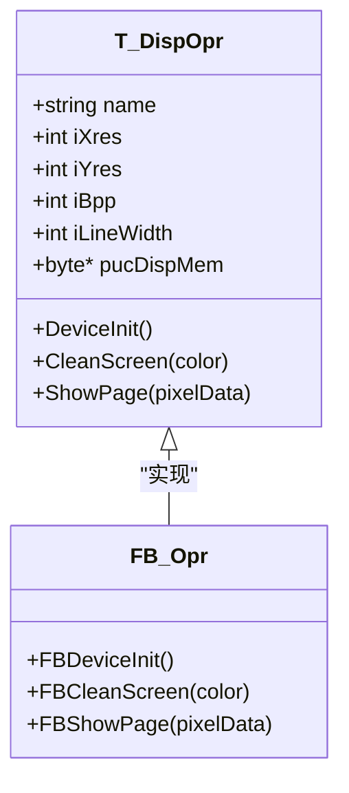
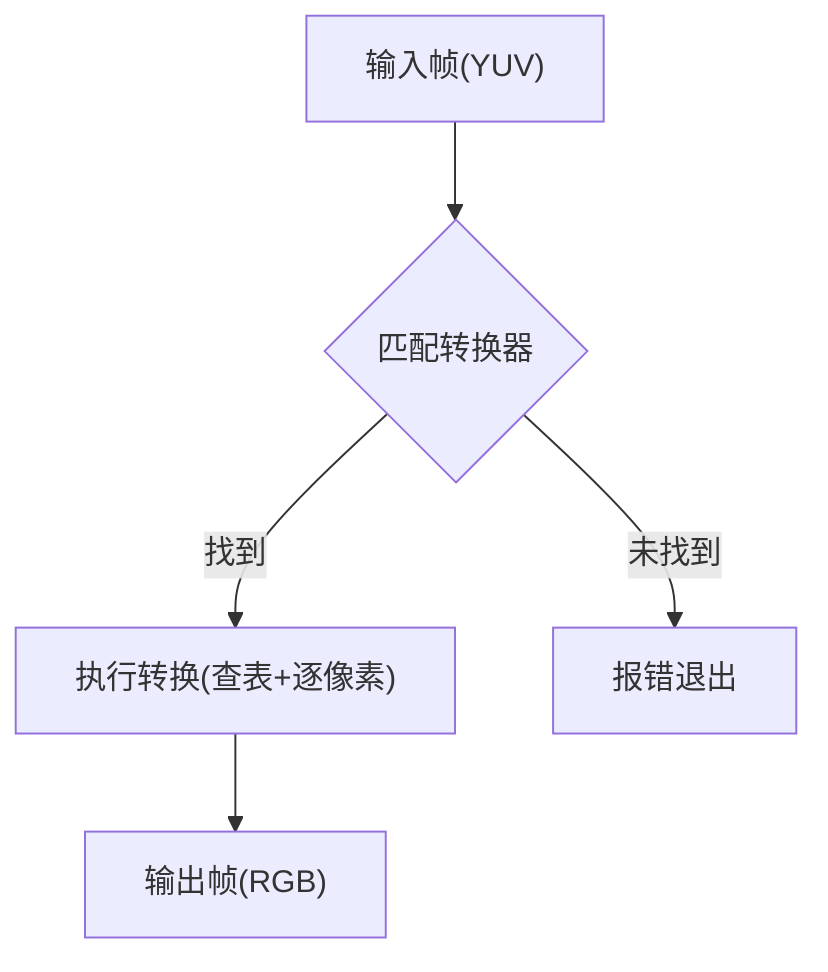
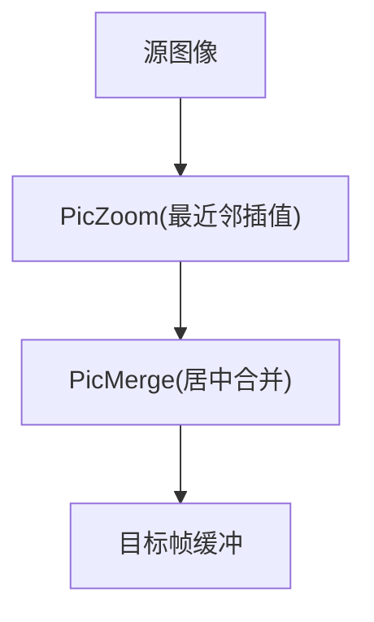
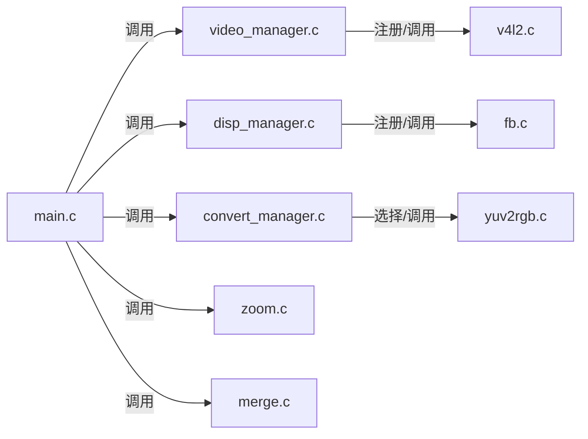

# 性能分析与优化

<cite>
**本文引用的文件**
- [main.c](file://video2lcd/main.c)
- [video_manager.c](file://video2lcd/video/video_manager.c)
- [v4l2.c](file://video2lcd/video/v4l2.c)
- [disp_manager.c](file://video2lcd/display/disp_manager.c)
- [fb.c](file://video2lcd/display/fb.c)
- [convert_manager.c](file://video2lcd/convert/convert_manager.c)
- [yuv2rgb.c](file://video2lcd/convert/yuv2rgb.c)
- [zoom.c](file://video2lcd/render/operation/zoom.c)
- [merge.c](file://video2lcd/render/operation/merge.c)
- [config.h](file://video2lcd/include/config.h)
</cite>

## 目录
1. [简介](#简介)
2. [项目结构](#项目结构)
3. [核心组件](#核心组件)
4. [架构总览](#架构总览)
5. [详细组件分析](#详细组件分析)
6. [依赖关系分析](#依赖关系分析)
7. [性能考量与优化策略](#性能考量与优化策略)
8. [故障排查指南](#故障排查指南)
9. [结论](#结论)
10. [附录：基准测试与工具使用](#附录：基准测试与工具使用)

## 简介
本文件面向嵌入式Linux相机到LCD显示链路（视频采集→格式转换→缩放→合并→帧缓冲显示）的性能分析与优化。重点覆盖：
- 实时性保证：时间片管理、优先级调度、延迟控制
- CPU利用率优化：算法复杂度优化、并行计算、资源调度
- 内存使用优化：内存池管理、垃圾回收、碎片整理
- 性能分析工具：perf、valgrind等集成与应用
- 瓶颈识别方法与调优最佳实践
- 基准测试设计与对比分析方法

## 项目结构
系统由以下模块组成，形成“采集—转换—渲染—显示”的流水线：
- 主程序：协调初始化、循环处理帧数据、刷新显示
- 视频模块：基于V4L2的设备初始化、缓冲区管理、流式取帧/还帧
- 显示模块：Framebuffer设备注册、显存映射、页面刷新
- 转换模块：按输入/输出像素格式动态选择转换器（YUV→RGB等）
- 渲染操作：图像缩放（最近邻插值）、区域合并（居中显示）
- 配置头：调试宏、设备路径等

**图表来源**
- [main.c:34-192](file://video2lcd/main.c#L34-L192)
- [video_manager.c:67-75](file://video2lcd/video/video_manager.c#L67-L75)
- [v4l2.c:47-401](file://video2lcd/video/v4l2.c#L47-L401)
- [disp_manager.c:100-175](file://video2lcd/display/disp_manager.c#L100-L175)
- [fb.c:53-174](file://video2lcd/display/fb.c#L53-L174)
- [convert_manager.c:23-131](file://video2lcd/convert/convert_manager.c#L23-L131)
- [yuv2rgb.c:161-232](file://video2lcd/convert/yuv2rgb.c#L161-L232)
- [zoom.c:27-85](file://video2lcd/render/operation/zoom.c#L27-L85)
- [merge.c:20-46](file://video2lcd/render/operation/merge.c#L20-L46)

**章节来源**
- [main.c:34-192](file://video2lcd/main.c#L34-L192)
- [video_manager.c:67-75](file://video2lcd/video/video_manager.c#L67-L75)
- [disp_manager.c:100-175](file://video2lcd/display/disp_manager.c#L100-L175)
- [convert_manager.c:23-131](file://video2lcd/convert/convert_manager.c#L23-L131)

## 核心组件
- 主循环与流程控制：负责设备初始化、帧获取、格式转换、缩放、合并、刷新显示、归还缓冲区
- 视频采集：V4L2流式模式，poll等待数据就绪，DQBUF/QBUF循环，mmap零拷贝
- 显示刷新：Framebuffer映射显存，批量复制或直接写入，ShowPage刷新
- 格式转换：根据输入输出格式动态选择转换器，支持YUV→RGB565/RGB32
- 渲染操作：最近邻插值缩放、行级memcpy合并

**章节来源**
- [main.c:117-189](file://video2lcd/main.c#L117-L189)
- [v4l2.c:267-326](file://video2lcd/video/v4l2.c#L267-L326)
- [fb.c:166-174](file://video2lcd/display/fb.c#L166-L174)
- [convert_manager.c:98-131](file://video2lcd/convert/convert_manager.c#L98-L131)
- [yuv2rgb.c:161-232](file://video2lcd/convert/yuv2rgb.c#L161-L232)
- [zoom.c:27-85](file://video2lcd/render/operation/zoom.c#L27-L85)
- [merge.c:20-46](file://video2lcd/render/operation/merge.c#L20-L46)

## 架构总览
下图展示从摄像头到LCD的关键调用序列，体现零拷贝、队列化缓冲与批处理刷新的设计。

**图表来源**
- [main.c:117-189](file://video2lcd/main.c#L117-L189)
- [v4l2.c:267-326](file://video2lcd/video/v4l2.c#L267-L326)
- [convert_manager.c:98-131](file://video2lcd/convert/convert_manager.c#L98-L131)
- [zoom.c:27-85](file://video2lcd/render/operation/zoom.c#L27-L85)
- [merge.c:20-46](file://video2lcd/render/operation/merge.c#L20-L46)
- [disp_manager.c:172-175](file://video2lcd/display/disp_manager.c#L172-L175)
- [fb.c:166-174](file://video2lcd/display/fb.c#L166-L174)

## 详细组件分析

### 视频采集（V4L2流式模式）
- 设备能力检测与格式枚举，选择支持的像素格式
- 请求并映射多个缓冲区（mmap），入队后启动流
- 使用poll等待数据就绪，DQBUF取帧，处理后QBUF归还
- 优势：零拷贝、低延迟、高吞吐

**图表来源**
- [v4l2.c:47-249](file://video2lcd/video/v4l2.c#L47-L249)
- [v4l2.c:267-326](file://video2lcd/video/v4l2.c#L267-L326)

**章节来源**
- [v4l2.c:47-249](file://video2lcd/video/v4l2.c#L47-L249)
- [v4l2.c:267-326](file://video2lcd/video/v4l2.c#L267-L326)

### 显示刷新（Framebuffer）
- 打开/dev/fb0，获取屏幕信息，mmap显存
- ShowPage将待显示像素数据复制到显存或直写显存
- 支持不同BPP的颜色填充与清屏

**图表来源**
- [fb.c:37-43](file://video2lcd/display/fb.c#L37-L43)
- [fb.c:53-174](file://video2lcd/display/fb.c#L53-L174)

**章节来源**
- [fb.c:53-174](file://video2lcd/display/fb.c#L53-L174)
- [disp_manager.c:100-175](file://video2lcd/display/disp_manager.c#L100-L175)

### 格式转换（YUV→RGB）
- 通过转换器链表匹配输入/输出格式
- YUV422Packed到RGB565/RGB32的逐像素转换，使用查找表加速
- 按需分配输出缓冲区，避免重复分配

**图表来源**
- [convert_manager.c:98-131](file://video2lcd/convert/convert_manager.c#L98-L131)
- [yuv2rgb.c:161-232](file://video2lcd/convert/yuv2rgb.c#L161-L232)

**章节来源**
- [convert_manager.c:98-131](file://video2lcd/convert/convert_manager.c#L98-L131)
- [yuv2rgb.c:161-232](file://video2lcd/convert/yuv2rgb.c#L161-L232)

### 渲染操作（缩放与合并）
- 缩放：最近邻插值，构建X坐标查找表，按行复制像素
- 合并：按行memcpy将小图拼到大图指定位置（居中）

**图表来源**
- [zoom.c:27-85](file://video2lcd/render/operation/zoom.c#L27-L85)
- [merge.c:20-46](file://video2lcd/render/operation/merge.c#L20-L46)

**章节来源**
- [zoom.c:27-85](file://video2lcd/render/operation/zoom.c#L27-L85)
- [merge.c:20-46](file://video2lcd/render/operation/merge.c#L20-L46)

## 依赖关系分析
- 主程序依赖各管理器接口，解耦具体实现
- 视频/显示/转换模块通过链表注册与查找，便于扩展
- 运行时依赖顺序：DisplayInit → VideoInit → 选择默认显示设备 → 启动设备 → 循环处理

**图表来源**
- [main.c:34-192](file://video2lcd/main.c#L34-L192)
- [video_manager.c:67-75](file://video2lcd/video/video_manager.c#L67-L75)
- [disp_manager.c:514-521](file://video2lcd/display/disp_manager.c#L514-L521)
- [convert_manager.c:121-131](file://video2lcd/convert/convert_manager.c#L121-L131)

**章节来源**
- [main.c:34-192](file://video2lcd/main.c#L34-L192)
- [video_manager.c:67-75](file://video2lcd/video/video_manager.c#L67-L75)
- [disp_manager.c:514-521](file://video2lcd/display/disp_manager.c#L514-L521)
- [convert_manager.c:121-131](file://video2lcd/convert/convert_manager.c#L121-L131)

## 性能考量与优化策略

### 实时性保证机制
- 时间片管理与阻塞等待
  - 使用poll等待V4L2数据就绪，避免忙轮询，降低CPU占用
  - 建议为采集线程设置较高实时优先级（SCHED_FIFO/SCHED_RR），确保及时取帧
- 优先级调度
  - 采集/处理/显示可分线程：采集线程优先，处理次之，显示最低；或使用单线程但减少临界区
- 延迟控制
  - 多缓冲策略（NB_BUFFER=4）平滑抖动，避免丢帧
  - 限制每帧处理耗时，必要时跳过非关键步骤（如跳过缩放）

**章节来源**
- [v4l2.c:267-326](file://video2lcd/video/v4l2.c#L267-L326)
- [main.c:117-189](file://video2lcd/main.c#L117-L189)

### CPU利用率优化
- 算法复杂度优化
  - 缩放采用最近邻插值，时间复杂度O(W×H)，适合嵌入式快速处理
  - 合并使用行级memcpy，减少函数调用开销
- 并行计算
  - 若平台支持多线程，可将转换与缩放/合并并行化（注意锁与缓存一致性）
  - 利用SIMD指令（如NEON）加速YUV→RGB转换
- 资源调度
  - 合理设置I/O优先级与CPU亲和性，绑定采集/处理到专用核
  - 关闭不必要的调试输出（DBG_PRINTF）以降低I/O开销

**章节来源**
- [zoom.c:27-85](file://video2lcd/render/operation/zoom.c#L27-L85)
- [merge.c:20-46](file://video2lcd/render/operation/merge.c#L20-L46)
- [yuv2rgb.c:161-232](file://video2lcd/convert/yuv2rgb.c#L161-L232)
- [config.h:13-15](file://video2lcd/include/config.h#L13-L15)

### 内存使用优化
- 内存池管理
  - 复用缩放/转换输出缓冲区，避免频繁malloc/free
  - 在display模块中已有VideoMem池概念，可扩展用于中间帧缓存
- 垃圾回收
  - 及时释放转换/缩放临时缓冲区，防止泄漏
  - 统一在ConvertExit/ZoomExit中释放
- 碎片整理
  - 预分配固定大小缓冲，减少碎片
  - 使用连续内存（如mmap显存）进行大块数据传输

**章节来源**
- [yuv2rgb.c:207-232](file://video2lcd/convert/yuv2rgb.c#L207-L232)
- [disp_manager.c:178-337](file://video2lcd/display/disp_manager.c#L178-L337)
- [main.c:158-166](file://video2lcd/main.c#L158-L166)

### I/O与带宽优化
- 零拷贝路径
  - V4L2 mmap与Framebuffer直接写入，避免额外拷贝
- 批量传输
  - ShowPage尽量整屏拷贝，减少多次小写
- 对齐与步长
  - 使用iLineBytes进行行拷贝，提升缓存命中率

**章节来源**
- [v4l2.c:152-219](file://video2lcd/video/v4l2.c#L152-L219)
- [fb.c:166-174](file://video2lcd/display/fb.c#L166-L174)
- [merge.c:38-44](file://video2lcd/render/operation/merge.c#L38-L44)

### 错误处理与健壮性
- 设备打开/IOCTL失败时尽早返回，避免悬挂状态
- 缓冲区操作前检查有效性（尺寸/BPP/边界）
- 提供清晰的错误日志（可通过配置开关）

**章节来源**
- [v4l2.c:47-249](file://video2lcd/video/v4l2.c#L47-L249)
- [fb.c:53-174](file://video2lcd/display/fb.c#L53-L174)
- [merge.c:26-32](file://video2lcd/render/operation/merge.c#L26-L32)

## 故障排查指南
- 无法打开设备
  - 检查权限与设备节点是否存在
  - 查看ioctl返回值与错误码
- 格式不支持
  - 确认枚举到的像素格式与期望一致
  - 检查转换器是否注册成功
- 显示异常
  - 验证BPP与行步长设置
  - 确认ShowPage是否被调用且参数正确
- 内存问题
  - 使用工具检测泄漏与越界访问
  - 关注malloc/free配对与缓冲区生命周期

**章节来源**
- [v4l2.c:47-249](file://video2lcd/video/v4l2.c#L47-L249)
- [fb.c:53-174](file://video2lcd/display/fb.c#L53-L174)
- [convert_manager.c:121-131](file://video2lcd/convert/convert_manager.c#L121-L131)

## 结论
该链路通过V4L2流式采集、mmap零拷贝、Framebuffer直写与模块化转换/渲染，具备较低的端到端延迟与较高的吞吐潜力。进一步优化方向包括：
- 引入更高精度时间戳与帧率统计，量化实时性
- 使用SIMD/多线程加速转换与缩放
- 完善VideoMem池以复用中间缓冲，减少分配开销
- 结合性能工具定位热点，持续迭代优化

[本节不直接分析具体文件]

## 附录：基准测试与工具使用

### 性能指标定义
- 帧率FPS：单位时间内完成的帧数
- 端到端延迟：从GetFrame到FlushPixelDatasToDev的时间
- CPU占用：各阶段CPU使用率
- 内存峰值：最大驻留内存与分配次数

### 数据采集方法
- 在关键路径插入高精度计时（如clock_gettime），统计每阶段耗时
- 记录每帧的GetFrame/PutFrame、Convert、Zoom、Merge、ShowPage耗时
- 统计malloc/free次数与峰值内存

**章节来源**
- [main.c:117-189](file://video2lcd/main.c#L117-L189)
- [v4l2.c:267-326](file://video2lcd/video/v4l2.c#L267-L326)
- [fb.c:166-174](file://video2lcd/display/fb.c#L166-L174)

### 工具集成与应用
- perf
  - 火焰图定位热点函数（如Pyuv422torgb565、PicZoom、PicMerge）
  - 事件计数：cpu-clock、cache-misses、page-faults
- valgrind
  - memcheck检测内存泄漏与越界
  - cachegrind分析缓存命中情况
- ftrace/kprobes
  - 跟踪V4L2 ioctl与mmap调用时序
- 系统监控
  - top/htop观察CPU占用
  - /proc/meminfo与smem分析内存使用

**章节来源**
- [yuv2rgb.c:50-149](file://video2lcd/convert/yuv2rgb.c#L50-L149)
- [zoom.c:27-85](file://video2lcd/render/operation/zoom.c#L27-L85)
- [merge.c:20-46](file://video2lcd/render/operation/merge.c#L20-L46)

### 瓶颈识别与调优建议
- 热点函数优化
  - 对YUV→RGB转换使用SIMD/查表优化
  - 缩放考虑双线性插值与GPU加速（若可用）
- I/O瓶颈
  - 增大V4L2缓冲区数量，降低poll频率
  - 合并显示区域，减少ShowPage调用次数
- 内存瓶颈
  - 预分配中间缓冲，减少malloc/free
  - 使用VideoMem池管理显示缓冲

**章节来源**
- [v4l2.c:132-219](file://video2lcd/video/v4l2.c#L132-L219)
- [disp_manager.c:178-337](file://video2lcd/display/disp_manager.c#L178-L337)
- [yuv2rgb.c:161-232](file://video2lcd/convert/yuv2rgb.c#L161-L232)