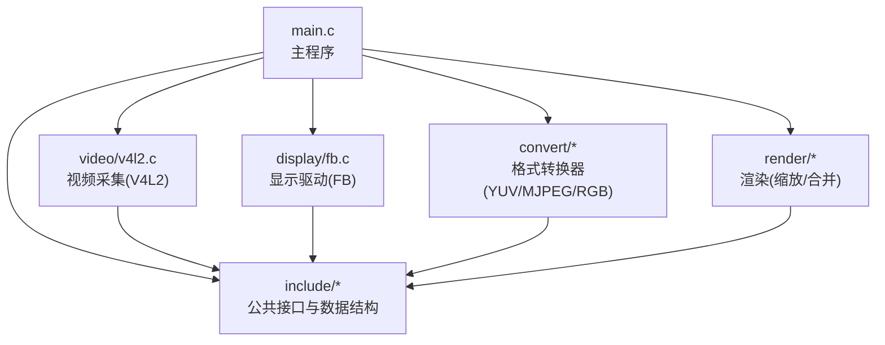
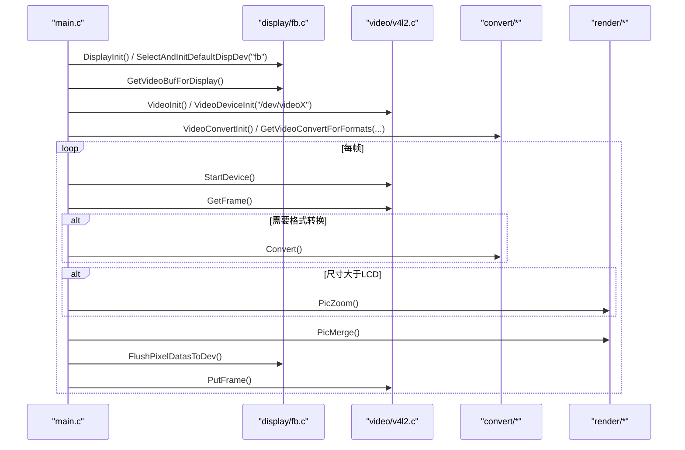
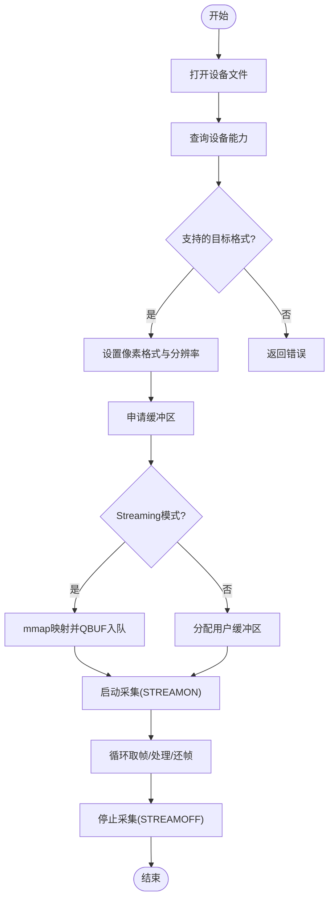
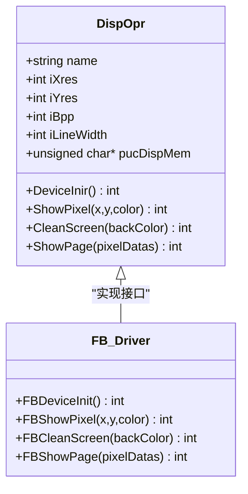
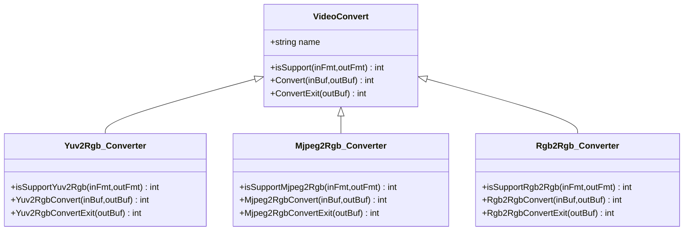
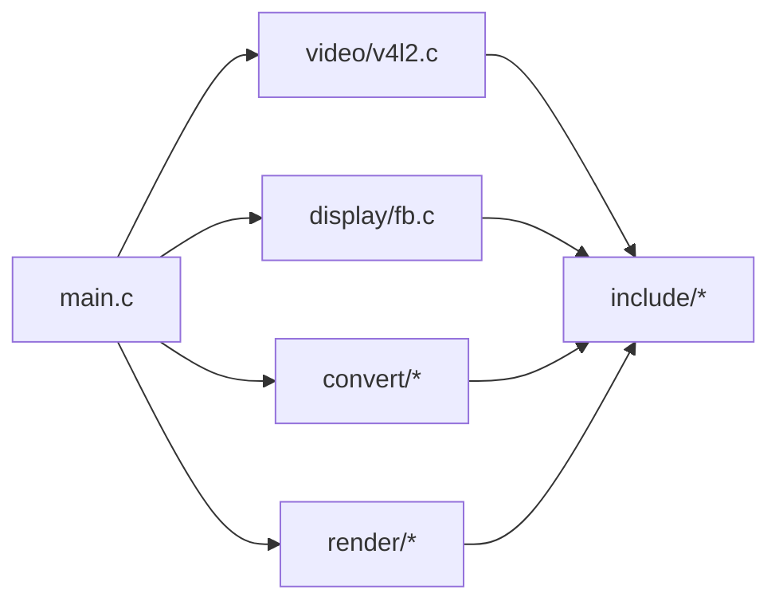

# 扩展开发指南

<cite>
**本文引用的文件**
- [main.c](file://video2lcd/main.c)
- [config.h](file://video2lcd/include/config.h)
- [video_manager.h](file://video2lcd/include/video_manager.h)
- [disp_manager.h](file://video2lcd/include/disp_manager.h)
- [convert_manager.h](file://video2lcd/include/convert_manager.h)
- [pic_operation.h](file://video2lcd/include/pic_operation.h)
- [render.h](file://video2lcd/include/render.h)
- [v4l2.c](file://video2lcd/video/v4l2.c)
- [fb.c](file://video2lcd/display/fb.c)
- [yuv2rgb.c](file://video2lcd/convert/yuv2rgb.c)
- [mjpeg2rgb.c](file://video2lcd/convert/mjpeg2rgb.c)
- [rgb2rgb.c](file://video2lcd/convert/rgb2rgb.c)
</cite>

## 目录
1. [简介](#简介)
2. [项目结构](#项目结构)
3. [核心组件](#核心组件)
4. [架构总览](#架构总览)
5. [详细组件分析](#详细组件分析)
6. [依赖关系分析](#依赖关系分析)
7. [性能考虑](#性能考虑)
8. [故障排查指南](#故障排查指南)
9. [结论](#结论)
10. [附录：扩展开发模板与示例工程](#附录：扩展开发模板与示例工程)

## 简介
本指南面向希望在嵌入式Linux相机系统中添加新功能模块与新设备支持的开发者。内容覆盖：
- 新增视频设备的完整流程（驱动接口、插件注册、兼容性测试）
- 新增显示设备的步骤（显示驱动实现、设备适配、性能测试）
- 新增格式转换器的规范（接口实现、格式检测、算法优化）
- 扩展模块的测试方法与质量保证流程
- 最佳实践与常见问题解决方案

本指南以现有代码为基础，提供可操作的步骤、图示和参考路径，帮助快速完成扩展开发。

## 项目结构
系统采用模块化设计，按功能划分目录：
- video：视频采集模块（V4L2驱动封装）
- display：显示模块（Framebuffer驱动封装）
- convert：格式转换模块（YUV/MJPEG/RGB等转换器）
- render：图像渲染（缩放、合并）
- include：公共头文件（数据结构与接口定义）
- main.c：主程序入口，编排采集、转换、渲染、显示流程

图表来源
- [main.c:34-192](file://video2lcd/main.c#L34-L192)
- [v4l2.c:47-401](file://video2lcd/video/v4l2.c#L47-L401)
- [fb.c:53-253](file://video2lcd/display/fb.c#L53-L253)
- [yuv2rgb.c:25-233](file://video2lcd/convert/yuv2rgb.c#L25-L233)
- [mjpeg2rgb.c:38-261](file://video2lcd/convert/mjpeg2rgb.c#L38-L261)
- [rgb2rgb.c:20-152](file://video2lcd/convert/rgb2rgb.c#L20-L152)

章节来源
- [main.c:34-192](file://video2lcd/main.c#L34-L192)
- [config.h:1-21](file://video2lcd/include/config.h#L1-L21)

## 核心组件
- 视频管理接口与设备描述
  - VideoDevice：封装摄像头设备状态（fd、像素格式、分辨率、缓冲区数组、操作函数指针）
  - VideoOpr：抽象摄像头操作接口（初始化、退出、取帧、还帧、启停），支持多驱动注册与选择
- 显示管理接口与设备描述
  - DispOpr：抽象显示设备操作（初始化、画点、清屏、整页显示），支持多显示驱动注册与选择
  - VideoMem：用于加速显示的缓冲机制（内存中准备数据后一次性复制到显存）
- 格式转换管理
  - VideoConvert：抽象格式转换器（名称、是否支持、转换函数、释放函数），支持多转换器注册与自动选择
- 图像处理与渲染
  - T_PixelDatas：统一描述像素数据（宽高、色深、行字节数、总字节数、数据指针）
  - PicZoom/PicMerge：缩放与合并操作，用于将图像适配到LCD并居中显示

章节来源
- [video_manager.h:14-56](file://video2lcd/include/video_manager.h#L14-L56)
- [disp_manager.h:69-96](file://video2lcd/include/disp_manager.h#L69-L96)
- [convert_manager.h:23-46](file://video2lcd/include/convert_manager.h#L23-L46)
- [pic_operation.h:10-18](file://video2lcd/include/pic_operation.h#L10-L18)
- [render.h:15-36](file://video2lcd/include/render.h#L15-L36)

## 架构总览
系统运行流程：
- 初始化显示设备（FB）并获取帧缓冲
- 初始化视频设备（V4L2）并启动采集
- 根据输入输出像素格式选择合适转换器
- 循环取帧、转换、缩放、合并到帧缓冲、刷新显示
- 归还缓冲区给驱动继续采集

图表来源
- [main.c:63-189](file://video2lcd/main.c#L63-L189)
- [v4l2.c:357-383](file://video2lcd/video/v4l2.c#L357-L383)
- [fb.c:166-174](file://video2lcd/display/fb.c#L166-L174)
- [yuv2rgb.c:161-199](file://video2lcd/convert/yuv2rgb.c#L161-L199)
- [mjpeg2rgb.c:145-228](file://video2lcd/convert/mjpeg2rgb.c#L145-L228)
- [rgb2rgb.c:46-120](file://video2lcd/convert/rgb2rgb.c#L46-L120)

## 详细组件分析

### 新增视频设备（V4L2或其他）开发流程
目标：为新的摄像头或视频源添加驱动支持，并通过统一的VideoOpr接口被上层调用。

步骤概览：
- 定义并实现VideoOpr函数集（initDevice、ExitDevice、GetFrame、PutFrame、StartDevice、StopDevice）
- 构造VideoOpr实例并注册到管理器
- 在应用层通过VideoDeviceInit选择并使用该驱动
- 进行兼容性测试（不同格式、分辨率、流式/读写模式）

关键实现要点：
- 设备能力查询与格式枚举：确保仅选择系统支持的格式
- 缓冲区管理：支持Streaming模式（mmap+队列）与ReadWrite模式（read/write）
- 取帧/还帧：正确设置像素格式、行字节数、总字节数及数据指针
- 启停控制：VIDIOC_STREAMON/OFF的正确使用

图表来源
- [v4l2.c:47-249](file://video2lcd/video/v4l2.c#L47-L249)
- [v4l2.c:267-383](file://video2lcd/video/v4l2.c#L267-L383)

章节来源
- [video_manager.h:14-56](file://video2lcd/include/video_manager.h#L14-L56)
- [v4l2.c:47-401](file://video2lcd/video/v4l2.c#L47-L401)

### 新增显示设备（如其他帧缓冲或自定义屏）开发步骤
目标：为新显示设备实现DispOpr接口，并注册到显示管理器。

步骤概览：
- 实现DispOpr函数集（DeviceInir、ShowPixel、CleanScreen、ShowPage）
- 构造DispOpr实例并注册到管理器
- 在主程序中通过SelectAndInitDefaultDispDev选择新设备
- 进行性能测试（清屏、画点、整页显示带宽与时延）

关键实现要点：
- 设备初始化：打开设备、获取屏幕信息、映射显存
- 颜色格式适配：针对不同BPP（8/16/32）进行颜色转换与写入
- 整页显示：高效拷贝或DMA方式将像素数据刷到显存

图表来源
- [disp_manager.h:79-96](file://video2lcd/include/disp_manager.h#L79-L96)
- [fb.c:37-43](file://video2lcd/display/fb.c#L37-L43)
- [fb.c:53-253](file://video2lcd/display/fb.c#L53-L253)

章节来源
- [disp_manager.h:117-154](file://video2lcd/include/disp_manager.h#L117-L154)
- [fb.c:53-253](file://video2lcd/display/fb.c#L53-L253)

### 新增格式转换器开发规范
目标：为新的输入/输出像素格式组合实现转换器，并注册到转换器管理器。

步骤概览：
- 实现VideoConvert接口（isSupport、Convert、ConvertExit）
- 构造VideoConvert实例并注册到管理器
- 在主程序中根据输入输出格式自动选择转换器
- 进行算法优化与性能测试（查找表、SIMD、批处理）

关键实现要点：
- isSupport：精确判断输入/输出格式组合是否支持
- Convert：高效实现像素级转换，注意内存分配与释放
- ConvertExit：释放转换过程中分配的内存，避免泄漏
- 优化策略：查找表、向量化、减少分支、缓存友好访问

图表来源
- [convert_manager.h:23-46](file://video2lcd/include/convert_manager.h#L23-L46)
- [yuv2rgb.c:25-233](file://video2lcd/convert/yuv2rgb.c#L25-L233)
- [mjpeg2rgb.c:38-261](file://video2lcd/convert/mjpeg2rgb.c#L38-L261)
- [rgb2rgb.c:20-152](file://video2lcd/convert/rgb2rgb.c#L20-L152)

章节来源
- [convert_manager.h:23-46](file://video2lcd/include/convert_manager.h#L23-L46)
- [yuv2rgb.c:161-233](file://video2lcd/convert/yuv2rgb.c#L161-L233)
- [mjpeg2rgb.c:145-261](file://video2lcd/convert/mjpeg2rgb.c#L145-L261)
- [rgb2rgb.c:46-152](file://video2lcd/convert/rgb2rgb.c#L46-L152)

### 主程序流程与扩展点
主程序负责协调各模块：
- 初始化显示与视频设备
- 获取帧缓冲与像素格式
- 初始化并选择格式转换器
- 循环取帧、转换、缩放、合并、刷新显示
- 归还缓冲区

扩展点：
- 新增设备驱动：实现对应Opr并注册
- 新增转换器：实现VideoConvert并注册
- 新增渲染操作：扩展PicZoom/PicMerge或新增操作接口

章节来源
- [main.c:34-192](file://video2lcd/main.c#L34-L192)

## 依赖关系分析
- 主程序依赖显示、视频、转换、渲染模块
- 视频模块依赖V4L2内核接口与公共数据结构
- 显示模块依赖Framebuffer内核接口与公共数据结构
- 转换模块依赖libjpeg（MJPEG）与颜色转换工具
- 渲染模块依赖像素数据处理与显示缓冲区

图表来源
- [main.c:34-192](file://video2lcd/main.c#L34-L192)
- [v4l2.c:47-401](file://video2lcd/video/v4l2.c#L47-L401)
- [fb.c:53-253](file://video2lcd/display/fb.c#L53-L253)
- [convert_manager.h:23-46](file://video2lcd/include/convert_manager.h#L23-L46)
- [disp_manager.h:79-96](file://video2lcd/include/disp_manager.h#L79-L96)
- [video_manager.h:14-56](file://video2lcd/include/video_manager.h#L14-L56)

章节来源
- [main.c:34-192](file://video2lcd/main.c#L34-L192)
- [video_manager.h:14-56](file://video2lcd/include/video_manager.h#L14-L56)
- [disp_manager.h:79-96](file://video2lcd/include/disp_manager.h#L79-L96)
- [convert_manager.h:23-46](file://video2lcd/include/convert_manager.h#L23-L46)

## 性能考虑
- 视频采集
  - 优先使用Streaming模式以减少拷贝开销
  - 合理设置缓冲区数量，平衡吞吐与延迟
- 格式转换
  - 使用查找表加速颜色转换（如YUV转RGB）
  - 针对目标平台优化循环与内存访问模式
  - 对MJPEG解码使用行缓冲逐行处理，降低峰值内存
- 显示刷新
  - 尽量整页拷贝或使用DMA，减少多次小写
  - 针对不同BPP的颜色转换需避免多余计算
- 渲染
  - 缩放算法选择最近邻插值时注意边界条件与对齐
  - 合并操作时避免越界与重复拷贝

[本节为通用性能建议，不直接分析具体文件]

## 故障排查指南
常见问题与定位方法：
- 无法打开设备文件
  - 检查设备路径与权限（如/dev/videoX、/dev/fb0）
  - 确认设备节点存在且未被占用
- 格式不支持
  - 检查设备枚举的像素格式是否在支持列表内
  - 确认转换器isSupport逻辑与实际输入输出格式匹配
- 缓冲区相关错误
  - Streaming模式下确认QBUF/DQBUF顺序与索引正确
  - ReadWrite模式下确认read返回值与缓冲区大小
- 显示异常
  - 检查BPP与颜色转换逻辑是否匹配硬件
  - 确认整页显示时数据长度与行字节数一致
- 内存泄漏
  - 转换器ConvertExit中确保释放分配的内存
  - 主循环中避免重复分配未释放的临时缓冲区

章节来源
- [v4l2.c:47-249](file://video2lcd/video/v4l2.c#L47-L249)
- [fb.c:53-253](file://video2lcd/display/fb.c#L53-L253)
- [yuv2rgb.c:207-233](file://video2lcd/convert/yuv2rgb.c#L207-L233)
- [mjpeg2rgb.c:237-261](file://video2lcd/convert/mjpeg2rgb.c#L237-L261)
- [rgb2rgb.c:128-152](file://video2lcd/convert/rgb2rgb.c#L128-L152)

## 结论
通过统一的接口抽象与插件化注册机制，系统能够灵活扩展视频设备、显示设备与格式转换器。遵循本指南的流程与规范，开发者可以快速集成新硬件与算法，同时保证系统的稳定性与可维护性。建议在扩展开发过程中重视兼容性测试与性能优化，建立完善的测试用例与回归验证流程。

[本节为总结性内容，不直接分析具体文件]

## 附录：扩展开发模板与示例工程

### 新增视频设备模板
- 实现VideoOpr函数集
- 构造并注册VideoOpr实例
- 在主程序中通过VideoDeviceInit选择新驱动
- 测试不同格式与分辨率下的稳定性

参考路径
- [video_manager.h:14-56](file://video2lcd/include/video_manager.h#L14-L56)
- [v4l2.c:386-401](file://video2lcd/video/v4l2.c#L386-L401)

### 新增显示设备模板
- 实现DispOpr函数集
- 构造并注册DispOpr实例
- 在主程序中通过SelectAndInitDefaultDispDev选择新设备
- 测试清屏、画点、整页显示性能

参考路径
- [disp_manager.h:79-96](file://video2lcd/include/disp_manager.h#L79-L96)
- [fb.c:249-253](file://video2lcd/display/fb.c#L249-L253)

### 新增格式转换器模板
- 实现VideoConvert接口（isSupport、Convert、ConvertExit）
- 构造并注册VideoConvert实例
- 在主程序中根据输入输出格式自动选择转换器
- 测试不同输入格式与分辨率下的正确性与性能

参考路径
- [convert_manager.h:23-46](file://video2lcd/include/convert_manager.h#L23-L46)
- [yuv2rgb.c:217-233](file://video2lcd/convert/yuv2rgb.c#L217-L233)
- [mjpeg2rgb.c:247-261](file://video2lcd/convert/mjpeg2rgb.c#L247-L261)
- [rgb2rgb.c:138-152](file://video2lcd/convert/rgb2rgb.c#L138-L152)

### 兼容性测试清单
- 视频设备
  - 不同像素格式（YUYV、MJPEG、RGB565）
  - 不同分辨率（与LCD分辨率匹配与不匹配）
  - Streaming与ReadWrite模式切换
- 显示设备
  - 不同BPP（8/16/32）颜色格式
  - 清屏、画点、整页显示带宽与时延
- 格式转换器
  - 输入输出格式组合覆盖
  - 大图像与高分辨率场景下的内存与CPU占用
  - 错误输入（损坏数据）的鲁棒性

### 质量保证流程
- 单元测试：每个模块独立测试接口行为
- 集成测试：端到端流程（采集→转换→渲染→显示）
- 性能基准：FPS、延迟、内存占用、CPU占用
- 回归测试：修改后重新执行全部用例
- 文档更新：接口变更与使用说明同步更新

[本节为通用指导，不直接分析具体文件]