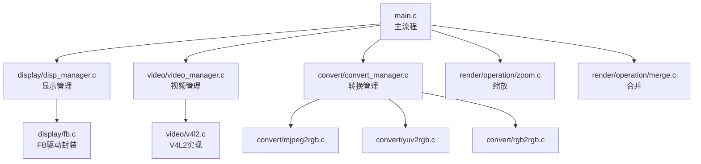
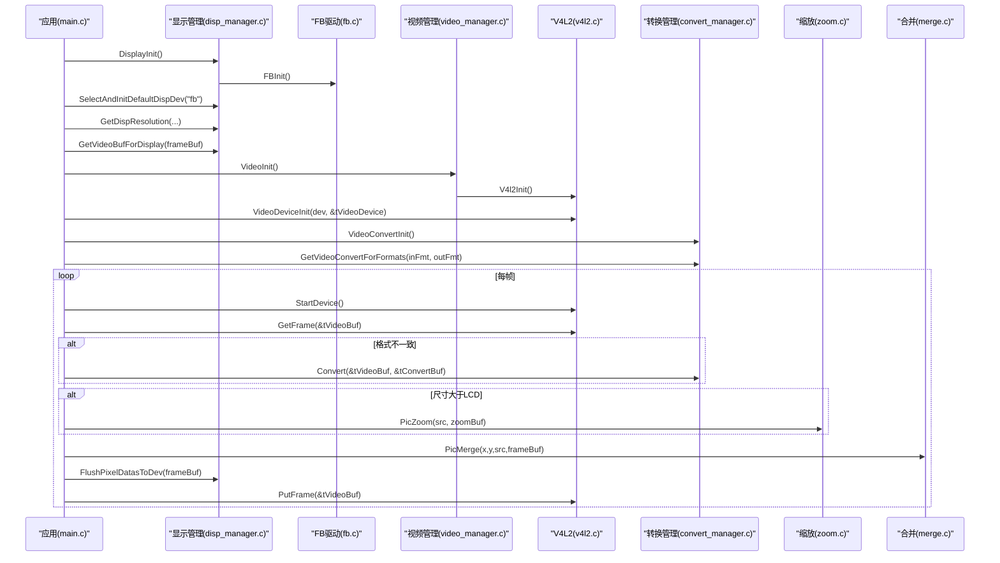
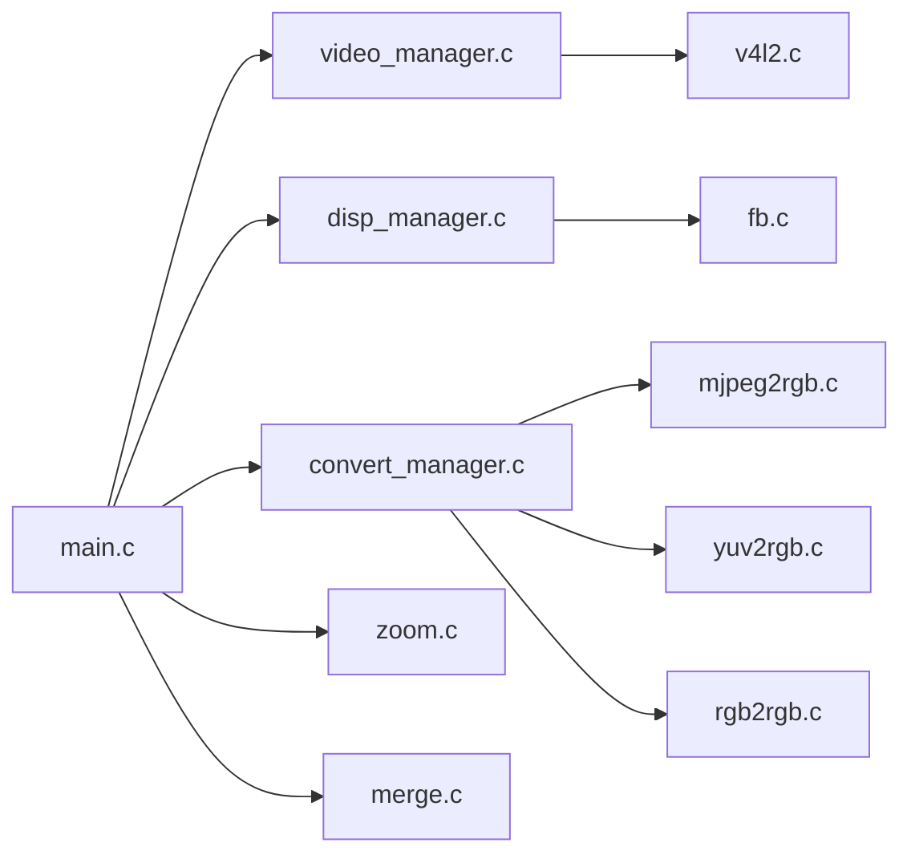
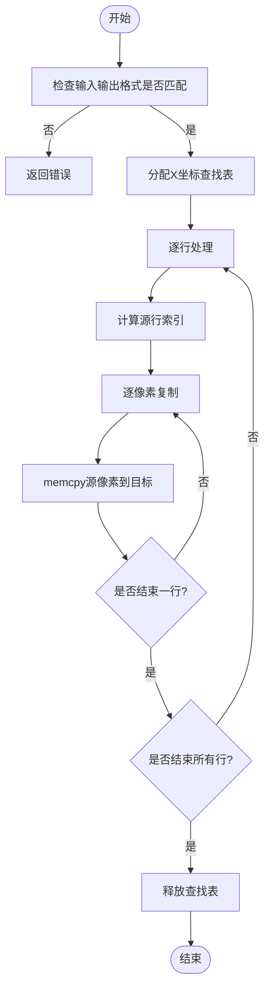

# 扩展测试与质量保证

<cite>
**本文引用的文件**
- [main.c](file://video2lcd/main.c)
- [video_manager.c](file://video2lcd/video/video_manager.c)
- [v4l2.c](file://video2lcd/video/v4l2.c)
- [disp_manager.c](file://video2lcd/display/disp_manager.c)
- [fb.c](file://video2lcd/display/fb.c)
- [convert_manager.c](file://video2lcd/convert/convert_manager.c)
- [mjpeg2rgb.c](file://video2lcd/convert/mjpeg2rgb.c)
- [yuv2rgb.c](file://video2lcd/convert/yuv2rgb.c)
- [rgb2rgb.c](file://video2lcd/convert/rgb2rgb.c)
- [zoom.c](file://video2lcd/render/operation/zoom.c)
- [merge.c](file://video2lcd/render/operation/merge.c)
- [config.h](file://video2lcd/include/config.h)
- [video_manager.h](file://video2lcd/include/video_manager.h)
- [disp_manager.h](file://video2lcd/include/disp_manager.h)
- [convert_manager.h](file://video2lcd/include/convert_manager.h)
- [Makefile](file://video2lcd/Makefile)
</cite>

## 目录
1. [简介](#简介)
2. [项目结构](#项目结构)
3. [核心组件](#核心组件)
4. [架构总览](#架构总览)
5. [详细组件分析](#详细组件分析)
6. [依赖关系分析](#依赖关系分析)
7. [性能考量](#性能考量)
8. [故障排查指南](#故障排查指南)
9. [结论](#结论)
10. [附录](#附录)

## 简介
本指南面向嵌入式Linux相机项目的扩展模块测试与质量保证，覆盖单元测试、集成测试与性能测试的编写方法与实践。重点围绕视频设备（V4L2）、显示设备（Framebuffer）和格式转换器（YUV/MJPEG/RGB）三大模块，提供自动化测试脚本建议、测试环境搭建步骤、性能指标与基准方法、代码质量检查工具与静态分析实践，以及常见问题诊断与调试技巧。

## 项目结构
本项目采用模块化分层设计：
- 视频采集层：基于V4L2实现摄像头设备抽象与帧缓冲管理
- 显示管理层：基于Framebuffer实现显示设备抽象与显存管理
- 格式转换层：支持多种像素格式转换（YUV/MJPEG/RGB）
- 渲染操作层：图像缩放、合并等基础图像处理
- 主流程：初始化显示与视频设备、选择转换器、循环采集-转换-缩放-合并-刷新

**图表来源**
- [main.c:34-192](file://video2lcd/main.c#L34-L192)
- [disp_manager.c:514-521](file://video2lcd/display/disp_manager.c#L514-L521)
- [video_manager.c:67-74](file://video2lcd/video/video_manager.c#L67-L74)
- [convert_manager.c:121-130](file://video2lcd/convert/convert_manager.c#L121-L130)

**章节来源**
- [main.c:34-192](file://video2lcd/main.c#L34-L192)
- [Makefile:1-54](file://video2lcd/Makefile#L1-L54)

## 核心组件
- 视频设备管理：通过VideoOpr链表注册不同驱动（如V4L2），统一GetFrame/PutFrame接口
- 显示设备管理：通过DispOpr链表注册不同显示驱动（如FB），统一管理分辨率、BPP、显存映射与刷新
- 格式转换管理：通过VideoConvert链表注册不同转换器，按输入输出像素格式自动选择
- 渲染操作：PicZoom最近邻插值缩放；PicMerge区域合并到目标缓冲区
- 配置：调试宏与设备路径定义

关键数据结构与职责：
- T_VideoDevice/T_VideoOpr：封装摄像头设备状态与操作接口
- T_DispOpr/T_VideoMem：封装显示设备能力与页面缓冲管理
- T_VideoConvert：封装格式转换器的isSupport/Convert接口
- T_PixelDatas：像素数据载体（宽、高、BPP、行字节、总字节、数据指针）

**章节来源**
- [video_manager.h:14-56](file://video2lcd/include/video_manager.h#L14-L56)
- [disp_manager.h:69-96](file://video2lcd/include/disp_manager.h#L69-L96)
- [convert_manager.h:23-46](file://video2lcd/include/convert_manager.h#L23-L46)
- [config.h:13-19](file://video2lcd/include/config.h#L13-L19)

## 架构总览
主程序启动后依次完成显示初始化、默认显示设备选择与清屏、获取LCD分辨率与帧缓冲；然后初始化视频模块并打开指定摄像头设备，设置像素格式与缓冲区；根据摄像头输出与LCD格式选择合适转换器；进入主循环：取帧→必要时格式转换→必要时缩放→居中合并到帧缓冲→刷新到设备→归还缓冲区。

**图表来源**
- [main.c:63-181](file://video2lcd/main.c#L63-L181)
- [disp_manager.c:100-175](file://video2lcd/display/disp_manager.c#L100-L175)
- [video_manager.c:67-74](file://video2lcd/video/video_manager.c#L67-L74)
- [v4l2.c:47-201](file://video2lcd/video/v4l2.c#L47-L201)
- [convert_manager.c:121-130](file://video2lcd/convert/convert_manager.c#L121-L130)
- [zoom.c:27-85](file://video2lcd/render/operation/zoom.c#L27-L85)
- [merge.c:20-46](file://video2lcd/render/operation/merge.c#L20-L46)

## 详细组件分析

### 视频设备测试（V4L2）
- 测试目标
  - 设备枚举与能力查询：确认设备为视频捕获设备，支持流式或读写模式
  - 格式协商：VIDIOC_S_FMT设置分辨率与像素格式，验证实际返回参数
  - 缓冲区管理：REQBUFS分配N个缓冲区，QUERYBUF/QBUF入队，DQBUF出队处理，再QBUF放回
  - 流控制：STREAMON/STREAMOFF正确开启/停止采集
  - 错误路径：无效设备名、不支持格式、内存不足、ioctl失败等
- 单元测试要点
  - 使用mock或桩替换底层ioctl/mmap，验证调用顺序与参数
  - 校验VideoDevice结构体字段填充（iFd、iPixelFormat、iWidth、iHeight、iVideoBufCnt等）
  - 验证GetFrame/PutFrame对队列的正确使用
- 集成测试要点
  - 在真实设备上运行，验证连续取帧稳定性、丢帧率、内存泄漏
  - 多分辨率/多格式组合测试（MJPEG/YUYV/RGB565）
  - 长时间运行压力测试（内存占用、句柄泄漏）
- 参考实现位置
  - 设备初始化与格式协商：[v4l2.c:47-125](file://video2lcd/video/v4l2.c#L47-L125)
  - 缓冲区申请与映射：[v4l2.c:127-201](file://video2lcd/video/v4l2.c#L127-L201)
  - 视频管理入口：[video_manager.c:67-74](file://video2lcd/video/video_manager.c#L67-L74)

**章节来源**
- [v4l2.c:47-201](file://video2lcd/video/v4l2.c#L47-L201)
- [video_manager.c:67-74](file://video2lcd/video/video_manager.c#L67-L74)

### 显示设备测试（Framebuffer）
- 测试目标
  - 设备注册与选择：DisplayInit/FBInit成功，SelectAndInitDefaultDispDev可正确初始化并清屏
  - 分辨率与BPP：GetDispResolution返回正确值
  - 帧缓冲映射：GetVideoBufForDisplay正确设置像素格式与数据指针指向显存
  - 刷新：FlushPixelDatasToDev将数据写入设备
  - 内存管理：AllocVideoMem/GetVideoMem/PutVideoMem生命周期与状态机
- 单元测试要点
  - 模拟DispOpr函数指针，验证CleanScreen/ShowPage调用
  - 验证ClearVideoMem/ClearVideoMemRegion对不同BPP的处理
- 集成测试要点
  - 在真实FB设备上绘制色块、渐变、文字，验证无闪烁与色彩正确性
  - 双缓冲策略下切换页面，验证显示一致性
- 参考实现位置
  - 显示管理入口与默认设备选择：[disp_manager.c:100-175](file://video2lcd/display/disp_manager.c#L100-L175)
  - 显存管理与页面缓冲：[disp_manager.c:188-337](file://video2lcd/display/disp_manager.c#L188-L337)
  - 颜色填充与区域清空：[disp_manager.c:370-505](file://video2lcd/display/disp_manager.c#L370-L505)
  - FB初始化：[disp_manager.c:514-521](file://video2lcd/display/disp_manager.c#L514-L521)

**章节来源**
- [disp_manager.c:100-521](file://video2lcd/display/disp_manager.c#L100-L521)

### 格式转换器测试（YUV/MJPEG/RGB）
- 测试目标
  - 转换器注册与选择：RegisterVideoConvert/VideoConvertInit/GetVideoConvertForFormats工作正常
  - 转换正确性：输入像素格式与输出像素格式一致，尺寸/BPP匹配
  - 性能：单位时间转换帧数、CPU占用、内存分配次数
- 单元测试要点
  - 构造最小输入缓冲区，断言输出缓冲区内容与期望一致（逐像素比对）
  - 边界条件：零尺寸、非法BPP、不支持格式组合
- 集成测试要点
  - 与V4L2输出格式联动，端到端验证MJPEG→RGB、YUV→RGB、RGB→RGB
  - 长时运行内存泄漏检测
- 参考实现位置
  - 转换管理：[convert_manager.c:23-130](file://video2lcd/convert/convert_manager.c#L23-L130)
  - 具体转换器初始化：[convert_manager.c:121-130](file://video2lcd/convert/convert_manager.c#L121-L130)
  - 各转换器源文件：[mjpeg2rgb.c](file://video2lcd/convert/mjpeg2rgb.c)、[yuv2rgb.c](file://video2lcd/convert/yuv2rgb.c)、[rgb2rgb.c](file://video2lcd/convert/rgb2rgb.c)

**章节来源**
- [convert_manager.c:23-130](file://video2lcd/convert/convert_manager.c#L23-L130)

### 渲染操作测试（缩放与合并）
- 测试目标
  - 缩放算法：PicZoom保持宽高比，最近邻插值结果正确
  - 合并逻辑：PicMerge将小图放置到大图指定位置，越界保护
- 单元测试要点
  - 构造已知图案（棋盘格、纯色条），断言缩放后特征保留
  - 合并前后像素值对比，验证坐标计算与行步长
- 参考实现位置
  - 缩放实现：[zoom.c:27-85](file://video2lcd/render/operation/zoom.c#L27-L85)
  - 合并实现：[merge.c:20-89](file://video2lcd/render/operation/merge.c#L20-L89)

**章节来源**
- [zoom.c:27-85](file://video2lcd/render/operation/zoom.c#L27-L85)
- [merge.c:20-89](file://video2lcd/render/operation/merge.c#L20-L89)

## 依赖关系分析
- 模块耦合
  - main.c依赖显示、视频、转换、渲染模块的公共接口
  - 视频模块依赖V4L2内核接口，显示模块依赖FB驱动
  - 转换模块依赖具体编解码库（如libjpeg）
- 外部依赖
  - libjpeg用于MJPEG解码
  - Linux内核V4L2/Framebuffer子系统
- 潜在风险
  - 未正确释放mmap映射或缓冲区导致内存泄漏
  - 多线程环境下VideoMem状态竞争
  - 格式不匹配导致转换失败

**图表来源**
- [main.c:34-192](file://video2lcd/main.c#L34-L192)
- [video_manager.c:67-74](file://video2lcd/video/video_manager.c#L67-L74)
- [disp_manager.c:514-521](file://video2lcd/display/disp_manager.c#L514-L521)
- [convert_manager.c:121-130](file://video2lcd/convert/convert_manager.c#L121-L130)

**章节来源**
- [main.c:34-192](file://video2lcd/main.c#L34-L192)
- [Makefile:17-21](file://video2lcd/Makefile#L17-L21)

## 性能考量
- 关键指标
  - 帧率（FPS）：每秒处理帧数
  - 延迟：从采集到显示的端到端时延
  - CPU占用：转换与缩放阶段的CPU利用率
  - 内存占用：峰值内存、增长趋势、泄漏检测
  - 吞吐：单位时间内处理的像素总量
- 基准测试方法
  - 使用time或perf统计单帧处理耗时，计算平均FPS
  - 使用valgrind massif或heaptrack检测内存增长与泄漏
  - 使用gprof或perf record分析热点函数（如PicZoom、Convert）
  - 在不同分辨率/格式组合下建立性能基线
- 优化建议
  - 优先使用硬件加速（若平台支持）
  - 减少不必要的内存拷贝，利用零拷贝mmap
  - 批量处理与流水线化（采集-转换-渲染并行）
  - 选择合适的缩放算法与质量权衡

[本节为通用指导，不直接分析具体文件]

## 故障排查指南
- 常见问题
  - 无法打开设备：检查设备路径与权限
  - 格式不支持：枚举并选择兼容格式
  - 内存不足：减少缓冲区数量或降低分辨率
  - 显示异常：确认BPP与像素格式匹配
  - 转换失败：检查输入输出格式组合是否被支持
- 调试技巧
  - 启用调试输出：修改config.h中的DBG_PRINTF宏
  - 打印关键变量：分辨率、BPP、缓冲区大小、地址
  - 使用gdb断点：定位ioctl失败、mmap失败、空指针
  - 日志记录：记录每帧处理时间与错误码
- 参考位置
  - 调试宏定义：[config.h:13-19](file://video2lcd/include/config.h#L13-L19)
  - 错误分支示例：[main.c:76-107](file://video2lcd/main.c#L76-L107)、[v4l2.c:64-125](file://video2lcd/video/v4l2.c#L64-L125)

**章节来源**
- [config.h:13-19](file://video2lcd/include/config.h#L13-L19)
- [main.c:76-107](file://video2lcd/main.c#L76-L107)
- [v4l2.c:64-125](file://video2lcd/video/v4l2.c#L64-L125)

## 结论
本项目采用清晰的模块化设计与统一的接口抽象，便于扩展与测试。通过系统化的单元与集成测试、严格的性能基准与静态分析，可有效保障视频采集、显示与转换链路的稳定性与性能。建议在持续集成中引入自动化测试与质量门禁，确保每次变更的可回归性与可维护性。

[本节为总结性内容，不直接分析具体文件]

## 附录

### 自动化测试脚本与环境搭建建议
- 环境准备
  - 交叉编译工具链：arm-linux-gcc
  - 依赖库：libjpeg
  - 目标设备：具备/dev/videoX与/dev/fb0的嵌入式Linux系统
- 构建命令
  - 顶层构建：make
  - 清理：make clean / make distclean
- 测试套件建议
  - 单元测试：针对PicZoom、PicMerge、ClearVideoMem等纯函数
  - 集成测试：端到端流程（采集-转换-缩放-合并-刷新）
  - 性能测试：FPS、延迟、CPU/内存指标采集
- 脚本框架
  - 使用shell或Python组织用例，输出JUnit风格报告
  - 使用dmesg/strace辅助定位内核与系统调用问题

**章节来源**
- [Makefile:1-54](file://video2lcd/Makefile#L1-L54)

### 代码质量检查与静态分析
- 工具推荐
  - 编译器警告：-Wall -Wextra -Werror
  - 静态分析：clang-tidy、cppcheck
  - 内存检测：valgrind、AddressSanitizer
  - 覆盖率：gcov/lcov
- 集成建议
  - 在CI中执行静态分析与单元测试
  - 生成覆盖率报告并设定阈值
  - 对关键模块进行内存泄漏与越界访问检测

[本节为通用指导，不直接分析具体文件]

### 关键流程图示（算法级）

**图表来源**
- [zoom.c:27-85](file://video2lcd/render/operation/zoom.c#L27-L85)