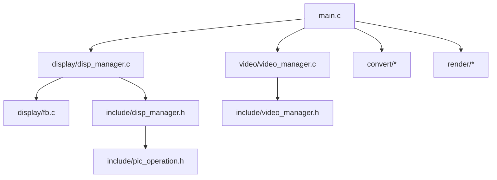
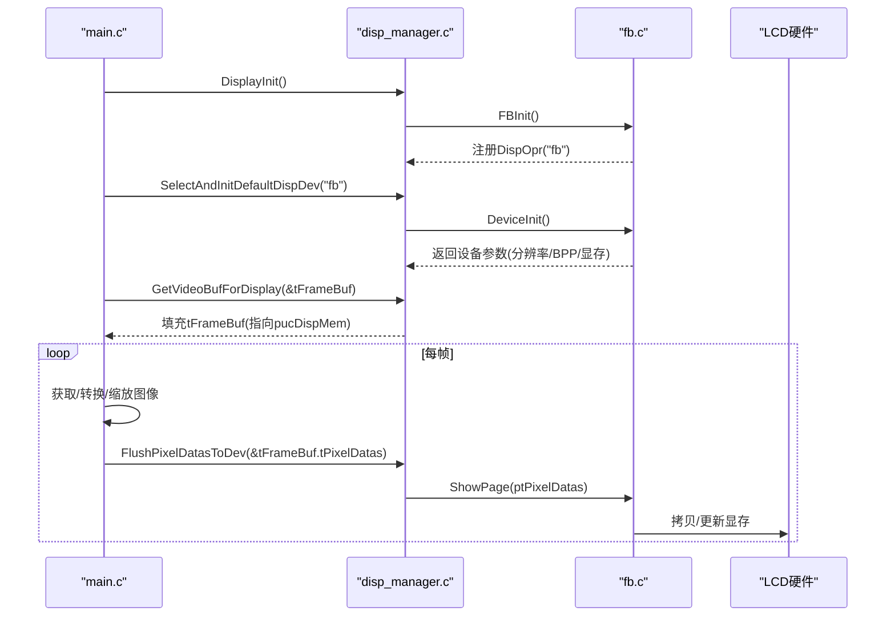
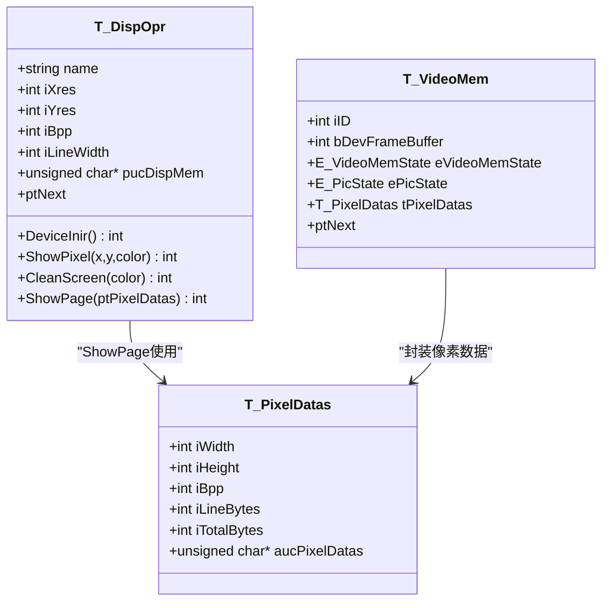
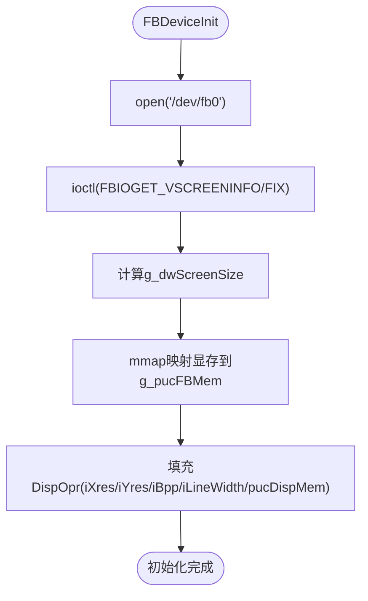
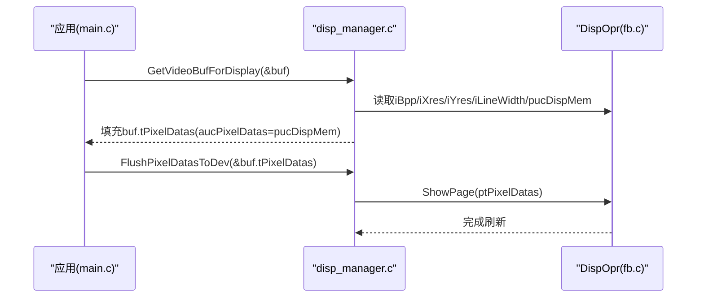
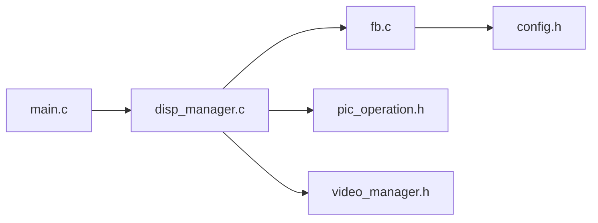

# 添加新显示设备

<cite>
**本文引用的文件**
- [main.c](file://video2lcd/main.c)
- [disp_manager.h](file://video2lcd/include/disp_manager.h)
- [disp_manager.c](file://video2lcd/display/disp_manager.c)
- [fb.c](file://video2lcd/display/fb.c)
- [pic_operation.h](file://video2lcd/include/pic_operation.h)
- [video_manager.h](file://video2lcd/include/video_manager.h)
- [config.h](file://video2lcd/include/config.h)
</cite>

## 目录
1. [简介](#简介)
2. [项目结构](#项目结构)
3. [核心组件](#核心组件)
4. [架构总览](#架构总览)
5. [详细组件分析](#详细组件分析)
6. [依赖关系分析](#依赖关系分析)
7. [性能考虑](#性能考虑)
8. [故障排查指南](#故障排查指南)
9. [结论](#结论)
10. [附录：实现模板与示例路径](#附录：实现模板与示例路径)

## 简介
本指南面向需要在该嵌入式Linux相机项目中添加“新显示设备”的开发者。文档围绕DisplayOpr（显示操作接口）的实现要求，详细说明设备初始化、像素数据处理、内存映射等关键函数；解释Framebuffer驱动的扩展机制与设备抽象层设计；提供可复用的代码模板与实现示例路径；并给出不同显示设备的适配方法与分辨率处理策略，以及性能优化和内存管理最佳实践。

## 项目结构
本项目采用分层与模块化设计：
- display：显示设备抽象与管理，包含通用管理器与具体驱动（如Framebuffer）。
- include：公共头文件，定义数据结构与接口（如DispOpr、PixelDatas、VideoBuf等）。
- video：视频采集模块（V4L2），负责从摄像头获取帧数据。
- convert：像素格式转换模块。
- render：图像渲染/合成模块（缩放、合并等）。
- main.c：主程序入口，串联显示、视频、转换与渲染流程。

图表来源
- [main.c:63-74](file://video2lcd/main.c#L63-L74)
- [disp_manager.c:514-521](file://video2lcd/display/disp_manager.c#L514-L521)
- [fb.c:249-252](file://video2lcd/display/fb.c#L249-L252)

章节来源
- [main.c:63-74](file://video2lcd/main.c#L63-L74)
- [disp_manager.c:514-521](file://video2lcd/display/disp_manager.c#L514-L521)
- [fb.c:249-252](file://video2lcd/display/fb.c#L249-L252)

## 核心组件
- 显示操作接口 DispOpr：统一抽象显示设备能力，包括名称、分辨率、BPP、行字节数、显存指针及一系列函数指针（初始化、画点、清屏、整页显示）。
- 显示管理器 disp_manager：维护DispOpr链表、选择默认设备、分配VideoMem缓冲、提供分辨率查询、帧缓冲区获取与刷新等通用能力。
- Framebuffer驱动 fb.c：基于/dev/fb0实现具体显示设备，完成设备打开、ioctl获取屏幕信息、mmap映射显存、按BPP写像素、整页拷贝刷新等。
- 像素数据模型 PixelDatas：统一描述图像尺寸、色深、行字节数、总字节数与数据指针，被显示、渲染、采集等多模块复用。
- 视频缓冲 VideoBuf：封装一帧图像数据及其像素格式，用于在采集、转换、显示之间传递。

章节来源
- [disp_manager.h:84-96](file://video2lcd/include/disp_manager.h#L84-L96)
- [disp_manager.c:14-18](file://video2lcd/display/disp_manager.c#L14-L18)
- [fb.c:37-43](file://video2lcd/display/fb.c#L37-L43)
- [pic_operation.h:10-17](file://video2lcd/include/pic_operation.h#L10-L17)
- [video_manager.h:52-55](file://video2lcd/include/video_manager.h#L52-L55)

## 架构总览
系统启动时，main调用DisplayInit注册所有显示设备；随后SelectAndInitDefaultDispDev选择并初始化默认显示设备（如“fb”），并通过GetDispResolution获取LCD分辨率；再通过GetVideoBufForDisplay获取指向设备framebuffer的帧缓冲区；进入循环读取摄像头帧，必要时进行格式转换与缩放，最后将像素数据写入帧缓冲区并通过FlushPixelDatasToDev刷新到硬件。

图表来源
- [main.c:63-74](file://video2lcd/main.c#L63-L74)
- [main.c:118-178](file://video2lcd/main.c#L118-L178)
- [disp_manager.c:148-175](file://video2lcd/display/disp_manager.c#L148-L175)
- [fb.c:166-174](file://video2lcd/display/fb.c#L166-L174)

## 详细组件分析

### 显示操作接口 DispOpr 与设备抽象层
- 接口字段：name、iXres、iYres、iBpp、iLineWidth、pucDispMem，以及函数指针DeviceInir、ShowPixel、CleanScreen、ShowPage。
- 设计要点：
  - 通过函数指针实现多态，使上层无需关心具体显示设备实现。
  - iLineWidth与iBpp决定行对齐与内存布局，影响像素访问与拷贝效率。
  - pucDispMem为设备显存的直接映射地址，便于零拷贝或最小拷贝刷新。

图表来源
- [disp_manager.h:84-96](file://video2lcd/include/disp_manager.h#L84-L96)
- [disp_manager.h:69-76](file://video2lcd/include/disp_manager.h#L69-L76)
- [pic_operation.h:10-17](file://video2lcd/include/pic_operation.h#L10-L17)

章节来源
- [disp_manager.h:84-96](file://video2lcd/include/disp_manager.h#L84-L96)

### Framebuffer驱动实现（fb.c）
- 初始化流程：
  - 打开/dev/fb0，使用ioctl获取可变/固定屏幕信息，计算屏幕总大小。
  - 使用mmap将显存映射到用户空间，得到pucDispMem。
  - 填充DispOpr的分辨率、BPP、行字节数与显存指针。
- 像素写入：
  - ShowPixel根据BPP（8/16/32）将32位颜色值转换为对应格式后写入指定坐标。
  - CleanScreen按BPP批量填充显存。
  - ShowPage将传入的PT_PixelDatas数据拷贝到显存（若源地址非显存则memcpy）。
- 注册机制：
  - FBInit构造T_DispOpr实例并调用RegisterDispOpr完成注册。

图表来源
- [fb.c:53-94](file://video2lcd/display/fb.c#L53-L94)

章节来源
- [fb.c:53-94](file://video2lcd/display/fb.c#L53-L94)
- [fb.c:106-157](file://video2lcd/display/fb.c#L106-L157)
- [fb.c:183-240](file://video2lcd/display/fb.c#L183-L240)
- [fb.c:166-174](file://video2lcd/display/fb.c#L166-L174)
- [fb.c:249-252](file://video2lcd/display/fb.c#L249-L252)

### 显示管理器（disp_manager.c）
- 设备注册与选择：
  - RegisterDispOpr将DispOpr加入全局链表。
  - SelectAndInitDefaultDispDev根据名称查找并调用DeviceInit与CleanScreen。
  - GetDefaultDispDev返回当前默认DispOpr。
- 分辨率与帧缓冲：
  - GetDispResolution返回默认设备的分辨率与BPP。
  - GetVideoBufForDisplay根据BPP设置像素格式，填充tPixelDatas尺寸与行字节，并将aucPixelDatas直接指向pucDispMem。
- 刷新与VideoMem：
  - FlushPixelDatasToDev调用ShowPage将像素数据输出到设备。
  - AllocVideoMem/GetVideoMem/PutVideoMem提供页面缓冲管理，支持设备framebuffer与普通内存缓冲两类VideoMem。
  - ClearVideoMem/ClearVideoMemRegion支持按BPP清空全屏或区域。

图表来源
- [disp_manager.c:148-175](file://video2lcd/display/disp_manager.c#L148-L175)
- [fb.c:166-174](file://video2lcd/display/fb.c#L166-L174)

章节来源
- [disp_manager.c:27-48](file://video2lcd/display/disp_manager.c#L27-L48)
- [disp_manager.c:100-113](file://video2lcd/display/disp_manager.c#L100-L113)
- [disp_manager.c:125-163](file://video2lcd/display/disp_manager.c#L125-L163)
- [disp_manager.c:188-259](file://video2lcd/display/disp_manager.c#L188-L259)
- [disp_manager.c:272-337](file://video2lcd/display/disp_manager.c#L272-L337)
- [disp_manager.c:370-424](file://video2lcd/display/disp_manager.c#L370-L424)
- [disp_manager.c:436-505](file://video2lcd/display/disp_manager.c#L436-L505)
- [disp_manager.c:514-521](file://video2lcd/display/disp_manager.c#L514-L521)

### 主流程与集成（main.c）
- 初始化顺序：DisplayInit -> SelectAndInitDefaultDispDev("fb") -> GetDispResolution -> GetVideoBufForDisplay。
- 采集与显示循环：GetFrame -> Convert（可选）-> Zoom（可选）-> PicMerge到帧缓冲 -> FlushPixelDatasToDev -> PutFrame。
- 居中显示与等比例缩放策略：以LCD宽度为基准计算缩放高度，若超出高度则反向计算，保持宽高比。

章节来源
- [main.c:63-74](file://video2lcd/main.c#L63-L74)
- [main.c:118-178](file://video2lcd/main.c#L118-L178)

## 依赖关系分析
- main.c依赖disp_manager与video_manager，间接依赖fb驱动。
- disp_manager依赖pic_operation（PixelDatas）与video_manager（VideoBuf）。
- fb.c依赖系统库（sys/mman、linux/fb）与配置宏（FB_DEVICE_NAME）。

图表来源
- [main.c:63-74](file://video2lcd/main.c#L63-L74)
- [disp_manager.c:148-175](file://video2lcd/display/disp_manager.c#L148-L175)
- [fb.c:53-94](file://video2lcd/display/fb.c#L53-L94)
- [config.h:17-18](file://video2lcd/include/config.h#L17-L18)

章节来源
- [main.c:63-74](file://video2lcd/main.c#L63-L74)
- [disp_manager.c:148-175](file://video2lcd/display/disp_manager.c#L148-L175)
- [fb.c:53-94](file://video2lcd/display/fb.c#L53-L94)
- [config.h:17-18](file://video2lcd/include/config.h#L17-L18)

## 性能考虑
- 优先使用设备framebuffer直写：GetVideoBufForDisplay将aucPixelDatas直接指向pucDispMem，避免额外拷贝。
- ShowPage优化：当源数据即显存时跳过memcpy，减少带宽占用。
- 批量操作优于逐点：CleanScreen与ClearVideoMem使用memset或按行循环，提高吞吐。
- 行对齐与BPP：确保iLineWidth正确计算，避免跨行错位导致的缓存未命中与额外拷贝。
- 预分配VideoMem：AllocVideoMem提前分配多页缓冲，降低运行时分配开销。
- 缩放与合并：仅在必要时执行缩放，并使用PicMerge将结果直接写入帧缓冲，减少中间缓冲。

[本节为通用性能建议，不直接分析具体文件]

## 故障排查指南
- 无法打开/dev/fb0：检查设备节点是否存在、权限是否正确。
- ioctl失败：确认内核已加载正确的framebuffer驱动，且屏幕参数有效。
- mmap失败：检查显存大小计算是否正确，是否具备读写权限。
- 显示异常：核对BPP与颜色格式转换逻辑（RGB565/RGB32），确保iLineWidth与iBpp一致。
- 刷新无变化：确认ShowPage中源地址是否为显存，若非显存需确保memcpy长度正确。

章节来源
- [fb.c:53-94](file://video2lcd/display/fb.c#L53-L94)
- [fb.c:106-157](file://video2lcd/display/fb.c#L106-L157)
- [fb.c:166-174](file://video2lcd/display/fb.c#L166-L174)
- [fb.c:183-240](file://video2lcd/display/fb.c#L183-L240)

## 结论
通过DispOpr接口与disp_manager的管理机制，本项目实现了显示设备的抽象与可扩展性。新增显示设备只需实现DispOpr中的函数指针并完成注册，即可无缝接入现有流程。Framebuffer驱动展示了典型的Linux显示设备实现方式，可作为其他设备（如SPI LCD、MIPI DSI等）的参考模板。结合VideoMem与合理的分辨率处理策略，可在保证显示质量的同时提升性能与稳定性。

[本节为总结性内容，不直接分析具体文件]

## 附录：实现模板与示例路径

### 新增显示设备步骤（以DispOpr为核心）
- 定义设备操作结构体：参照fb.c中的T_DispOpr实例，实现以下函数指针：
  - DeviceInir：打开设备、获取屏幕信息、映射显存、填充DispOpr字段。
  - ShowPixel：按BPP将颜色写入指定坐标。
  - CleanScreen：按BPP批量填充显存。
  - ShowPage：将PT_PixelDatas数据输出到设备（若源非显存则拷贝）。
- 注册设备：在设备初始化阶段调用RegisterDispOpr(&your_Opr)。
- 选择默认设备：在main中调用SelectAndInitDefaultDispDev("your_device_name")。
- 获取分辨率与帧缓冲：使用GetDispResolution与GetVideoBufForDisplay。
- 刷新显示：在主循环末尾调用FlushPixelDatasToDev。

章节来源
- [fb.c:37-43](file://video2lcd/display/fb.c#L37-L43)
- [fb.c:249-252](file://video2lcd/display/fb.c#L249-L252)
- [disp_manager.c:27-48](file://video2lcd/display/disp_manager.c#L27-L48)
- [disp_manager.c:100-113](file://video2lcd/display/disp_manager.c#L100-L113)
- [disp_manager.c:148-175](file://video2lcd/display/disp_manager.c#L148-L175)
- [main.c:63-74](file://video2lcd/main.c#L63-L74)

### 像素数据处理与内存映射要点
- 像素格式：根据设备BPP（8/16/32）进行颜色转换（如RGB32到RGB565）。
- 行字节与总字节：iLineWidth = iXres * iBpp / 8；iTotalBytes = iLineWidth * iYres。
- 显存映射：使用mmap将设备显存映射到用户空间，得到pucDispMem并填入DispOpr。
- 刷新策略：优先零拷贝（源=显存），否则使用memcpy整页拷贝。

章节来源
- [fb.c:75-91](file://video2lcd/display/fb.c#L75-L91)
- [fb.c:106-157](file://video2lcd/display/fb.c#L106-L157)
- [fb.c:166-174](file://video2lcd/display/fb.c#L166-L174)
- [disp_manager.c:148-163](file://video2lcd/display/disp_manager.c#L148-L163)

### 不同显示设备的适配方法与分辨率处理策略
- 适配方法：
  - 对于SPI/I2C LCD：DeviceInir中配置时序与命令，ShowPage中将像素数据分块发送；CleanScreen发送填充命令。
  - 对于MIPI DSI：DeviceInir建立DSI通道与面板初始化序列，ShowPage通过DSI写命令传输像素。
- 分辨率处理：
  - 获取设备实际分辨率与BPP，计算iLineWidth与iTotalBytes。
  - 在GetVideoBufForDisplay中设置正确的像素格式与尺寸。
  - 在main中进行等比例缩放与居中显示，避免拉伸变形。

章节来源
- [disp_manager.c:125-163](file://video2lcd/display/disp_manager.c#L125-L163)
- [main.c:141-178](file://video2lcd/main.c#L141-L178)

### 性能优化技巧与内存管理最佳实践
- 使用VideoMem池：AllocVideoMem预分配多页缓冲，GetVideoMem/PutVideoMem管理状态，减少分配开销。
- 区域清理：ClearVideoMemRegion仅清理需要更新的矩形区域，降低带宽消耗。
- 批量写入：CleanScreen与ClearVideoMem使用memset或按行循环，避免逐像素写入。
- 避免重复拷贝：ShowPage检测源是否为显存，是则跳过memcpy。
- 合理BPP：优先使用设备原生BPP（如16位RGB565），减少格式转换开销。

章节来源
- [disp_manager.c:188-259](file://video2lcd/display/disp_manager.c#L188-L259)
- [disp_manager.c:272-337](file://video2lcd/display/disp_manager.c#L272-L337)
- [disp_manager.c:370-424](file://video2lcd/display/disp_manager.c#L370-L424)
- [disp_manager.c:436-505](file://video2lcd/display/disp_manager.c#L436-L505)
- [fb.c:166-174](file://video2lcd/display/fb.c#L166-L174)