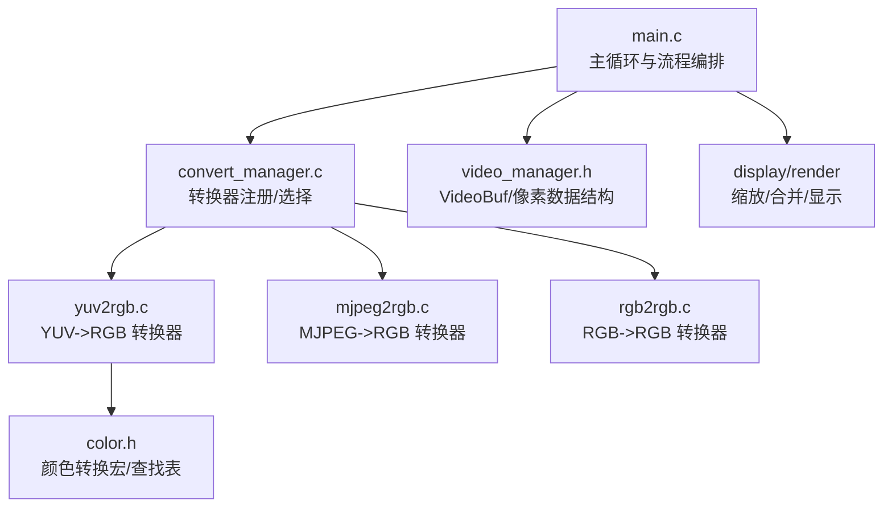
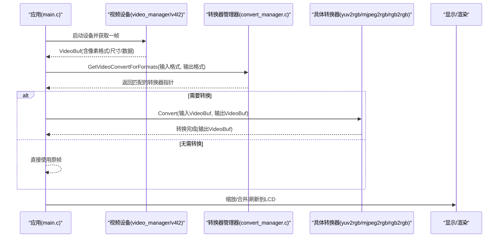
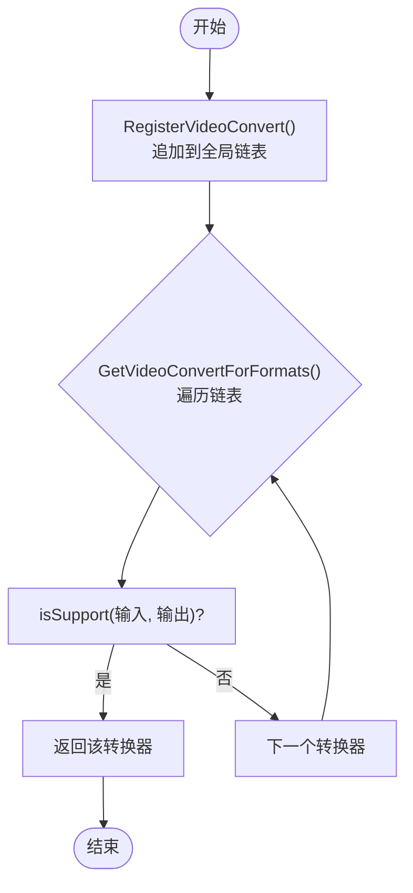
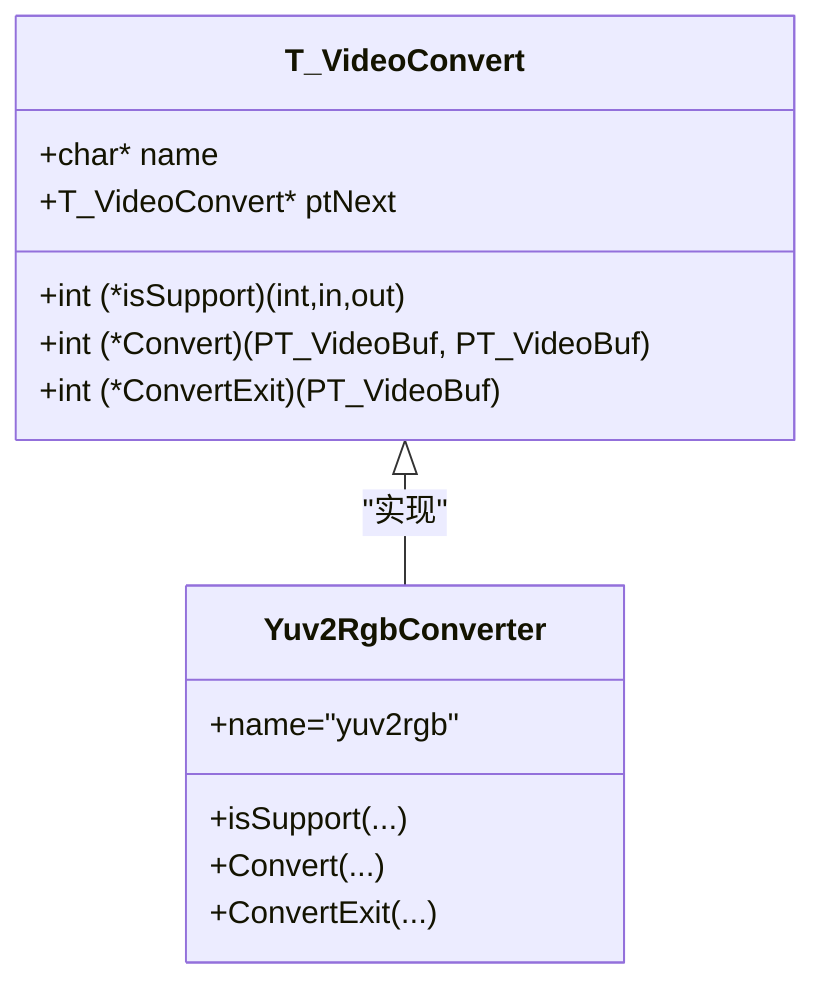
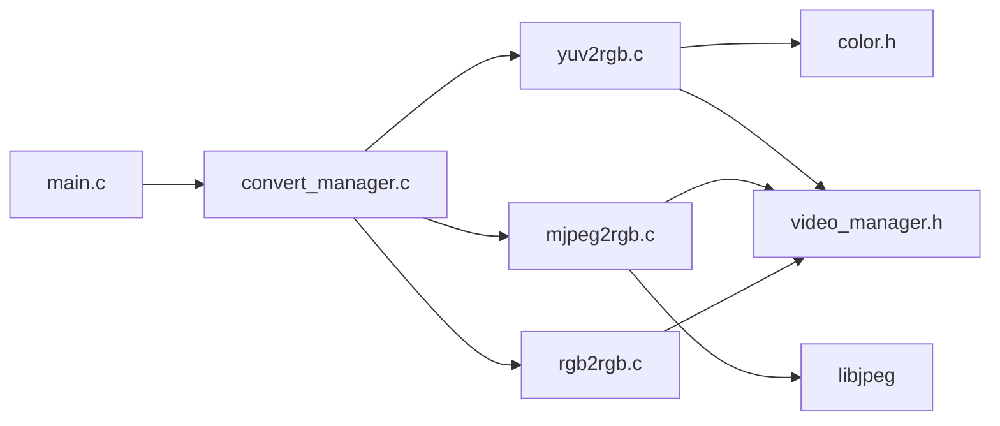

# 添加新格式转换器

<cite>
**本文引用的文件**
- [convert_manager.h](file://video2lcd/include/convert_manager.h)
- [convert_manager.c](file://video2lcd/convert/convert_manager.c)
- [yuv2rgb.c](file://video2lcd/convert/yuv2rgb.c)
- [rgb2rgb.c](file://video2lcd/convert/rgb2rgb.c)
- [mjpeg2rgb.c](file://video2lcd/convert/mjpeg2rgb.c)
- [color.h](file://video2lcd/convert/color.h)
- [video_manager.h](file://video2lcd/include/video_manager.h)
- [main.c](file://video2lcd/main.c)
</cite>

## 目录
1. [简介](#简介)
2. [项目结构](#项目结构)
3. [核心组件](#核心组件)
4. [架构总览](#架构总览)
5. [详细组件分析](#详细组件分析)
6. [依赖关系分析](#依赖关系分析)
7. [性能考量与优化](#性能考量与优化)
8. [故障排查指南](#故障排查指南)
9. [结论](#结论)
10. [附录：实现步骤清单](#附录：实现步骤清单)

## 简介
本指南面向需要在嵌入式Linux相机项目中新增“格式转换器”的开发者。文档围绕 ConvertOpr（即 VideoConvert）接口规范，系统阐述格式检测、数据转换、内存管理、注册机制与自动选择算法，并提供完整的参考实现路径与最佳实践，帮助你在不破坏现有架构的前提下扩展新的格式转换能力。

## 项目结构
本项目采用模块化设计，视频采集、显示、渲染与格式转换相互解耦。新增转换器位于 convert 模块，通过统一的管理器进行注册与调度。

图表来源
- [main.c:91-138](file://video2lcd/main.c#L91-L138)
- [convert_manager.c:23-131](file://video2lcd/convert/convert_manager.c#L23-L131)
- [yuv2rgb.c:218-232](file://video2lcd/convert/yuv2rgb.c#L218-L232)
- [mjpeg2rgb.c:247-260](file://video2lcd/convert/mjpeg2rgb.c#L247-L260)
- [rgb2rgb.c:138-151](file://video2lcd/convert/rgb2rgb.c#L138-L151)
- [video_manager.h:48-56](file://video2lcd/include/video_manager.h#L48-L56)

章节来源
- [main.c:91-138](file://video2lcd/main.c#L91-L138)
- [convert_manager.c:23-131](file://video2lcd/convert/convert_manager.c#L23-L131)
- [video_manager.h:48-56](file://video2lcd/include/video_manager.h#L48-L56)

## 核心组件
- VideoConvert（ConvertOpr）接口：定义名称、支持判断、转换函数、释放函数以及链表指针，用于统一封装一个格式转换器。
- 转换器管理器：维护全局链表，提供注册、按输入输出格式自动选择转换器的能力。
- 具体转换器：如 YUV->RGB、MJPEG->RGB、RGB->RGB，各自实现 isSupport、Convert、ConvertExit。
- 数据载体：VideoBuf/PixelDatas 描述帧尺寸、位深、行字节数、总字节数及像素数据指针。

章节来源
- [convert_manager.h:16-43](file://video2lcd/include/convert_manager.h#L16-L43)
- [convert_manager.c:23-131](file://video2lcd/convert/convert_manager.c#L23-L131)
- [video_manager.h:48-56](file://video2lcd/include/video_manager.h#L48-L56)

## 架构总览
下图展示了从摄像头采集到显示的完整数据流，重点标注了格式转换器的选择与调用位置。

图表来源
- [main.c:91-138](file://video2lcd/main.c#L91-L138)
- [convert_manager.c:98-111](file://video2lcd/convert/convert_manager.c#L98-L111)
- [yuv2rgb.c:161-199](file://video2lcd/convert/yuv2rgb.c#L161-L199)
- [mjpeg2rgb.c:145-228](file://video2lcd/convert/mjpeg2rgb.c#L145-L228)
- [rgb2rgb.c:46-120](file://video2lcd/convert/rgb2rgb.c#L46-L120)

## 详细组件分析

### ConvertOpr（VideoConvert）接口规范
- name：转换器可读名称，便于调试与日志。
- isSupport(iPixelFormatIn, iPixelFormatOut)：声明该转换器支持的输入/输出格式组合。
- Convert(ptVideoBufIn, ptVideoBufOut)：执行实际转换；负责设置输出缓冲区的尺寸、位深、行字节数、总字节数，并在必要时分配输出缓冲区。
- ConvertExit(ptVideoBufOut)：释放由 Convert 分配的输出缓冲区（若存在）。
- ptNext：用于加入全局链表的指针。

章节来源
- [convert_manager.h:16-43](file://video2lcd/include/convert_manager.h#L16-L43)

### 转换器注册机制与自动选择算法
- 注册：每个转换器在初始化时调用 RegisterVideoConvert，将自身结构体追加到全局链表尾部。
- 选择：GetVideoConvertForFormats 遍历已注册的转换器，依次调用其 isSupport，返回第一个匹配项。
- 初始化：VideoConvertInit 集中调用各转换器的 Init 函数，完成注册。

图表来源
- [convert_manager.c:23-44](file://video2lcd/convert/convert_manager.c#L23-L44)
- [convert_manager.c:98-111](file://video2lcd/convert/convert_manager.c#L98-L111)
- [convert_manager.c:121-131](file://video2lcd/convert/convert_manager.c#L121-L131)

章节来源
- [convert_manager.c:23-131](file://video2lcd/convert/convert_manager.c#L23-L131)

### 参考实现：YUV 转 RGB（YUV422Packed -> RGB565/RGB32）
- 支持判断：仅当输入为 V4L2_PIX_FMT_YUYV，且输出为 RGB565 或 RGB32 时返回支持。
- 转换逻辑：
  - RGB565：逐对像素读取 Y/U/Y/V，计算 R/G/B，右移对齐至 5/6/5 位宽后打包为 16 位。
  - RGB32：计算 R/G/B 后直接拼装为 32 位 0xRRGGBB。
- 内存管理：
  - 根据输出位深计算 iLineBytes 与 iTotalBytes。
  - 若输出缓冲区未分配，则按需 malloc。
  - ConvertExit 负责 free 输出缓冲区。
- 辅助：使用 color.h 中的转换宏与查找表 initLut()。

图表来源
- [convert_manager.h:23-29](file://video2lcd/include/convert_manager.h#L23-L29)
- [yuv2rgb.c:25-34](file://video2lcd/convert/yuv2rgb.c#L25-L34)
- [yuv2rgb.c:50-149](file://video2lcd/convert/yuv2rgb.c#L50-L149)
- [yuv2rgb.c:161-215](file://video2lcd/convert/yuv2rgb.c#L161-L215)
- [yuv2rgb.c:218-232](file://video2lcd/convert/yuv2rgb.c#L218-L232)
- [color.h:65-88](file://video2lcd/convert/color.h#L65-L88)

章节来源
- [yuv2rgb.c:25-232](file://video2lcd/convert/yuv2rgb.c#L25-L232)
- [color.h:65-88](file://video2lcd/convert/color.h#L65-L88)

### 其他转换器要点
- MJPEG->RGB：基于 libjpeg 解码为 24bpp 行数据，再转换为 RGB565/RGB32；包含自定义错误处理与 setjmp/longjmp 恢复；注意行缓冲与输出缓冲的分配与释放。
- RGB->RGB：当输入为 RGB565 且目标为 RGB565 时可直接 memcpy；目标为 RGB32 时需逐像素提取分量并扩展为 32 位。

章节来源
- [mjpeg2rgb.c:38-47](file://video2lcd/convert/mjpeg2rgb.c#L38-L47)
- [mjpeg2rgb.c:83-133](file://video2lcd/convert/mjpeg2rgb.c#L83-L133)
- [mjpeg2rgb.c:145-228](file://video2lcd/convert/mjpeg2rgb.c#L145-L228)
- [rgb2rgb.c:20-29](file://video2lcd/convert/rgb2rgb.c#L20-L29)
- [rgb2rgb.c:46-120](file://video2lcd/convert/rgb2rgb.c#L46-L120)

### 数据模型与内存约定
- VideoBuf 承载像素数据与格式信息；PixelDatas 描述宽高、位深、行字节数、总字节数与数据指针。
- 转换器职责边界：
  - Convert 必须正确设置输出 PixelDatas 的尺寸与步长，并在必要时分配内存。
  - ConvertExit 必须释放 Convert 分配的内存，避免泄漏。
  - 输入数据由上层（视频采集）提供，转换器不得修改输入缓冲区生命周期。

章节来源
- [video_manager.h:48-56](file://video2lcd/include/video_manager.h#L48-L56)
- [yuv2rgb.c:161-215](file://video2lcd/convert/yuv2rgb.c#L161-L215)
- [rgb2rgb.c:62-116](file://video2lcd/convert/rgb2rgb.c#L62-L116)
- [mjpeg2rgb.c:200-228](file://video2lcd/convert/mjpeg2rgb.c#L200-L228)

## 依赖关系分析
- main.c 依赖 convert_manager 进行转换器选择与调用。
- 各转换器依赖 video_manager 的数据结构（VideoBuf/PixelDatas）。
- yuv2rgb 依赖 color.h 的颜色转换宏与查找表。
- mjpeg2rgb 依赖 libjpeg（外部库），需确保链接配置正确。

图表来源
- [main.c:91-138](file://video2lcd/main.c#L91-L138)
- [convert_manager.c:23-131](file://video2lcd/convert/convert_manager.c#L23-L131)
- [yuv2rgb.c:218-232](file://video2lcd/convert/yuv2rgb.c#L218-L232)
- [mjpeg2rgb.c:247-260](file://video2lcd/convert/mjpeg2rgb.c#L247-L260)
- [rgb2rgb.c:138-151](file://video2lcd/convert/rgb2rgb.c#L138-L151)
- [video_manager.h:48-56](file://video2lcd/include/video_manager.h#L48-L56)

章节来源
- [main.c:91-138](file://video2lcd/main.c#L91-L138)
- [convert_manager.c:23-131](file://video2lcd/convert/convert_manager.c#L23-L131)

## 性能考量与优化
- 批量与向量化：YUV->RGB 可考虑 SIMD 指令（如 NEON/SSE）加速像素计算；当前实现为逐像素循环，适合通用 CPU。
- 查找表：YUV->RGB 使用 color.h 提供的查找表减少乘法开销，已在 yuv2rgb 中通过 initLut() 启用。
- 内存分配：尽量复用输出缓冲区，避免每帧 malloc/free；可在上层缓存 tConvertBuf 的像素缓冲区，仅在尺寸变化时重新分配。
- 零拷贝路径：当输入输出格式一致（如 RGB565->RGB565）时，应走 memcpy 或直接传递，避免无谓转换。
- I/O 与解码：MJPEG 解码为 CPU 密集操作，建议限制分辨率/帧率或在多核上并行化（谨慎评估功耗）。
- 行缓冲策略：MJPEG 解码按行处理，保持最小行缓冲大小以降低峰值内存占用。

[本节为通用性能建议，不直接分析特定文件]

## 故障排查指南
- 找不到合适转换器：检查 isSupport 是否覆盖所有期望的组合；确认 VideoConvertInit 已调用且各 Init 成功注册。
- 转换失败：
  - 检查输入/输出格式是否与 isSupport 一致。
  - 检查输出缓冲区是否已正确设置 iWidth/iHeight/iBpp/iLineBytes/iTotalBytes。
  - 检查 ConvertExit 是否正确释放内存，避免重复释放或泄漏。
- MJPEG 解码异常：确认 libjpeg 版本与头文件一致；检查 jpeg_mem_src_tj 的实现与数据源长度；关注 MyErrorExit 的错误路径。
- 显示异常：核对最终输出的像素格式与 LCD 要求一致；检查缩放/合并后的坐标与步长计算。

章节来源
- [main.c:91-138](file://video2lcd/main.c#L91-L138)
- [convert_manager.c:98-131](file://video2lcd/convert/convert_manager.c#L98-L131)
- [mjpeg2rgb.c:59-70](file://video2lcd/convert/mjpeg2rgb.c#L59-L70)
- [mjpeg2rgb.c:145-228](file://video2lcd/convert/mjpeg2rgb.c#L145-L228)

## 结论
通过统一的 VideoConvert 接口与集中式注册/选择机制，本项目实现了可扩展、易维护的格式转换体系。新增转换器只需遵循 isSupport/Convert/ConvertExit 契约，即可无缝接入流水线。结合查找表、零拷贝路径与合理的内存管理策略，可在资源受限的嵌入式平台上获得良好性能。

[本节为总结性内容，不直接分析特定文件]

## 附录：实现步骤清单
- 定义 isSupport：明确支持的输入/输出格式组合，严格校验。
- 实现 Convert：
  - 设置输出 PixelDatas 的 iWidth/iHeight/iBpp/iLineBytes/iTotalBytes。
  - 按需分配输出缓冲区（若为空）。
  - 实现像素级转换逻辑，保证边界安全与数值裁剪。
- 实现 ConvertExit：释放 Convert 分配的内存，置空指针。
- 构造 T_VideoConvert 实例并注册：
  - 在 xxxInit 中调用 RegisterVideoConvert。
  - 在 VideoConvertInit 中调用 xxxInit。
- 测试与验证：
  - 覆盖常见分辨率与格式组合。
  - 验证内存分配/释放无泄漏。
  - 对比色彩准确性与性能指标。

章节来源
- [convert_manager.h:31-43](file://video2lcd/include/convert_manager.h#L31-L43)
- [convert_manager.c:121-131](file://video2lcd/convert/convert_manager.c#L121-L131)
- [yuv2rgb.c:218-232](file://video2lcd/convert/yuv2rgb.c#L218-L232)
- [rgb2rgb.c:138-151](file://video2lcd/convert/rgb2rgb.c#L138-L151)
- [mjpeg2rgb.c:247-260](file://video2lcd/convert/mjpeg2rgb.c#L247-L260)