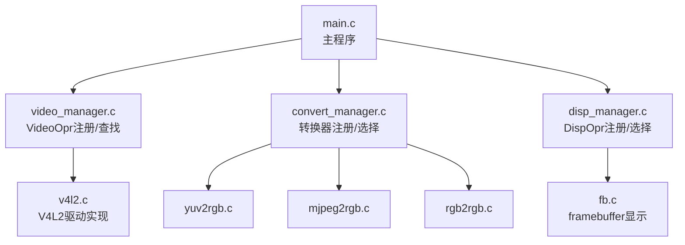
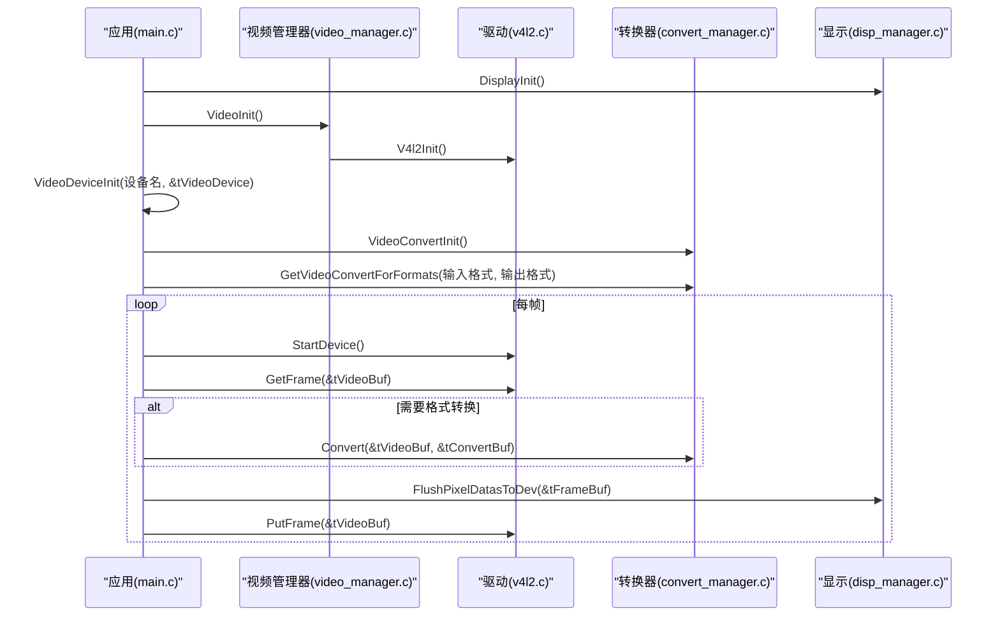
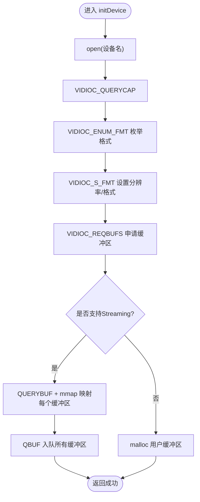
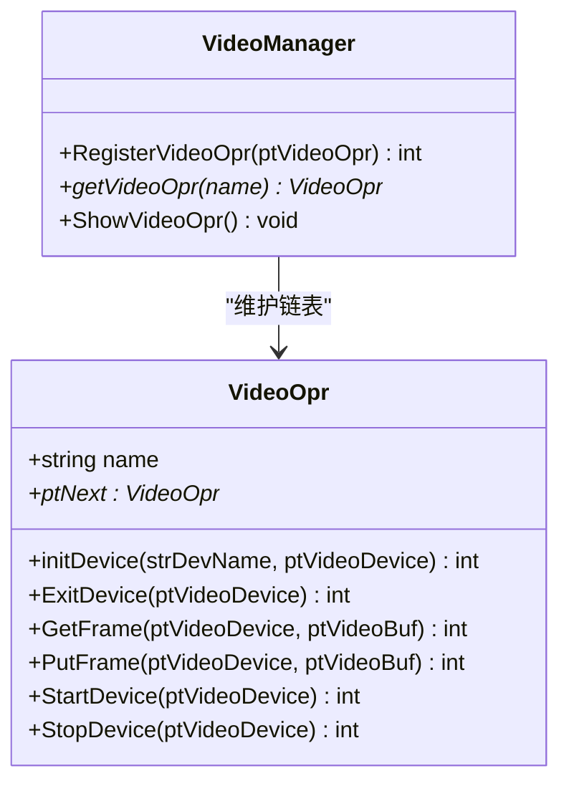
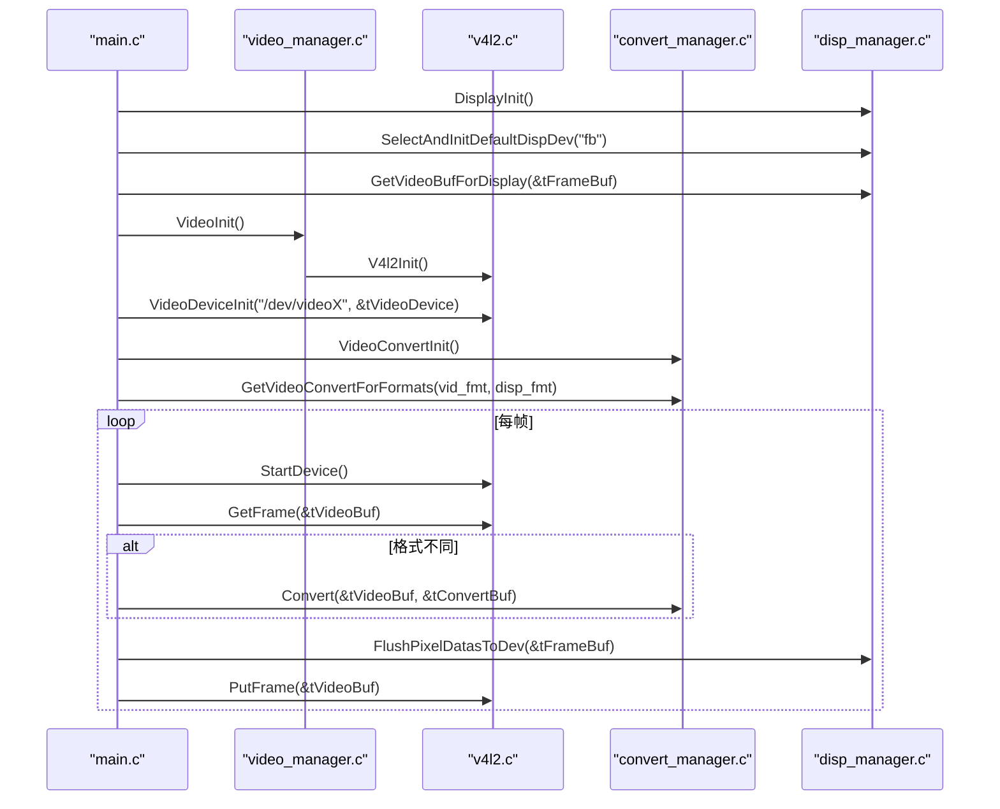
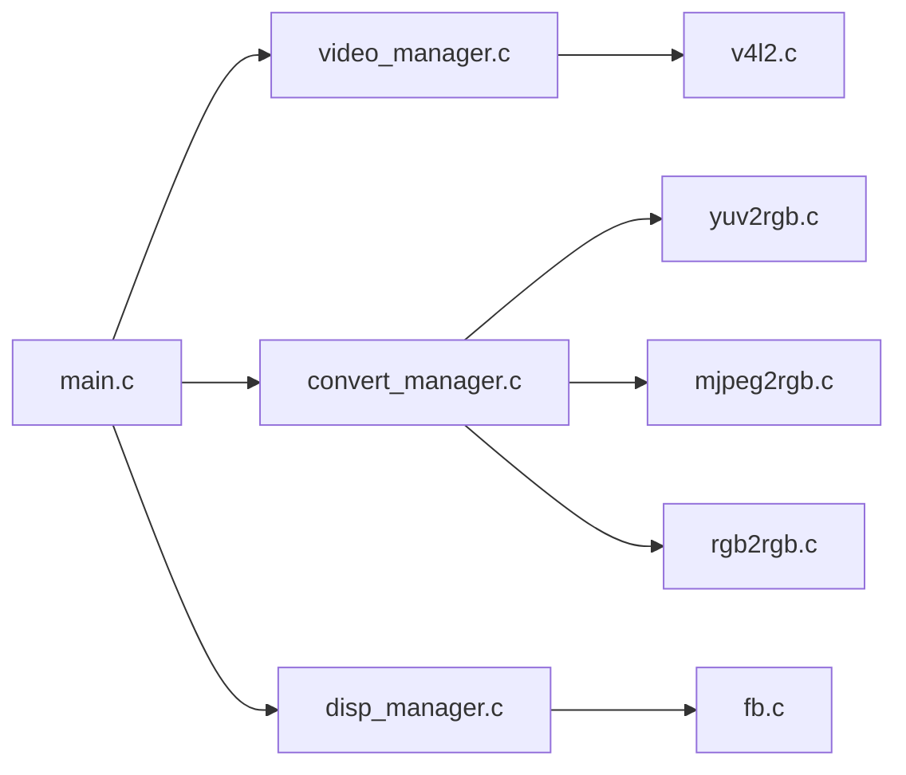

# 添加新视频设备

<cite>
**本文引用的文件**
- [video_manager.h](file://video2lcd/include/video_manager.h)
- [video_manager.c](file://video2lcd/video/video_manager.c)
- [v4l2.c](file://video2lcd/video/v4l2.c)
- [main.c](file://video2lcd/main.c)
- [convert_manager.h](file://video2lcd/include/convert_manager.h)
- [convert_manager.c](file://video2lcd/convert/convert_manager.c)
- [disp_manager.h](file://video2lcd/include/disp_manager.h)
- [disp_manager.c](file://video2lcd/display/disp_manager.c)
- [config.h](file://video2lcd/include/config.h)
- [Makefile](file://video2lcd/Makefile)
- [V4L2关键机制深度解析.md](file://video2lcd/doc/V4L2关键机制深度解析.md)
</cite>

## 目录
1. [简介](#简介)
2. [项目结构](#项目结构)
3. [核心组件](#核心组件)
4. [架构总览](#架构总览)
5. [详细组件分析](#详细组件分析)
6. [依赖关系分析](#依赖关系分析)
7. [性能与资源管理](#性能与资源管理)
8. [兼容性测试与调试指南](#兼容性测试与调试指南)
9. [结论](#结论)
10. [附录：实现清单与示例路径](#附录：实现清单与示例路径)

## 简介
本指南面向需要在嵌入式Linux相机项目中添加新视频设备的开发者。重点说明如何实现 VideoOpr 接口结构体（initDevice、ExitDevice、GetFrame、PutFrame、StartDevice、StopDevice），解释设备注册机制与插件式架构，提供完整实现步骤与代码片段路径，并给出兼容性测试方法、调试技巧、错误处理策略与资源管理最佳实践。

## 项目结构
本项目采用分层与插件化设计：
- 视频采集层：通过 VideoOpr 抽象不同视频设备驱动（当前为 V4L2）
- 显示层：通过 DispOpr 抽象显示设备（当前为 framebuffer）
- 格式转换层：通过 VideoConvert 抽象像素格式转换器（YUV/MJPEG/RGB）
- 渲染层：缩放、合并等图像操作
- 主程序：串联初始化、采集、转换、显示流程

图表来源
- [main.c:34-192](file://video2lcd/main.c#L34-L192)
- [video_manager.c:12-75](file://video2lcd/video/video_manager.c#L12-L75)
- [v4l2.c:47-401](file://video2lcd/video/v4l2.c#L47-L401)
- [convert_manager.c:23-131](file://video2lcd/convert/convert_manager.c#L23-L131)
- [disp_manager.c:27-524](file://video2lcd/display/disp_manager.c#L27-L524)

章节来源
- [main.c:34-192](file://video2lcd/main.c#L34-L192)
- [Makefile:30-43](file://video2lcd/Makefile#L30-L43)

## 核心组件
- VideoDevice：封装单个视频设备的状态（fd、像素格式、分辨率、缓冲区数组、操作函数指针）
- VideoOpr：定义统一的视频设备操作接口（名称、初始化、退出、取帧、还帧、启停、链表指针）
- VideoBuf：统一描述一帧图像数据（像素数据结构、像素格式）
- 注册机制：全局链表维护已注册的 VideoOpr，支持按名称查找与遍历

章节来源
- [video_manager.h:14-56](file://video2lcd/include/video_manager.h#L14-L56)
- [video_manager.c:12-75](file://video2lcd/video/video_manager.c#L12-L75)

## 架构总览
系统启动时，先初始化显示模块（FBInit），再初始化视频模块（VideoInit -> V4l2Init），随后根据命令行参数打开具体视频设备（VideoDeviceInit），获取像素格式后选择合适的格式转换器，循环执行 GetFrame -> 转换（可选）-> 缩放（可选）-> 合并到帧缓冲 -> FlushPixelDatasToDev -> PutFrame。

图表来源
- [main.c:63-192](file://video2lcd/main.c#L63-L192)
- [video_manager.c:67-75](file://video2lcd/video/video_manager.c#L67-L75)
- [v4l2.c:357-401](file://video2lcd/video/v4l2.c#L357-L401)
- [convert_manager.c:121-131](file://video2lcd/convert/convert_manager.c#L121-L131)
- [disp_manager.c:148-175](file://video2lcd/display/disp_manager.c#L148-L175)

## 详细组件分析

### VideoOpr 接口与实现要点
- initDevice(strDevName, ptVideoDevice)
  - 打开设备文件，查询能力 VIDIOC_QUERYCAP
  - 枚举支持的像素格式 VIDIOC_ENUM_FMT，选择目标格式
  - 设置分辨率与格式 VIDIOC_S_FMT
  - 申请缓冲区 VIDIOC_REQBUFS，并根据能力选择 Streaming 或 ReadWrite 模式
  - Streaming：QUERYBUF + mmap 映射每个缓冲区；QBUF 入队
  - ReadWrite：分配用户缓冲区，后续 read() 读取
- ExitDevice(ptVideoDevice)
  - 释放 mmap 内存（munmap），关闭 fd
- GetFrame(ptVideoDevice, ptVideoBuf)
  - Streaming：poll 等待可读，DQBUF 取出缓冲区，填充 VideoBuf（宽度、高度、bpp、行字节、总字节、像素数据指针）
  - ReadWrite：read 到用户缓冲区，填充 VideoBuf
- PutFrame(ptVideoDevice, ptVideoBuf)
  - Streaming：QBUF 将缓冲区重新入队
  - ReadWrite：空实现（无队列）
- StartDevice(ptVideoDevice)
  - STREAMON
- StopDevice(ptVideoDevice)
  - STREAMOFF

图表来源
- [v4l2.c:47-249](file://video2lcd/video/v4l2.c#L47-L249)

章节来源
- [v4l2.c:47-401](file://video2lcd/video/v4l2.c#L47-L401)
- [video_manager.h:35-44](file://video2lcd/include/video_manager.h#L35-L44)

### 设备注册机制与插件式架构
- 注册：RegisterVideoOpr 将 VideoOpr 结构体尾插到全局链表
- 查找：getVideoOpr 按 name 匹配返回对应 VideoOpr
- 扩展：新增驱动只需实现 VideoOpr 并调用 RegisterVideoOpr 完成注册
- 类似机制：显示模块（DispOpr）、格式转换模块（VideoConvert）均采用相同注册/查找模式

图表来源
- [video_manager.h:35-44](file://video2lcd/include/video_manager.h#L35-L44)
- [video_manager.c:12-58](file://video2lcd/video/video_manager.c#L12-L58)

章节来源
- [video_manager.c:12-75](file://video2lcd/video/video_manager.c#L12-L75)
- [convert_manager.c:23-131](file://video2lcd/convert/convert_manager.c#L23-L131)
- [disp_manager.c:27-113](file://video2lcd/display/disp_manager.c#L27-L113)

### 主流程与数据流
- 初始化顺序：DisplayInit -> SelectAndInitDefaultDispDev -> GetDispResolution -> GetVideoBufForDisplay -> VideoInit -> V4l2Init -> VideoDeviceInit -> VideoConvertInit -> GetVideoConvertForFormats
- 每帧流程：StartDevice -> GetFrame -> 转换（必要时）-> 缩放（必要时）-> PicMerge -> FlushPixelDatasToDev -> PutFrame

图表来源
- [main.c:63-192](file://video2lcd/main.c#L63-L192)
- [video_manager.c:67-75](file://video2lcd/video/video_manager.c#L67-L75)
- [v4l2.c:357-401](file://video2lcd/video/v4l2.c#L357-L401)
- [convert_manager.c:121-131](file://video2lcd/convert/convert_manager.c#L121-L131)
- [disp_manager.c:148-175](file://video2lcd/display/disp_manager.c#L148-L175)

章节来源
- [main.c:63-192](file://video2lcd/main.c#L63-L192)

## 依赖关系分析
- main.c 依赖 video_manager、convert_manager、disp_manager
- video_manager.c 依赖 v4l2.c（通过 V4l2Init 注册）
- convert_manager.c 聚合多个转换器（YUV/MJPEG/RGB）
- disp_manager.c 聚合显示驱动（当前为 fb）

图表来源
- [main.c:1-192](file://video2lcd/main.c#L1-L192)
- [video_manager.c:1-75](file://video2lcd/video/video_manager.c#L1-L75)
- [convert_manager.c:1-131](file://video2lcd/convert/convert_manager.c#L1-L131)
- [disp_manager.c:1-524](file://video2lcd/display/disp_manager.c#L1-L524)

章节来源
- [Makefile:30-43](file://video2lcd/Makefile#L30-L43)

## 性能与资源管理
- 零拷贝：Streaming 模式使用 mmap 直接访问内核缓冲区，避免额外拷贝
- 多缓冲轮转：NB_BUFFER 个缓冲区形成环形队列，提升吞吐与稳定性
- 格式转换优化：仅在输入与输出格式不一致时进行转换
- 缩放策略：保持宽高比，优先以 LCD 宽度为基准计算缩放尺寸
- 资源释放：ExitDevice 中 munmap 所有映射并 close fd；确保异常路径也清理资源

章节来源
- [v4l2.c:152-249](file://video2lcd/video/v4l2.c#L152-L249)
- [v4l2.c:251-265](file://video2lcd/video/v4l2.c#L251-L265)
- [main.c:129-178](file://video2lcd/main.c#L129-L178)

## 兼容性测试与调试指南
- 设备能力检测：确认设备具备 VIDEO_CAPTURE 能力，支持 streaming 或 read/write
- 格式支持：枚举并选择目标像素格式（YUYV/MJPEG/RGB565），若不支持则失败
- 缓冲区大小：length 由 S_FMT 设置的分辨率与格式决定，需正确映射与入队
- 常见问题定位：
  - 无法 open 设备：检查设备节点权限与存在性
  - ioctl 失败：检查返回值与错误码，打印调试信息
  - poll 超时：确认设备是否处于 STREAMON 状态
  - 显示黑屏/花屏：检查像素格式、BPP、行字节与总字节是否正确
- 调试建议：
  - 启用 DBG_PRINTF 输出关键步骤
  - 逐步验证：open -> QUERYCAP -> ENUM_FMT -> S_FMT -> REQBUFS -> QUERYBUF/mmap -> QBUF -> STREAMON -> DQBUF/QBUF
  - 对比已知工作驱动（如 v4l2.c）的行为差异

章节来源
- [v4l2.c:47-249](file://video2lcd/video/v4l2.c#L47-L249)
- [V4L2关键机制深度解析.md:1-278](file://video2lcd/doc/V4L2关键机制深度解析.md#L1-L278)

## 结论
通过实现 VideoOpr 接口并完成注册，即可将新的视频设备无缝接入本项目的插件式架构。遵循 V4L2 标准流程、合理管理缓冲区与资源、在必要处进行格式转换与缩放，即可稳定高效地实现视频采集与显示。

## 附录：实现清单与示例路径
- 实现 VideoOpr 的六个核心函数：
  - initDevice：参考 [v4l2.c:47-249](file://video2lcd/video/v4l2.c#L47-L249)
  - ExitDevice：参考 [v4l2.c:251-265](file://video2lcd/video/v4l2.c#L251-L265)
  - GetFrame：参考 [v4l2.c:267-355](file://video2lcd/video/v4l2.c#L267-L355)
  - PutFrame：参考 [v4l2.c:309-355](file://video2lcd/video/v4l2.c#L309-L355)
  - StartDevice：参考 [v4l2.c:357-369](file://video2lcd/video/v4l2.c#L357-L369)
  - StopDevice：参考 [v4l2.c:371-383](file://video2lcd/video/v4l2.c#L371-L383)
- 注册新驱动：
  - 构造 VideoOpr 实例并调用 RegisterVideoOpr：参考 [v4l2.c:387-401](file://video2lcd/video/v4l2.c#L387-L401)
  - 在 VideoInit 中调用新驱动的初始化入口（类比 V4l2Init）：参考 [video_manager.c:67-75](file://video2lcd/video/video_manager.c#L67-L75)
- 主流程集成：
  - 初始化与循环采集：参考 [main.c:63-192](file://video2lcd/main.c#L63-L192)
- 显示与转换：
  - 显示初始化与帧缓冲获取：参考 [disp_manager.c:148-175](file://video2lcd/display/disp_manager.c#L148-L175)
  - 转换器初始化与选择：参考 [convert_manager.c:121-131](file://video2lcd/convert/convert_manager.c#L121-L131)