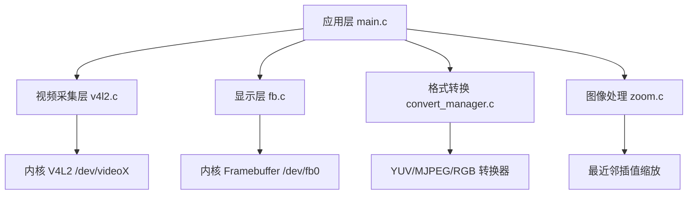
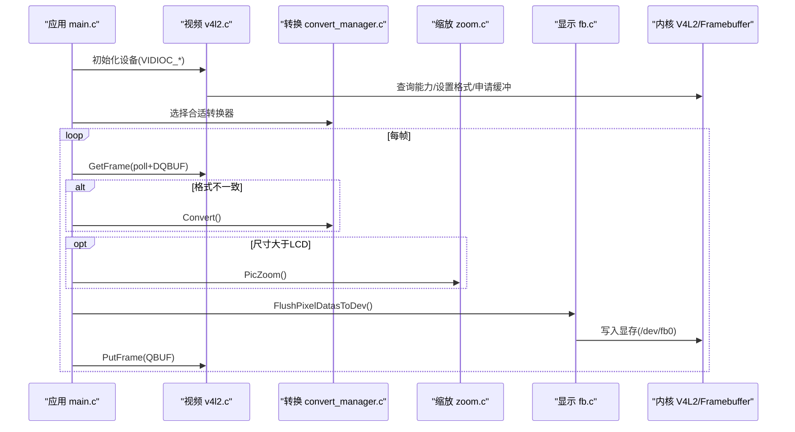
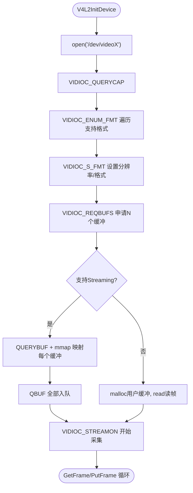
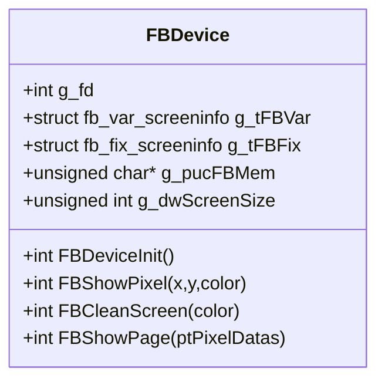
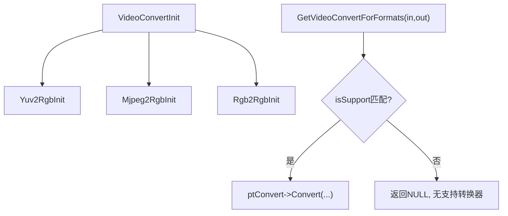
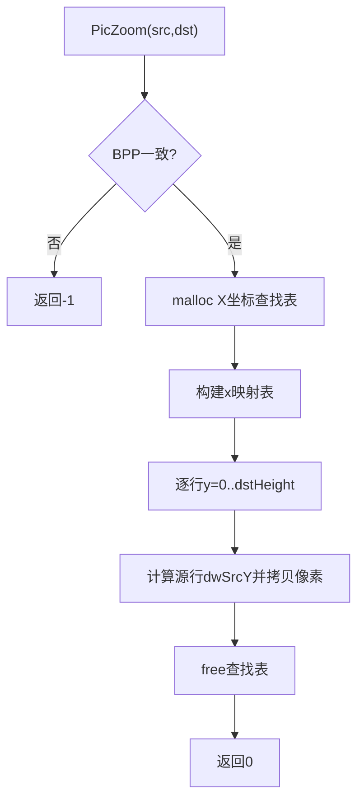
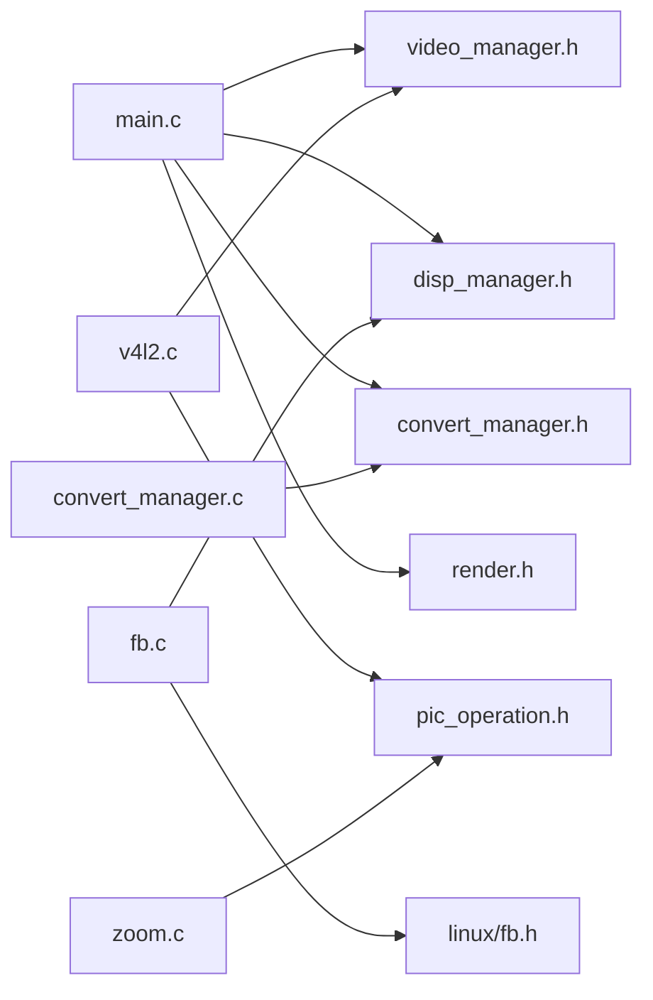

# 故障排除与调试

<cite>
**本文引用的文件**
- [main.c](file://video2lcd/main.c)
- [config.h](file://video2lcd/include/config.h)
- [v4l2.c](file://video2lcd/video/v4l2.c)
- [fb.c](file://video2lcd/display/fb.c)
- [convert_manager.c](file://video2lcd/convert/convert_manager.c)
- [zoom.c](file://video2lcd/render/operation/zoom.c)
- [video_manager.h](file://video2lcd/include/video_manager.h)
- [disp_manager.h](file://video2lcd/include/disp_manager.h)
- [pic_operation.h](file://video2lcd/include/pic_operation.h)
- [V4L2关键机制深度解析.md](file://video2lcd/doc/V4L2关键机制深度解析.md)
- [嵌入式Linux相机项目学习笔记.md](file://video2lcd/doc/嵌入式Linux相机项目学习笔记.md)
</cite>

## 目录
1. [简介](#简介)
2. [项目结构](#项目结构)
3. [核心组件](#核心组件)
4. [架构总览](#架构总览)
5. [详细组件分析](#详细组件分析)
6. [依赖关系分析](#依赖关系分析)
7. [性能考虑](#性能考虑)
8. [故障排除指南](#故障排除指南)
9. [结论](#结论)
10. [附录](#附录)

## 简介
本指南面向嵌入式Linux相机项目的开发与维护人员，聚焦于系统常见问题的诊断与解决、调试工具使用（GDB、printf调试、系统日志）、错误类型与修复策略、性能问题定位（CPU、内存、I/O）、崩溃与死锁排查、日志系统配置与管理，以及标准问题报告格式与调试信息收集方法。内容基于仓库源码与文档进行系统化梳理，确保可操作性和可追溯性。

## 项目结构
本项目采用分层与插件化设计：
- 应用层：main.c 负责设备初始化、采集循环、格式转换、缩放与显示刷新。
- 视频采集层：video_manager.h 定义统一接口；v4l2.c 实现V4L2驱动适配（Streaming/Read-Write两种模式）。
- 显示层：disp_manager.h 定义显示抽象；fb.c 实现Framebuffer设备驱动。
- 渲染与处理：render/operation/zoom.c 提供图像缩放；convert_manager.c 管理多种格式转换器注册与选择。
- 公共数据结构：pic_operation.h 定义像素数据载体 T_PixelDatas。
- 配置：include/config.h 定义调试输出宏与设备路径等。

图表来源
- [main.c:34-189](file://video2lcd/main.c#L34-L189)
- [v4l2.c:47-401](file://video2lcd/video/v4l2.c#L47-L401)
- [fb.c:53-253](file://video2lcd/display/fb.c#L53-L253)
- [convert_manager.c:23-131](file://video2lcd/convert/convert_manager.c#L23-L131)
- [zoom.c:27-86](file://video2lcd/render/operation/zoom.c#L27-L86)

章节来源
- [main.c:34-189](file://video2lcd/main.c#L34-L189)
- [video_manager.h:14-56](file://video2lcd/include/video_manager.h#L14-L56)
- [disp_manager.h:84-236](file://video2lcd/include/disp_manager.h#L84-L236)
- [pic_operation.h:10-18](file://video2lcd/include/pic_operation.h#L10-L18)

## 核心组件
- 视频采集（V4L2）：支持 Streaming（mmap + poll + DQBUF/QBUF）与 Read-Write（read）两种模式；自动枚举并选择支持的像素格式；申请多个缓冲区以实现流水线采集。
- 显示（Framebuffer）：打开/dev/fb0，获取屏幕分辨率与BPP，映射显存到用户空间；支持清屏、画点、整页刷新。
- 格式转换：通过链表注册多种转换器（YUV->RGB、MJPEG->RGB、RGB->RGB），根据输入输出格式动态选择。
- 图像处理：PicZoom 使用最近邻插值进行等比例缩放，避免画面拉伸变形。
- 主循环：从摄像头取帧→必要时格式转换→必要时缩放→居中合并到帧缓冲→刷新到LCD→归还缓冲区。

章节来源
- [v4l2.c:47-401](file://video2lcd/video/v4l2.c#L47-L401)
- [fb.c:53-253](file://video2lcd/display/fb.c#L53-L253)
- [convert_manager.c:23-131](file://video2lcd/convert/convert_manager.c#L23-L131)
- [zoom.c:27-86](file://video2lcd/render/operation/zoom.c#L27-L86)
- [main.c:34-189](file://video2lcd/main.c#L34-L189)

## 架构总览
下图展示从应用层到内核驱动的调用链路与数据流：

图表来源
- [main.c:76-189](file://video2lcd/main.c#L76-L189)
- [v4l2.c:152-326](file://video2lcd/video/v4l2.c#L152-L326)
- [convert_manager.c:98-131](file://video2lcd/convert/convert_manager.c#L98-L131)
- [zoom.c:27-86](file://video2lcd/render/operation/zoom.c#L27-L86)
- [fb.c:166-174](file://video2lcd/display/fb.c#L166-L174)

## 详细组件分析

### 视频采集（V4L2）
- 设备能力检测：通过 VIDIOC_QUERYCAP 判断是否支持视频采集与 streaming/read-write。
- 格式枚举与设置：VIDIOC_ENUM_FMT 遍历支持格式，VIDIOC_S_FMT 设置分辨率与像素格式。
- 缓冲区管理：VIDIOC_REQBUFS 申请多个缓冲区；Streaming 模式下 QUERYBUF+mmap 映射到用户空间，QBUF 入队；读取时 DQBUF 出队，处理后 QBUF 放回。
- 错误处理：所有 ioctl/mmap 失败均打印错误并跳转至 err_exit 清理资源。

图表来源
- [v4l2.c:47-249](file://video2lcd/video/v4l2.c#L47-L249)
- [v4l2.c:267-326](file://video2lcd/video/v4l2.c#L267-L326)
- [v4l2.c:357-383](file://video2lcd/video/v4l2.c#L357-L383)

章节来源
- [v4l2.c:47-401](file://video2lcd/video/v4l2.c#L47-L401)
- [V4L2关键机制深度解析.md:117-278](file://video2lcd/doc/V4L2关键机制深度解析.md#L117-L278)

### 显示（Framebuffer）
- 设备初始化：打开 /dev/fb0，获取可变/固定屏幕信息，计算屏幕大小并 mmap 显存。
- 显示操作：支持按BPP写点、清屏、整页复制显示；当目标内存非显存时执行 memcpy 到显存。
- 错误处理：ioctl/mmap 失败打印错误并返回。

图表来源
- [fb.c:25-94](file://video2lcd/display/fb.c#L25-L94)
- [fb.c:106-174](file://video2lcd/display/fb.c#L106-L174)
- [fb.c:183-240](file://video2lcd/display/fb.c#L183-L240)

章节来源
- [fb.c:53-253](file://video2lcd/display/fb.c#L53-L253)

### 格式转换管理
- 注册与选择：通过链表注册多个转换器，根据输入输出格式调用 isSupport 匹配并执行 Convert。
- 初始化：依次初始化 YUV->RGB、MJPEG->RGB、RGB->RGB 转换器。

图表来源
- [convert_manager.c:23-131](file://video2lcd/convert/convert_manager.c#L23-L131)

章节来源
- [convert_manager.c:23-131](file://video2lcd/convert/convert_manager.c#L23-L131)

### 图像处理（缩放）
- 算法：最近邻插值，构建X坐标查找表，逐行拷贝像素。
- 约束：要求源与目标BPP一致；分配临时查找表并在结束后释放。

图表来源
- [zoom.c:27-86](file://video2lcd/render/operation/zoom.c#L27-L86)

章节来源
- [zoom.c:27-86](file://video2lcd/render/operation/zoom.c#L27-L86)

## 依赖关系分析
- 模块耦合：
  - main.c 依赖 video_manager.h、disp_manager.h、convert_manager.h、render.h。
  - v4l2.c 依赖 config.h、video_manager.h、pic_operation.h。
  - fb.c 依赖 config.h、disp_manager.h、linux/fb.h。
  - convert_manager.c 依赖 config.h、convert_manager.h、video_manager.h。
  - zoom.c 依赖 config.h、pic_operation.h。
- 外部依赖：
  - Linux V4L2子系统（/dev/videoX）。
  - Linux Framebuffer子系统（/dev/fb0）。
  - libjpeg（用于MJPEG解码，包含错误处理机制）。

图表来源
- [main.c:34-189](file://video2lcd/main.c#L34-L189)
- [v4l2.c:1-35](file://video2lcd/video/v4l2.c#L1-L35)
- [fb.c:9-17](file://video2lcd/display/fb.c#L9-L17)
- [convert_manager.c:9-11](file://video2lcd/convert/convert_manager.c#L9-L11)
- [zoom.c:11-14](file://video2lcd/render/operation/zoom.c#L11-L14)

章节来源
- [embedded notes:45-80](file://video2lcd/doc/嵌入式Linux相机项目学习笔记.md#L45-L80)

## 性能考虑
- 采集模式选择：优先使用 Streaming 模式（零拷贝、多缓冲轮转），避免 Read-Write 模式的额外拷贝开销。
- 缓冲区数量：合理设置 NB_BUFFER（默认4），平衡吞吐与内存占用；过多会增加内存压力，过少可能导致丢帧。
- 格式转换成本：尽量让摄像头输出与LCD格式一致以减少转换；若必须转换，注意内存分配与拷贝开销。
- 缩放策略：仅在图像尺寸大于LCD时缩放；使用最近邻插值速度快但质量一般，可根据需求优化为双线性/双三次插值。
- 显示刷新：使用整页 memcpy 到显存减少多次小写操作；确保目标内存与显存地址一致时跳过拷贝。

[本节为通用指导，不直接分析具体文件]

## 故障排除指南

### 常见问题与解决方案
- 设备访问错误
  - 现象：无法打开 /dev/videoX 或 /dev/fb0；ioctl 失败。
  - 排查：检查设备节点是否存在与权限；确认内核驱动已加载；查看 dmesg 是否有设备相关错误。
  - 参考位置：
    - [v4l2.c:64-77](file://video2lcd/video/v4l2.c#L64-L77)
    - [fb.c:56-74](file://video2lcd/display/fb.c#L56-L74)
- 内存分配失败
  - 现象：malloc 返回 NULL；mmap 返回 MAP_FAILED。
  - 排查：检查系统可用内存；减少缓冲区数量或图像分辨率；确认未重复分配导致泄漏。
  - 参考位置：
    - [v4l2.c:187-194](file://video2lcd/video/v4l2.c#L187-L194)
    - [zoom.c:51-56](file://video2lcd/render/operation/zoom.c#L51-L56)
- 格式不兼容
  - 现象：GetVideoConvertForFormats 返回 NULL；转换失败。
  - 排查：确认摄像头输出格式与LCD格式；检查转换器是否已正确注册与初始化。
  - 参考位置：
    - [main.c:91-99](file://video2lcd/main.c#L91-L99)
    - [convert_manager.c:98-111](file://video2lcd/convert/convert_manager.c#L98-L111)
- 采集卡顿或丢帧
  - 现象：GetFrame 阻塞或频繁失败；PutFrame 失败。
  - 排查：检查 poll 超时与返回值；确认 DQBUF/QBUF 配对正确；避免在主循环中进行耗时操作。
  - 参考位置：
    - [v4l2.c:267-306](file://video2lcd/video/v4l2.c#L267-L306)
    - [v4l2.c:309-326](file://video2lcd/video/v4l2.c#L309-L326)
- 显示异常或花屏
  - 现象：屏幕无显示、颜色错乱、闪烁。
  - 排查：确认BPP与颜色格式转换正确；检查 memcpy 长度与行字节数；验证清屏与刷新顺序。
  - 参考位置：
    - [fb.c:166-174](file://video2lcd/display/fb.c#L166-L174)
    - [fb.c:183-240](file://video2lcd/display/fb.c#L183-L240)

章节来源
- [v4l2.c:64-326](file://video2lcd/video/v4l2.c#L64-L326)
- [fb.c:56-240](file://video2lcd/display/fb.c#L56-L240)
- [main.c:91-189](file://video2lcd/main.c#L91-L189)
- [zoom.c:51-86](file://video2lcd/render/operation/zoom.c#L51-L86)

### 调试工具使用方法
- printf 调试
  - 启用/关闭：通过 include/config.h 中的 DBG_PRINTF 宏控制输出开关。
  - 建议：在关键路径（设备初始化、ioctl、mmap、转换、缩放、刷新）添加结构化日志，包含参数与返回值。
  - 参考位置：
    - [config.h:13-18](file://video2lcd/include/config.h#L13-L18)
    - [v4l2.c:64-249](file://video2lcd/video/v4l2.c#L64-L249)
    - [fb.c:56-94](file://video2lcd/display/fb.c#L56-L94)
- GDB 调试
  - 启动调试：编译时保留符号（-g），使用 gdb ./video2lcd 启动。
  - 常用命令：break 关键函数（如 V4l2InitDevice、FBDeviceInit、PicZoom）、run 运行、print 查看变量、bt 查看堆栈。
  - 断点建议：在 ioctl 前后、mmap 前后、malloc/free 处设置断点，观察返回值与内存状态。
- 系统日志分析
  - 使用 dmesg 查看内核消息，重点关注 V4L2 与 framebuffer 相关错误。
  - 结合应用层 DBG_PRINTF 输出，交叉定位问题阶段。

章节来源
- [config.h:13-18](file://video2lcd/include/config.h#L13-L18)
- [v4l2.c:64-249](file://video2lcd/video/v4l2.c#L64-L249)
- [fb.c:56-94](file://video2lcd/display/fb.c#L56-L94)

### 性能问题诊断方法
- CPU 占用率分析
  - 使用 top/htop 观察进程CPU占用；定位热点函数（如 PicZoom、Convert）。
  - 使用 perf 采样热点函数调用次数与耗时。
- 内存使用监控
  - 使用 valgrind 检测内存泄漏与越界访问；关注 malloc/free 配对。
  - 检查 NB_BUFFER 与图像分辨率对内存占用的影响。
- I/O 性能评估
  - 使用 iostat 观察磁盘与设备I/O；对于V4L2/Framebuffer，关注 mmap 与 memcpy 的带宽。
  - 对比 Streaming 与 Read-Write 模式下的吞吐差异。

[本节为通用指导，不直接分析具体文件]

### 系统崩溃与死锁排查技巧
- 崩溃定位
  - 使用 GDB 捕获 core dump，查看信号与堆栈；重点检查非法指针访问、数组越界。
  - 检查 libjpeg 错误处理（MyErrorExit）是否正确恢复，避免程序退出。
- 死锁排查
  - 检查多线程环境下 VideoMem 状态机（FREE/USED_FOR_PREPARE/USED_FOR_CUR）是否正确使用。
  - 确保 DQBUF/QBUF 成对出现，避免队列饥饿。
- 参考位置：
  - [disp_manager.h:39-76](file://video2lcd/include/disp_manager.h#L39-L76)
  - [v4l2.c:267-326](file://video2lcd/video/v4l2.c#L267-L326)

章节来源
- [disp_manager.h:39-76](file://video2lcd/include/disp_manager.h#L39-L76)
- [v4l2.c:267-326](file://video2lcd/video/v4l2.c#L267-L326)

### 日志系统配置与使用
- 日志级别控制
  - 通过 config.h 中的 DBG_PRINTF 宏切换输出开关；生产环境建议关闭以减小开销。
- 日志文件管理
  - 将 DBG_PRINTF 重定向到文件（例如 stdout 重定向或自定义 log 函数），定期归档与轮转。
- 参考位置：
  - [config.h:13-18](file://video2lcd/include/config.h#L13-L18)

章节来源
- [config.h:13-18](file://video2lcd/include/config.h#L13-L18)

### 问题报告标准格式与调试信息收集
- 问题描述
  - 设备型号、内核版本、摄像头设备节点、LCD分辨率与BPP。
- 复现步骤
  - 命令行参数、运行环境、触发条件。
- 日志与快照
  - 应用层 DBG_PRINTF 输出、dmesg 日志片段、core dump 文件。
- 性能数据
  - top/htop 截图、perf 报告、valgrind 报告。
- 参考位置
  - [main.c:34-189](file://video2lcd/main.c#L34-L189)
  - [v4l2.c:47-401](file://video2lcd/video/v4l2.c#L47-L401)
  - [fb.c:53-253](file://video2lcd/display/fb.c#L53-L253)

章节来源
- [main.c:34-189](file://video2lcd/main.c#L34-L189)
- [v4l2.c:47-401](file://video2lcd/video/v4l2.c#L47-L401)
- [fb.c:53-253](file://video2lcd/display/fb.c#L53-L253)

## 结论
本指南基于项目源码与文档，系统梳理了嵌入式Linux相机项目的架构与关键组件，提供了针对设备访问、内存分配、格式兼容、采集与显示等常见问题的诊断与解决方法，并结合 GDB、printf 与系统日志进行调试实践。同时给出了性能分析与崩溃排查的建议，以及标准化的问题报告格式，帮助开发者快速定位与解决问题，提升系统稳定性与可维护性。

## 附录
- V4L2 关键机制参考：
  - 设备能力位运算、格式枚举、缓冲区申请与映射、Streaming/Read-Write 模式对比。
  - 参考位置：[V4L2关键机制深度解析.md:7-278](file://video2lcd/doc/V4L2关键机制深度解析.md#L7-L278)
- 项目结构与结构体说明：
  - 分层架构、核心结构体作用、抽象接口设计。
  - 参考位置：[嵌入式Linux相机项目学习笔记.md:45-263](file://video2lcd/doc/嵌入式Linux相机项目学习笔记.md#L45-L263)