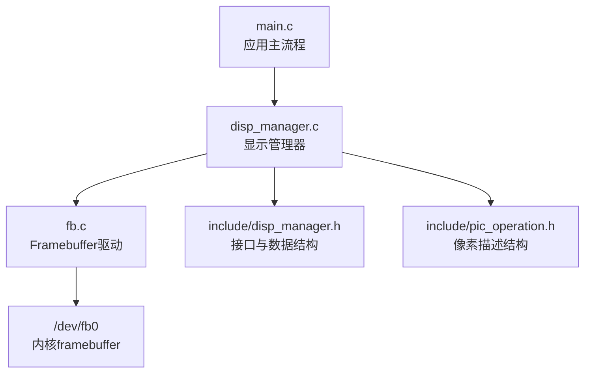
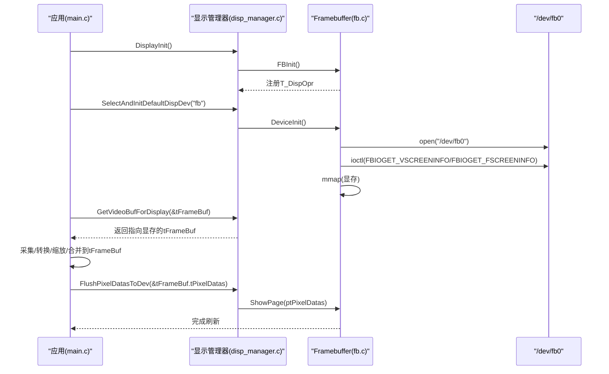
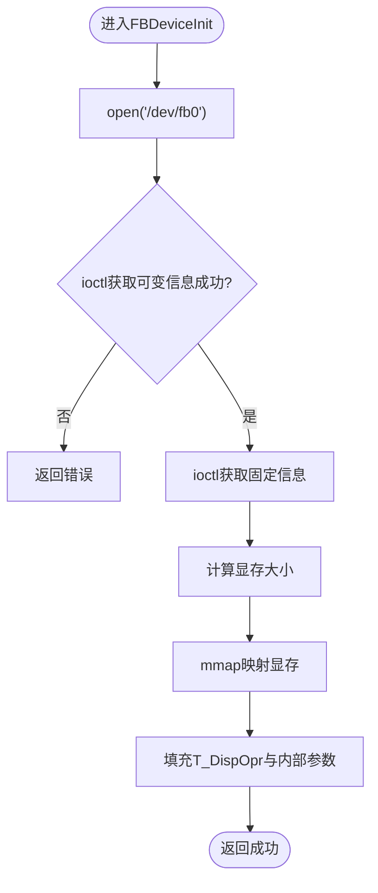
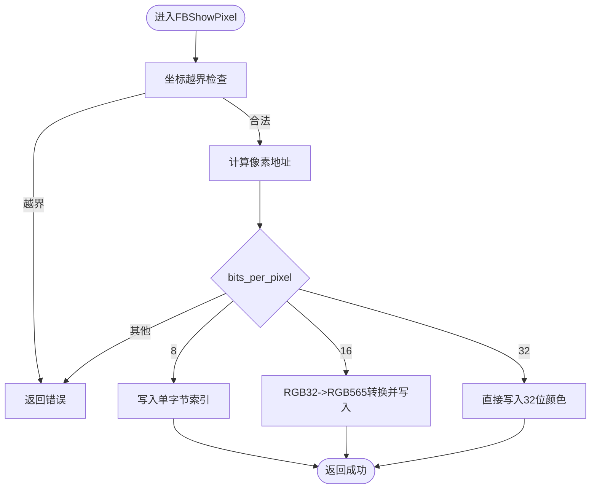
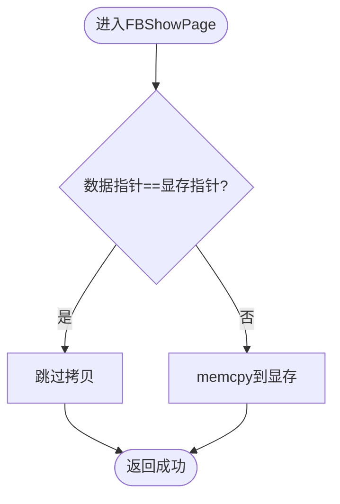
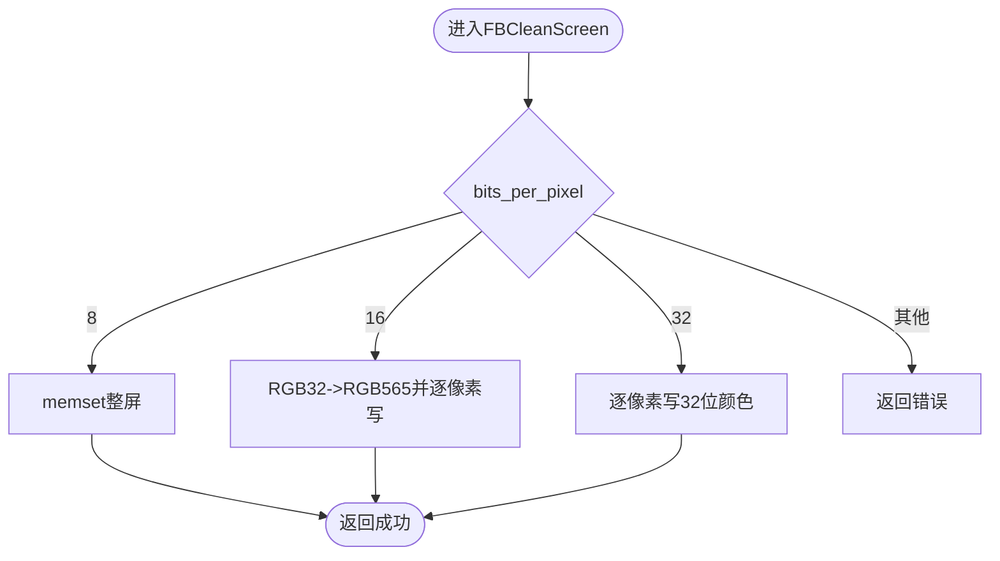
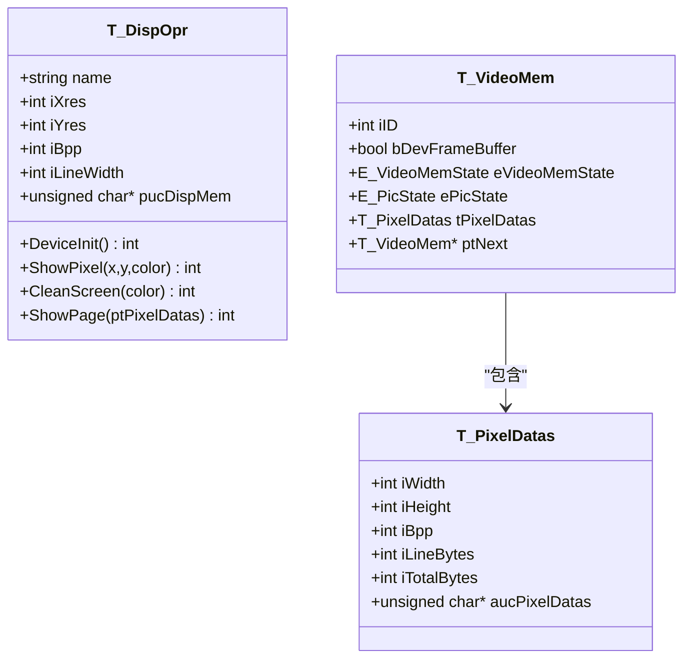
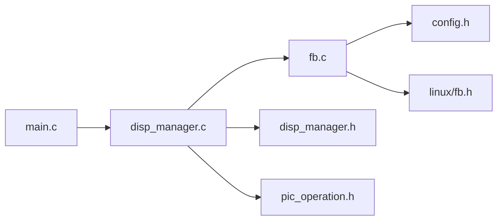

# Framebuffer驱动实现

<cite>
**本文引用的文件**
- [fb.c](file://video2lcd/display/fb.c)
- [disp_manager.h](file://video2lcd/include/disp_manager.h)
- [disp_manager.c](file://video2lcd/display/disp_manager.c)
- [pic_operation.h](file://video2lcd/include/pic_operation.h)
- [config.h](file://video2lcd/include/config.h)
- [main.c](file://video2lcd/main.c)
</cite>

## 目录
1. [简介](#简介)
2. [项目结构](#项目结构)
3. [核心组件](#核心组件)
4. [架构总览](#架构总览)
5. [详细组件分析](#详细组件分析)
6. [依赖关系分析](#依赖关系分析)
7. [性能考虑](#性能考虑)
8. [故障排查指南](#故障排查指南)
9. [结论](#结论)
10. [附录](#附录)

## 简介
本技术文档围绕基于Linux Framebuffer的LCD显示实现，系统阐述设备文件操作、内存映射机制与硬件抽象层设计。重点解析FBDeviceInit初始化流程（打开/dev/fb0、ioctl获取屏幕信息、mmap内存映射）、像素操作接口FBShowPixel在不同位深(8/16/32bpp)下的颜色格式转换与坐标计算、批量显示函数FBShowPage的工作原理，以及FBCleanScreen清屏功能的优化实现。同时提供扩展新显示设备的指南、常见问题兼容性与性能优化建议及调试方法。

## 项目结构
本项目将显示子系统以“设备抽象 + 管理器”的方式组织：
- display/fb.c：Framebuffer设备的具体实现，封装/dev/fb0访问、内存映射、画点/清屏/整页刷新等能力。
- include/disp_manager.h：定义显示设备操作接口T_DispOpr、视频缓冲VideoMem管理、统一像素描述T_PixelDatas等。
- display/disp_manager.c：实现显示设备注册、默认设备选择、VideoMem分配与管理、帧缓冲区适配与刷新。
- include/pic_operation.h：统一的像素数据描述结构，贯穿采集、转换、渲染与显示。
- include/config.h：全局配置，如调试输出宏与设备路径。
- main.c：主程序编排，完成显示初始化、摄像头采集、格式转换、缩放与居中合并、刷新到LCD。

图表来源
- [main.c:63-74](file://video2lcd/main.c#L63-L74)
- [disp_manager.c:514-521](file://video2lcd/display/disp_manager.c#L514-L521)
- [fb.c:53-94](file://video2lcd/display/fb.c#L53-L94)

章节来源
- [main.c:63-74](file://video2lcd/main.c#L63-L74)
- [disp_manager.c:514-521](file://video2lcd/display/disp_manager.c#L514-L521)
- [fb.c:53-94](file://video2lcd/display/fb.c#L53-L94)

## 核心组件
- T_DispOpr：显示设备操作接口，包含名称、分辨率、BPP、行字节数、显存指针以及DeviceInit/ShowPixel/CleanScreen/ShowPage等回调。
- T_PixelDatas：统一像素数据描述，包含宽高、BPP、行字节数、总字节数与像素数据指针。
- VideoMem：用于加速显示的页面缓冲，支持设备显存直写与用户态缓冲复用。
- FB驱动：具体实现/dev/fb0的打开、ioctl查询、mmap映射、像素写入与整页刷新。

章节来源
- [disp_manager.h:69-96](file://video2lcd/include/disp_manager.h#L69-L96)
- [pic_operation.h:10-17](file://video2lcd/include/pic_operation.h#L10-L17)
- [fb.c:36-43](file://video2lcd/display/fb.c#L36-L43)

## 架构总览
整体数据流：
- 应用层通过DisplayInit注册并选择默认显示设备（fb），随后获取分辨率与BPP。
- 通过GetVideoBufForDisplay获得指向设备显存的帧缓冲区描述，供后续绘制使用。
- 采集到的图像可能需进行格式转换与缩放，最终通过PicMerge合并到帧缓冲区指定区域。
- 调用FlushPixelDatasToDev触发底层ShowPage，将数据复制到显存或直接写入显存，完成显示。

图表来源
- [main.c:63-74](file://video2lcd/main.c#L63-L74)
- [disp_manager.c:148-175](file://video2lcd/display/disp_manager.c#L148-L175)
- [fb.c:53-94](file://video2lcd/display/fb.c#L53-L94)

## 详细组件分析

### FBDeviceInit初始化流程
- 打开设备：open(FB_DEVICE_NAME, O_RDWR)，其中FB_DEVICE_NAME由配置宏定义。
- 获取屏幕信息：两次ioctl分别获取可变信息与固定信息，得到分辨率、BPP、行字节数等。
- 计算显存大小：xres * yres * bits_per_pixel / 8。
- 内存映射：mmap将显存映射到用户空间，得到g_pucFBMem。
- 填充接口：设置T_DispOpr中的iXres/iYres/iBpp/iLineWidth/pucDispMem，并缓存每行字节数与每像素字节数以加速后续计算。

图表来源
- [fb.c:53-94](file://video2lcd/display/fb.c#L53-L94)
- [config.h:17-18](file://video2lcd/include/config.h#L17-L18)

章节来源
- [fb.c:53-94](file://video2lcd/display/fb.c#L53-L94)
- [config.h:17-18](file://video2lcd/include/config.h#L17-L18)

### FBShowPixel像素操作接口
- 坐标校验：检查坐标是否越界。
- 地址计算：pucFB = g_pucFBMem + iY * g_dwLineWidth + iX * g_dwPixelWidth。
- 位深处理：
  - 8bpp：直接写入单字节索引值。
  - 16bpp：从32位颜色提取RGB分量，转换为RGB565格式后写入。
  - 32bpp：直接写入32位颜色值。
- 注意：代码中16bpp分支使用了局部变量wColor16bpp进行转换；32bpp分支存在一个未声明变量的笔误，实际应使用pwFB32bpp或pdwFB32bpp之一进行赋值。

图表来源
- [fb.c:106-157](file://video2lcd/display/fb.c#L106-L157)

章节来源
- [fb.c:106-157](file://video2lcd/display/fb.c#L106-L157)

### FBShowPage批量显示函数
- 若传入的像素数据指针与当前显存不同，则通过memcpy将整页数据复制到显存。
- 若相同则无需复制，避免重复拷贝。
- 该实现简单高效，适用于一次性整屏更新场景。

图表来源
- [fb.c:166-174](file://video2lcd/display/fb.c#L166-L174)

章节来源
- [fb.c:166-174](file://video2lcd/display/fb.c#L166-L174)

### FBCleanScreen清屏功能
- 根据BPP选择不同策略：
  - 8bpp：memset整块显存为索引值。
  - 16bpp：将32位颜色转换为RGB565后逐像素写入。
  - 32bpp：逐像素写入32位颜色。
- 优化点：对16/32bpp采用按字/双字写入减少循环次数；对于8bpp使用memset提升效率。

图表来源
- [fb.c:183-240](file://video2lcd/display/fb.c#L183-L240)

章节来源
- [fb.c:183-240](file://video2lcd/display/fb.c#L183-L240)

### 显示管理器与VideoMem
- 注册与选择：RegisterDispOpr将设备接口加入链表；SelectAndInitDefaultDispDev选择并初始化默认设备，执行清屏。
- 帧缓冲适配：GetVideoBufForDisplay根据BPP设置像素格式，填充尺寸与行字节数，并将aucPixelDatas直接指向显存。
- 刷新：FlushPixelDatasToDev调用默认设备的ShowPage完成显示。
- VideoMem管理：AllocVideoMem将设备显存封装为第一个VideoMem，并分配若干用户态缓冲；GetVideoMem/PutVideoMem实现状态机管理；ClearVideoMem/ClearVideoMemRegion提供区域清屏能力。

图表来源
- [disp_manager.h:69-96](file://video2lcd/include/disp_manager.h#L69-L96)
- [disp_manager.h:157-197](file://video2lcd/include/disp_manager.h#L157-L197)
- [pic_operation.h:10-17](file://video2lcd/include/pic_operation.h#L10-L17)

章节来源
- [disp_manager.c:27-113](file://video2lcd/display/disp_manager.c#L27-L113)
- [disp_manager.c:148-175](file://video2lcd/display/disp_manager.c#L148-L175)
- [disp_manager.c:188-359](file://video2lcd/display/disp_manager.c#L188-L359)

## 依赖关系分析
- fb.c依赖：
  - config.h：设备路径与调试宏。
  - disp_manager.h：T_DispOpr接口与注册机制。
  - Linux内核头：fcntl/ioctl/mman/linux/fb。
- disp_manager.c依赖：
  - config.h、disp_manager.h、pic_operation.h。
  - 与fb.c协作完成设备注册与默认设备选择。
- main.c依赖：
  - 显示管理器与视频模块，完成端到端的数据流。

图表来源
- [main.c:63-74](file://video2lcd/main.c#L63-L74)
- [disp_manager.c:514-521](file://video2lcd/display/disp_manager.c#L514-L521)
- [fb.c:9-17](file://video2lcd/display/fb.c#L9-L17)

章节来源
- [main.c:63-74](file://video2lcd/main.c#L63-L74)
- [disp_manager.c:514-521](file://video2lcd/display/disp_manager.c#L514-L521)
- [fb.c:9-17](file://video2lcd/display/fb.c#L9-L17)

## 性能考虑
- 批量更新优先：尽量使用FBShowPage整页复制，减少频繁画点带来的开销。
- 位深优化：
  - 8bpp使用memset整屏，效率高。
  - 16/32bpp按字/双字写入，减少循环次数。
- 避免重复拷贝：当待显示数据已在显存时，跳过memcpy。
- 区域清屏：使用ClearVideoMemRegion仅更新需要变更的区域，降低带宽占用。
- 预取与多缓冲：利用VideoMem机制在用户态准备下一帧，降低卡顿。

[本节为通用性能建议，不直接分析具体文件]

## 故障排查指南
- 无法打开/dev/fb0：
  - 检查设备节点是否存在与权限是否正确。
  - 确认内核已启用framebuffer驱动。
- ioctl失败：
  - 检查FBIOGET_VSCREENINFO/FBIOGET_FSCREENINFO返回值。
  - 确认平台支持的分辨率与BPP。
- mmap失败：
  - 检查显存大小计算是否正确。
  - 确认进程是否有足够权限与资源。
- 显示异常：
  - 核对BPP与像素格式匹配（16bpp对应RGB565，32bpp对应RGB32）。
  - 检查坐标与行字节数计算是否一致。
- 调试输出：
  - 通过DBG_PRINTF打印关键步骤，定位问题。

章节来源
- [fb.c:53-94](file://video2lcd/display/fb.c#L53-L94)
- [fb.c:106-157](file://video2lcd/display/fb.c#L106-L157)
- [fb.c:183-240](file://video2lcd/display/fb.c#L183-L240)
- [config.h:13-18](file://video2lcd/include/config.h#L13-L18)

## 结论
本项目以清晰的抽象层实现了基于Linux Framebuffer的LCD显示：通过T_DispOpr统一接口屏蔽底层差异，借助mmap实现高效的显存访问，并提供像素级与页面级的操作能力。FBDeviceInit完成设备打开、信息查询与内存映射；FBShowPixel支持多BPP的颜色转换；FBShowPage与FBCleanScreen提供高效的批量更新与清屏。结合VideoMem管理，可进一步提升显示性能与稳定性。

[本节为总结性内容，不直接分析具体文件]

## 附录

### FrameBuffer驱动扩展指南
- 新增显示设备步骤：
  - 在display目录下新增设备实现文件，实现DeviceInit/ShowPixel/CleanScreen/ShowPage。
  - 构造T_DispOpr实例并调用RegisterDispOpr注册。
  - 在DisplayInit中调用新设备的初始化入口。
- 兼容性注意事项：
  - 确保BPP与像素格式匹配（16bpp RGB565，32bpp RGB32）。
  - 正确计算行字节数与像素地址偏移。
  - 处理不同平台的ioctl与内存映射差异。
- 常见问题解决：
  - 坐标越界：增加边界检查。
  - 颜色格式不一致：在转换层统一为LCD所需格式。
  - 性能瓶颈：优先批量更新，减少细粒度写入。

[本节为概念性指导，不直接分析具体文件]

### 关键流程参考
- 初始化与选择默认设备：
  - [main.c:63-74](file://video2lcd/main.c#L63-L74)
  - [disp_manager.c:94-113](file://video2lcd/display/disp_manager.c#L94-L113)
- 帧缓冲适配与刷新：
  - [disp_manager.c:148-175](file://video2lcd/display/disp_manager.c#L148-L175)
- FB驱动核心：
  - [fb.c:53-94](file://video2lcd/display/fb.c#L53-L94)
  - [fb.c:106-157](file://video2lcd/display/fb.c#L106-L157)
  - [fb.c:166-174](file://video2lcd/display/fb.c#L166-L174)
  - [fb.c:183-240](file://video2lcd/display/fb.c#L183-L240)