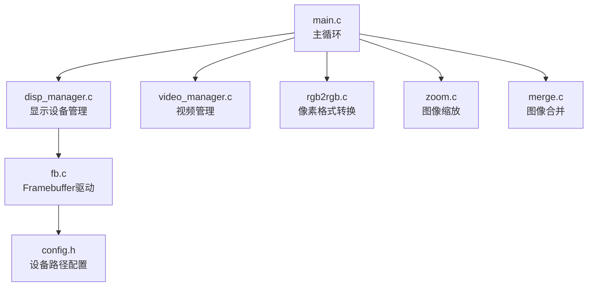
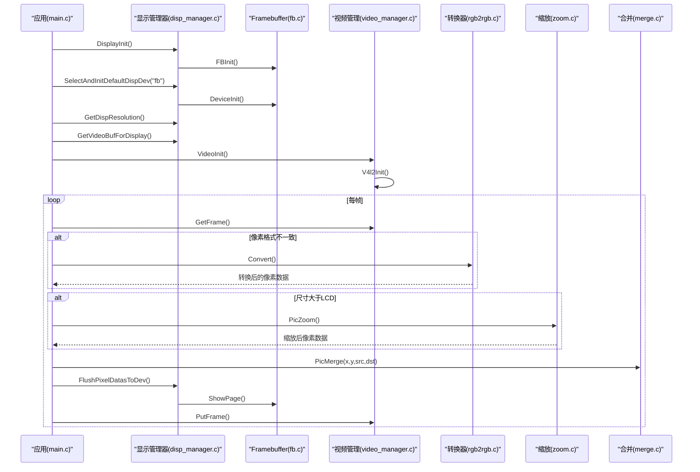
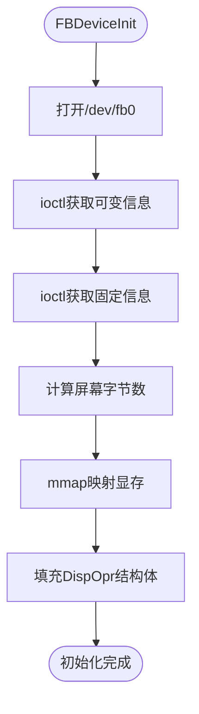
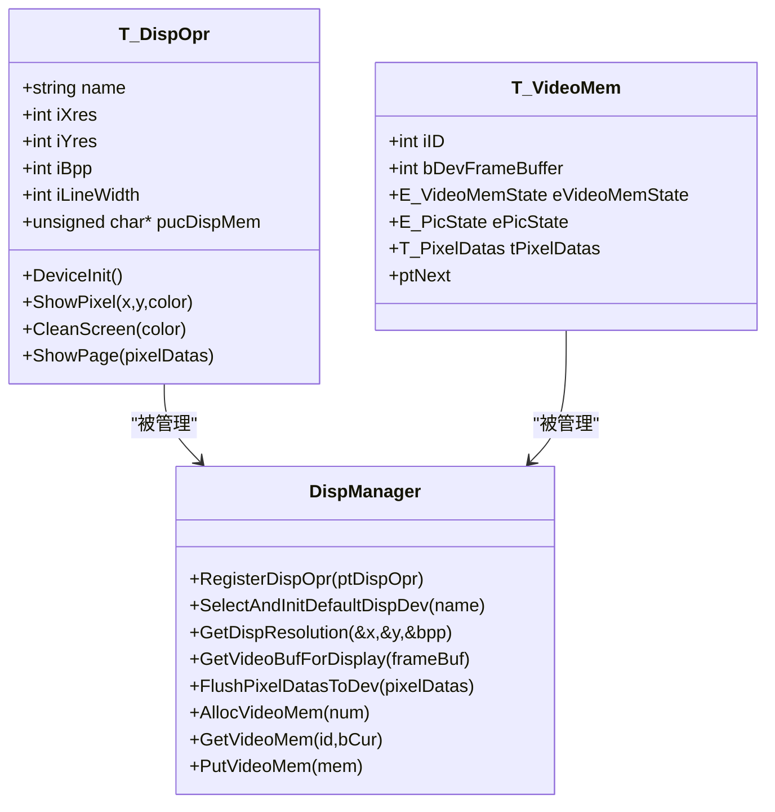
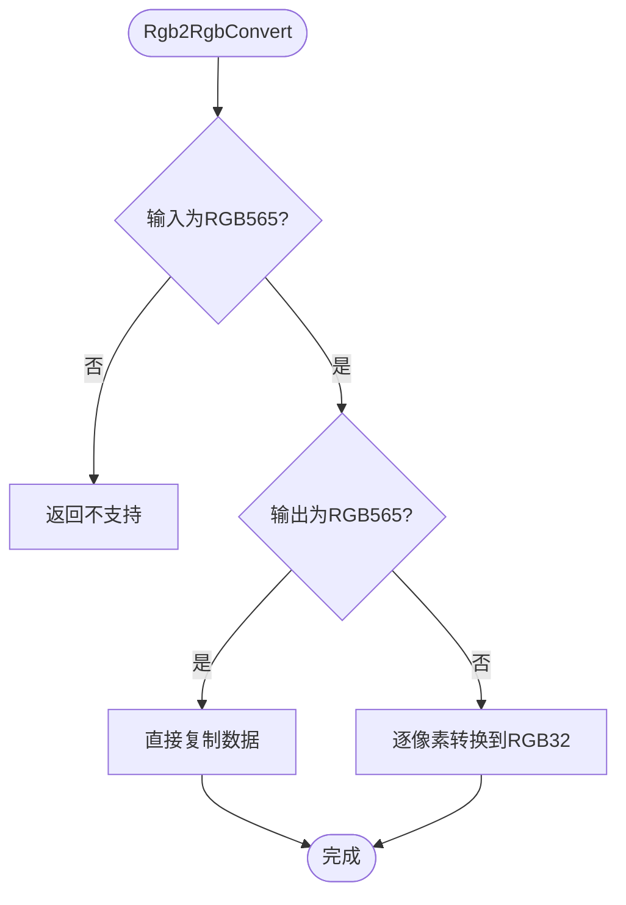
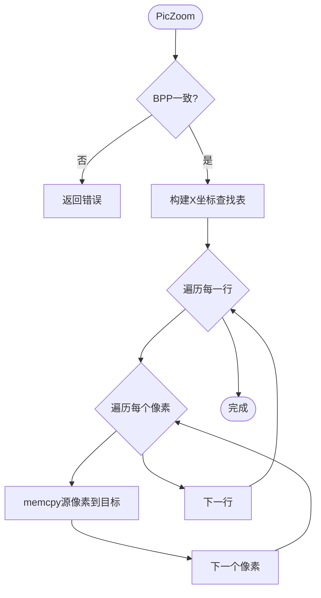
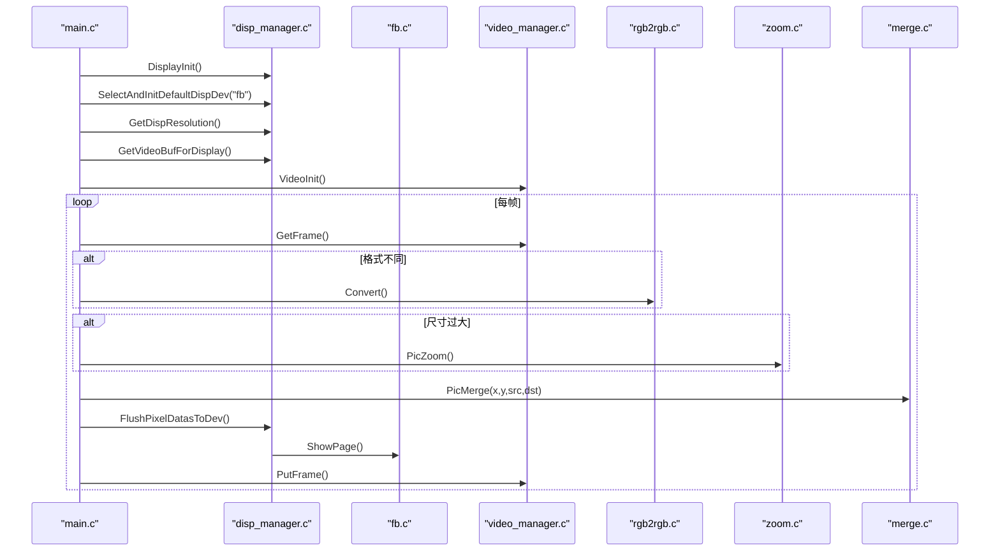
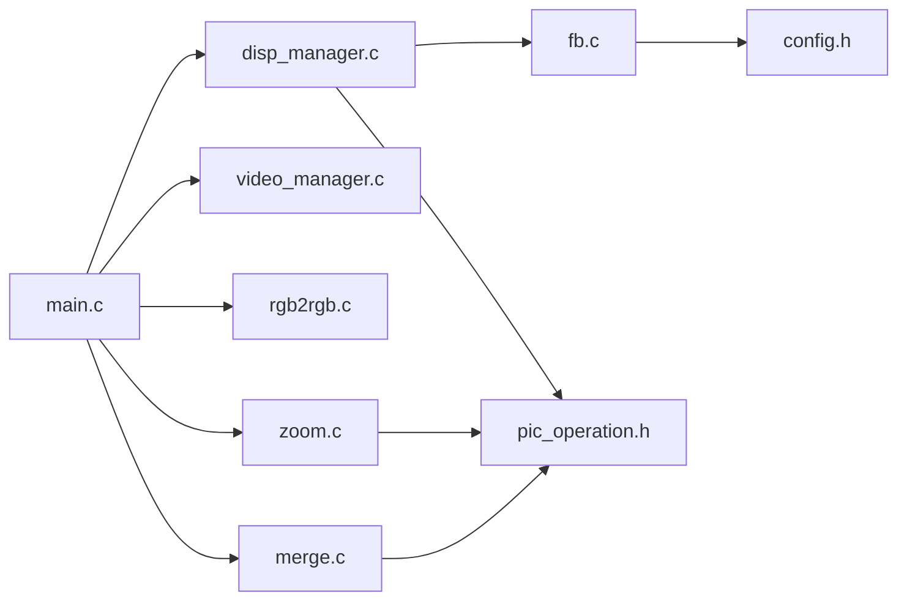

# 显示系统

<cite>
**本文引用的文件**
- [main.c](file://video2lcd/main.c)
- [fb.c](file://video2lcd/display/fb.c)
- [disp_manager.c](file://video2lcd/display/disp_manager.c)
- [config.h](file://video2lcd/include/config.h)
- [disp_manager.h](file://video2lcd/include/disp_manager.h)
- [pic_operation.h](file://video2lcd/include/pic_operation.h)
- [zoom.c](file://video2lcd/render/operation/zoom.c)
- [merge.c](file://video2lcd/render/operation/merge.c)
- [rgb2rgb.c](file://video2lcd/convert/rgb2rgb.c)
- [video_manager.c](file://video2lcd/video/video_manager.c)
</cite>

## 目录
1. [简介](#简介)
2. [项目结构](#项目结构)
3. [核心组件](#核心组件)
4. [架构总览](#架构总览)
5. [详细组件分析](#详细组件分析)
6. [依赖关系分析](#依赖关系分析)
7. [性能考虑](#性能考虑)
8. [故障排查指南](#故障排查指南)
9. [结论](#结论)
10. [附录](#附录)

## 简介
本文件系统性地说明基于Linux Framebuffer的LCD显示实现，涵盖以下方面：
- Framebuffer驱动工作原理：设备打开、ioctl获取屏幕信息、内存映射到用户空间、像素写入与刷新。
- 显示设备管理器设计：多显示设备注册与选择、分辨率自适应、默认设备初始化与清屏。
- 像素数据处理流程：从摄像头采集的RGB格式到LCD特定格式的转换（如RGB565到RGB32）。
- 显示性能优化：直接内存写入、批量更新、区域合并与缩放策略。
- 配置与扩展：如何配置显示设备、如何扩展新的显示驱动。
- 调试与性能分析：常用调试技巧与性能分析方法。

## 项目结构
本项目采用分层模块化设计：
- 显示层：display/fb.c 实现具体Framebuffer驱动；display/disp_manager.c 提供显示设备管理接口。
- 渲染层：render/operation/zoom.c、merge.c 实现图像缩放与合并。
- 转换层：convert/rgb2rgb.c 等实现像素格式转换。
- 视频层：video/video_manager.c 封装V4L2视频采集。
- 公共头：include/*.h 定义通用数据结构与接口。
- 入口：main.c 串联视频采集、格式转换、缩放、合并与显示刷新。

图表来源
- [main.c:34-192](file://video2lcd/main.c#L34-L192)
- [disp_manager.c:514-521](file://video2lcd/display/disp_manager.c#L514-L521)
- [fb.c:53-94](file://video2lcd/display/fb.c#L53-L94)
- [rgb2rgb.c:139-151](file://video2lcd/convert/rgb2rgb.c#L139-L151)
- [zoom.c:27-85](file://video2lcd/render/operation/zoom.c#L27-L85)
- [merge.c:20-46](file://video2lcd/render/operation/merge.c#L20-L46)
- [config.h:17-18](file://video2lcd/include/config.h#L17-L18)

章节来源
- [main.c:34-192](file://video2lcd/main.c#L34-L192)
- [disp_manager.c:514-521](file://video2lcd/display/disp_manager.c#L514-L521)
- [fb.c:53-94](file://video2lcd/display/fb.c#L53-L94)
- [config.h:17-18](file://video2lcd/include/config.h#L17-L18)

## 核心组件
- 显示设备管理器（disp_manager.c）：维护显示操作接口链表，支持多设备注册、选择默认设备、获取分辨率、分配VideoMem、刷新数据到设备。
- Framebuffer驱动（fb.c）：打开/dev/fb0，通过ioctl获取可变/固定屏幕信息，mmap映射显存，实现画点、清屏、整页显示。
- 像素操作（zoom.c、merge.c）：最近邻插值缩放、按行拷贝合并，支持区域合并。
- 像素格式转换（rgb2rgb.c）：将RGB565转换为RGB32或保持RGB565，自动分配输出缓冲。
- 视频管理（video_manager.c）：注册V4L2驱动，提供统一视频操作接口。
- 公共数据结构（pic_operation.h、disp_manager.h）：T_PixelDatas、T_VideoMem、T_DispOpr等。

章节来源
- [disp_manager.c:27-175](file://video2lcd/display/disp_manager.c#L27-L175)
- [fb.c:53-174](file://video2lcd/display/fb.c#L53-L174)
- [zoom.c:27-85](file://video2lcd/render/operation/zoom.c#L27-L85)
- [merge.c:20-89](file://video2lcd/render/operation/merge.c#L20-L89)
- [rgb2rgb.c:20-151](file://video2lcd/convert/rgb2rgb.c#L20-L151)
- [video_manager.c:12-75](file://video2lcd/video/video_manager.c#L12-L75)
- [pic_operation.h:10-17](file://video2lcd/include/pic_operation.h#L10-L17)
- [disp_manager.h:69-96](file://video2lcd/include/disp_manager.h#L69-L96)

## 架构总览
系统以main.c为入口，依次完成：
- 显示初始化与默认设备选择：DisplayInit -> SelectAndInitDefaultDispDev("fb") -> FBDeviceInit。
- 获取LCD分辨率与帧缓冲区：GetDispResolution、GetVideoBufForDisplay。
- 视频初始化与设备启动：VideoInit -> V4l2Init -> StartDevice。
- 主循环：GetFrame -> 格式转换（必要时）-> 缩放（必要时）-> 合并到帧缓冲 -> FlushPixelDatasToDev -> PutFrame。

图表来源
- [main.c:63-179](file://video2lcd/main.c#L63-L179)
- [disp_manager.c:100-175](file://video2lcd/display/disp_manager.c#L100-L175)
- [fb.c:53-174](file://video2lcd/display/fb.c#L53-L174)
- [rgb2rgb.c:46-119](file://video2lcd/convert/rgb2rgb.c#L46-L119)
- [zoom.c:27-85](file://video2lcd/render/operation/zoom.c#L27-L85)
- [merge.c:20-46](file://video2lcd/render/operation/merge.c#L20-L46)

## 详细组件分析

### Framebuffer驱动（fb.c）
- 设备初始化：打开/dev/fb0，使用ioctl获取可变和固定屏幕信息，计算屏幕大小并mmap映射到用户空间。
- 像素写入：根据BPP（8/16/32位）进行颜色转换与写入；16位时执行RGB565编码。
- 整页显示：当输入像素数据与显存地址一致时直接复用，否则memcpy复制到显存。
- 清屏：按BPP填充背景色，支持快速memset或逐像素写入。

图表来源
- [fb.c:53-94](file://video2lcd/display/fb.c#L53-L94)

章节来源
- [fb.c:53-174](file://video2lcd/display/fb.c#L53-L174)
- [config.h:17-18](file://video2lcd/include/config.h#L17-L18)

### 显示设备管理器（disp_manager.c）
- 设备注册：RegisterDispOpr将多个显示驱动接入链表。
- 默认设备选择：SelectAndInitDefaultDispDev查找并初始化设备，同时清屏。
- 分辨率查询：GetDispResolution返回当前设备的X/Y分辨率与BPP。
- 帧缓冲获取：GetVideoBufForDisplay根据BPP设置像素格式，填充尺寸与行字节，并将aucPixelDatas指向显存。
- 刷新：FlushPixelDatasToDev调用ShowPage将像素数据输出到设备。
- VideoMem管理：AllocVideoMem/GetVideoMem/PutVideoMem用于预分配页面缓冲，支持多页管理与状态机。

图表来源
- [disp_manager.h:69-96](file://video2lcd/include/disp_manager.h#L69-L96)
- [disp_manager.c:27-175](file://video2lcd/display/disp_manager.c#L27-L175)

章节来源
- [disp_manager.c:27-175](file://video2lcd/display/disp_manager.c#L27-L175)
- [disp_manager.h:69-96](file://video2lcd/include/disp_manager.h#L69-L96)

### 像素格式转换（rgb2rgb.c）
- 支持判断：isSupportRgb2Rgb检查输入输出格式是否可转换。
- 转换逻辑：
  - RGB565 -> RGB565：直接memcpy，无需逐像素处理。
  - RGB565 -> RGB32：逐像素提取R/G/B分量，扩展至8位精度，拼装为0x00RRGGBB。
- 内存管理：若输出缓冲未分配则自动malloc所需大小；退出时释放。

图表来源
- [rgb2rgb.c:20-119](file://video2lcd/convert/rgb2rgb.c#L20-L119)

章节来源
- [rgb2rgb.c:20-151](file://video2lcd/convert/rgb2rgb.c#L20-L151)

### 图像缩放与合并（zoom.c、merge.c）
- 缩放（zoom.c）：最近邻插值算法，构建X坐标查找表，逐行复制源像素到目标行。
- 合并（merge.c）：将小图按指定左上角坐标复制到大图，支持区域合并PicMergeRegion。

图表来源
- [zoom.c:27-85](file://video2lcd/render/operation/zoom.c#L27-L85)

章节来源
- [zoom.c:27-85](file://video2lcd/render/operation/zoom.c#L27-L85)
- [merge.c:20-89](file://video2lcd/render/operation/merge.c#L20-L89)

### 主流程控制（main.c）
- 初始化显示与视频：DisplayInit、VideoInit。
- 获取LCD分辨率与帧缓冲：GetDispResolution、GetVideoBufForDisplay。
- 主循环：
  - 获取帧：GetFrame。
  - 格式转换：Convert（必要时）。
  - 缩放：PicZoom（当源尺寸大于LCD）。
  - 合并：PicMerge（居中显示）。
  - 刷新：FlushPixelDatasToDev。
  - 归还帧：PutFrame。

图表来源
- [main.c:63-179](file://video2lcd/main.c#L63-L179)
- [disp_manager.c:100-175](file://video2lcd/display/disp_manager.c#L100-L175)
- [fb.c:166-174](file://video2lcd/display/fb.c#L166-L174)
- [rgb2rgb.c:46-119](file://video2lcd/convert/rgb2rgb.c#L46-L119)
- [zoom.c:27-85](file://video2lcd/render/operation/zoom.c#L27-L85)
- [merge.c:20-46](file://video2lcd/render/operation/merge.c#L20-L46)

章节来源
- [main.c:63-179](file://video2lcd/main.c#L63-L179)

## 依赖关系分析
- main.c依赖：disp_manager.h、video_manager.h、convert_manager.h、render.h、config.h。
- disp_manager.c依赖：config.h、disp_manager.h、pic_operation.h、video_manager.h。
- fb.c依赖：config.h、disp_manager.h、linux/fb.h、sys/mman.h。
- rgb2rgb.c依赖：convert_manager.h。
- zoom.c、merge.c依赖：pic_operation.h。
- video_manager.c依赖：config.h、video_manager.h。

图表来源
- [main.c:4-8](file://video2lcd/main.c#L4-L8)
- [disp_manager.c:9-11](file://video2lcd/display/disp_manager.c#L9-L11)
- [fb.c:9-17](file://video2lcd/display/fb.c#L9-L17)
- [rgb2rgb.c:9-11](file://video2lcd/convert/rgb2rgb.c#L9-L11)
- [zoom.c:11-14](file://video2lcd/render/operation/zoom.c#L11-L14)
- [merge.c:8-9](file://video2lcd/render/operation/merge.c#L8-L9)
- [video_manager.c:1-3](file://video2lcd/video/video_manager.c#L1-L3)

章节来源
- [main.c:4-8](file://video2lcd/main.c#L4-L8)
- [disp_manager.c:9-11](file://video2lcd/display/disp_manager.c#L9-L11)
- [fb.c:9-17](file://video2lcd/display/fb.c#L9-L17)
- [rgb2rgb.c:9-11](file://video2lcd/convert/rgb2rgb.c#L9-L11)
- [zoom.c:11-14](file://video2lcd/render/operation/zoom.c#L11-L14)
- [merge.c:8-9](file://video2lcd/render/operation/merge.c#L8-L9)
- [video_manager.c:1-3](file://video2lcd/video/video_manager.c#L1-L3)

## 性能考虑
- 直接内存写入：GetVideoBufForDisplay将aucPixelDatas直接指向显存，避免额外拷贝；FBShowPage在数据与显存地址一致时跳过memcpy。
- 批量更新：主循环中每帧仅进行一次ShowPage，减少系统调用开销。
- 区域刷新：merge.c提供PicMergeRegion，可对局部区域进行高效复制，适合UI元素增量更新。
- 缩放优化：zoom.c使用X坐标查找表减少重复计算，最近邻插值速度快但可能锯齿；如需更高质量可替换为双线性或双三次插值。
- 格式转换优化：rgb2rgb.c对RGB565->RGB565走memcpy路径，避免逐像素处理；RGB565->RGB32需逐像素转换，注意缓存友好性。
- 内存管理：VideoMem支持多页缓冲，可在后台准备下一帧，前台显示当前帧，降低卡顿。

[本节为通用性能建议，不直接分析具体代码文件]

## 故障排查指南
- 无法打开/dev/fb0：检查config.h中的FB_DEVICE_NAME是否正确，确认内核已启用framebuffer驱动。
- ioctl失败：检查权限与设备节点是否存在；查看内核日志。
- 颜色异常：确认BPP与颜色编码匹配（16位RGB565、32位RGB32），检查颜色转换逻辑。
- 显示空白或花屏：确认GetVideoBufForDisplay正确设置iLineBytes与iTotalBytes；确保PicMerge前尺寸与BPP一致。
- 转换失败：检查isSupportRgb2Rgb支持的输入输出格式；确认输出缓冲已分配。
- 性能瓶颈：使用perf或自定义时间戳统计各阶段耗时（GetFrame、Convert、Zoom、Merge、ShowPage）。

章节来源
- [fb.c:53-94](file://video2lcd/display/fb.c#L53-L94)
- [fb.c:106-157](file://video2lcd/display/fb.c#L106-L157)
- [fb.c:183-240](file://video2lcd/display/fb.c#L183-L240)
- [rgb2rgb.c:20-119](file://video2lcd/convert/rgb2rgb.c#L20-L119)
- [merge.c:20-46](file://video2lcd/render/operation/merge.c#L20-L46)

## 结论
本显示系统通过模块化设计实现了从视频采集到LCD显示的完整链路：
- 使用Framebuffer作为底层显示驱动，支持多设备注册与切换。
- 通过像素格式转换、缩放与合并，适配不同分辨率与格式。
- 提供VideoMem机制提升显示性能，支持多页缓冲与区域更新。
- 可扩展新显示设备与转换器，便于适配不同硬件平台。

[本节为总结性内容，不直接分析具体代码文件]

## 附录

### 显示设备配置方法
- 修改config.h中的FB_DEVICE_NAME以适配不同设备节点。
- 在DisplayInit中注册新的显示驱动（类似FBInit）。
- 通过SelectAndInitDefaultDispDev选择默认设备。

章节来源
- [config.h:17-18](file://video2lcd/include/config.h#L17-L18)
- [disp_manager.c:514-521](file://video2lcd/display/disp_manager.c#L514-L521)
- [fb.c:249-252](file://video2lcd/display/fb.c#L249-L252)

### 扩展新显示设备指导
- 实现DispOpr接口：DeviceInit、ShowPixel、CleanScreen、ShowPage。
- 在模块初始化时调用RegisterDispOpr注册。
- 在main中通过SelectAndInitDefaultDispDev选择新设备。

章节来源
- [disp_manager.h:84-96](file://video2lcd/include/disp_manager.h#L84-L96)
- [disp_manager.c:27-48](file://video2lcd/display/disp_manager.c#L27-L48)
- [fb.c:37-43](file://video2lcd/display/fb.c#L37-L43)

### 像素数据处理流程说明
- 输入：摄像头输出的RGB565或RGB32。
- 转换：必要时转换为LCD所需格式（如RGB32）。
- 缩放：当源尺寸大于LCD时进行等比例缩放。
- 合并：将处理后的图像居中合并到帧缓冲。
- 刷新：调用ShowPage将数据写入显存。

章节来源
- [main.c:118-179](file://video2lcd/main.c#L118-L179)
- [rgb2rgb.c:46-119](file://video2lcd/convert/rgb2rgb.c#L46-L119)
- [zoom.c:27-85](file://video2lcd/render/operation/zoom.c#L27-L85)
- [merge.c:20-46](file://video2lcd/render/operation/merge.c#L20-L46)
- [fb.c:166-174](file://video2lcd/display/fb.c#L166-L174)