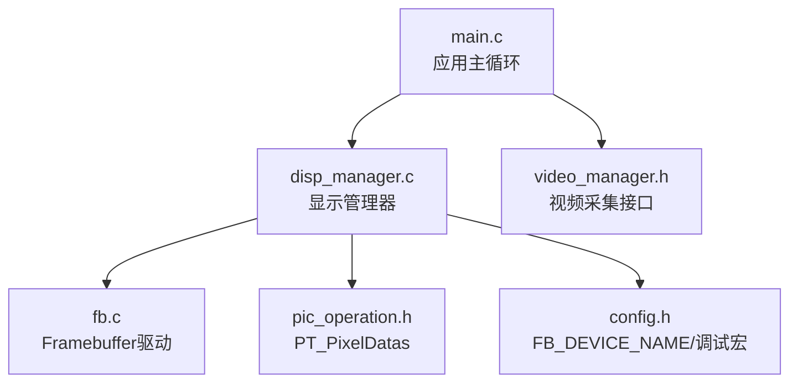
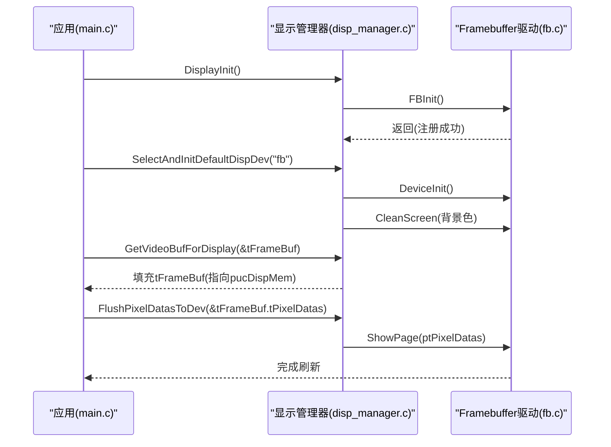
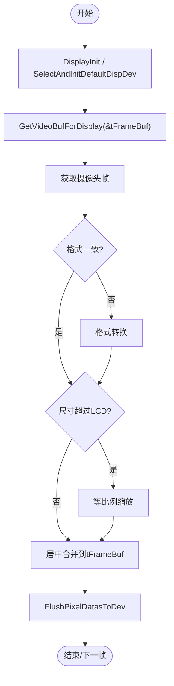
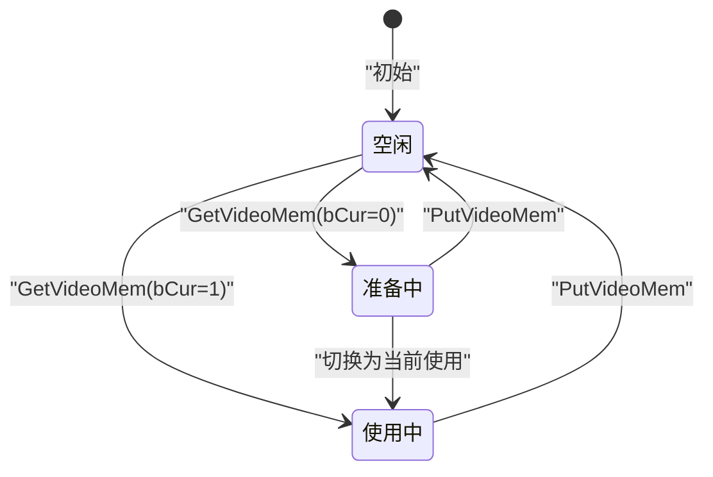
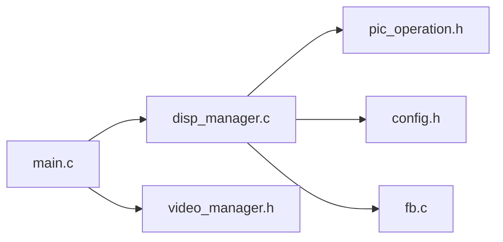

# 显示设备管理器

<cite>
**本文引用的文件**
- [disp_manager.h](file://video2lcd/include/disp_manager.h)
- [disp_manager.c](file://video2lcd/display/disp_manager.c)
- [fb.c](file://video2lcd/display/fb.c)
- [pic_operation.h](file://video2lcd/include/pic_operation.h)
- [video_manager.h](file://video2lcd/include/video_manager.h)
- [config.h](file://video2lcd/include/config.h)
- [main.c](file://video2lcd/main.c)
</cite>

## 目录
1. [简介](#简介)
2. [项目结构](#项目结构)
3. [核心组件](#核心组件)
4. [架构总览](#架构总览)
5. [详细组件分析](#详细组件分析)
6. [依赖关系分析](#依赖关系分析)
7. [性能考虑](#性能考虑)
8. [故障排查指南](#故障排查指南)
9. [结论](#结论)
10. [附录：配置与扩展指南](#附录：配置与扩展指南)

## 简介
本文件面向“显示设备管理器”模块，系统性说明 T_DispOpr 接口结构体的设计理念与各成员函数职责，覆盖设备初始化、像素绘制、清屏、页面刷新等关键操作；阐述通过 RegisterDispOpr 的插件式注册机制如何支持多种显示设备；解释多显示设备的管理策略（设备选择、分辨率自适应、冲突处理）；详述 PT_PixelDatas 数据结构的设计要点（像素格式、缓冲区管理、内存对齐要求）；并提供显示设备的配置方法与扩展新显示设备的开发指南，以及最佳实践与常见问题解决方案。

## 项目结构
显示相关代码主要位于 display 目录，头文件在 include 目录，主程序入口在 main.c。整体采用“接口抽象 + 驱动实现 + 管理器调度”的分层设计：
- 接口定义：disp_manager.h 定义 T_DispOpr、T_VideoMem、PT_PixelDatas 等核心类型及 API。
- 管理器实现：disp_manager.c 实现设备注册、默认设备选择、VideoMem 缓冲池管理、分辨率查询、帧缓冲映射与刷新等。
- 驱动实现：fb.c 基于 Linux Framebuffer 提供具体显示设备实现，填充 T_DispOpr 并注册到管理器。
- 数据模型：pic_operation.h 定义统一的像素数据描述结构 PT_PixelDatas。
- 集成入口：main.c 串联显示与视频采集流程，完成图像获取、转换、缩放、合并与刷新。

图表来源
- [main.c:63-74](file://video2lcd/main.c#L63-L74)
- [disp_manager.c:100-175](file://video2lcd/display/disp_manager.c#L100-L175)
- [fb.c:37-93](file://video2lcd/display/fb.c#L37-L93)
- [pic_operation.h:10-17](file://video2lcd/include/pic_operation.h#L10-L17)
- [config.h:17-18](file://video2lcd/include/config.h#L17-L18)

章节来源
- [main.c:63-74](file://video2lcd/main.c#L63-L74)
- [disp_manager.c:100-175](file://video2lcd/display/disp_manager.c#L100-L175)
- [fb.c:37-93](file://video2lcd/display/fb.c#L37-L93)
- [pic_operation.h:10-17](file://video2lcd/include/pic_operation.h#L10-L17)
- [config.h:17-18](file://video2lcd/include/config.h#L17-L18)

## 核心组件
- T_DispOpr：显示设备操作接口结构体，封装设备名称、分辨率、色深、行字节数、显存指针以及一组函数指针（初始化、画点、清屏、显示一页）。
- PT_PixelDatas：统一像素数据描述，包含宽高、BPP、行字节数、总字节数和像素数据指针。
- VideoMem：用于加速显示的页缓冲链表节点，区分设备帧缓冲与普通内存缓冲，维护状态机（空闲、准备中、当前使用）和图像生成状态（空白、生成中、已生成）。
- 管理器API：RegisterDispOpr、DisplayInit、SelectAndInitDefaultDispDev、GetDefaultDispDev、GetDispResolution、AllocVideoMem、GetVideoMem/PutVideoMem、ClearVideoMem/ClearVideoMemRegion、GetVideoBufForDisplay、FlushPixelDatasToDev。
- 驱动实现：fb.c 提供 FBDeviceInit/FBShowPixel/FBCleanScreen/FBShowPage，并通过 FBInit 将 g_tFBOpr 注册到管理器。

章节来源
- [disp_manager.h:60-96](file://video2lcd/include/disp_manager.h#L60-L96)
- [disp_manager.h:98-233](file://video2lcd/include/disp_manager.h#L98-L233)
- [disp_manager.c:13-17](file://video2lcd/display/disp_manager.c#L13-L17)
- [fb.c:37-43](file://video2lcd/display/fb.c#L37-L43)

## 架构总览
系统采用“插件式”显示设备架构：
- 各显示驱动以 T_DispOpr 形式实现并调用 RegisterDispOpr 注册到全局链表。
- 管理器维护一个默认设备指针，通过 SelectAndInitDefaultDispDev 选择并初始化指定设备，随后所有上层调用均通过该默认设备执行。
- 显示流程：获取或分配 VideoMem -> 在内存中准备像素数据 -> 调用 FlushPixelDatasToDev -> 驱动内部根据是否直接指向显存决定 memcpy 或直接写入。

图表来源
- [main.c:63-74](file://video2lcd/main.c#L63-L74)
- [disp_manager.c:100-175](file://video2lcd/display/disp_manager.c#L100-L175)
- [fb.c:249-252](file://video2lcd/display/fb.c#L249-L252)

## 详细组件分析

### T_DispOpr 接口结构体与职责
- 设计目标：以函数指针抽象不同显示设备的共性能力，屏蔽底层差异，使上层仅依赖统一接口。
- 关键字段：
  - name：设备标识名，用于选择与调试。
  - iXres/iYres/iBpp/iLineWidth：分辨率与色深信息，用于分辨率自适应与行步长计算。
  - pucDispMem：设备显存基址，供直接写入或作为目标缓冲。
  - DeviceInir/ShowPixel/CleanScreen/ShowPage：设备级操作函数指针。
- 典型用法：
  - 驱动实现这些函数后，构造 T_DispOpr 实例并调用 RegisterDispOpr 注册。
  - 管理器通过默认设备指针调用上述函数，完成初始化、清屏、画点与整页刷新。

章节来源
- [disp_manager.h:78-96](file://video2lcd/include/disp_manager.h#L78-L96)
- [fb.c:37-43](file://video2lcd/display/fb.c#L37-L43)

### 设备注册机制 RegisterDispOpr
- 作用：将驱动提供的 T_DispOpr 插入全局链表，形成可枚举的设备列表。
- 行为：若链表为空则设为头节点；否则遍历至尾部追加。
- 扩展性：新增显示设备只需实现 T_DispOpr 并调用 RegisterDispOpr，无需修改管理器核心逻辑。

章节来源
- [disp_manager.c:27-48](file://video2lcd/display/disp_manager.c#L27-L48)

### 多显示设备管理策略
- 设备选择：SelectAndInitDefaultDispDev(name) 通过名称查找设备并执行初始化与清屏，设置默认设备指针。
- 分辨率自适应：GetDispResolution 返回当前默认设备的分辨率与BPP；GetVideoBufForDisplay 据此填充帧缓冲区的像素格式与尺寸。
- 冲突处理：
  - 同一时刻只有一个默认设备被激活，避免多设备同时写入导致的竞争。
  - VideoMem 链表管理多个缓冲页，通过状态机与ID策略协调并发访问（见下文）。
  - 若未先选择默认设备即调用相关API，将返回错误码提示。

章节来源
- [disp_manager.c:100-138](file://video2lcd/display/disp_manager.c#L100-L138)
- [disp_manager.c:148-175](file://video2lcd/display/disp_manager.c#L148-L175)

### PT_PixelDatas 数据结构与内存对齐
- 字段含义：
  - iWidth/iHeight：图像宽高（像素）。
  - iBpp：每像素位数（如16/32），决定颜色格式。
  - iLineBytes：一行像素占用的字节数（含可能的行对齐填充）。
  - iTotalBytes：整帧像素数据总字节数（iLineBytes * iHeight）。
  - aucPixelDatas：像素数据起始地址，可为普通内存或设备显存。
- 缓冲区管理：
  - 在 fb 驱动中，GetVideoBufForDisplay 将 tFrameBuf.tPixelDatas.aucPixelDatas 直接指向 pucDispMem，实现零拷贝刷新。
  - 在 VideoMem 管理中，普通 VideoMem 的 aucPixelDatas 指向分配的内存块，便于先在内存中合成再一次性复制到显存。
- 内存对齐要求：
  - 行字节数 iLineBytes 可能大于 iWidth*iBpp/8，需按设备实际行步长进行逐行访问与复制，避免越界或错位。
  - 颜色格式转换（如32位转16位RGB565）需在写像素时按设备BPP进行位域拆分与重组。

章节来源
- [pic_operation.h:10-17](file://video2lcd/include/pic_operation.h#L10-L17)
- [disp_manager.c:148-163](file://video2lcd/display/disp_manager.c#L148-L163)
- [fb.c:106-157](file://video2lcd/display/fb.c#L106-L157)

### 显示流程与刷新机制
- 初始化：DisplayInit 调用 FBInit 注册 fb 驱动；SelectAndInitDefaultDispDev 选择并初始化默认设备。
- 帧缓冲获取：GetVideoBufForDisplay 根据默认设备分辨率与BPP填充 tFrameBuf，并将像素数据指针指向显存。
- 渲染与合并：应用侧对原始帧进行格式转换、缩放、居中合并到 tFrameBuf。
- 刷新：FlushPixelDatasToDev 调用默认设备的 ShowPage；fb 驱动内部判断是否直接指向显存，若是则跳过 memcpy，否则将内存数据复制到显存。

图表来源
- [main.c:117-179](file://video2lcd/main.c#L117-L179)
- [disp_manager.c:148-175](file://video2lcd/display/disp_manager.c#L148-L175)
- [fb.c:166-174](file://video2lcd/display/fb.c#L166-L174)

### VideoMem 缓冲池与状态机
- 目的：在内存中预分配多页缓冲，提升显示效率；第一页可直接映射设备显存，后续为普通内存页。
- 状态：
  - eVideoMemState：VMS_FREE/VMS_USED_FOR_PREPARE/VMS_USED_FOR_CUR。
  - ePicState：PS_BLANK/PS_GENERATING/PS_GENERATED。
- 分配策略（GetVideoMem）：
  - 优先匹配 ID 且空闲的页；
  - 其次取空闲且无有效图像的页；
  - 再次取任意空闲页；
  - 若 bCur=1 且无空闲，强制占用任意页（适用于必须立即使用的场景）。
- 释放（PutVideoMem）：将状态置回空闲，必要时重置图像状态。

图表来源
- [disp_manager.c:188-337](file://video2lcd/display/disp_manager.c#L188-L337)

章节来源
- [disp_manager.c:188-337](file://video2lcd/display/disp_manager.c#L188-L337)

### 像素绘制与清屏
- 画点（ShowPixel）：根据坐标计算显存偏移，按设备BPP写入对应颜色值（8/16/32位）。
- 清屏（CleanScreen）：按设备BPP将整帧显存填充为目标颜色，支持快速 memset 或逐像素写入。
- 区域清空（ClearVideoMemRegion）：按布局矩形区域逐行填充，注意行步长与边界。

章节来源
- [fb.c:106-157](file://video2lcd/display/fb.c#L106-L157)
- [fb.c:183-240](file://video2lcd/display/fb.c#L183-L240)
- [disp_manager.c:436-505](file://video2lcd/display/disp_manager.c#L436-L505)

## 依赖关系分析
- 模块耦合：
  - main.c 依赖 disp_manager 与 video_manager，负责编排流程。
  - disp_manager.c 依赖 pic_operation.h（PT_PixelDatas）、config.h（FB_DEVICE_NAME）。
  - fb.c 依赖 disp_manager.h（接口）与内核 fb 头文件。
- 外部依赖：
  - Linux Framebuffer 子系统（/dev/fb0）。
  - V4L2 视频采集（由 video_manager 封装，此处不展开）。

图表来源
- [main.c:1-9](file://video2lcd/main.c#L1-L9)
- [disp_manager.c:9-11](file://video2lcd/display/disp_manager.c#L9-L11)
- [fb.c:9-17](file://video2lcd/display/fb.c#L9-L17)

章节来源
- [main.c:1-9](file://video2lcd/main.c#L1-L9)
- [disp_manager.c:9-11](file://video2lcd/display/disp_manager.c#L9-L11)
- [fb.c:9-17](file://video2lcd/display/fb.c#L9-L17)

## 性能考虑
- 零拷贝刷新：当 ptPixelDatas->aucPixelDatas 直接指向显存时，ShowPage 跳过 memcpy，减少一次内存拷贝开销。
- 行步长优化：按 iLineBytes 逐行处理，避免跨行错位与多余拷贝。
- 颜色格式转换：在画点/清屏时对16位RGB565进行位域拆分与重组，尽量减少中间缓冲。
- 缓冲池复用：VideoMem 复用机制降低频繁分配/释放的开销。
- 建议：
  - 尽量让渲染结果直接输出到显存或接近显存的连续内存，减少拷贝。
  - 对大区域更新使用 ClearVideoMemRegion 而非逐点绘制。
  - 合理设置 VideoMem 数量，平衡内存占用与并发需求。

[本节为通用性能指导，不直接分析具体文件]

## 故障排查指南
- 无法打开 /dev/fb0：检查设备是否存在、权限是否正确；确认 config.h 中 FB_DEVICE_NAME 与实际设备一致。
- 分辨率/BPP 异常：确认 ioctl 获取的屏幕信息与硬件一致；检查 iLineWidth 计算是否正确。
- 显示花屏/错位：核对 iLineBytes 与 iBpp 的关系；确保按行步长访问，避免越界。
- 未选择默认设备：调用 GetDispResolution 或刷新前必须先 SelectAndInitDefaultDispDev，否则会返回错误。
- 颜色失真：确认颜色格式转换逻辑（32位到16位RGB565）与设备期望一致。

章节来源
- [fb.c:53-93](file://video2lcd/display/fb.c#L53-L93)
- [disp_manager.c:125-138](file://video2lcd/display/disp_manager.c#L125-L138)
- [fb.c:106-157](file://video2lcd/display/fb.c#L106-L157)

## 结论
本显示设备管理器通过 T_DispOpr 接口实现了显示驱动的插件化接入，结合 PT_PixelDatas 统一像素数据描述与 VideoMem 缓冲池管理，提供了设备初始化、像素绘制、清屏与页面刷新等完整能力。其分层清晰、扩展性强，能够适配不同分辨率与色深的显示设备，并在嵌入式相机项目中与视频采集、格式转换、缩放与合并流程无缝衔接。遵循本文的配置与扩展指南，可高效新增显示设备并保障系统稳定性与性能。

[本节为总结性内容，不直接分析具体文件]

## 附录：配置与扩展指南

### 显示设备配置方法
- 设备路径：在 config.h 中配置 FB_DEVICE_NAME（默认 /dev/fb0）。
- 初始化流程：
  - 调用 DisplayInit 注册所有显示设备（目前包括 fb）。
  - 调用 SelectAndInitDefaultDispDev("fb") 选择并初始化默认设备。
  - 调用 GetDispResolution 获取分辨率与BPP，用于后续渲染参数设置。
  - 调用 GetVideoBufForDisplay 获取帧缓冲（直接映射显存）。
  - 渲染完成后调用 FlushPixelDatasToDev 刷新到设备。

章节来源
- [config.h:17-18](file://video2lcd/include/config.h#L17-L18)
- [main.c:63-74](file://video2lcd/main.c#L63-L74)
- [disp_manager.c:148-175](file://video2lcd/display/disp_manager.c#L148-L175)

### 扩展新显示设备的开发指南
- 步骤：
  1. 实现 T_DispOpr 所需函数：DeviceInir、ShowPixel、CleanScreen、ShowPage。
  2. 构造 T_DispOpr 实例，填写 name、分辨率、BPP、行字节数、显存指针。
  3. 在模块初始化时调用 RegisterDispOpr 注册。
  4. 如需支持多设备选择，确保 name 唯一且可被 SelectAndInitDefaultDispDev 识别。
- 注意事项：
  - 颜色格式转换需与设备BPP匹配（8/16/32位）。
  - 行步长 iLineWidth 必须准确，避免逐行访问错位。
  - 若设备不支持随机画点，可将 ShowPixel 简化为区域填充或忽略。

章节来源
- [disp_manager.h:78-96](file://video2lcd/include/disp_manager.h#L78-L96)
- [disp_manager.c:27-48](file://video2lcd/display/disp_manager.c#L27-L48)
- [fb.c:37-43](file://video2lcd/display/fb.c#L37-L43)

### 最佳实践
- 始终先选择默认设备再进行任何显示操作。
- 使用 PT_PixelDatas 统一描述像素数据，避免在各模块间传递不一致的格式。
- 优先使用整页刷新（ShowPage）与区域清空（ClearVideoMemRegion）以提升性能。
- 合理使用 VideoMem 缓冲池，避免过多分配导致内存压力。
- 在渲染阶段尽量直接写入显存或紧邻显存的连续内存，减少拷贝次数。

[本节为通用最佳实践，不直接分析具体文件]