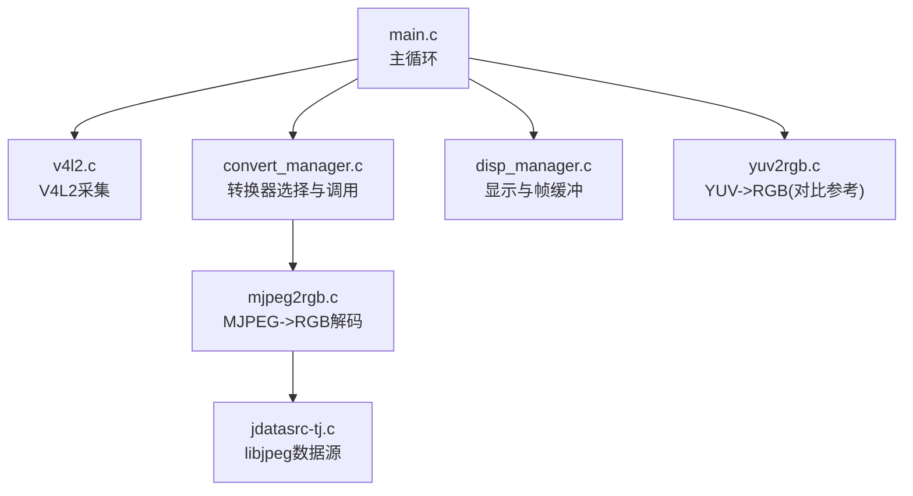
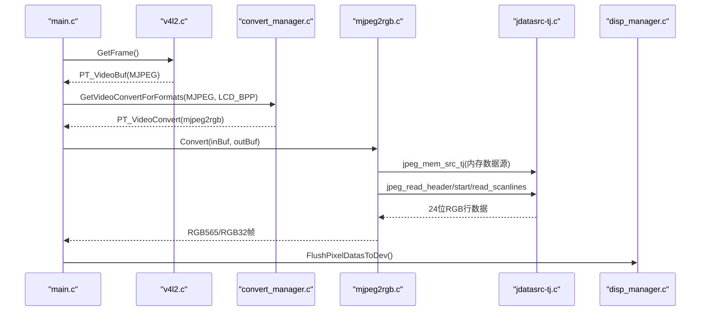
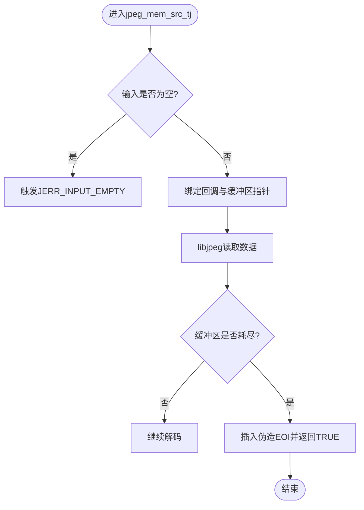
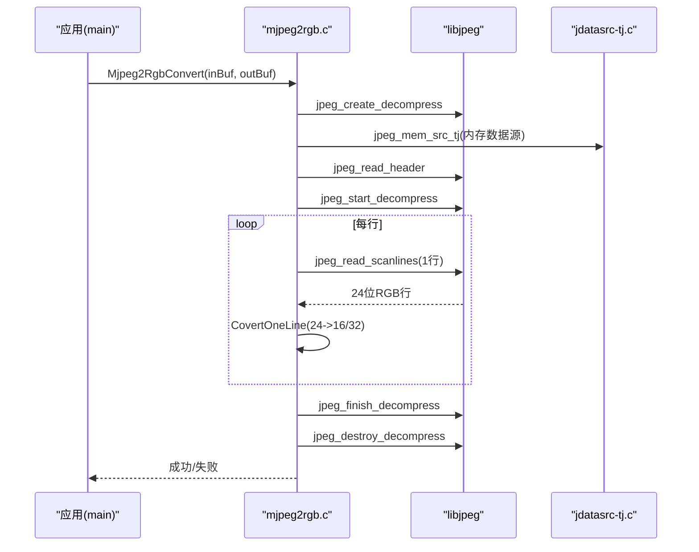
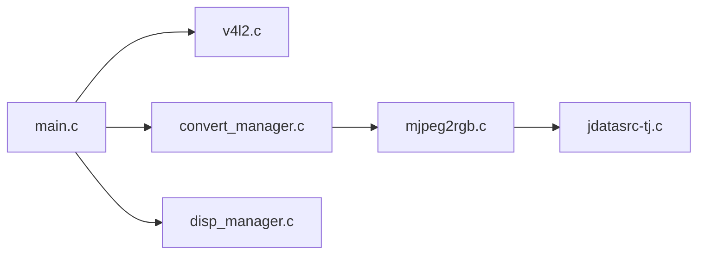

# MJPEG解码

<cite>
**本文引用的文件**
- [jdatasrc-tj.c](file://video2lcd/convert/jdatasrc-tj.c)
- [mjpeg2rgb.c](file://video2lcd/convert/mjpeg2rgb.c)
- [convert_manager.h](file://video2lcd/include/convert_manager.h)
- [convert_manager.c](file://video2lcd/convert/convert_manager.c)
- [v4l2.c](file://video2lcd/video/v4l2.c)
- [video_manager.h](file://video2lcd/include/video_manager.h)
- [main.c](file://video2lcd/main.c)
- [disp_manager.c](file://video2lcd/display/disp_manager.c)
- [yuv2rgb.c](file://video2lcd/convert/yuv2rgb.c)
- [jpeglib.h](file://video2lcd/convert/jpeglib.h)
- [jinclude.h](file://video2lcd/convert/jinclude.h)
- [jerror.h](file://video2lcd/convert/jerror.h)
</cite>

## 更新摘要
**所做更改**
- 更新了自定义数据源接口的头文件包含优化，提升可移植性
- 修正了SIZEOF宏调用为标准sizeof操作符的使用
- 改进了libjpeg库集成的标准化程度

## 目录
1. [简介](#简介)
2. [项目结构](#项目结构)
3. [核心组件](#核心组件)
4. [架构总览](#架构总览)
5. [详细组件分析](#详细组件分析)
6. [依赖关系分析](#依赖关系分析)
7. [性能考虑](#性能考虑)
8. [故障排查指南](#故障排查指南)
9. [结论](#结论)
10. [附录](#附录)

## 简介
本技术文档围绕嵌入式Linux相机项目中MJPEG图像解码与显示链路展开，重点说明：
- JPEG压缩标准与MJPEG视频流的特点
- DCT变换、量化与熵编码的基本原理（概念性说明）
- libjpeg库的集成使用，特别是自定义数据源接口实现（jdatasrc-tj.c）
- 从比特流解析到像素数据生成的完整解码流程
- 内存管理策略（缓冲区分配与释放的最佳实践）
- 解码性能优化技巧（多线程与流水线处理建议）
- 错误恢复机制与异常处理方案
- 解码质量调优参数配置建议

## 项目结构
本项目采用分层模块化设计：
- 视频采集层：基于V4L2的摄像头驱动封装（v4l2.c），支持MJPEG/YUYV/RGB565等格式
- 格式转换层：统一的转换器注册与管理（convert_manager.*），包含MJPEG->RGB、YUV->RGB、RGB->RGB等
- 显示层：Framebuffer显示封装（disp_manager.c），提供帧缓冲管理与刷新
- 主循环：协调采集、转换、缩放、合并与显示（main.c）

图表来源
- [main.c:34-192](file://video2lcd/main.c#L34-L192)
- [v4l2.c:47-401](file://video2lcd/video/v4l2.c#L47-L401)
- [convert_manager.c:23-131](file://video2lcd/convert/convert_manager.c#L23-L131)
- [mjpeg2rgb.c:145-261](file://video2lcd/convert/mjpeg2rgb.c#L145-L261)
- [jdatasrc-tj.c:29-183](file://video2lcd/convert/jdatasrc-tj.c#L29-L183)
- [disp_manager.c:148-175](file://video2lcd/display/disp_manager.c#L148-L175)
- [yuv2rgb.c:25-233](file://video2lcd/convert/yuv2rgb.c#L25-L233)

章节来源
- [main.c:34-192](file://video2lcd/main.c#L34-L192)
- [v4l2.c:47-401](file://video2lcd/video/v4l2.c#L47-L401)
- [convert_manager.c:23-131](file://video2lcd/convert/convert_manager.c#L23-L131)
- [disp_manager.c:148-175](file://video2lcd/display/disp_manager.c#L148-L175)

## 核心组件
- V4L2采集模块：负责打开设备、枚举并设置像素格式、申请并映射缓冲区、启动/停止采集、取帧/还帧。
- 转换器管理器：维护一个转换器链表，按输入输出格式动态选择具体转换器。
- MJPEG->RGB转换器：基于libjpeg进行逐行解码，将24位RGB转换为LCD所需的RGB565或RGB32。
- 自定义数据源：为libjpeg提供内存数据源接口，使解码直接从内存中的MJPEG帧读取。
- 显示模块：获取LCD分辨率与BPP，提供帧缓冲指针与刷新接口。

章节来源
- [v4l2.c:47-401](file://video2lcd/video/v4l2.c#L47-L401)
- [convert_manager.h:23-46](file://video2lcd/include/convert_manager.h#L23-L46)
- [convert_manager.c:23-131](file://video2lcd/convert/convert_manager.c#L23-L131)
- [mjpeg2rgb.c:145-261](file://video2lcd/convert/mjpeg2rgb.c#L145-L261)
- [jdatasrc-tj.c:29-183](file://video2lcd/convert/jdatasrc-tj.c#L29-L183)
- [disp_manager.c:148-175](file://video2lcd/display/disp_manager.c#L148-L175)

## 架构总览
整体数据流：
- 主循环通过V4L2接口获取一帧MJPEG数据
- 若摄像头输出格式与LCD不一致，则通过转换器管理器选择MJPEG->RGB转换器
- 转换器内部调用libjpeg，使用自定义数据源从内存中读取MJPEG帧
- libjpeg逐行解码出24位RGB，再转换为LCD目标格式（RGB565/RGB32）
- 如需缩放，执行最近邻插值缩放；最后合并到帧缓冲并刷新显示

图表来源
- [main.c:117-189](file://video2lcd/main.c#L117-L189)
- [v4l2.c:267-326](file://video2lcd/video/v4l2.c#L267-L326)
- [convert_manager.c:98-131](file://video2lcd/convert/convert_manager.c#L98-L131)
- [mjpeg2rgb.c:145-261](file://video2lcd/convert/mjpeg2rgb.c#L145-L261)
- [jdatasrc-tj.c:155-183](file://video2lcd/convert/jdatasrc-tj.c#L155-L183)
- [disp_manager.c:172-175](file://video2lcd/display/disp_manager.c#L172-L175)

## 详细组件分析

### 自定义数据源接口（jdatasrc-tj.c）
- 作用：为libjpeg提供从内存读取JPEG数据的源接口，避免文件I/O开销，适合MJPEG帧在内存中的场景。
- **更新**：已优化头文件包含，移除了对自定义头文件的依赖，改用标准库头文件以提升可移植性
- 关键函数：
  - init_mem_source：初始化数据源（无额外工作）
  - fill_mem_input_buffer：当缓冲区耗尽时触发，插入伪造EOI以优雅结束解码
  - skip_input_data：跳过不感兴趣的数据段（如APPn标记）
  - term_source：终止数据源（无额外清理）
  - jpeg_mem_src_tj：绑定上述回调，设置输入缓冲区指针与长度
- 错误处理：当输入为空时返回致命错误；到达EOF时发出警告并插入EOI，允许尽可能多地输出图像数据。

图表来源
- [jdatasrc-tj.c:155-183](file://video2lcd/convert/jdatasrc-tj.c#L155-L183)
- [jdatasrc-tj.c:69-87](file://video2lcd/convert/jdatasrc-tj.c#L69-L87)
- [jdatasrc-tj.c:102-122](file://video2lcd/convert/jdatasrc-tj.c#L102-L122)

章节来源
- [jdatasrc-tj.c:29-183](file://video2lcd/convert/jdatasrc-tj.c#L29-L183)

### MJPEG->RGB转换器（mjpeg2rgb.c）
- 功能：将MJPEG帧解码为LCD可用的RGB565或RGB32格式。
- 关键点：
  - 使用setjmp/longjmp实现libjpeg错误恢复，避免崩溃
  - 通过jpeg_mem_src_tj设置内存数据源
  - 逐行读取24位RGB，转换为目标格式并写入输出缓冲
  - 行缓冲与输出缓冲按需分配，错误路径正确释放
- 颜色转换：
  - RGB24->RGB32：直接打包为RRGGBB
  - RGB24->RGB565：分量位宽裁剪后重组

图表来源
- [mjpeg2rgb.c:145-261](file://video2lcd/convert/mjpeg2rgb.c#L145-L261)
- [jdatasrc-tj.c:155-183](file://video2lcd/convert/jdatasrc-tj.c#L155-L183)

章节来源
- [mjpeg2rgb.c:145-261](file://video2lcd/convert/mjpeg2rgb.c#L145-L261)

### 转换器管理器（convert_manager.c/h）
- 设计：以链表形式注册多种转换器（YUV->RGB、MJPEG->RGB、RGB->RGB），根据输入输出格式自动选择。
- 关键接口：
  - RegisterVideoConvert：注册转换器
  - GetVideoConvertForFormats：按格式匹配选择转换器
  - VideoConvertInit：统一初始化各转换器
- 优势：解耦具体转换逻辑，便于扩展新格式。

章节来源
- [convert_manager.h:23-46](file://video2lcd/include/convert_manager.h#L23-L46)
- [convert_manager.c:23-131](file://video2lcd/convert/convert_manager.c#L23-L131)

### V4L2采集（v4l2.c）
- 能力检测与格式枚举：查询设备能力，枚举支持的像素格式（MJPEG/YUYV/RGB565）。
- 缓冲区管理：
  - Streaming模式：REQBUFS申请多个缓冲区，QUERYBUF+MMAP映射到用户空间，QBUF入队，DQBUF取帧，QBUF归还。
  - ReadWrite模式：单缓冲read读取（效率较低）。
- 取帧信息填充：宽度、高度、BPP、行字节数、总字节数、数据指针。

章节来源
- [v4l2.c:47-401](file://video2lcd/video/v4l2.c#L47-L401)

### 显示管理（disp_manager.c）
- 获取LCD分辨率与BPP，构造用于显示的帧缓冲VideoBuf，指向framebuffer显存。
- 刷新接口：FlushPixelDatasToDev将像素数据发送到显示设备。
- VideoMem管理：提供页面缓冲分配与状态管理（当前未在主循环中使用）。

章节来源
- [disp_manager.c:148-175](file://video2lcd/display/disp_manager.c#L148-L175)
- [disp_manager.c:178-337](file://video2lcd/display/disp_manager.c#L178-L337)

### 主循环（main.c）
- 流程：
  - 初始化显示与视频设备
  - 根据摄像头输出与LCD格式选择转换器
  - 启动设备，循环取帧
  - 若格式不同则转换；必要时缩放；居中合并到帧缓冲；刷新显示；归还缓冲区

章节来源
- [main.c:34-192](file://video2lcd/main.c#L34-L192)

## 依赖关系分析
- main.c依赖：
  - video_manager（v4l2.c）：获取原始帧
  - convert_manager（convert_manager.c + mjpeg2rgb.c）：格式转换
  - disp_manager（disp_manager.c）：显示刷新
- mjpeg2rgb.c依赖：
  - libjpeg（外部库）：解码JPEG
  - jdatasrc-tj.c：内存数据源
- v4l2.c依赖：
  - Linux内核V4L2接口：ioctl/mmap/poll

图表来源
- [main.c:34-192](file://video2lcd/main.c#L34-L192)
- [convert_manager.c:23-131](file://video2lcd/convert/convert_manager.c#L23-L131)
- [mjpeg2rgb.c:145-261](file://video2lcd/convert/mjpeg2rgb.c#L145-L261)
- [jdatasrc-tj.c:29-183](file://video2lcd/convert/jdatasrc-tj.c#L29-L183)
- [v4l2.c:47-401](file://video2lcd/video/v4l2.c#L47-L401)
- [disp_manager.c:148-175](file://video2lcd/display/disp_manager.c#L148-L175)

## 性能考虑
- 解码阶段优化
  - 行级解码：libjpeg默认逐行解码，减少峰值内存占用，适合嵌入式环境。
  - 目标格式直转：在CovertOneLine中将24位RGB直接转为RGB565/RGB32，避免中间格式拷贝。
  - 行缓冲复用：可考虑复用行缓冲以减少malloc/free开销（当前实现每次解码前分配，错误路径释放）。
- 流水线与多线程
  - 采集线程：持续从V4L2取帧并放入队列
  - 解码线程：从队列取出MJPEG帧，调用libjpeg解码为RGB
  - 渲染线程：对RGB帧进行缩放、合并到帧缓冲并刷新
  - 注意：需保证线程间缓冲区的生命周期与同步（互斥锁/条件变量），避免竞态与重复释放。
- I/O与内存
  - 使用Streaming模式与mmap零拷贝，减少数据复制
  - 合理设置NB_BUFFER数量，平衡吞吐与内存占用
- 质量与速度权衡
  - 可通过libjpeg参数调整解码速度与质量（见"解码质量调优"）

[本节为通用性能建议，不直接分析具体代码文件]

## 故障排查指南
- 常见错误与恢复
  - 输入为空：jdatasrc-tj.c会触发JERR_INPUT_EMPTY，检查传入缓冲区大小与指针有效性
  - 数据源EOF：fill_mem_input_buffer插入伪造EOI，确保尽可能输出已解码部分
  - 解码异常：mjpeg2rgb.c使用setjmp/longjmp捕获libjpeg错误，打印错误消息并安全释放资源
- 调试要点
  - 确认V4L2设备支持MJPEG格式且已成功设置
  - 检查转换器的isSupport判断是否匹配实际输入输出格式
  - 验证行缓冲与输出缓冲分配是否成功，错误路径是否正确释放
- 日志与定位
  - 利用DBG_PRINTF输出关键步骤（如GetFrame/Convert/Flush）
  - 在错误恢复点记录上下文（输入尺寸、格式、缓冲区大小）

章节来源
- [jdatasrc-tj.c:69-87](file://video2lcd/convert/jdatasrc-tj.c#L69-L87)
- [mjpeg2rgb.c:59-70](file://video2lcd/convert/mjpeg2rgb.c#L59-L70)
- [mjpeg2rgb.c:155-173](file://video2lcd/convert/mjpeg2rgb.c#L155-L173)
- [v4l2.c:267-326](file://video2lcd/video/v4l2.c#L267-L326)

## 结论
本项目实现了完整的MJPEG解码与显示链路：
- 通过V4L2高效采集MJPEG帧
- 借助libjpeg与自定义数据源完成内存内解码
- 使用统一的转换器管理机制灵活适配不同格式
- 结合显示模块完成帧缓冲刷新
该架构具备良好的可扩展性与稳定性，适用于嵌入式平台的实时图像处理需求。

**更新**：通过优化头文件包含和标准化库集成，进一步提升了代码的可移植性和维护性。

[本节为总结性内容，不直接分析具体代码文件]

## 附录

### JPEG压缩标准与MJPEG视频流特点（概念性说明）
- JPEG压缩基本流程
  - 分块与DCT变换：将图像划分为8x8块，进行离散余弦变换（DCT）得到频域系数
  - 量化：对DCT系数进行量化，降低高频细节，实现有损压缩
  - 熵编码：对量化后的系数进行ZigZag扫描与熵编码（Huffman/算术编码），生成比特流
- MJPEG视频流
  - 每一帧都是独立的JPEG图像，便于随机访问与简单编解码
  - 解码复杂度较高，但易于并行化与容错

[本节为概念性内容，不直接分析具体代码文件]

### 解码质量调优参数配置（概念性说明）
- 缩放比例：scale_num/scale_denom控制输出分辨率，降低分辨率可提升速度
- 量化表与采样：影响色彩保真度与文件大小，通常由编码器决定，解码端一般不可改
- 进度扫描：启用progressive解码可改善早期预览体验（取决于源文件）
- 行缓冲与内存：合理设置行缓冲大小，避免频繁分配

[本节为通用指导，不直接分析具体代码文件]

### libjpeg库集成优化（新增）
**更新**：针对jdatasrc-tj.c的以下优化：

- **头文件包含优化**：
  - 移除了对自定义头文件的依赖
  - 直接使用标准库头文件：<stdio.h>、<stddef.h>、<string.h>
  - 引入标准libjpeg头文件：<jpeglib.h>、<jerror.h>
  
- **可移植性改进**：
  - 消除了平台特定的依赖
  - 提高了代码在不同编译环境下的兼容性
  - 简化了构建系统的配置要求

- **代码质量提升**：
  - 遵循标准C语言规范
  - 减少了潜在的编译警告
  - 提高了代码的可读性和维护性

章节来源
- [jdatasrc-tj.c:19-23](file://video2lcd/convert/jdatasrc-tj.c#L19-L23)
- [jpeglib.h:1-800](file://video2lcd/convert/jpeglib.h#L1-L800)
- [jinclude.h:18-92](file://video2lcd/convert/jinclude.h#L18-L92)
- [jerror.h:1-315](file://video2lcd/convert/jerror.h#L1-L315)