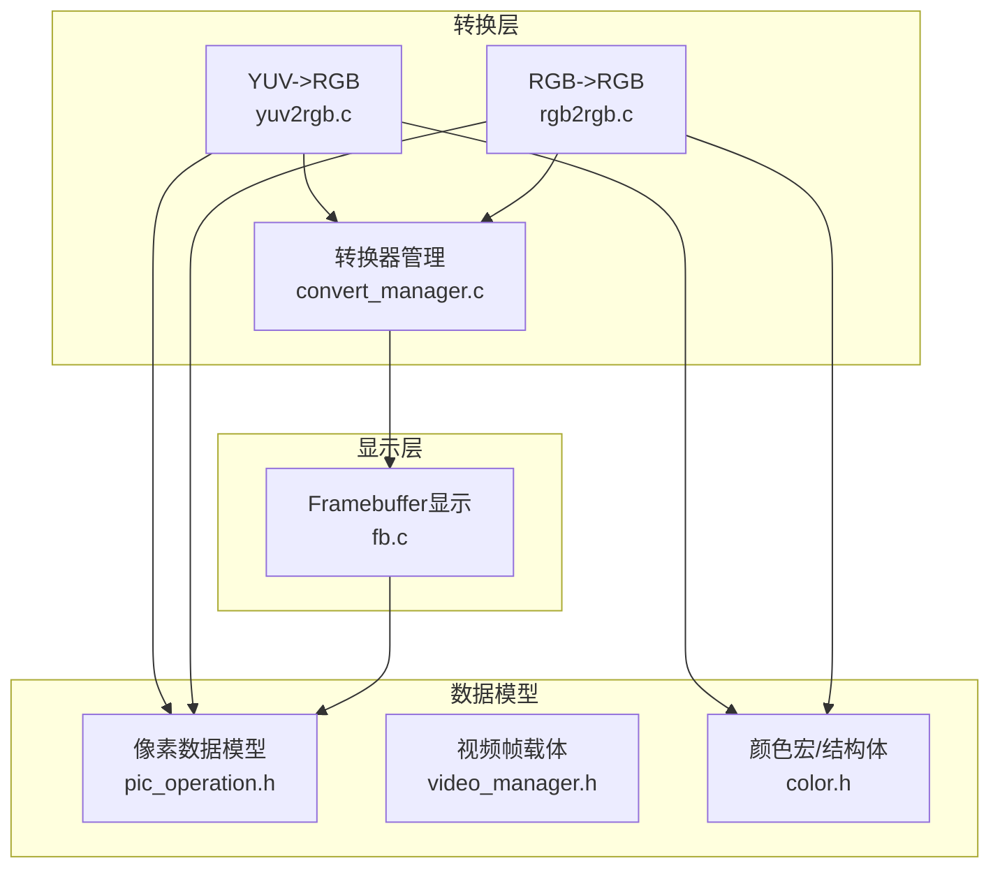
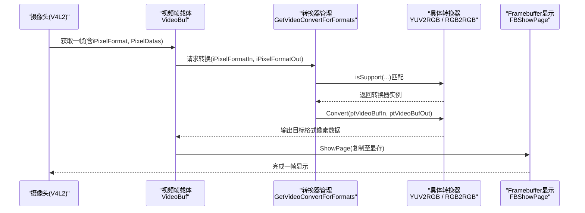
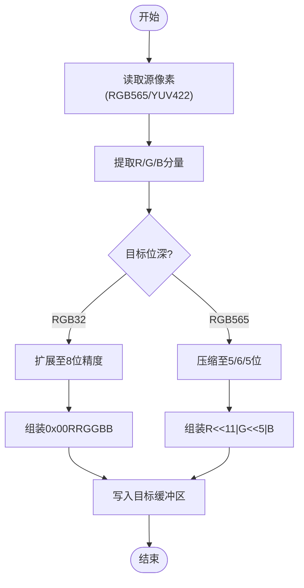
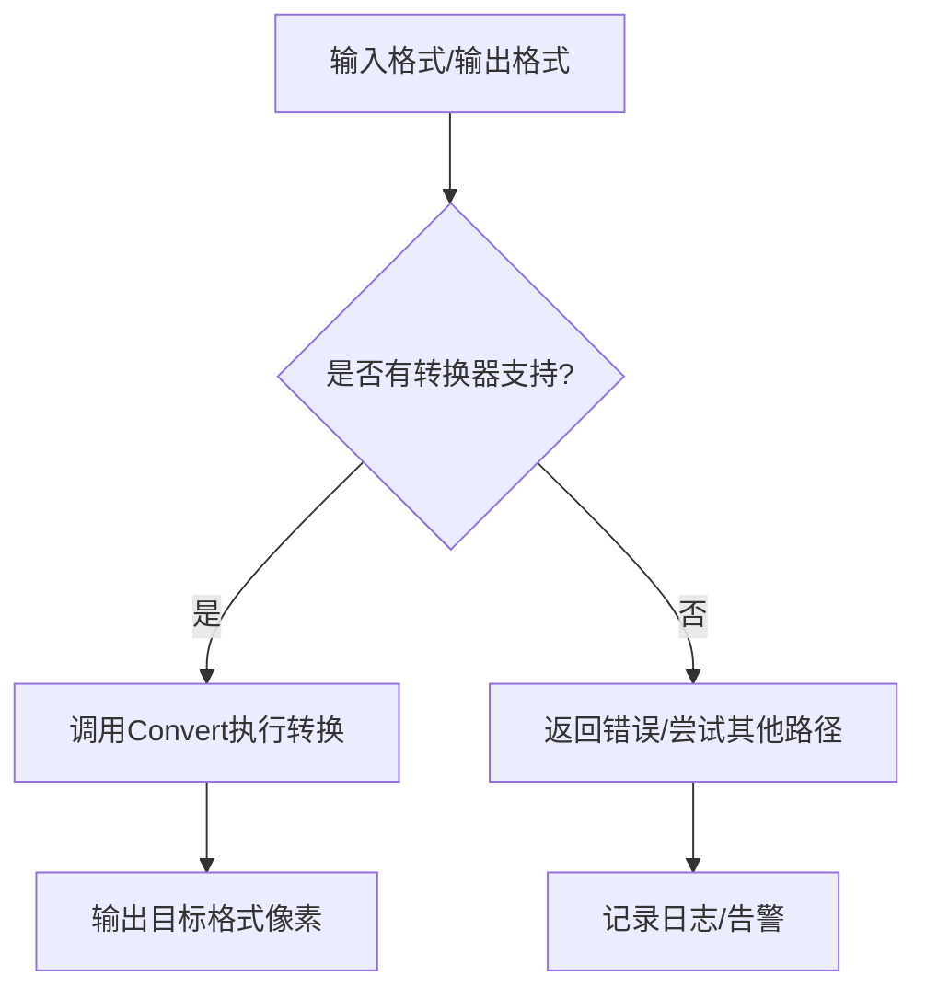
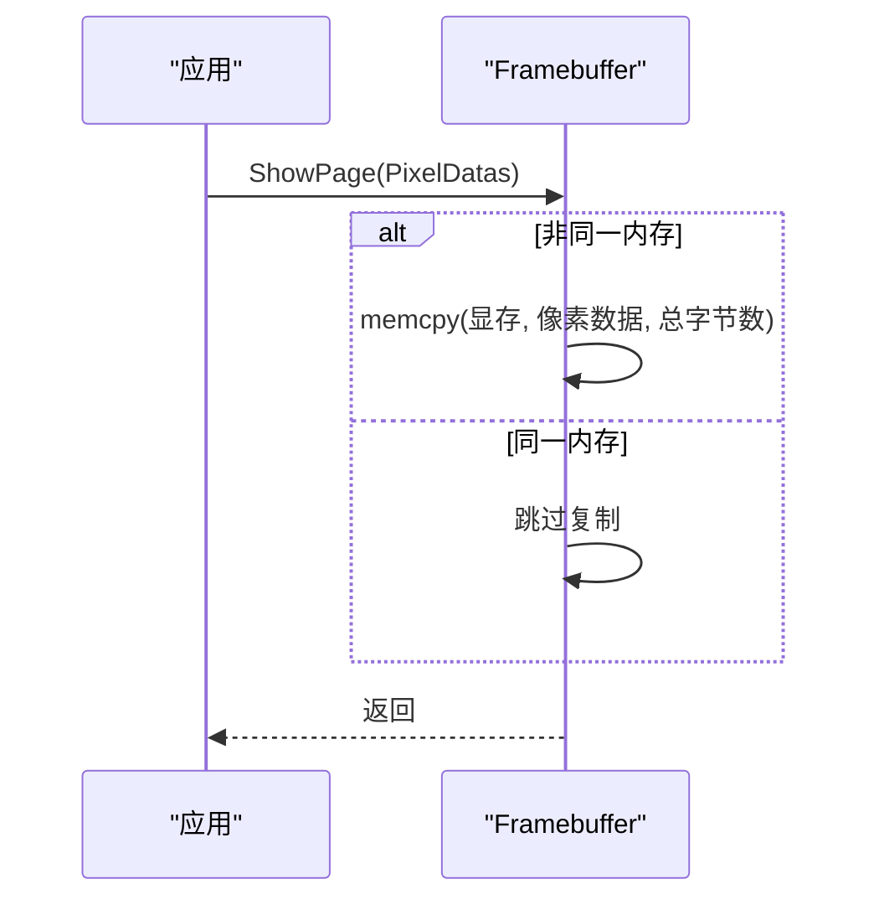
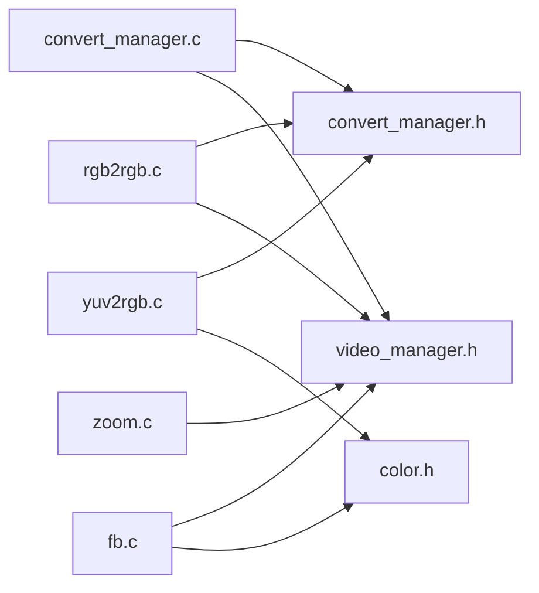

# RGB格式转换

<cite>
**本文引用的文件**
- [color.h](file://video2lcd/convert/color.h)
- [rgb2rgb.c](file://video2lcd/convert/rgb2rgb.c)
- [yuv2rgb.c](file://video2lcd/convert/yuv2rgb.c)
- [convert_manager.c](file://video2lcd/convert/convert_manager.c)
- [convert_manager.h](file://video2lcd/include/convert_manager.h)
- [pic_operation.h](file://video2lcd/include/pic_operation.h)
- [video_manager.h](file://video2lcd/include/video_manager.h)
- [fb.c](file://video2lcd/display/fb.c)
- [config.h](file://video2lcd/include/config.h)
- [zoom.c](file://video2lcd/render/operation/zoom.c)
</cite>

## 目录
1. [简介](#简介)
2. [项目结构](#项目结构)
3. [核心组件](#核心组件)
4. [架构总览](#架构总览)
5. [详细组件分析](#详细组件分析)
6. [依赖关系分析](#依赖关系分析)
7. [性能考虑](#性能考虑)
8. [故障排查指南](#故障排查指南)
9. [结论](#结论)
10. [附录](#附录)

## 简介
本技术文档围绕嵌入式Linux相机项目中RGB格式转换的实现，系统阐述不同RGB位深格式的内存布局与数据表示（如RGB565、RGB888、ARGB8888），深入解析位深转换算法的位操作技巧与精度保持方法，说明字节序处理机制与大端/小端平台兼容策略，描述像素格式兼容性检查与处理流程，并提供内存对齐、批量处理等性能优化方案。同时给出格式验证工具与调试方法，以及常见问题的诊断与解决方案。

## 项目结构
本项目采用模块化设计：视频采集通过V4L2获取原始帧，颜色空间转换模块负责将YUV或RGB源转换为显示所需的RGB目标格式，渲染/显示模块将结果写入Framebuffer设备。关键路径如下：
- convert：颜色空间与像素格式转换实现（YUV->RGB、RGB->RGB）
- include：公共数据结构与接口定义（PixelDatas、VideoBuf、转换器接口等）
- display：Framebuffer驱动封装，负责屏幕绘制与清屏
- render：图像几何变换（缩放等）
- video：V4L2设备管理（未在本节展开）

图表来源
- [convert_manager.c:23-44](file://video2lcd/convert/convert_manager.c#L23-L44)
- [yuv2rgb.c:161-199](file://video2lcd/convert/yuv2rgb.c#L161-L199)
- [rgb2rgb.c:46-119](file://video2lcd/convert/rgb2rgb.c#L46-L119)
- [pic_operation.h:10-17](file://video2lcd/include/pic_operation.h#L10-L17)
- [video_manager.h:52-55](file://video2lcd/include/video_manager.h#L52-L55)
- [color.h:28-48](file://video2lcd/convert/color.h#L28-L48)
- [fb.c:166-174](file://video2lcd/display/fb.c#L166-L174)

章节来源
- [convert_manager.c:23-44](file://video2lcd/convert/convert_manager.c#L23-L44)
- [convert_manager.h:23-29](file://video2lcd/include/convert_manager.h#L23-L29)
- [pic_operation.h:10-17](file://video2lcd/include/pic_operation.h#L10-L17)
- [video_manager.h:52-55](file://video2lcd/include/video_manager.h#L52-L55)
- [color.h:28-48](file://video2lcd/convert/color.h#L28-L48)
- [fb.c:166-174](file://video2lcd/display/fb.c#L166-L174)

## 核心组件
- 像素数据模型：统一描述图像的宽、高、位深、行字节数、总字节数和像素数据指针，贯穿采集、转换、显示全链路。
- 视频帧载体：封装一帧图像的像素数据与像素格式标识，作为转换器的输入输出单元。
- 转换器接口：以函数指针形式抽象“是否支持”、“执行转换”、“释放资源”三类操作，支持动态注册与按格式自动选择。
- 颜色定义与宏：提供RGB16/RGB24/RGB32结构体、YUV结构体、裁剪宏、YUV↔RGB公式宏、RGB16打包/解包宏。
- 具体转换器：
  - YUV->RGB：将YUV422Packed转为RGB565或RGB32，使用标准YUV到RGB系数并做分量裁剪与位深压缩/扩展。
  - RGB->RGB：在RGB565与RGB32之间进行无损位深转换或直拷。
- 显示后端：Framebuffer驱动根据屏幕位深（8/16/32bpp）将像素写入显存，支持单点绘制、整页拷贝和清屏。

章节来源
- [pic_operation.h:10-17](file://video2lcd/include/pic_operation.h#L10-L17)
- [video_manager.h:52-55](file://video2lcd/include/video_manager.h#L52-L55)
- [convert_manager.h:23-29](file://video2lcd/include/convert_manager.h#L23-L29)
- [color.h:28-48](file://video2lcd/convert/color.h#L28-L48)
- [yuv2rgb.c:161-199](file://video2lcd/convert/yuv2rgb.c#L161-L199)
- [rgb2rgb.c:46-119](file://video2lcd/convert/rgb2rgb.c#L46-L119)
- [fb.c:166-174](file://video2lcd/display/fb.c#L166-L174)

## 架构总览
下图展示了从摄像头采集到显示的完整数据流，重点标注了格式转换与显示适配的关键节点。

图表来源
- [convert_manager.c:98-111](file://video2lcd/convert/convert_manager.c#L98-L111)
- [yuv2rgb.c:161-199](file://video2lcd/convert/yuv2rgb.c#L161-L199)
- [rgb2rgb.c:46-119](file://video2lcd/convert/rgb2rgb.c#L46-L119)
- [fb.c:166-174](file://video2lcd/display/fb.c#L166-L174)

## 详细组件分析

### 像素格式与内存布局
- RGB565（16bpp）：R占5位、G占6位、B占5位，通常以小端顺序存储为两个字节；本项目中RGB565转RGB32时按小端读取并按位域提取R/G/B。
- RGB888（24bpp）：R/G/B各8位，连续排列；在RGB32中常以0x00RRGGBB形式存放（Alpha置0）。
- ARGB8888（32bpp）：A/R/G/B各8位，顺序依平台与API约定；本项目中RGB32输出为0x00RRGGBB（无Alpha通道参与显示）。

注意：
- 本项目未直接实现ARGB8888到RGB565/RGB888的转换逻辑，但可通过扩展RGB32处理分支增加Alpha通道处理。
- 位深转换遵循“先分离分量，再按目标位深重采样与打包”的原则，确保精度损失可控。

章节来源
- [color.h:28-48](file://video2lcd/convert/color.h#L28-L48)
- [rgb2rgb.c:97-115](file://video2lcd/convert/rgb2rgb.c#L97-L115)
- [yuv2rgb.c:112-149](file://video2lcd/convert/yuv2rgb.c#L112-L149)

### 位深转换算法与精度保持
- RGB565 -> RGB32：逐像素从16位值中提取R(5bit)/G(6bit)/B(5bit)，分别左移扩展至8位精度后拼装为32位0x00RRGGBB。该过程避免中间溢出，并通过位移保证精度。
- YUV422Packed -> RGB565/RGB32：使用标准YUV到RGB线性组合公式，计算得到R/G/B后再按目标位深压缩或保留8位精度。
- 精度保持要点：
  - 使用查找表或整数近似系数减少浮点运算开销（代码中使用整数系数与右移实现）。
  - 对中间结果进行裁剪，防止越界导致色彩失真。
  - 位域提取与打包时使用掩码与移位，避免符号扩展问题。

图表来源
- [rgb2rgb.c:97-115](file://video2lcd/convert/rgb2rgb.c#L97-L115)
- [yuv2rgb.c:50-98](file://video2lcd/convert/yuv2rgb.c#L50-L98)
- [color.h:65-83](file://video2lcd/convert/color.h#L65-L83)

章节来源
- [rgb2rgb.c:97-115](file://video2lcd/convert/rgb2rgb.c#L97-L115)
- [yuv2rgb.c:50-98](file://video2lcd/convert/yuv2rgb.c#L50-L98)
- [color.h:65-83](file://video2lcd/convert/color.h#L65-L83)

### 字节序处理与平台兼容
- 小端平台：RGB565的低字节在前，高位在后；代码通过按位操作提取R/G/B，不依赖字节序语义，仅依赖固定位域位置。
- 大端平台：若硬件或外设输出为大端序，需对16位像素进行字节交换（例如使用字节反转或库函数）后再进行位域提取。当前实现假设小端序，建议在大端平台上增加字节序检测与交换步骤。
- 32位RGB32：按字访问，需注意目标缓冲区的字节序与显示设备一致；当前显示路径按字写入，默认小端。

建议：
- 在转换入口增加平台字节序检测，必要时对输入像素进行字节交换。
- 对于跨平台移植，统一在入口处规范化字节序，内部算法保持与字节序无关。

章节来源
- [rgb2rgb.c:97-115](file://video2lcd/convert/rgb2rgb.c#L97-L115)
- [fb.c:106-157](file://video2lcd/display/fb.c#L106-L157)

### 像素格式兼容性检查与处理策略
- 转换器通过isSupport函数声明支持的输入/输出格式组合，管理器遍历已注册的转换器，找到第一个匹配的转换器执行转换。
- 当前支持：
  - YUV422Packed -> RGB565/RGB32
  - RGB565 -> RGB565/RGB32
- 策略：
  - 若输入格式不支持，返回错误，调用方可降级或提示用户。
  - 若输出格式不匹配，可在上层进行二次转换或选择其他路径。

图表来源
- [convert_manager.c:98-111](file://video2lcd/convert/convert_manager.c#L98-L111)
- [yuv2rgb.c:25-34](file://video2lcd/convert/yuv2rgb.c#L25-L34)
- [rgb2rgb.c:20-29](file://video2lcd/convert/rgb2rgb.c#L20-L29)

章节来源
- [convert_manager.c:98-111](file://video2lcd/convert/convert_manager.c#L98-L111)
- [yuv2rgb.c:25-34](file://video2lcd/convert/yuv2rgb.c#L25-L34)
- [rgb2rgb.c:20-29](file://video2lcd/convert/rgb2rgb.c#L20-L29)

### 显示适配与帧缓冲写入
- Framebuffer初始化时获取屏幕分辨率、位深与每行字节数，映射显存到进程地址空间。
- 显示页面时，若目标缓冲区与显存非同一块内存，则整体memcpy复制到显存；否则直接复用。
- 单点绘制与清屏根据屏幕位深（8/16/32bpp）分别处理，16bpp下将32位颜色转换为RGB565写入。

图表来源
- [fb.c:166-174](file://video2lcd/display/fb.c#L166-L174)
- [fb.c:53-94](file://video2lcd/display/fb.c#L53-L94)

章节来源
- [fb.c:53-94](file://video2lcd/display/fb.c#L53-L94)
- [fb.c:166-174](file://video2lcd/display/fb.c#L166-L174)

### 图像缩放与格式一致性
- 缩放模块要求源与目标的位深一致，否则返回错误；内部使用最近邻插值，按行复制像素块。
- 建议在缩放前确保像素格式一致，或在缩放前后插入格式转换步骤。

章节来源
- [zoom.c:27-85](file://video2lcd/render/operation/zoom.c#L27-L85)

## 依赖关系分析
- 转换器管理依赖公共配置与视频帧结构，维护转换器链表，提供按名称或格式查询能力。
- 具体转换器依赖颜色宏与像素数据模型，实现各自转换逻辑。
- 显示模块依赖像素数据模型与配置，负责将像素数据写入显存。

图表来源
- [convert_manager.c:9-11](file://video2lcd/convert/convert_manager.c#L9-L11)
- [yuv2rgb.c:14-16](file://video2lcd/convert/yuv2rgb.c#L14-L16)
- [rgb2rgb.c:9-11](file://video2lcd/convert/rgb2rgb.c#L9-L11)
- [fb.c:9-17](file://video2lcd/display/fb.c#L9-L17)
- [zoom.c:11-14](file://video2lcd/render/operation/zoom.c#L11-L14)

章节来源
- [convert_manager.c:9-11](file://video2lcd/convert/convert_manager.c#L9-L11)
- [yuv2rgb.c:14-16](file://video2lcd/convert/yuv2rgb.c#L14-L16)
- [rgb2rgb.c:9-11](file://video2lcd/convert/rgb2rgb.c#L9-L11)
- [fb.c:9-17](file://video2lcd/display/fb.c#L9-L17)
- [zoom.c:11-14](file://video2lcd/render/operation/zoom.c#L11-L14)

## 性能考虑
- 内存分配与复用：
  - 输出缓冲区按需分配，避免重复malloc/free；可引入双缓冲或池化分配降低碎片与开销。
  - 当PixelDatas与显存为同一块内存时，跳过memcpy提升效率。
- 批量处理：
  - 行级循环与指针步进减少寻址开销；RGB32路径使用32位指针一次写一个字，提高吞吐。
  - YUV->RGB路径每次处理两个像素，减少循环次数。
- 内存对齐：
  - 使用自然对齐类型（unsigned short/unsigned int）进行读写，避免未对齐访问带来的性能惩罚。
  - 在ARM等平台，确保行字节数为4字节倍数以提升缓存命中。
- 查找表与整数运算：
  - 使用整数系数与右移替代浮点运算，减少CPU开销。
  - 可扩展查找表进一步加速YUV->RGB转换。
- 并行化：
  - 可按行多线程处理（注意线程安全与内存边界），或使用SIMD指令（NEON/SSE）加速像素处理。

[本节为通用性能指导，不直接分析具体文件]

## 故障排查指南
- 常见问题与定位：
  - 颜色异常或偏色：检查YUV->RGB系数与裁剪逻辑，确认分量范围与位深压缩是否正确。
  - 画面错位或撕裂：确认行字节数与总字节数计算正确，避免跨行偏移错误。
  - 显示黑屏或花屏：检查Framebuffer位深与像素格式是否匹配，确认memcpy长度与源/目标一致。
  - 缩放失败：确认源与目标位深一致，否则返回错误；检查坐标查找表构建是否正确。
- 调试方法：
  - 启用调试输出宏，打印像素数据首地址、尺寸、位深等信息，辅助定位内存与格式问题。
  - 在转换前后保存中间结果（如RGB32）到文件，对比预期色彩。
  - 使用十六进制查看器检查像素数据的位域分布是否符合预期。
- 修复建议：
  - 在转换入口增加参数校验（宽度、高度、位深、缓冲区有效性）。
  - 对大端平台增加字节序检测与交换。
  - 对不支持的格式组合提供明确错误码与降级策略。

章节来源
- [config.h:13-15](file://video2lcd/include/config.h#L13-L15)
- [zoom.c:38-48](file://video2lcd/render/operation/zoom.c#L38-L48)
- [fb.c:106-157](file://video2lcd/display/fb.c#L106-L157)

## 结论
本项目实现了从YUV422Packed到RGB565/RGB32以及RGB565到RGB32的像素格式转换，具备清晰的转换器注册与选择机制，并在Framebuffer显示层完成了多bpp适配。通过位操作与整数近似系数，保证了转换效率与精度平衡。未来可进一步增强ARGB8888支持、平台字节序兼容性与并行化优化，以满足更高性能的显示需求。

[本节为总结性内容，不直接分析具体文件]

## 附录
- 常用宏与结构体参考：
  - 颜色裁剪宏、YUV->RGB公式宏、RGB16打包/解包宏位于颜色头文件。
  - 像素数据模型与视频帧载体定义于公共头文件。
- 示例路径（用于定位实现细节）：
  - RGB565->RGB32位深转换：[rgb2rgb.c:97-115](file://video2lcd/convert/rgb2rgb.c#L97-L115)
  - YUV422->RGB565/RGB32转换：[yuv2rgb.c:50-98](file://video2lcd/convert/yuv2rgb.c#L50-L98), [yuv2rgb.c:112-149](file://video2lcd/convert/yuv2rgb.c#L112-L149)
  - 转换器注册与管理：[convert_manager.c:23-44](file://video2lcd/convert/convert_manager.c#L23-L44), [convert_manager.c:98-111](file://video2lcd/convert/convert_manager.c#L98-L111)
  - Framebuffer显示适配：[fb.c:53-94](file://video2lcd/display/fb.c#L53-L94), [fb.c:166-174](file://video2lcd/display/fb.c#L166-L174)