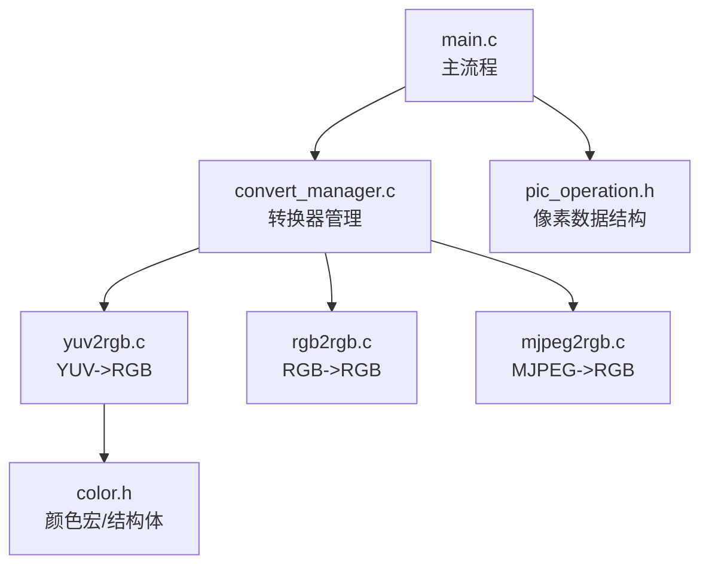
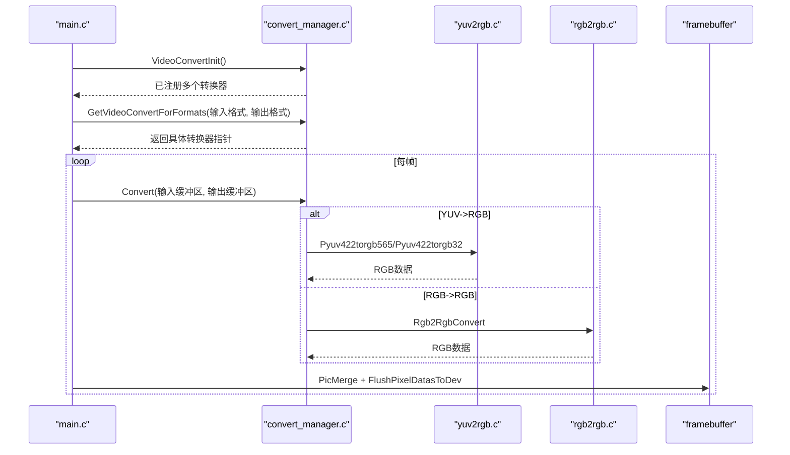
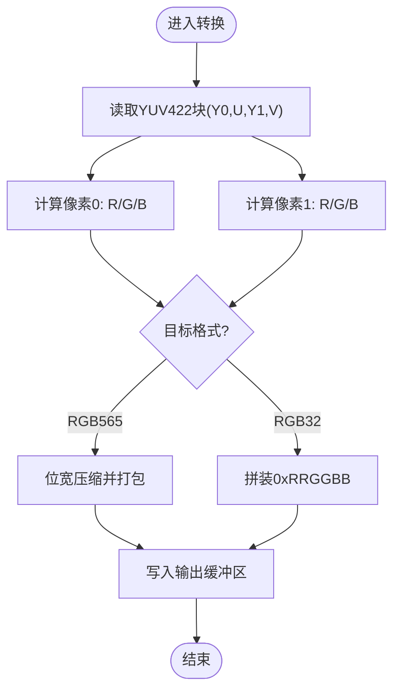
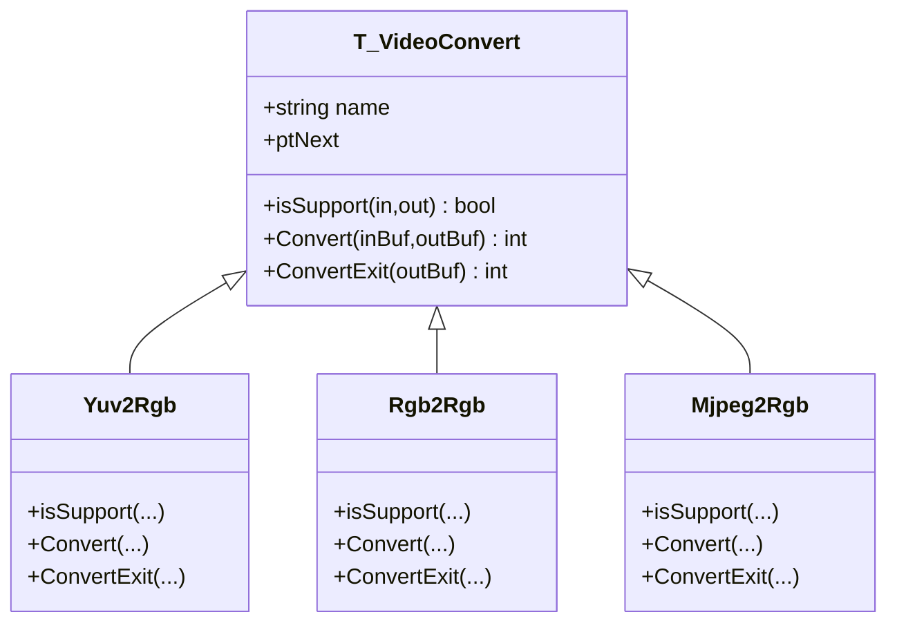
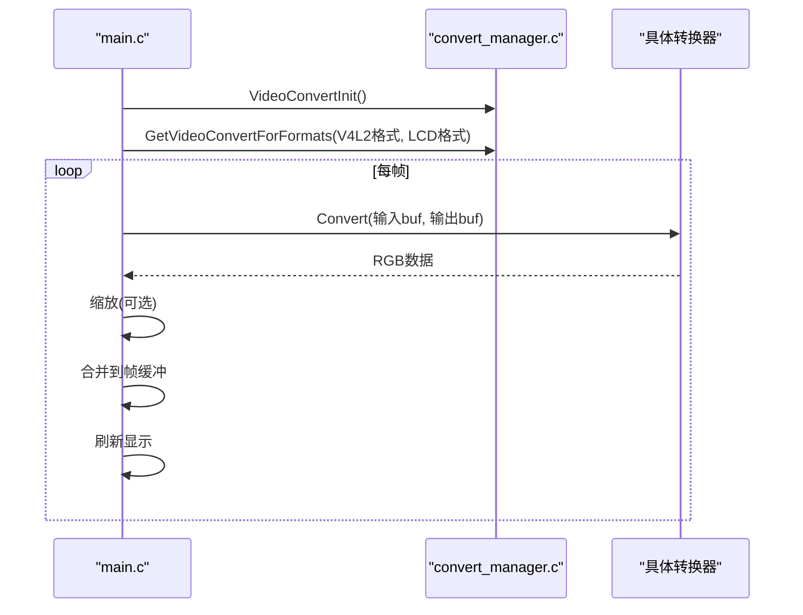
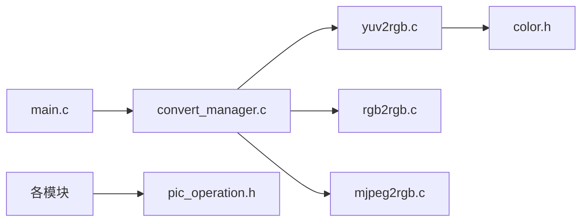

# YUV到RGB转换

<cite>
**本文引用的文件**
- [yuv2rgb.c](file://video2lcd/convert/yuv2rgb.c)
- [color.h](file://video2lcd/convert/color.h)
- [rgb2rgb.c](file://video2lcd/convert/rgb2rgb.c)
- [convert_manager.c](file://video2lcd/convert/convert_manager.c)
- [convert_manager.h](file://video2lcd/include/convert_manager.h)
- [pic_operation.h](file://video2lcd/include/pic_operation.h)
- [mjpeg2rgb.c](file://video2lcd/convert/mjpeg2rgb.c)
- [main.c](file://video2lcd/main.c)
</cite>

## 目录
1. [简介](#简介)
2. [项目结构](#项目结构)
3. [核心组件](#核心组件)
4. [架构总览](#架构总览)
5. [详细组件分析](#详细组件分析)
6. [依赖关系分析](#依赖关系分析)
7. [性能与优化](#性能与优化)
8. [故障排查指南](#故障排查指南)
9. [结论](#结论)
10. [附录](#附录)

## 简介
本技术文档围绕嵌入式Linux相机项目中“YUV到RGB颜色空间转换”的实现进行系统化说明。重点包括：
- YUV与RGB的数学关系与常用转换公式
- 常见YUV子采样格式（如4:2:2、4:2:0、4:4:4）的像素排列与处理差异
- 本项目中YUV422Packed到RGB565/RGB32的具体实现路径
- 查找表与定点化思路、内存访问与SIMD加速建议
- 质量评估方法与常见问题定位

## 项目结构
本项目将视频采集、格式转换、显示渲染解耦为独立模块，并通过统一的转换器注册机制管理不同格式间的转换。与YUV到RGB相关的关键文件如下：
- convert/yuv2rgb.c：YUV422Packed到RGB565/RGB32的转换实现
- convert/color.h：颜色结构体、裁剪宏、转换宏与函数声明
- convert/rgb2rgb.c：RGB565到RGB32等格式的转换
- convert/convert_manager.c/.h：转换器注册、选择与管理
- include/pic_operation.h：像素数据描述结构体
- convert/mjpeg2rgb.c：MJPEG解码并输出RGB（用于对比参考）
- main.c：主流程，负责设备初始化、自动选择转换器、循环采集与显示

图表来源
- [main.c:91-138](file://video2lcd/main.c#L91-L138)
- [convert_manager.c:23-131](file://video2lcd/convert/convert_manager.c#L23-L131)
- [yuv2rgb.c:161-232](file://video2lcd/convert/yuv2rgb.c#L161-L232)
- [color.h:28-88](file://video2lcd/convert/color.h#L28-L88)
- [pic_operation.h:10-17](file://video2lcd/include/pic_operation.h#L10-L17)

章节来源
- [main.c:91-138](file://video2lcd/main.c#L91-L138)
- [convert_manager.c:23-131](file://video2lcd/convert/convert_manager.c#L23-L131)
- [yuv2rgb.c:161-232](file://video2lcd/convert/yuv2rgb.c#L161-L232)
- [color.h:28-88](file://video2lcd/convert/color.h#L28-L88)
- [pic_operation.h:10-17](file://video2lcd/include/pic_operation.h#L10-L17)

## 核心组件
- 颜色空间基础
  - RGB与YUV的线性变换关系，包含亮度Y与色度U/V的定义与反变换
  - 常用BT.601系数在工程中的定点近似表达
- 像素格式与子采样
  - YUV422Packed（V4L2_PIX_FMT_YUYV）：每4字节表示2个像素，共享U/V
  - RGB565/RGB32：目标显示格式
- 转换器接口
  - T_VideoConvert：统一封装isSupport/Convert/ConvertExit
  - 通过RegisterVideoConvert注册，GetVideoConvertForFormats按输入输出格式选择具体转换器

章节来源
- [color.h:28-88](file://video2lcd/convert/color.h#L28-L88)
- [yuv2rgb.c:18-34](file://video2lcd/convert/yuv2rgb.c#L18-L34)
- [convert_manager.h:23-43](file://video2lcd/include/convert_manager.h#L23-L43)
- [convert_manager.c:23-131](file://video2lcd/convert/convert_manager.c#L23-L131)

## 架构总览
系统启动后，main完成显示与视频设备初始化，随后根据摄像头输出格式与LCD期望格式，调用转换器管理器选择合适转换器执行转换；若尺寸不匹配则进行缩放，最后合并到帧缓冲并刷新显示。

图表来源
- [main.c:91-178](file://video2lcd/main.c#L91-L178)
- [convert_manager.c:98-131](file://video2lcd/convert/convert_manager.c#L98-L131)
- [yuv2rgb.c:161-232](file://video2lcd/convert/yuv2rgb.c#L161-L232)
- [rgb2rgb.c:46-151](file://video2lcd/convert/rgb2rgb.c#L46-L151)

## 详细组件分析

### YUV到RGB转换算法与实现
- 数学关系
  - 正向：从RGB计算Y/U/V（BT.601系数的定点近似）
  - 反向：从Y/U/V计算R/G/B（工程中常使用整数乘法+移位或查找表）
- 本项目实现要点
  - 支持YUV422Packed（YUYV）到RGB565/RGB32
  - 每个YUYV块包含两个像素的Y和共享的U/V，分别计算两像素的R/G/B
  - 使用CLIP宏对中间结果进行范围裁剪，避免溢出
  - 输出RGB565时进行位宽压缩（R:8→5,G:8→6,B:8→5），并按低位在前写入
  - 输出RGB32时直接拼装为0xRRGGBB

图表来源
- [yuv2rgb.c:50-98](file://video2lcd/convert/yuv2rgb.c#L50-L98)
- [yuv2rgb.c:112-149](file://video2lcd/convert/yuv2rgb.c#L112-L149)
- [color.h:65-83](file://video2lcd/convert/color.h#L65-L83)

章节来源
- [yuv2rgb.c:50-149](file://video2lcd/convert/yuv2rgb.c#L50-L149)
- [color.h:65-83](file://video2lcd/convert/color.h#L65-L83)

### 像素格式与子采样处理差异
- YUV422Packed（YUYV）
  - 每4字节对应2像素：[Y0 U0 Y1 V0]，U/V水平方向半采样
  - 本项目当前实现针对该格式
- YUV420（未在当前代码中直接实现）
  - 典型平面布局：Y平面全分辨率，U/V平面各半分辨率
  - 解码时需对U/V进行双线性或最近邻插值以匹配Y分辨率
- YUV444（未在当前代码中直接实现）
  - 每个像素独立Y/U/V，无子采样，适合高质量场景

注意：上述差异影响的是“如何从原始YUV数据提取Y/U/V并映射到每个像素”，而本项目的YUV422Packed路径已经内联处理了共享U/V的情况。

章节来源
- [color.h:50-63](file://video2lcd/convert/color.h#L50-L63)
- [yuv2rgb.c:38-98](file://video2lcd/convert/yuv2rgb.c#L38-L98)

### 颜色转换查找表与定点化
- 查找表（LUT）
  - 初始化入口：initLut()，在YUV转RGB初始化时调用
  - 作用：将浮点系数乘法替换为查表+加减，减少CPU开销
- 定点化技巧
  - 使用整数乘加与右移近似浮点运算（例如乘以系数后再移位）
  - CLIP宏保证结果落在[0,255]区间，防止溢出
- 当前状态
  - color.h声明了initLut/freeLut，但具体实现不在本仓库可见范围内；可据此扩展为高效查表实现

章节来源
- [yuv2rgb.c:225-232](file://video2lcd/convert/yuv2rgb.c#L225-L232)
- [color.h:85-88](file://video2lcd/convert/color.h#L85-L88)

### 转换器管理与选择
- 统一接口
  - T_VideoConvert封装name/isSupport/Convert/ConvertExit
  - RegisterVideoConvert将转换器加入链表
  - GetVideoConvertForFormats遍历链表，按输入输出格式选择具体转换器
- 已注册转换器
  - yuv2rgb：YUV422Packed -> RGB565/RGB32
  - rgb2rgb：RGB565 -> RGB565/RGB32
  - mjpeg2rgb：MJPEG -> RGB（借助libjpeg）

图表来源
- [convert_manager.h:23-43](file://video2lcd/include/convert_manager.h#L23-L43)
- [convert_manager.c:23-131](file://video2lcd/convert/convert_manager.c#L23-L131)
- [yuv2rgb.c:217-232](file://video2lcd/convert/yuv2rgb.c#L217-L232)
- [rgb2rgb.c:138-151](file://video2lcd/convert/rgb2rgb.c#L138-L151)
- [mjpeg2rgb.c:247-260](file://video2lcd/convert/mjpeg2rgb.c#L247-L260)

章节来源
- [convert_manager.h:23-43](file://video2lcd/include/convert_manager.h#L23-L43)
- [convert_manager.c:23-131](file://video2lcd/convert/convert_manager.c#L23-L131)
- [yuv2rgb.c:217-232](file://video2lcd/convert/yuv2rgb.c#L217-L232)
- [rgb2rgb.c:138-151](file://video2lcd/convert/rgb2rgb.c#L138-L151)
- [mjpeg2rgb.c:247-260](file://video2lcd/convert/mjpeg2rgb.c#L247-L260)

### 主流程中的数据流
- 初始化阶段：显示与视频设备初始化，获取LCD分辨率与像素格式
- 选择转换器：根据摄像头输出格式与LCD期望格式选择转换器
- 循环处理：获取一帧 -> 必要时格式转换 -> 必要时缩放 -> 合并到帧缓冲 -> 刷新显示

图表来源
- [main.c:91-178](file://video2lcd/main.c#L91-L178)
- [convert_manager.c:98-131](file://video2lcd/convert/convert_manager.c#L98-L131)

章节来源
- [main.c:91-178](file://video2lcd/main.c#L91-L178)
- [convert_manager.c:98-131](file://video2lcd/convert/convert_manager.c#L98-L131)

## 依赖关系分析
- 模块耦合
  - main.c依赖convert_manager.c进行转换器选择与调用
  - yuv2rgb.c依赖color.h提供颜色结构与转换宏
  - rgb2rgb.c与mjpeg2rgb.c同样遵循T_VideoConvert接口
- 外部依赖
  - mjpeg2rgb.c依赖libjpeg进行JPEG解码
- 数据结构
  - pic_operation.h定义统一的像素数据描述，被各模块复用

图表来源
- [main.c:91-138](file://video2lcd/main.c#L91-L138)
- [convert_manager.c:23-131](file://video2lcd/convert/convert_manager.c#L23-L131)
- [yuv2rgb.c:14-16](file://video2lcd/convert/yuv2rgb.c#L14-L16)
- [color.h:28-88](file://video2lcd/convert/color.h#L28-L88)
- [pic_operation.h:10-17](file://video2lcd/include/pic_operation.h#L10-L17)

章节来源
- [main.c:91-138](file://video2lcd/main.c#L91-L138)
- [convert_manager.c:23-131](file://video2lcd/convert/convert_manager.c#L23-L131)
- [yuv2rgb.c:14-16](file://video2lcd/convert/yuv2rgb.c#L14-L16)
- [color.h:28-88](file://video2lcd/convert/color.h#L28-L88)
- [pic_operation.h:10-17](file://video2lcd/include/pic_operation.h#L10-L17)

## 性能与优化
- 当前实现特征
  - YUV422Packed到RGB565/RGB32采用逐像素循环，逻辑清晰但存在优化空间
  - 使用CLIP宏与位操作进行快速裁剪与打包
- 内存访问优化
  - 顺序读写YUYV与RGB缓冲区，具备良好缓存局部性
  - 建议按行对齐分配输出缓冲区，减少跨页访问
- 计算优化
  - 引入查找表（initLut）替代浮点乘法，降低CPU开销
  - 使用定点化（整数乘加+移位）替代浮点运算
- SIMD加速建议
  - 使用NEON/SSE等指令并行处理多像素（每次处理4-8像素）
  - 将YUV到RGB的矩阵乘法展开为向量加法与移位
- 质量评估方法
  - PSNR/SSIM：量化重建误差
  - 主观评测：观察肤色、暗部细节与色彩过渡
  - 边界测试：极端亮度/饱和度区域验证CLIP正确性
- 基准测试建议
  - 在不同分辨率（如640x480、1280x720）下测量FPS与CPU占用
  - 对比浮点/定点/LUT/SIMD四种实现的吞吐与时延

[本节为通用指导，不直接分析具体文件]

## 故障排查指南
- 无合适转换器
  - 现象：日志提示“No suitable video convert for formats”
  - 排查：确认摄像头输出格式与LCD期望格式是否被某转换器支持
- 转换失败
  - 现象：Convert返回错误码
  - 排查：检查输入/输出缓冲区大小、像素格式、行字节数计算是否正确
- 颜色异常
  - 现象：画面偏色或过曝/欠曝
  - 排查：确认CLIP范围、位宽压缩（RGB565）是否正确，检查U/V偏移与符号处理
- MJPEG解码错误
  - 现象：libjpeg报错
  - 排查：查看自定义错误处理输出的错误信息，确认数据源长度与格式

章节来源
- [main.c:91-138](file://video2lcd/main.c#L91-L138)
- [mjpeg2rgb.c:59-70](file://video2lcd/convert/mjpeg2rgb.c#L59-L70)
- [yuv2rgb.c:161-199](file://video2lcd/convert/yuv2rgb.c#L161-L199)
- [rgb2rgb.c:46-119](file://video2lcd/convert/rgb2rgb.c#L46-L119)

## 结论
本项目实现了基于YUV422Packed到RGB565/RGB32的颜色空间转换，并通过统一的转换器管理机制灵活扩展其他格式转换。当前实现简洁可靠，具备进一步优化的空间，尤其是引入查找表、定点化与SIMD指令以提升性能。对于更广泛的YUV子采样格式（如4:2:0、4:4:4），可在现有框架上按需扩展相应转换器。

[本节为总结性内容，不直接分析具体文件]

## 附录
- 关键数据结构
  - T_PixelDatas：统一描述图像数据的宽度、高度、位深、行字节数、总字节数与数据指针
- 关键接口
  - RegisterVideoConvert：注册转换器
  - GetVideoConvertForFormats：按输入输出格式选择转换器
  - VideoConvertInit：初始化所有转换器
- 参考路径
  - YUV->RGB：[yuv2rgb.c:50-149](file://video2lcd/convert/yuv2rgb.c#L50-L149)
  - RGB->RGB：[rgb2rgb.c:46-119](file://video2lcd/convert/rgb2rgb.c#L46-L119)
  - 转换器管理：[convert_manager.c:23-131](file://video2lcd/convert/convert_manager.c#L23-L131)
  - 颜色宏与结构体：[color.h:28-88](file://video2lcd/convert/color.h#L28-L88)
  - 像素数据结构：[pic_operation.h:10-17](file://video2lcd/include/pic_operation.h#L10-L17)

章节来源
- [yuv2rgb.c:50-149](file://video2lcd/convert/yuv2rgb.c#L50-L149)
- [rgb2rgb.c:46-119](file://video2lcd/convert/rgb2rgb.c#L46-L119)
- [convert_manager.c:23-131](file://video2lcd/convert/convert_manager.c#L23-L131)
- [color.h:28-88](file://video2lcd/convert/color.h#L28-L88)
- [pic_operation.h:10-17](file://video2lcd/include/pic_operation.h#L10-L17)