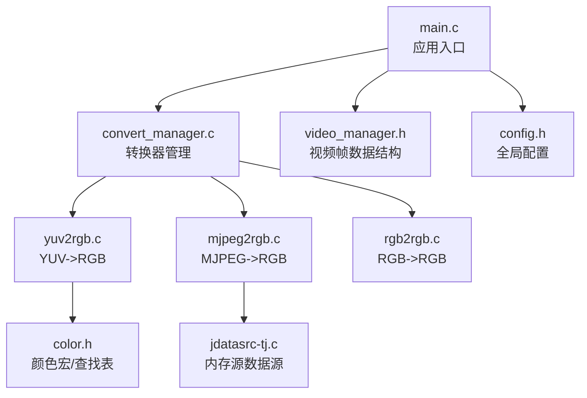
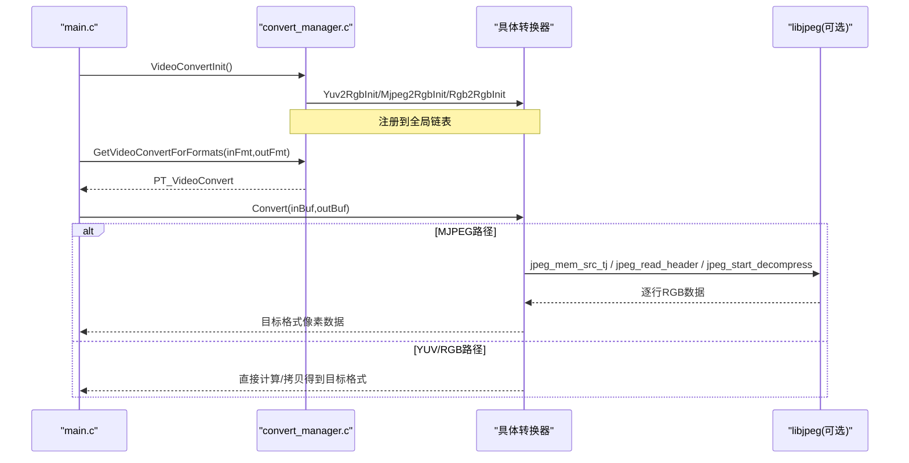
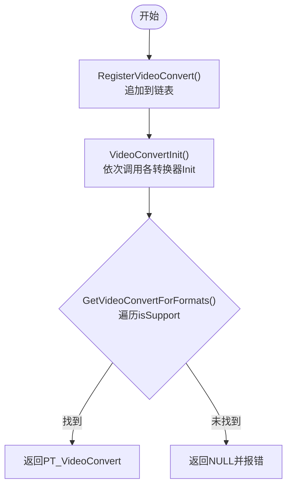
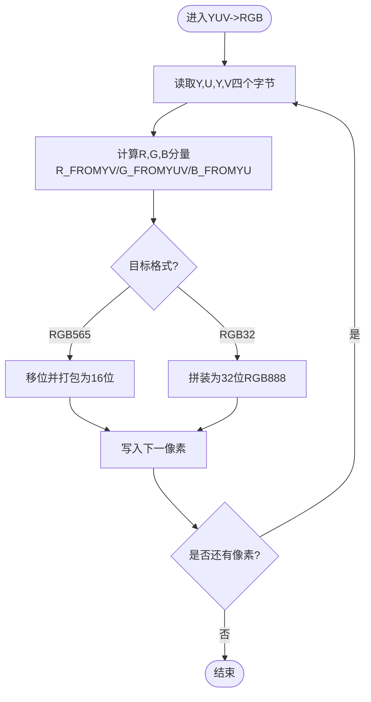
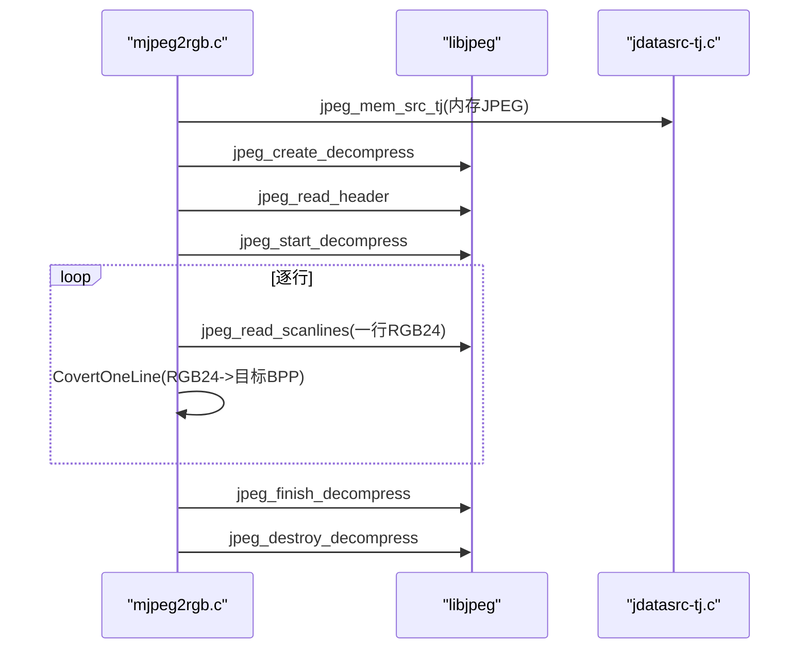
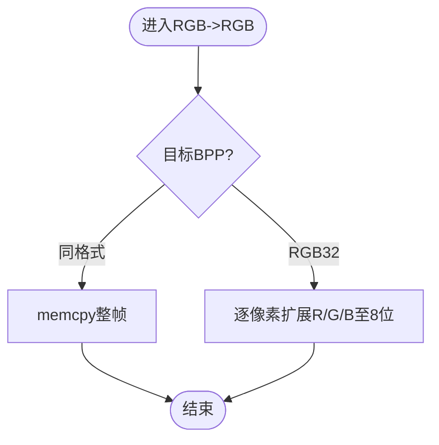
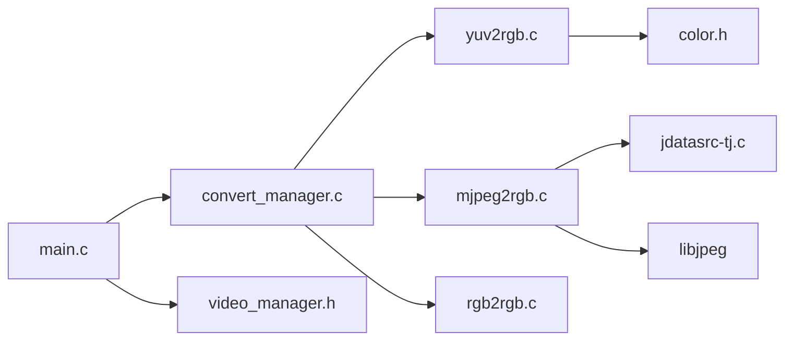

# 格式转换系统

<cite>
**本文引用的文件**
- [convert_manager.c](file://video2lcd/convert/convert_manager.c)
- [convert_manager.h](file://video2lcd/include/convert_manager.h)
- [yuv2rgb.c](file://video2lcd/convert/yuv2rgb.c)
- [mjpeg2rgb.c](file://video2lcd/convert/mjpeg2rgb.c)
- [rgb2rgb.c](file://video2lcd/convert/rgb2rgb.c)
- [color.h](file://video2lcd/convert/color.h)
- [jdatasrc-tj.c](file://video2lcd/convert/jdatasrc-tj.c)
- [config.h](file://video2lcd/include/config.h)
- [video_manager.h](file://video2lcd/include/video_manager.h)
- [main.c](file://video2lcd/main.c)
</cite>

## 目录
1. [简介](#简介)
2. [项目结构](#项目结构)
3. [核心组件](#核心组件)
4. [架构总览](#架构总览)
5. [详细组件分析](#详细组件分析)
6. [依赖关系分析](#依赖关系分析)
7. [性能与优化](#性能与优化)
8. [故障排查指南](#故障排查指南)
9. [结论](#结论)
10. [附录：开发指南与最佳实践](#附录：开发指南与最佳实践)

## 简介
本文件系统性地梳理并文档化嵌入式Linux相机项目中的“格式转换子系统”，重点说明插件式转换器架构、格式匹配算法、动态加载策略，以及YUV到RGB的颜色空间转换、MJPEG解码流程、RGB位深转换等关键实现。同时给出颜色空间理论与数学原理、性能优化建议（SIMD、内存对齐、并行处理）、添加新转换器的开发指南，以及质量评估与基准测试方法。

## 项目结构
该子系统位于 video2lcd/convert 目录，配合 include 下的接口定义，形成“管理器 + 多转换器”的插件式架构。主程序在 main.c 中完成设备初始化、格式选择、转换调用与显示流程编排。

图表来源
- [main.c:34-192](file://video2lcd/main.c#L34-L192)
- [convert_manager.c:1-131](file://video2lcd/convert/convert_manager.c#L1-L131)
- [yuv2rgb.c:1-233](file://video2lcd/convert/yuv2rgb.c#L1-L233)
- [mjpeg2rgb.c:1-261](file://video2lcd/convert/mjpeg2rgb.c#L1-L261)
- [rgb2rgb.c:1-152](file://video2lcd/convert/rgb2rgb.c#L1-L152)
- [color.h:1-88](file://video2lcd/convert/color.h#L1-L88)
- [jdatasrc-tj.c:1-183](file://video2lcd/convert/jdatasrc-tj.c#L1-L183)
- [video_manager.h:1-56](file://video2lcd/include/video_manager.h#L1-L56)
- [config.h:1-21](file://video2lcd/include/config.h#L1-L21)

章节来源
- [main.c:34-192](file://video2lcd/main.c#L34-L192)
- [convert_manager.c:1-131](file://video2lcd/convert/convert_manager.c#L1-L131)

## 核心组件
- 转换器接口与管理器
  - 通过统一的 VideoConvert 结构体描述一个转换器：名称、支持判断、转换函数、退出释放函数、链表指针。
  - 管理器提供注册、按名称获取、按输入输出格式自动匹配、统一初始化等功能。
- 具体转换器
  - YUV422(YUYV) -> RGB565/RGB32
  - MJPEG -> RGB565/RGB32（基于libjpeg）
  - RGB565 -> RGB565/RGB32（位深扩展或直拷）
- 颜色工具
  - color.h 提供YUV/RGB转换宏、查找表初始化接口等。
- 数据载体
  - VideoBuf/PixelDatas 统一封装像素数据、宽高、BPP、行字节数、总字节数等。

章节来源
- [convert_manager.h:16-46](file://video2lcd/include/convert_manager.h#L16-L46)
- [convert_manager.c:16-131](file://video2lcd/convert/convert_manager.c#L16-L131)
- [video_manager.h:47-56](file://video2lcd/include/video_manager.h#L47-L56)

## 架构总览
采用“插件式+链表注册”的架构：各转换器以静态结构体形式暴露初始化函数，由管理器集中初始化并维护链表；运行时根据输入输出像素格式自动匹配最合适的转换器执行转换。

图表来源
- [convert_manager.c:121-131](file://video2lcd/convert/convert_manager.c#L121-L131)
- [convert_manager.c:98-111](file://video2lcd/convert/convert_manager.c#L98-L111)
- [mjpeg2rgb.c:145-228](file://video2lcd/convert/mjpeg2rgb.c#L145-L228)
- [jdatasrc-tj.c:155-183](file://video2lcd/convert/jdatasrc-tj.c#L155-L183)

## 详细组件分析

### 转换器注册与匹配机制
- 注册机制
  - RegisterVideoConvert 将转换器节点追加到全局链表头 g_ptVideoConvertHead。
  - 每个转换器模块提供 Init 函数，内部调用 RegisterVideoConvert 完成自注册。
- 匹配算法
  - GetVideoConvertForFormats 遍历已注册的转换器，调用其 isSupport 回调，返回第一个匹配的转换器。
  - 匹配依据为输入/输出像素格式组合（如 V4L2_PIX_FMT_YUYV -> RGB565/RGB32）。
- 动态加载策略
  - 当前为编译期链接的动态注册（各 .c 提供 Init 并在管理器初始化时调用），非运行时 dlopen/dlsym。
  - 扩展方式：新增 .c 文件实现 isSupport/Convert/ConvertExit，并提供 Init 调用 RegisterVideoConvert，然后在 VideoConvertInit 中调用该 Init。

图表来源
- [convert_manager.c:23-44](file://video2lcd/convert/convert_manager.c#L23-L44)
- [convert_manager.c:98-111](file://video2lcd/convert/convert_manager.c#L98-L111)
- [convert_manager.c:121-131](file://video2lcd/convert/convert_manager.c#L121-L131)

章节来源
- [convert_manager.c:16-131](file://video2lcd/convert/convert_manager.c#L16-L131)
- [convert_manager.h:16-46](file://video2lcd/include/convert_manager.h#L16-L46)

### YUV到RGB颜色空间转换
- 支持的输入/输出
  - 输入：V4L2_PIX_FMT_YUYV（YUV422Packed）
  - 输出：V4L2_PIX_FMT_RGB565 或 V4L2_PIX_FMT_RGB32
- 转换原理
  - 使用标准BT.601系数进行YUV->RGB转换，代码中通过宏 R_FROMYV/G_FROMYUV/B_FROMYU 实现。
  - 对两个像素共享一对U/V的YUYV布局，每次读取4字节，生成两个RGB像素。
- 实现要点
  - Pyuv422torgb565：将8位R/G/B分量分别右移为5/6/5位后打包为16位RGB565。
  - Pyuv422torgb32：将R/G/B扩展为8位后拼装为32位RGB888（低24位有效）。
  - 输出缓冲区按需分配，大小按 iWidth*iHeight*iBpp/8 计算。
- 复杂度
  - 时间复杂度 O(N)，N为像素数；空间复杂度 O(W*H) 用于输出缓冲。

图表来源
- [yuv2rgb.c:50-98](file://video2lcd/convert/yuv2rgb.c#L50-L98)
- [yuv2rgb.c:112-149](file://video2lcd/convert/yuv2rgb.c#L112-L149)
- [color.h:65-83](file://video2lcd/convert/color.h#L65-L83)

章节来源
- [yuv2rgb.c:1-233](file://video2lcd/convert/yuv2rgb.c#L1-L233)
- [color.h:1-88](file://video2lcd/convert/color.h#L1-L88)

### MJPEG解码与RGB位深转换
- 输入/输出
  - 输入：V4L2_PIX_FMT_MJPEG（每帧为完整JPEG流）
  - 输出：V4L2_PIX_FMT_RGB565 或 V4L2_PIX_FMT_RGB32
- 解码流程
  - 使用 libjpeg 库，通过自定义内存数据源 jpeg_mem_src_tj 将内存中的JPEG数据传入解码器。
  - 设置错误恢复（setjmp/longjmp），避免解码异常导致进程退出。
  - 逐行读取解码后的RGB24数据，再转换为目标格式。
- 行级转换
  - CovertOneLine：从RGB24提取R/G/B，按目标BPP转换为RGB565或RGB32。
- 资源管理
  - 行缓冲与输出缓冲按需分配，结束时释放。

图表来源
- [mjpeg2rgb.c:145-228](file://video2lcd/convert/mjpeg2rgb.c#L145-L228)
- [jdatasrc-tj.c:155-183](file://video2lcd/convert/jdatasrc-tj.c#L155-L183)

章节来源
- [mjpeg2rgb.c:1-261](file://video2lcd/convert/mjpeg2rgb.c#L1-L261)
- [jdatasrc-tj.c:1-183](file://video2lcd/convert/jdatasrc-tj.c#L1-L183)

### RGB位深转换（RGB565 <-> RGB32）
- 场景
  - 摄像头输出RGB565，而LCD需要RGB32（或反之）。
- 实现
  - RGB565 -> RGB565：直接memcpy，零开销。
  - RGB565 -> RGB32：逐像素提取R/G/B分量并扩展到8位精度，组装为0x00RRGGBB。
- 复杂度
  - 时间复杂度 O(N)，空间复杂度 O(W*H)。

图表来源
- [rgb2rgb.c:46-119](file://video2lcd/convert/rgb2rgb.c#L46-L119)

章节来源
- [rgb2rgb.c:1-152](file://video2lcd/convert/rgb2rgb.c#L1-L152)

### 颜色空间理论与转换公式
- BT.601标准（常用）
  - Y = 0.299R + 0.587G + 0.114B
  - U = 0.492(B - Y)
  - V = 0.877(R - Y)
  - 反向：
    - R = Y + 1.402(V - 128)
    - G = Y - 0.344136(U - 128) - 0.714136(V - 128)
    - B = Y + 1.772(U - 128)
- 实现映射
  - 代码通过宏与查找表实现快速计算，避免浮点运算，提升性能。
  - 注意数值裁剪防止溢出（CLIP宏）。

章节来源
- [color.h:65-83](file://video2lcd/convert/color.h#L65-L83)
- [yuv2rgb.c:8-12](file://video2lcd/convert/yuv2rgb.c#L8-L12)

## 依赖关系分析
- 模块耦合
  - main.c 依赖 convert_manager、video_manager、display/render（不在本范围）。
  - convert_manager 依赖各转换器的 Init 函数和 VideoConvert 接口。
  - yuv2rgb 依赖 color.h 提供的转换宏与查找表。
  - mjpeg2rgb 依赖 libjpeg 及 jdatasrc-tj.c 的内存数据源。
- 外部依赖
  - libjpeg（MJPEG解码）
  - Linux V4L2 像素格式常量（videodev2.h）
  - 系统malloc/free用于缓冲分配

图表来源
- [main.c:34-192](file://video2lcd/main.c#L34-L192)
- [convert_manager.c:1-131](file://video2lcd/convert/convert_manager.c#L1-L131)
- [yuv2rgb.c:1-233](file://video2lcd/convert/yuv2rgb.c#L1-L233)
- [mjpeg2rgb.c:1-261](file://video2lcd/convert/mjpeg2rgb.c#L1-L261)
- [rgb2rgb.c:1-152](file://video2lcd/convert/rgb2rgb.c#L1-L152)
- [color.h:1-88](file://video2lcd/convert/color.h#L1-L88)
- [jdatasrc-tj.c:1-183](file://video2lcd/convert/jdatasrc-tj.c#L1-L183)
- [video_manager.h:1-56](file://video2lcd/include/video_manager.h#L1-L56)

章节来源
- [main.c:34-192](file://video2lcd/main.c#L34-L192)
- [convert_manager.c:1-131](file://video2lcd/convert/convert_manager.c#L1-L131)

## 性能与优化
- 当前实现特点
  - 纯C循环实现，无显式SIMD指令；使用查找表与整数运算加速YUV->RGB。
  - MJPEG解码使用libjpeg，行级转换避免全图临时缓冲。
  - RGB565->RGB565采用memcpy零拷贝。
- 可优化方向
  - SIMD指令
    - 使用NEON（ARM）或SSE/AVX（x86）向量化YUV->RGB计算，批量处理多个像素。
    - 对RGB位深转换进行向量化打包/解包。
  - 内存对齐
    - 确保输入/输出缓冲按16/32字节对齐，便于SIMD高效访问。
    - 使用aligned_alloc或__attribute__((aligned))。
  - 并行处理
    - 多核并行：按行分块，多线程并行处理不同行块（注意线程安全与内存分配）。
    - 流水线：采集、转换、缩放、显示尽量并行化（生产者-消费者模型）。
  - 缓存友好
    - 顺序访问像素数据，减少跨步访问；保持行内连续存储。
  - 查找表优化
    - 预计算YUV->RGB系数表，减少乘加次数。
  - 内存复用
    - 复用输出缓冲，避免频繁malloc/free。
  - 编译器优化
    - 开启-O2/-O3，启用-funsafe-math-optimizations（谨慎使用）。

[本节为通用性能指导，不直接分析具体文件]

## 故障排查指南
- 常见错误
  - 找不到合适转换器：检查输入/输出像素格式是否在 isSupport 中覆盖。
  - MJPEG解码失败：确认JPEG数据完整、尺寸合理；检查错误恢复路径是否正确释放资源。
  - 内存泄漏：确保 ConvertExit 释放输出缓冲；异常路径也要释放。
  - 显示错位：检查缩放与居中逻辑，确保iTopLeftX/Y计算正确。
- 调试建议
  - 打印输入/输出格式、宽高、BPP、行字节数、总字节数。
  - 对关键路径增加断言，验证边界条件（宽度/高度>0，缓冲非空）。
  - 使用valgrind检测内存问题。

章节来源
- [mjpeg2rgb.c:59-70](file://video2lcd/convert/mjpeg2rgb.c#L59-L70)
- [mjpeg2rgb.c:155-173](file://video2lcd/convert/mjpeg2rgb.c#L155-L173)
- [yuv2rgb.c:207-215](file://video2lcd/convert/yuv2rgb.c#L207-L215)
- [rgb2rgb.c:128-136](file://video2lcd/convert/rgb2rgb.c#L128-L136)
- [main.c:129-178](file://video2lcd/main.c#L129-L178)

## 结论
该格式转换系统通过插件式架构实现了灵活的格式适配，支持YUV->RGB、MJPEG->RGB、RGB位深转换等常见场景。管理器负责注册与匹配，具体转换器专注算法实现。整体结构清晰、可扩展性强。后续可通过SIMD、并行、内存对齐等手段进一步提升性能，并通过完善的基准测试保障质量。

[本节为总结性内容，不直接分析具体文件]

## 附录：开发指南与最佳实践

### 添加新格式转换器的步骤
- 新建 .c 文件，实现以下要素：
  - isSupport：判断输入/输出格式组合是否支持。
  - Convert：实现具体转换逻辑，填充输出缓冲区的宽高、BPP、行字节数、总字节数，必要时分配内存。
  - ConvertExit：释放输出缓冲。
  - 定义 T_VideoConvert 静态实例，并实现 Init 函数调用 RegisterVideoConvert。
- 在 convert_manager.c 的 VideoConvertInit 中调用新转换器的 Init。
- 若涉及第三方库（如libjpeg），确保链接相应库。

章节来源
- [convert_manager.h:16-46](file://video2lcd/include/convert_manager.h#L16-L46)
- [convert_manager.c:121-131](file://video2lcd/convert/convert_manager.c#L121-L131)

### 最佳实践
- 严格校验输入参数（宽高>0、缓冲非空、格式合法）。
- 优先使用memcpy当格式一致时，避免不必要的逐像素计算。
- 对大图像采用分块/并行处理，注意线程安全与内存分配。
- 使用查找表与整数运算替代浮点计算，提高性能。
- 统一错误处理与资源释放，避免内存泄漏。
- 为关键路径编写单元测试与基准测试。

[本节为通用开发指导，不直接分析具体文件]

### 转换质量评估
- 主观评估
  - 观察色彩还原度、边缘清晰度、噪声情况。
- 客观指标
  - PSNR、SSIM、MAE等，对比参考RGB与转换结果。
- 测试方法
  - 准备标准测试图（灰阶、彩色条、自然图像）。
  - 在不同分辨率/压缩比下测量指标，记录趋势。

[本节为通用评估方法，不直接分析具体文件]

### 性能基准测试
- 测试项
  - YUV->RGB吞吐（FPS）、CPU占用率、内存峰值。
  - MJPEG解码吞吐、延迟。
  - RGB位深转换吞吐。
- 工具
  - time、perf、valgrind、自定义计时。
- 环境
  - 固定CPU频率、关闭后台任务、多次运行取均值。
- 报告
  - 记录硬件平台、编译器选项、优化等级、测试结果与建议。

[本节为通用基准方法，不直接分析具体文件]