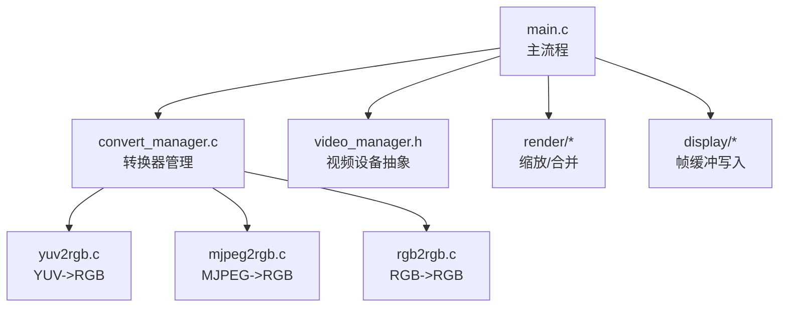
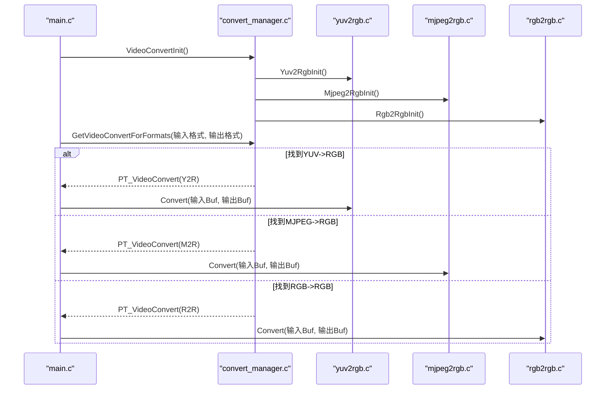
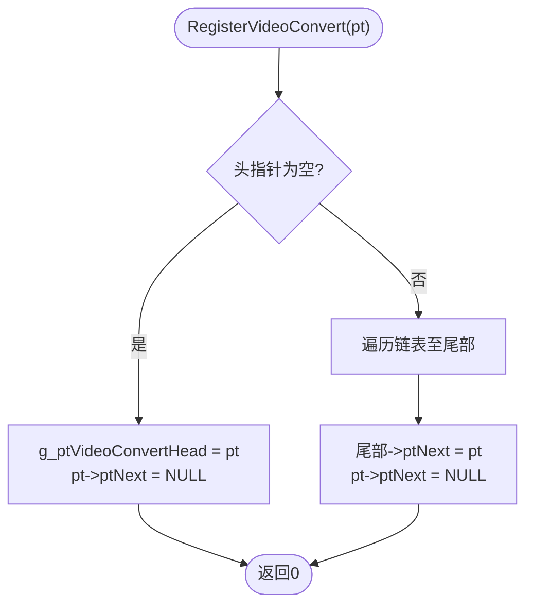
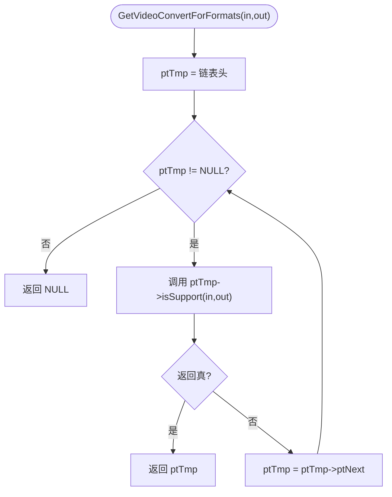
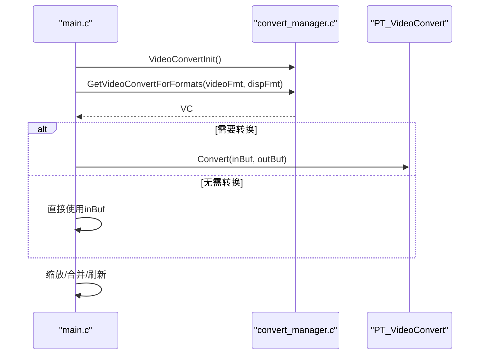
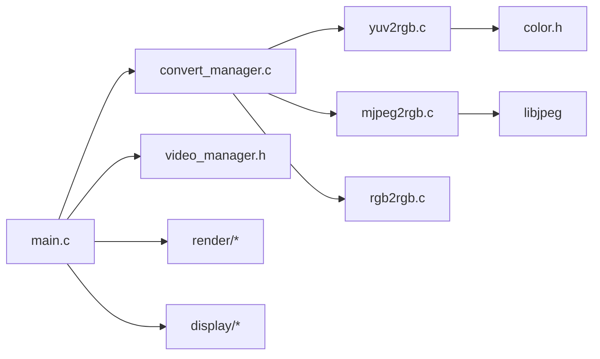

# 转换框架设计

<cite>
**本文引用的文件**
- [convert_manager.h](file://video2lcd/include/convert_manager.h)
- [convert_manager.c](file://video2lcd/convert/convert_manager.c)
- [yuv2rgb.c](file://video2lcd/convert/yuv2rgb.c)
- [mjpeg2rgb.c](file://video2lcd/convert/mjpeg2rgb.c)
- [rgb2rgb.c](file://video2lcd/convert/rgb2rgb.c)
- [main.c](file://video2lcd/main.c)
- [video_manager.h](file://video2lcd/include/video_manager.h)
- [pic_operation.h](file://video2lcd/include/pic_operation.h)
- [config.h](file://video2lcd/include/config.h)
- [color.h](file://video2lcd/convert/color.h)
- [Makefile](file://video2lcd/Makefile)
</cite>

## 目录
1. [简介](#简介)
2. [项目结构](#项目结构)
3. [核心组件](#核心组件)
4. [架构总览](#架构总览)
5. [详细组件分析](#详细组件分析)
6. [依赖关系分析](#依赖关系分析)
7. [性能考量](#性能考量)
8. [故障排查指南](#故障排查指南)
9. [结论](#结论)
10. [附录：添加新转换器开发指南](#附录添加新转换器开发指南)

## 简介
本框架实现了一个插件式的视频格式转换系统，用于在嵌入式Linux相机项目中将摄像头采集的原始帧数据转换为LCD显示所需的像素格式。其核心思想是“按输入输出格式自动选择合适转换器”，通过统一的接口抽象、链表注册机制与运行时匹配算法，达到高内聚、低耦合的可扩展架构。

## 项目结构
- convert：包含各格式转换器的实现（YUV→RGB、MJPEG→RGB、RGB→RGB）以及转换器管理模块
- include：公共头文件，定义数据结构与接口
- video：V4L2视频采集封装
- display：Framebuffer显示封装
- render：图像缩放、合并等渲染操作
- main.c：主流程编排，串联采集、转换、渲染、显示

图表来源
- [main.c:34-192](file://video2lcd/main.c#L34-L192)
- [convert_manager.c:23-131](file://video2lcd/convert/convert_manager.c#L23-L131)
- [yuv2rgb.c:218-233](file://video2lcd/convert/yuv2rgb.c#L218-L233)
- [mjpeg2rgb.c:247-261](file://video2lcd/convert/mjpeg2rgb.c#L247-L261)
- [rgb2rgb.c:138-152](file://video2lcd/convert/rgb2rgb.c#L138-L152)

章节来源
- [main.c:34-192](file://video2lcd/main.c#L34-L192)
- [Makefile:30-43](file://video2lcd/Makefile#L30-L43)

## 核心组件
- VideoConvert 结构体：统一描述一个转换器的能力与行为
- 转换器管理器：负责注册、查找、初始化所有转换器
- 具体转换器：YUV→RGB、MJPEG→RGB、RGB→RGB
- 主流程：根据摄像头与LCD的像素格式，自动选择并调用合适的转换器

章节来源
- [convert_manager.h:23-43](file://video2lcd/include/convert_manager.h#L23-L43)
- [convert_manager.c:23-131](file://video2lcd/convert/convert_manager.c#L23-L131)

## 架构总览
下图展示了从主程序到具体转换器的调用链，以及数据流向。

图表来源
- [main.c:91-139](file://video2lcd/main.c#L91-L139)
- [convert_manager.c:121-131](file://video2lcd/convert/convert_manager.c#L121-L131)
- [convert_manager.c:98-111](file://video2lcd/convert/convert_manager.c#L98-L111)
- [yuv2rgb.c:161-199](file://video2lcd/convert/yuv2rgb.c#L161-L199)
- [mjpeg2rgb.c:145-228](file://video2lcd/convert/mjpeg2rgb.c#L145-L228)
- [rgb2rgb.c:46-120](file://video2lcd/convert/rgb2rgb.c#L46-L120)

## 详细组件分析

### VideoConvert 结构体设计与职责
- name：转换器名称，便于调试与展示
- isSupport：判断是否支持某组输入/输出格式的谓词函数指针
- Convert：执行实际格式转换的函数指针，接收输入/输出缓冲区
- ConvertExit：释放转换过程中可能分配的输出缓冲区
- ptNext：链表节点指针，用于将所有注册的转换器串成单链表

该结构体以C语言实现了“面向对象”的多态：不同转换器只需提供各自的isSupport/Convert/ConvertExit实现，并通过统一接口被管理器调度。

章节来源
- [convert_manager.h:23-29](file://video2lcd/include/convert_manager.h#L23-L29)

### 转换器注册机制（链表管理）
- RegisterVideoConvert：将传入的T_VideoConvert实例追加到全局链表尾部
- 维护全局头指针 g_ptVideoConvertHead，首次插入时设置头，后续遍历至尾追加
- ShowVideoConvert：遍历打印已注册转换器名称，便于调试
- GetVideoConvert：按名称查找转换器（内部使用）

图表来源
- [convert_manager.c:23-44](file://video2lcd/convert/convert_manager.c#L23-L44)

章节来源
- [convert_manager.c:23-64](file://video2lcd/convert/convert_manager.c#L23-L64)

### 格式匹配算法（GetVideoConvertForFormats）
- 遍历所有已注册的转换器，依次调用其 isSupport(iPixelFormatIn, iPixelFormatOut)
- 首个返回“支持”的转换器即为匹配结果
- 若无任何转换器支持，则返回NULL

图表来源
- [convert_manager.c:98-111](file://video2lcd/convert/convert_manager.c#L98-L111)

章节来源
- [convert_manager.c:98-111](file://video2lcd/convert/convert_manager.c#L98-L111)

### 具体转换器实现要点

#### YUV→RGB 转换器
- 支持输入：V4L2_PIX_FMT_YUYV；输出：V4L2_PIX_FMT_RGB565 或 V4L2_PIX_FMT_RGB32
- 使用颜色空间转换宏/函数进行YUV到RGB的计算，并按目标BPP打包
- 为输出缓冲区按需分配内存，并在退出时释放

章节来源
- [yuv2rgb.c:25-34](file://video2lcd/convert/yuv2rgb.c#L25-L34)
- [yuv2rgb.c:161-199](file://video2lcd/convert/yuv2rgb.c#L161-L199)
- [yuv2rgb.c:207-215](file://video2lcd/convert/yuv2rgb.c#L207-L215)
- [yuv2rgb.c:218-233](file://video2lcd/convert/yuv2rgb.c#L218-L233)
- [color.h:65-88](file://video2lcd/convert/color.h#L65-L88)

#### MJPEG→RGB 转换器
- 支持输入：V4L2_PIX_FMT_MJPEG；输出：V4L2_PIX_FMT_RGB565 或 V4L2_PIX_FMT_RGB32
- 使用libjpeg解码JPEG帧，逐行读取并转换为目标BPP
- 自定义错误管理器，基于setjmp/longjmp实现错误恢复，避免崩溃

章节来源
- [mjpeg2rgb.c:38-47](file://video2lcd/convert/mjpeg2rgb.c#L38-L47)
- [mjpeg2rgb.c:59-70](file://video2lcd/convert/mjpeg2rgb.c#L59-L70)
- [mjpeg2rgb.c:145-228](file://video2lcd/convert/mjpeg2rgb.c#L145-L228)
- [mjpeg2rgb.c:237-245](file://video2lcd/convert/mjpeg2rgb.c#L237-L245)
- [mjpeg2rgb.c:247-261](file://video2lcd/convert/mjpeg2rgb.c#L247-L261)

#### RGB→RGB 转换器
- 支持输入：V4L2_PIX_FMT_RGB565；输出：V4L2_PIX_FMT_RGB565 或 V4L2_PIX_FMT_RGB32
- 同格式直接memcpy，异格式逐像素位域提取并扩展为32位

章节来源
- [rgb2rgb.c:20-29](file://video2lcd/convert/rgb2rgb.c#L20-L29)
- [rgb2rgb.c:46-120](file://video2lcd/convert/rgb2rgb.c#L46-L120)
- [rgb2rgb.c:128-136](file://video2lcd/convert/rgb2rgb.c#L128-L136)
- [rgb2rgb.c:138-152](file://video2lcd/convert/rgb2rgb.c#L138-L152)

### 主流程中的转换调用
- 初始化显示与视频设备后，获取LCD像素格式与摄像头像素格式
- 调用 VideoConvertInit 完成所有转换器注册
- 通过 GetVideoConvertForFormats 自动选择转换器
- 若格式不一致，则调用对应 Convert 进行转换；否则直接使用原帧
- 随后进行缩放、居中合并、刷新显示

图表来源
- [main.c:91-139](file://video2lcd/main.c#L91-L139)
- [convert_manager.c:121-131](file://video2lcd/convert/convert_manager.c#L121-L131)
- [convert_manager.c:98-111](file://video2lcd/convert/convert_manager.c#L98-L111)

章节来源
- [main.c:63-139](file://video2lcd/main.c#L63-L139)

## 依赖关系分析
- 主程序依赖：convert_manager、video_manager、render、display
- 转换器依赖：convert_manager 接口、video_manager 的数据结构（VideoBuf/PixelDatas）、color.h（YUV/RGB转换宏）
- 构建依赖：链接 libjpeg（MJPEG解码），数学库

图表来源
- [main.c:1-10](file://video2lcd/main.c#L1-L10)
- [convert_manager.c:9-11](file://video2lcd/convert/convert_manager.c#L9-L11)
- [yuv2rgb.c:14-16](file://video2lcd/convert/yuv2rgb.c#L14-L16)
- [mjpeg2rgb.c:10-14](file://video2lcd/convert/mjpeg2rgb.c#L10-L14)
- [Makefile:20](file://video2lcd/Makefile#L20)

章节来源
- [Makefile:20](file://video2lcd/Makefile#L20)
- [video_manager.h:14-56](file://video2lcd/include/video_manager.h#L14-L56)
- [pic_operation.h:10-17](file://video2lcd/include/pic_operation.h#L10-L17)

## 性能考量
- 选择最小开销路径：同格式直接memcpy（如RGB565→RGB565）
- 批量处理：YUV→RGB采用每两像素共用U/V的策略，减少计算量
- 内存分配：仅在必要时分配输出缓冲区，并在退出时释放，避免频繁malloc/free
- JPEG解码：逐行读取并转换，降低峰值内存占用
- 查找表优化：颜色转换可使用预计算查找表（initLut）加速

[本节为通用性能建议，不直接分析特定代码]

## 故障排查指南
- 无可用转换器：当 GetVideoConvertForFormats 返回NULL，检查摄像头与LCD的像素格式组合是否在任一转换器的 isSupport 中声明
- 转换失败：检查 Convert 返回值与日志输出；确认输出缓冲区已正确分配且尺寸参数一致
- MJPEG解码异常：查看自定义错误管理器输出的错误信息；确保输入数据为有效JPEG流
- 内存泄漏：确保每个 ConvertExit 被调用以释放输出缓冲区；检查异常分支是否提前返回导致未释放
- 构建问题：确认链接了 -ljpeg；交叉编译工具链配置正确

章节来源
- [main.c:95-99](file://video2lcd/main.c#L95-L99)
- [mjpeg2rgb.c:59-70](file://video2lcd/convert/mjpeg2rgb.c#L59-L70)
- [yuv2rgb.c:207-215](file://video2lcd/convert/yuv2rgb.c#L207-L215)
- [mjpeg2rgb.c:237-245](file://video2lcd/convert/mjpeg2rgb.c#L237-L245)
- [rgb2rgb.c:128-136](file://video2lcd/convert/rgb2rgb.c#L128-L136)
- [config.h:13-15](file://video2lcd/include/config.h#L13-L15)

## 结论
该转换框架通过统一的 VideoConvert 接口与链表注册机制，实现了“按格式自动选择转换器”的插件式架构。主流程简洁清晰，具体转换器可独立扩展与维护。结合错误处理与调试输出，具备较好的可维护性与可扩展性。

[本节为总结性内容，不直接分析特定代码]

## 附录：添加新转换器开发指南

### 接口规范
- 实现 T_VideoConvert 结构体，至少包含：
  - name：转换器名称
  - isSupport：判断是否支持给定输入/输出格式
  - Convert：执行转换的核心逻辑
  - ConvertExit：释放转换过程中分配的内存
  - ptNext：由管理器填充，无需手动设置
- 提供 Init 函数，内部调用 RegisterVideoConvert 完成注册

章节来源
- [convert_manager.h:23-43](file://video2lcd/include/convert_manager.h#L23-L43)
- [convert_manager.c:23-44](file://video2lcd/convert/convert_manager.c#L23-L44)

### 实现步骤
1. 新建源文件（例如 xxx2yyy.c），实现 isSupport、Convert、ConvertExit
2. 定义静态 T_VideoConvert 实例，填充上述函数指针
3. 实现 XxxInit 函数，调用 RegisterVideoConvert(&g_tXxxConvert)
4. 在 convert_manager.c 的 VideoConvertInit 中调用你的 XxxInit，使其在启动时被注册
5. 如需外部依赖（如libjpeg），在 Makefile 中添加相应链接标志

章节来源
- [convert_manager.c:121-131](file://video2lcd/convert/convert_manager.c#L121-L131)
- [Makefile:20](file://video2lcd/Makefile#L20)

### 测试方法
- 运行主程序，观察控制台输出：
  - 使用 ShowVideoConvert 可列出已注册转换器（当前实现存在但未在主流程调用）
  - 关注“无合适转换器”的错误提示，确认格式匹配是否正确
- 构造不同输入/输出格式组合，验证是否进入预期转换器
- 对MJPEG路径，准备合法JPEG数据，验证解码与转换流程
- 检查内存释放：确保 ConvertExit 能正确释放输出缓冲区

章节来源
- [convert_manager.c:54-64](file://video2lcd/convert/convert_manager.c#L54-L64)
- [main.c:91-139](file://video2lcd/main.c#L91-L139)