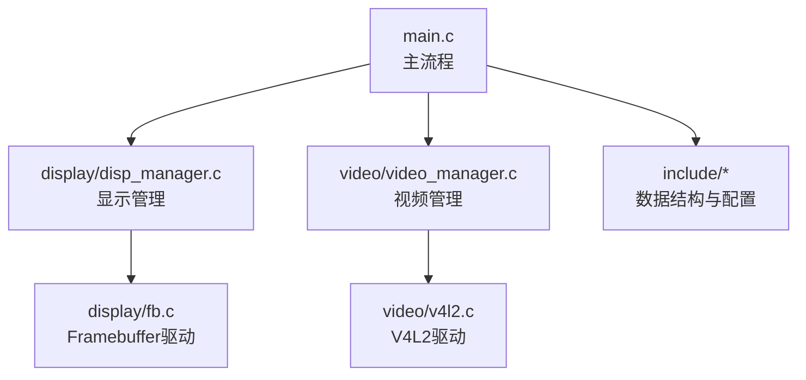
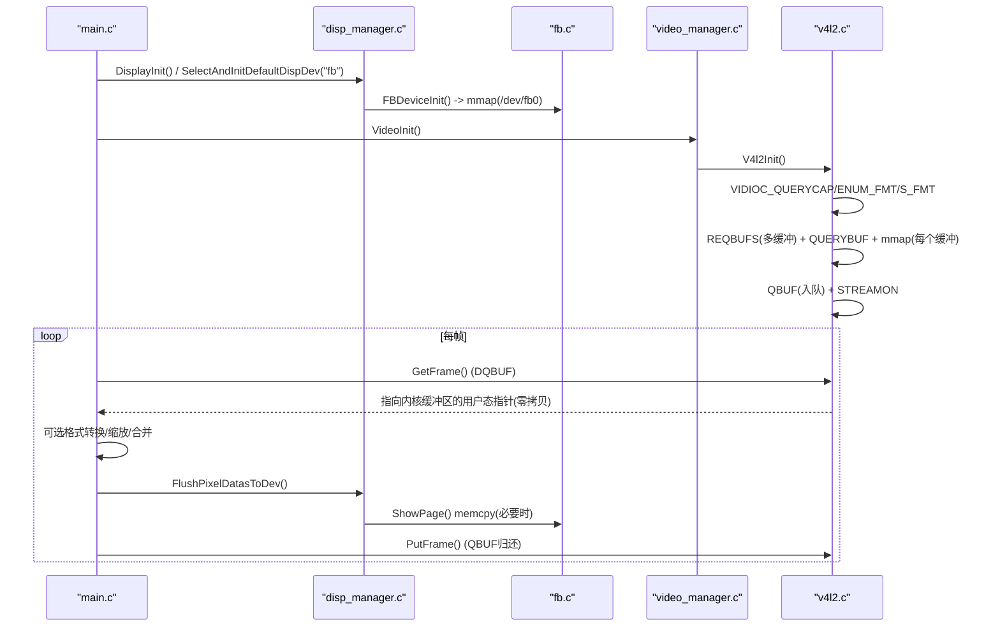
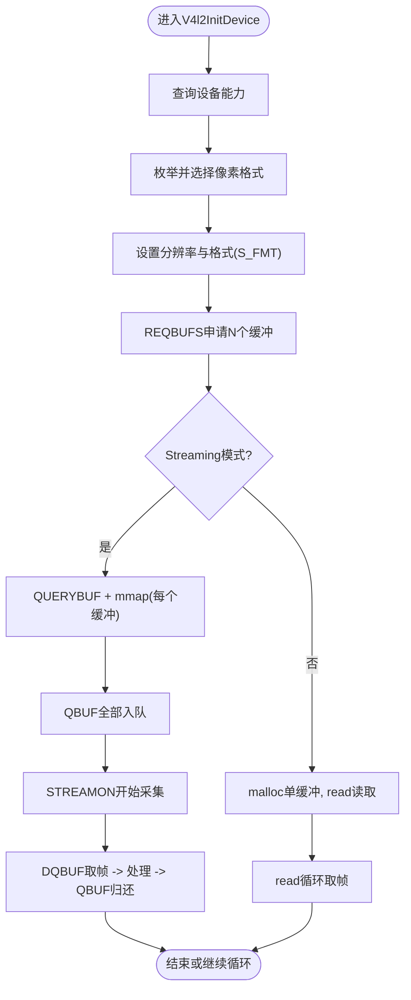
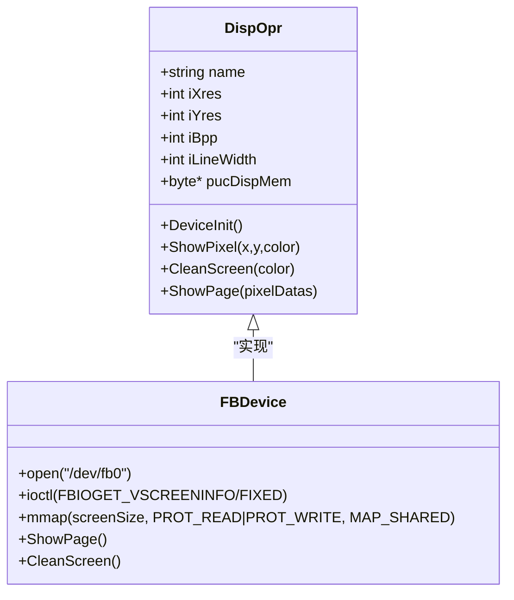
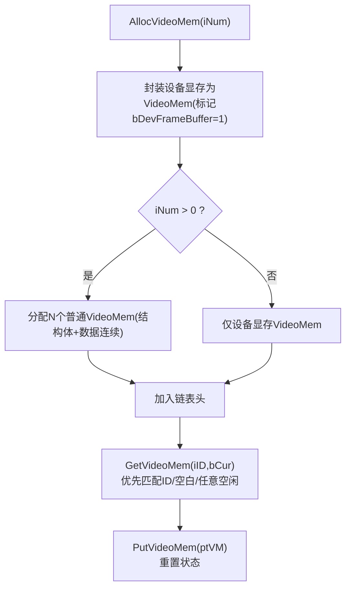
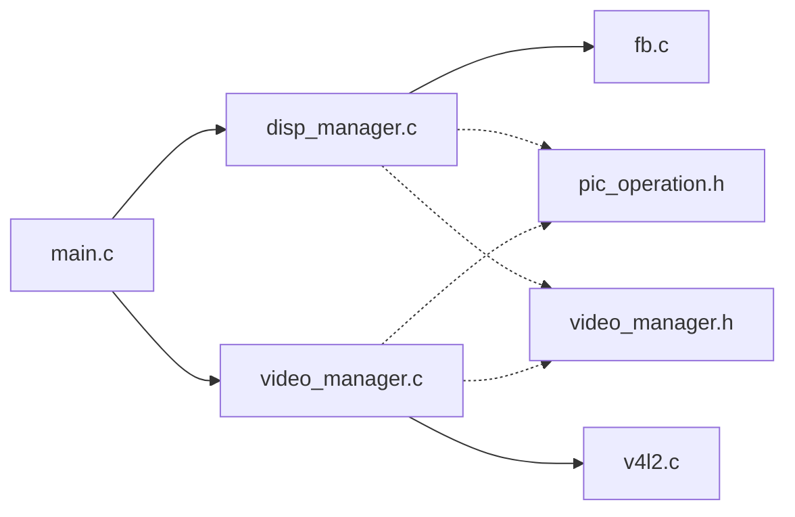

# 内存管理机制

<cite>
**本文引用的文件**
- [main.c](file://video2lcd/main.c)
- [v4l2.c](file://video2lcd/video/v4l2.c)
- [video_manager.c](file://video2lcd/video/video_manager.c)
- [fb.c](file://video2lcd/display/fb.c)
- [disp_manager.c](file://video2lcd/display/disp_manager.c)
- [video_manager.h](file://video2lcd/include/video_manager.h)
- [disp_manager.h](file://video2lcd/include/disp_manager.h)
- [pic_operation.h](file://video2lcd/include/pic_operation.h)
- [config.h](file://video2lcd/include/config.h)
- [V4L2关键机制深度解析.md](file://video2lcd/doc/V4L2关键机制深度解析.md)
</cite>

## 目录
1. [简介](#简介)
2. [项目结构](#项目结构)
3. [核心组件](#核心组件)
4. [架构总览](#架构总览)
5. [详细组件分析](#详细组件分析)
6. [依赖关系分析](#依赖关系分析)
7. [性能考量](#性能考量)
8. [故障排查指南](#故障排查指南)
9. [结论](#结论)
10. [附录](#附录)

## 简介
本文件围绕嵌入式Linux相机项目的内存管理机制，系统阐述V4L2缓冲区管理、双/多缓冲实现原理、FrameBuffer内存映射使用与注意事项、零拷贝技术路径、内存泄漏防护与错误处理策略，以及在资源受限环境下的优化建议与调试分析方法。内容以代码为依据，结合流程图与时序图帮助理解数据流与控制流。

## 项目结构
本项目采用分层与模块化设计：
- 视频采集层：基于V4L2的Streaming/ReadWrite模式，负责设备初始化、缓冲区申请与映射、帧获取与归还。
- 显示层：基于Linux Framebuffer，完成显存映射、清屏、逐点绘制与整页刷新。
- 管理与抽象层：提供设备操作接口注册、默认设备选择、分辨率查询、VideoMem页面缓冲管理等。
- 主流程：初始化显示与视频设备，循环采集、格式转换、缩放、合并到帧缓冲并刷新显示。

图表来源
- [main.c:63-82](file://video2lcd/main.c#L63-L82)
- [disp_manager.c:514-521](file://video2lcd/display/disp_manager.c#L514-L521)
- [fb.c:53-94](file://video2lcd/display/fb.c#L53-L94)
- [video_manager.c:67-74](file://video2lcd/video/video_manager.c#L67-L74)
- [v4l2.c:47-249](file://video2lcd/video/v4l2.c#L47-L249)

章节来源
- [main.c:34-82](file://video2lcd/main.c#L34-L82)
- [disp_manager.c:514-521](file://video2lcd/display/disp_manager.c#L514-L521)
- [fb.c:53-94](file://video2lcd/display/fb.c#L53-L94)
- [video_manager.c:67-74](file://video2lcd/video/video_manager.c#L67-L74)
- [v4l2.c:47-249](file://video2lcd/video/v4l2.c#L47-L249)

## 核心组件
- V4L2视频采集模块：支持Streaming（mmap+队列）与ReadWrite（read）两种模式；在Streaming模式下通过VIDIOC_REQBUFS/QUERYBUF/mmap/QBUF/DQBUF实现零拷贝环形缓冲。
- Framebuffer显示模块：打开/dev/fb0，ioctl获取屏幕信息，mmap映射显存至用户空间，支持清屏、画点、整页刷新。
- 显示管理模块：维护显示设备链表、默认设备选择、分辨率查询、VideoMem页面缓冲分配与管理。
- 视频管理模块：维护摄像头操作接口链表，统一封装Init/GetFrame/PutFrame/Start/Stop等调用。
- 像素数据抽象：T_PixelDatas统一描述图像尺寸、色深、行字节数、总字节数与数据指针，贯穿采集、转换、渲染与显示。

章节来源
- [v4l2.c:47-249](file://video2lcd/video/v4l2.c#L47-L249)
- [fb.c:53-94](file://video2lcd/display/fb.c#L53-L94)
- [disp_manager.c:148-175](file://video2lcd/display/disp_manager.c#L148-L175)
- [video_manager.c:12-74](file://video2lcd/video/video_manager.c#L12-L74)
- [pic_operation.h:10-17](file://video2lcd/include/pic_operation.h#L10-L17)

## 架构总览
下图展示从摄像头采集到LCD显示的完整内存路径与零拷贝关键点：

图表来源
- [main.c:63-181](file://video2lcd/main.c#L63-L181)
- [disp_manager.c:148-175](file://video2lcd/display/disp_manager.c#L148-L175)
- [fb.c:53-94](file://video2lcd/display/fb.c#L53-L94)
- [v4l2.c:47-249](file://video2lcd/video/v4l2.c#L47-L249)

## 详细组件分析

### V4L2缓冲区管理与多缓冲实现
- 设备能力检测与格式协商：通过VIDIOC_QUERYCAP判断是否支持视频采集与streaming/readwrite；枚举支持的像素格式并设置S_FMT确定分辨率与格式。
- 缓冲区申请与映射：
  - Streaming模式：REQBUFS申请N个内核缓冲区；对每个缓冲QUERYBUF获取length与offset；mmap将内核缓冲映射到用户空间，得到零拷贝的用户态指针数组pucVideBuf[i]。
  - ReadWrite模式：仅分配一个用户缓冲区，通过read读取一帧数据。
- 队列与轮转：所有缓冲QBUF入队后启动STREAMON；采集时DQBUF取出已就绪缓冲，处理后再QBUF归还，形成环形缓冲流水线。
- 多缓冲优势：内核写新帧与用户读旧帧并行，避免阻塞与重复拷贝，提升吞吐与降低延迟。

图表来源
- [v4l2.c:47-249](file://video2lcd/video/v4l2.c#L47-L249)
- [V4L2关键机制深度解析.md:117-172](file://video2lcd/doc/V4L2关键机制深度解析.md#L117-L172)

章节来源
- [v4l2.c:47-249](file://video2lcd/video/v4l2.c#L47-L249)
- [V4L2关键机制深度解析.md:117-172](file://video2lcd/doc/V4L2关键机制深度解析.md#L117-L172)

### FrameBuffer内存映射与显示刷新
- 初始化：打开/dev/fb0，ioctl获取可变与固定屏幕信息，计算屏幕大小并mmap映射至用户空间指针g_pucFBMem。
- 显示操作：
  - 清屏：按BPP填充显存。
  - 画点：根据坐标计算偏移并写入对应颜色值（支持8/16/32bpp）。
  - 整页刷新：ShowPage中若输入数据地址与显存不同则memcpy复制，否则直接复用显存实现零拷贝。
- 注意：
  - 确保读写权限与MAP_SHARED共享映射。
  - 正确处理BPP差异导致的颜色格式转换。
  - 避免越界访问与未对齐写入。

图表来源
- [disp_manager.h:84-96](file://video2lcd/include/disp_manager.h#L84-L96)
- [fb.c:53-94](file://video2lcd/display/fb.c#L53-L94)
- [fb.c:166-174](file://video2lcd/display/fb.c#L166-L174)

章节来源
- [fb.c:53-94](file://video2lcd/display/fb.c#L53-L94)
- [fb.c:166-174](file://video2lcd/display/fb.c#L166-L174)
- [disp_manager.h:84-96](file://video2lcd/include/disp_manager.h#L84-L96)

### 零拷贝技术与共享内存路径
- V4L2 Streaming模式：通过mmap将内核分配的帧缓冲映射到用户空间，GetFrame返回的aucPixelDatas直接指向内核缓冲，无需额外拷贝。
- 显示路径：当转换/缩放后的数据目标为显存（GetVideoBufForDisplay返回的tFrameBuf.aucPixelDatas指向pucDispMem），可直接写入显存，避免二次拷贝。
- 条件拷贝：ShowPage仅在源数据与显存地址不一致时执行memcpy，否则直接利用显存作为渲染目标。

章节来源
- [v4l2.c:161-195](file://video2lcd/video/v4l2.c#L161-L195)
- [v4l2.c:267-305](file://video2lcd/video/v4l2.c#L267-L305)
- [disp_manager.c:148-162](file://video2lcd/display/disp_manager.c#L148-L162)
- [fb.c:166-174](file://video2lcd/display/fb.c#L166-L174)

### VideoMem页面缓冲与双缓冲思想
- 目的：在内存中准备图像页面，再一次性复制到显存，减少频繁小写入带来的开销。
- 实现要点：
  - AllocVideoMem：首先将设备显存封装为一个VideoMem（标记为设备帧缓冲），再分配若干普通VideoMem页面（结构与数据连续分配）。
  - GetVideoMem：按优先级查找空闲且状态合适的页面，支持“当前必须”与“提前准备”两种策略。
  - PutVideoMem：释放页面并重置状态。
  - Clear/ClearRegion：按BPP高效清零指定区域。
- 双缓冲思想：通过“准备页”和“显示页”分离，配合FlushPixelDatasToDev进行原子切换或批量复制，降低撕裂与抖动。

图表来源
- [disp_manager.c:188-259](file://video2lcd/display/disp_manager.c#L188-L259)
- [disp_manager.c:272-337](file://video2lcd/display/disp_manager.c#L272-L337)
- [disp_manager.c:370-505](file://video2lcd/display/disp_manager.c#L370-L505)

章节来源
- [disp_manager.c:188-259](file://video2lcd/display/disp_manager.c#L188-L259)
- [disp_manager.c:272-337](file://video2lcd/display/disp_manager.c#L272-L337)
- [disp_manager.c:370-505](file://video2lcd/display/disp_manager.c#L370-L505)

### 主流程中的内存路径与优化点
- 初始化顺序：先初始化显示并选择默认设备，获取LCD分辨率与帧缓冲指针；再初始化视频设备并启动采集。
- 每帧处理：
  - 获取原始帧（零拷贝）。
  - 若格式不匹配，进行格式转换。
  - 若尺寸大于LCD，进行等比缩放并分配临时缓冲（首次分配后复用）。
  - 计算居中位置，将缩放结果合并到帧缓冲（直接写入显存）。
  - 刷新显示，归还V4L2缓冲。
- 优化点：
  - 尽量让渲染目标为显存，避免中间拷贝。
  - 缩放缓冲复用，减少malloc/free频率。
  - 使用VideoMem页面缓冲组织渲染过程。

章节来源
- [main.c:63-181](file://video2lcd/main.c#L63-L181)

## 依赖关系分析
- 模块耦合：
  - main.c依赖disp_manager与video_manager提供的统一接口，屏蔽底层fb与v4l2细节。
  - disp_manager依赖fb实现具体显示操作，并通过VideoMem管理页面缓冲。
  - video_manager依赖v4l2实现具体采集操作。
- 数据结构依赖：
  - T_PixelDatas被各模块共用，保证跨模块图像数据一致性。
  - T_VideoDevice/T_VideoBuf封装采集上下文与帧元数据。
  - T_DispOpr/T_VideoOpr定义设备操作接口，支持多设备注册与切换。

图表来源
- [main.c:63-82](file://video2lcd/main.c#L63-L82)
- [disp_manager.c:514-521](file://video2lcd/display/disp_manager.c#L514-L521)
- [video_manager.c:67-74](file://video2lcd/video/video_manager.c#L67-L74)
- [pic_operation.h:10-17](file://video2lcd/include/pic_operation.h#L10-L17)
- [video_manager.h:14-56](file://video2lcd/include/video_manager.h#L14-L56)

章节来源
- [main.c:63-82](file://video2lcd/main.c#L63-L82)
- [disp_manager.c:514-521](file://video2lcd/display/disp_manager.c#L514-L521)
- [video_manager.c:67-74](file://video2lcd/video/video_manager.c#L67-L74)
- [pic_operation.h:10-17](file://video2lcd/include/pic_operation.h#L10-L17)
- [video_manager.h:14-56](file://video2lcd/include/video_manager.h#L14-L56)

## 性能考量
- 优先使用V4L2 Streaming模式与mmap，避免read/write路径的额外拷贝与系统调用开销。
- 合理设置NB_BUFFER数量，平衡内存占用与吞吐；过多会增加mmap与队列管理成本，过少可能引发丢帧。
- 渲染目标尽量为显存（GetVideoBufForDisplay），减少中间缓冲与memcpy次数。
- 缩放缓冲复用，避免频繁malloc/free造成碎片与延迟。
- 在资源受限平台：
  - 降低分辨率或BPP以减少显存占用。
  - 限制VideoMem数量，按需分配。
  - 关闭不必要的调试输出，减少I/O开销。
  - 使用区域清理（ClearVideoMemRegion）替代全屏清屏，降低带宽压力。

[本节为通用指导，不直接分析具体文件]

## 故障排查指南
- 设备打开失败：检查设备节点是否存在与权限；确认设备类型与能力位。
- 格式不支持：枚举失败或S_FMT失败时，回退到更通用的格式或调整分辨率。
- 缓冲区映射失败：检查REQBUFS返回值与QUERYBUF长度；确认mmap参数与offset正确。
- 队列错误：QBUF/DQBUF失败时，检查设备状态与STREAMON/STREAMOFF顺序。
- 显示异常：确认FB设备路径、ioctl成功、mmap成功；检查BPP与颜色转换逻辑。
- 内存泄漏：确保退出时munmap所有映射、close设备句柄；VideoMem使用后及时PutVideoMem。

章节来源
- [v4l2.c:64-249](file://video2lcd/video/v4l2.c#L64-L249)
- [fb.c:53-94](file://video2lcd/display/fb.c#L53-L94)
- [disp_manager.c:272-337](file://video2lcd/display/disp_manager.c#L272-L337)

## 结论
本项目通过V4L2 Streaming模式与FrameBuffer mmap实现了端到端的零拷贝图像采集与显示链路，结合VideoMem页面缓冲与统一的设备操作接口，形成了清晰、可扩展的内存管理架构。在嵌入式环境中，应重点关注缓冲数量、BPP与分辨率的选择、渲染目标直写显存以及必要的区域操作，以获得更好的性能与稳定性。

[本节为总结性内容，不直接分析具体文件]

## 附录
- V4L2关键机制参考文档提供了详细的初始化流程与概念解释，可作为深入学习的补充材料。

章节来源
- [V4L2关键机制深度解析.md:1-278](file://video2lcd/doc/V4L2关键机制深度解析.md#L1-L278)