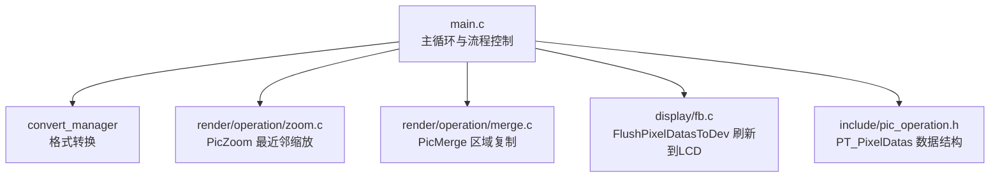
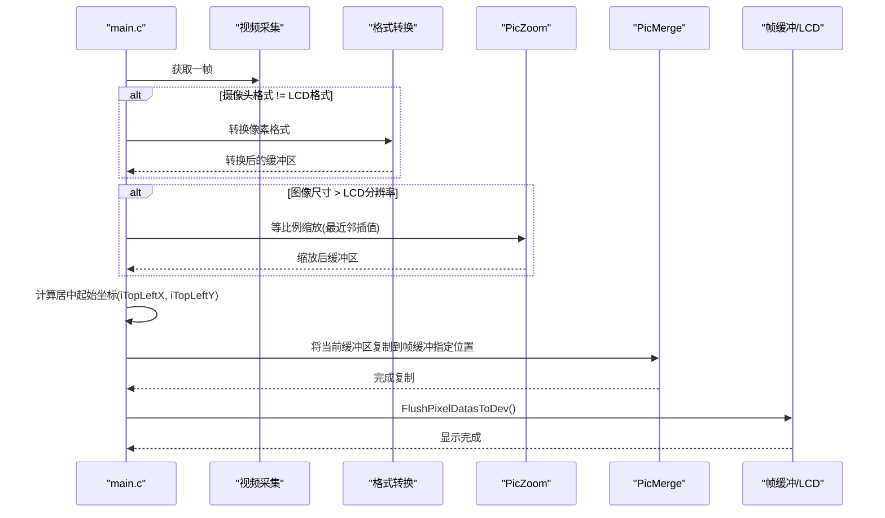
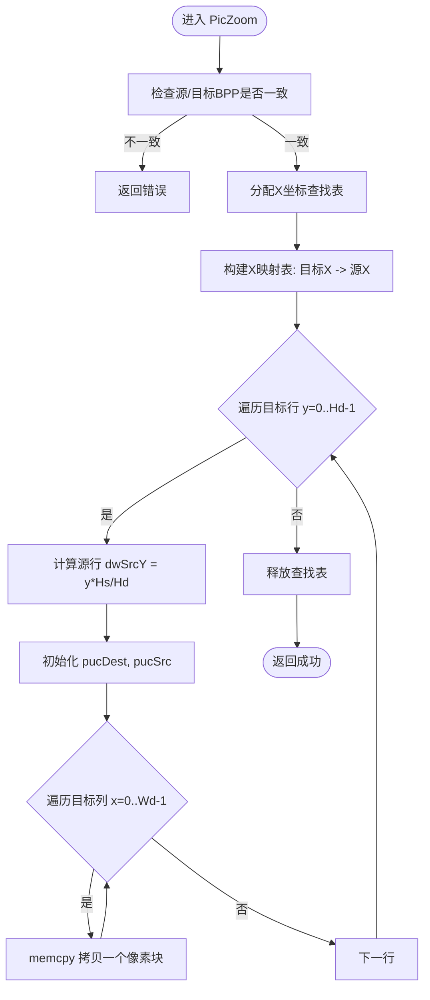
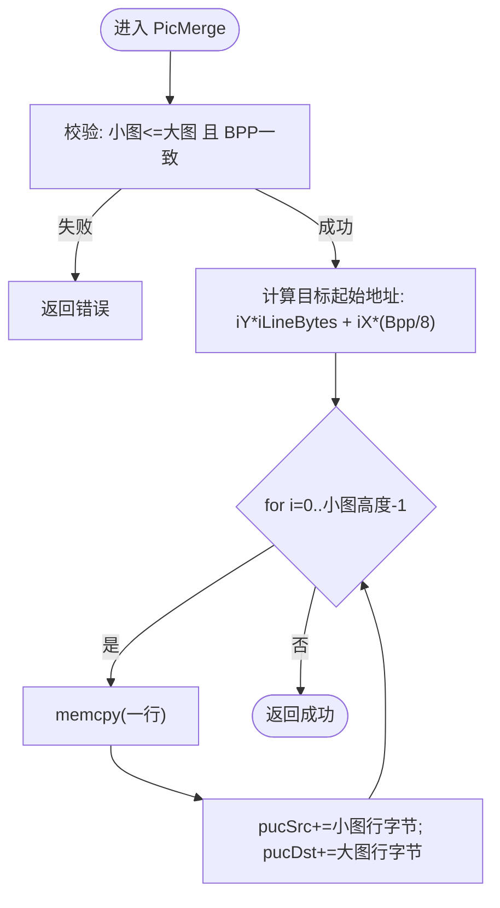
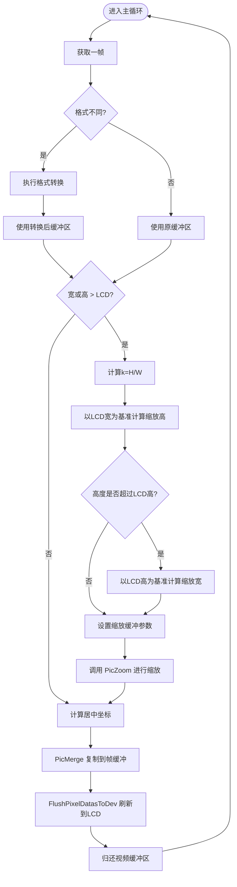
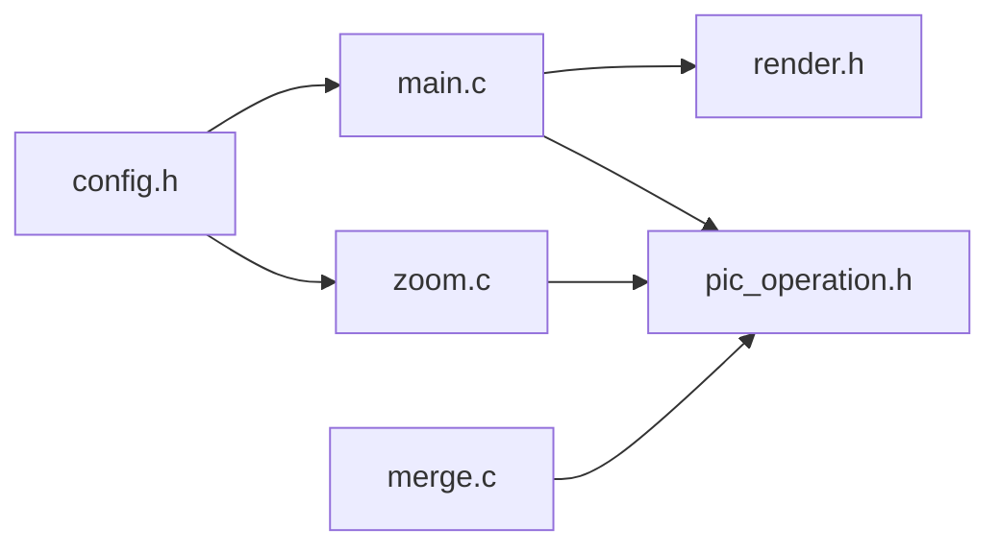

# 图像处理数据流

<cite>
**本文引用的文件**
- [main.c](file://video2lcd/main.c)
- [zoom.c](file://video2lcd/render/operation/zoom.c)
- [merge.c](file://video2lcd/render/operation/merge.c)
- [pic_operation.h](file://video2lcd/include/pic_operation.h)
- [render.h](file://video2lcd/include/render.h)
- [config.h](file://video2lcd/include/config.h)
</cite>

## 目录
1. [简介](#简介)
2. [项目结构](#项目结构)
3. [核心组件](#核心组件)
4. [架构总览](#架构总览)
5. [详细组件分析](#详细组件分析)
6. [依赖关系分析](#依赖关系分析)
7. [性能考量](#性能考量)
8. [故障排查指南](#故障排查指南)
9. [结论](#结论)
10. [附录](#附录)

## 简介
本文件面向嵌入式Linux相机项目的图像处理数据流，重点说明图像缩放与合并操作的执行流程、算法实现、内存对齐优化、尺寸检测与自适应缩放策略，并提供处理流程图与时间复杂度分析，帮助开发者理解性能特征与优化方向。

## 项目结构
本项目围绕“采集—转换—渲染—显示”的数据管线组织代码：
- 采集与缓冲：通过V4L2获取视频帧，封装为统一缓冲区结构。
- 格式转换：将摄像头输出像素格式转换为LCD支持的格式。
- 渲染操作：对图像进行缩放（最近邻插值）与合并（居中复制到帧缓冲）。
- 显示刷新：将帧缓冲数据刷新到LCD硬件。

图表来源
- [main.c:117-189](file://video2lcd/main.c#L117-L189)
- [zoom.c:27-85](file://video2lcd/render/operation/zoom.c#L27-L85)
- [merge.c:20-46](file://video2lcd/render/operation/merge.c#L20-L46)
- [pic_operation.h:10-17](file://video2lcd/include/pic_operation.h#L10-L17)

章节来源
- [main.c:117-189](file://video2lcd/main.c#L117-L189)
- [pic_operation.h:10-17](file://video2lcd/include/pic_operation.h#L10-L17)

## 核心组件
- PT_PixelDatas：统一描述图像数据的结构体，包含宽、高、每像素位数、行字节数、总字节数及像素数据指针。
- PicZoom：按目标尺寸进行图像缩放，采用最近邻插值算法，使用X坐标查找表加速映射。
- PicMerge：将小图复制到大图指定位置，支持整图或区域复制。
- main.c：编排采集、转换、缩放、合并、刷新的完整流水线，并负责居中显示计算与自适应缩放。

章节来源
- [pic_operation.h:10-17](file://video2lcd/include/pic_operation.h#L10-L17)
- [render.h:15-36](file://video2lcd/include/render.h#L15-L36)
- [zoom.c:27-85](file://video2lcd/render/operation/zoom.c#L27-L85)
- [merge.c:20-46](file://video2lcd/render/operation/merge.c#L20-L46)
- [main.c:117-189](file://video2lcd/main.c#L117-L189)

## 架构总览
下图展示了从摄像头采集到LCD显示的端到端数据流，包括关键决策点（是否需要转换、是否需要缩放）以及居中合并逻辑。

图表来源
- [main.c:117-189](file://video2lcd/main.c#L117-L189)
- [zoom.c:27-85](file://video2lcd/render/operation/zoom.c#L27-L85)
- [merge.c:20-46](file://video2lcd/render/operation/merge.c#L20-L46)

## 详细组件分析

### 图像缩放：PicZoom（最近邻插值）
- 输入校验：要求源与目标的BPP一致，否则返回错误。
- X坐标查找表：为目标宽度构建映射表，将目标X映射回源X，避免重复计算。
- 逐行处理：根据目标行y计算源行dwSrcY；对每一行，遍历目标列x，查表得到源列，拷贝一个像素块。
- 内存访问模式：按行顺序访问源与目标缓冲，利用iLineBytes保证行内连续访问，减少跨步开销。
- 复杂度：O(Wd×Hd)，其中Wd、Hd为目标宽高。

图表来源
- [zoom.c:27-85](file://video2lcd/render/operation/zoom.c#L27-L85)

章节来源
- [zoom.c:27-85](file://video2lcd/render/operation/zoom.c#L27-L85)

### 图像合并：PicMerge 与 PicMergeRegion
- PicMerge：将小图整体复制到大图指定左上角(iX,iY)。先校验尺寸与BPP一致性，再逐行memcpy复制，行步进分别使用各自iLineBytes。
- PicMergeRegion：支持从新图的某区域复制到旧图的某区域，带边界检查与区域长度计算。
- 内存对齐与访问：以行为单位进行大块拷贝，充分利用连续内存布局，降低访存碎片化。

图表来源
- [merge.c:20-46](file://video2lcd/render/operation/merge.c#L20-L46)

章节来源
- [merge.c:20-46](file://video2lcd/render/operation/merge.c#L20-L46)
- [merge.c:60-88](file://video2lcd/render/operation/merge.c#L60-L88)

### 尺寸检测与自适应缩放策略（main.c）
- 尺寸检测：若当前缓冲区宽或高大于LCD分辨率，则触发缩放。
- 等比例缩放：基于原始宽高比k=H/W，优先以LCD宽度为基准计算缩放后高度；若高度超出LCD高度，则改为以LCD高度为基准反算宽度，确保完全适配且不越界。
- 缓冲区管理：首次需要时分配缩放缓冲区，后续复用；设置iLineBytes与iTotalBytes，供PicZoom使用。
- 居中显示：计算(iTopLeftX, iTopLeftY)作为合并起点，使图像在LCD上居中。

图表来源
- [main.c:117-189](file://video2lcd/main.c#L117-L189)

章节来源
- [main.c:117-189](file://video2lcd/main.c#L117-L189)

### 内存对齐优化与数据访问模式
- 行字节对齐：所有模块均使用iLineBytes进行行步进，确保按行连续访问，减少跨步带来的缓存不命中。
- 批量拷贝：合并过程按行memcpy，最大化利用内存带宽。
- 查找表优化：缩放过程中预计算X映射表，避免每像素重复除法与乘法。
- 像素块拷贝：根据Bpp/8确定每次拷贝的字节数，保持像素完整性。

章节来源
- [zoom.c:27-85](file://video2lcd/render/operation/zoom.c#L27-L85)
- [merge.c:20-46](file://video2lcd/render/operation/merge.c#L20-L46)
- [pic_operation.h:10-17](file://video2lcd/include/pic_operation.h#L10-L17)

## 依赖关系分析
- main.c 依赖 render.h 暴露的接口（PicZoom、PicMerge），并通过 pic_operation.h 中的 PT_PixelDatas 传递图像数据。
- zoom.c 与 merge.c 仅依赖 pic_operation.h 提供的数据结构定义。
- config.h 提供调试宏与设备路径常量，被多处引用。

图表来源
- [main.c:1-10](file://video2lcd/main.c#L1-L10)
- [render.h:1-40](file://video2lcd/include/render.h#L1-L40)
- [pic_operation.h:1-18](file://video2lcd/include/pic_operation.h#L1-L18)
- [zoom.c:11-14](file://video2lcd/render/operation/zoom.c#L11-L14)
- [merge.c:8-9](file://video2lcd/render/operation/merge.c#L8-L9)
- [config.h:13-18](file://video2lcd/include/config.h#L13-L18)

章节来源
- [main.c:1-10](file://video2lcd/main.c#L1-L10)
- [render.h:1-40](file://video2lcd/include/render.h#L1-L40)
- [pic_operation.h:1-18](file://video2lcd/include/pic_operation.h#L1-L18)
- [zoom.c:11-14](file://video2lcd/render/operation/zoom.c#L11-L14)
- [merge.c:8-9](file://video2lcd/render/operation/merge.c#L8-L9)
- [config.h:13-18](file://video2lcd/include/config.h#L13-L18)

## 性能考量
- 时间复杂度
  - 缩放：O(Wd×Hd)，Wd、Hd为目标宽高。
  - 合并：O(Ws×Hs)，Ws、Hs为被复制区域的宽高。
  - 主循环每帧总体复杂度近似 O(Ws×Hs + Wd×Hd)，取决于是否缩放。
- 空间复杂度
  - 缩放额外分配大小为 Wd×(Bpp/8) 的X坐标查找表。
  - 合并无额外分配（原地复制）。
- 内存访问
  - 行序访问与行字节步进提升缓存命中率。
  - 批量memcpy减少函数调用开销。
- 优化建议
  - 可考虑将X查找表常驻缓存或线程局部存储，避免重复分配。
  - 对于极小缩放或无损情况，可跳过缩放分支。
  - 针对ARM平台，可使用NEON指令对memcpy进行加速（需评估平台支持）。

[本节为通用性能讨论，不直接分析具体文件]

## 故障排查指南
- 缩放失败（返回非0）
  - 可能原因：源与目标BPP不一致。
  - 排查：确认转换模块已将像素格式转为LCD格式，并在缩放前保持一致。
  - 参考：缩放入口的参数校验逻辑。
- 合并失败（返回非0）
  - 可能原因：小图尺寸超过大图，或BPP不一致；区域合并时坐标越界。
  - 排查：检查传入的iX/iY与宽高是否在范围内，确认BPP一致。
- 显示异常
  - 可能原因：未正确计算居中坐标或刷新未调用。
  - 排查：确认主循环中居中计算与FlushPixelDatasToDev调用。

章节来源
- [zoom.c:44-48](file://video2lcd/render/operation/zoom.c#L44-L48)
- [merge.c:26-32](file://video2lcd/render/operation/merge.c#L26-L32)
- [merge.c:67-74](file://video2lcd/render/operation/merge.c#L67-L74)
- [main.c:169-178](file://video2lcd/main.c#L169-L178)

## 结论
该图像处理数据流以简洁高效的最近邻插值实现缩放，结合行级批量拷贝完成合并，满足嵌入式环境下的实时性需求。通过尺寸检测与自适应缩放策略，确保图像始终适配LCD显示并居中呈现。整体复杂度线性于像素数量，内存访问模式友好，具备进一步优化的空间（如查找表复用、SIMD加速）。

[本节为总结性内容，不直接分析具体文件]

## 附录
- 数据结构定义
  - PT_PixelDatas：包含宽、高、BPP、行字节、总字节与像素数据指针，用于统一描述图像数据。
- 关键接口
  - PicZoom：最近邻插值缩放。
  - PicMerge / PicMergeRegion：图像合并与区域复制。
- 配置项
  - 调试输出宏与Framebuffer设备路径。

章节来源
- [pic_operation.h:10-17](file://video2lcd/include/pic_operation.h#L10-L17)
- [render.h:15-36](file://video2lcd/include/render.h#L15-L36)
- [config.h:13-18](file://video2lcd/include/config.h#L13-L18)