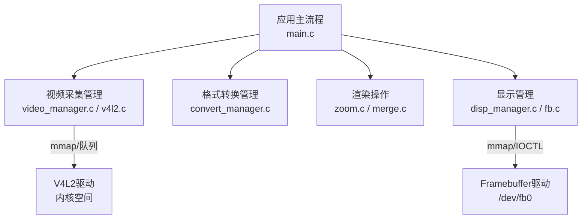
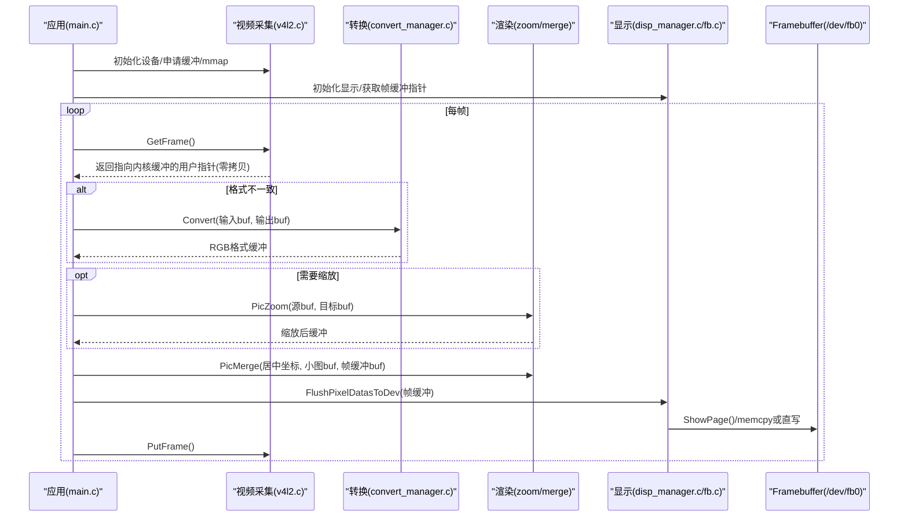
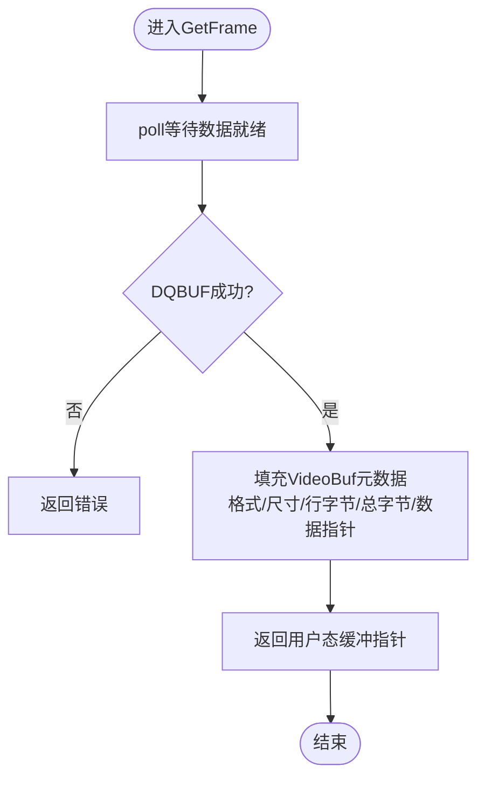
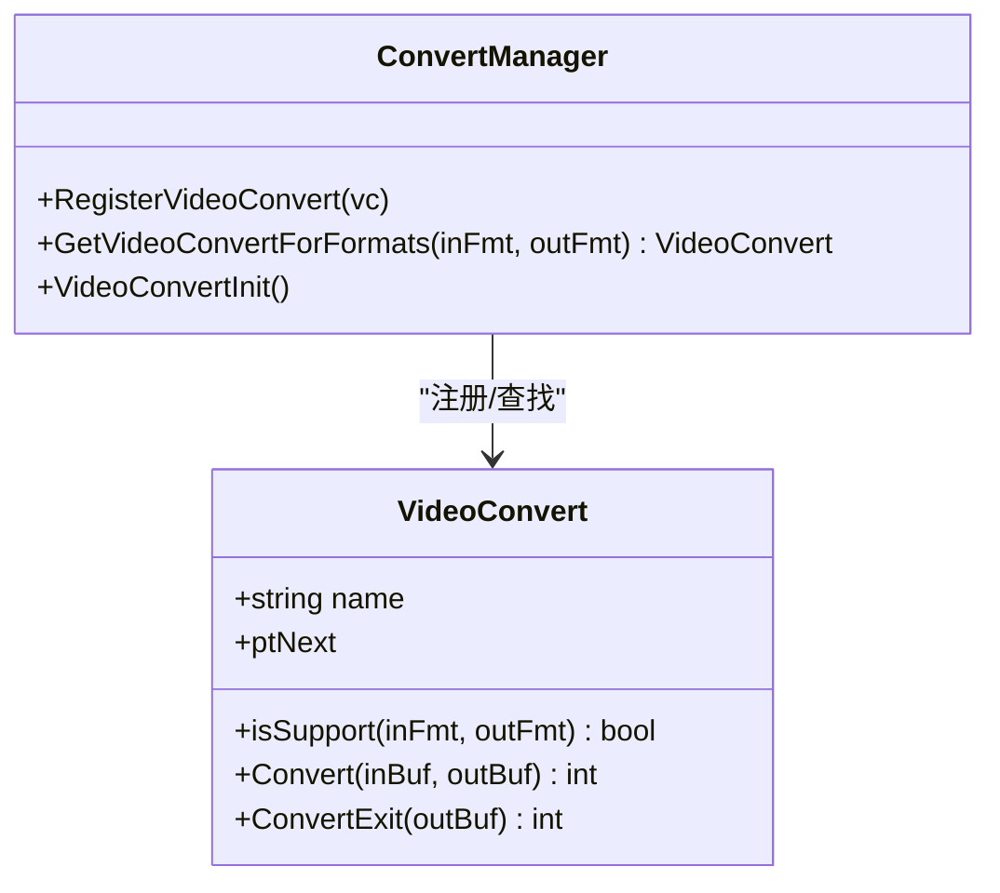
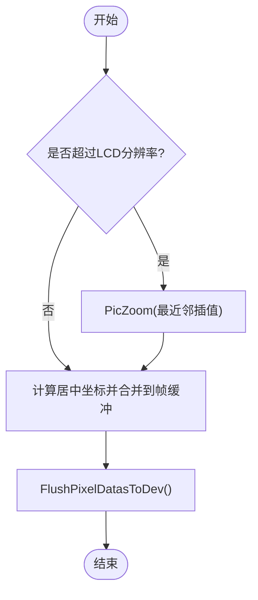
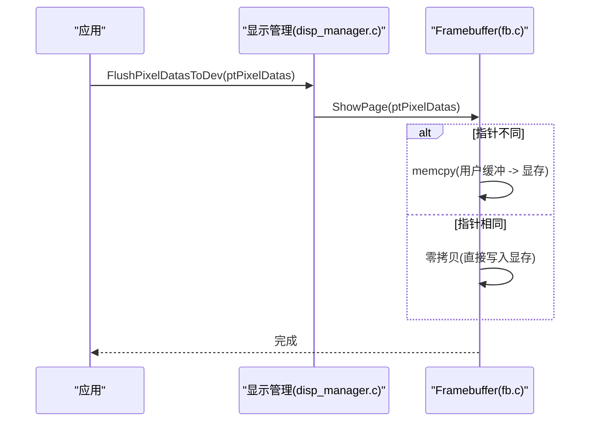
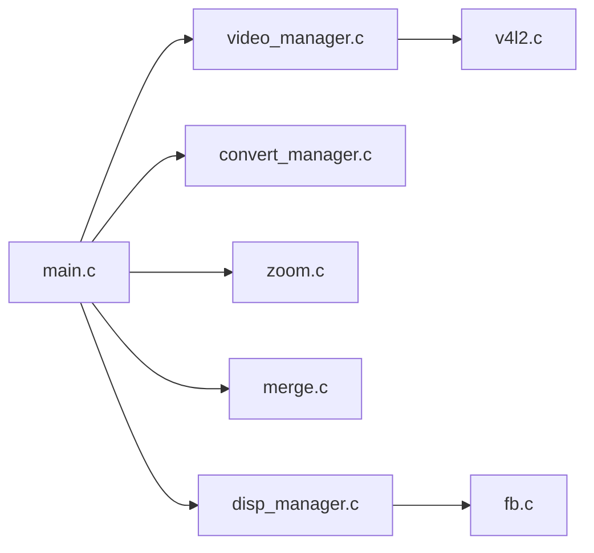
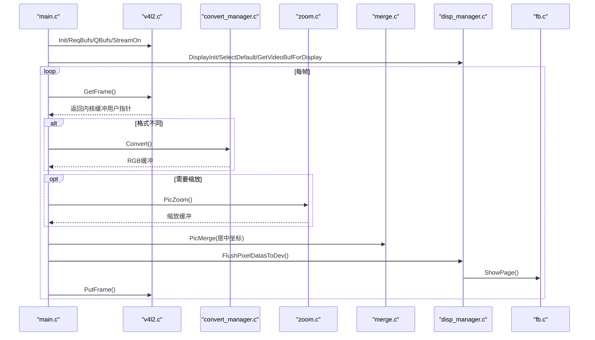

# 数据流设计

<cite>
**本文引用的文件**
- [main.c](file://video2lcd/main.c)
- [v4l2.c](file://video2lcd/video/v4l2.c)
- [video_manager.c](file://video2lcd/video/video_manager.c)
- [fb.c](file://video2lcd/display/fb.c)
- [disp_manager.c](file://video2lcd/display/disp_manager.c)
- [convert_manager.c](file://video2lcd/convert/convert_manager.c)
- [zoom.c](file://video2lcd/render/operation/zoom.c)
- [merge.c](file://video2lcd/render/operation/merge.c)
- [config.h](file://video2lcd/include/config.h)
- [video_manager.h](file://video2lcd/include/video_manager.h)
- [render.h](file://video2lcd/include/render.h)
- [convert_manager.h](file://video2lcd/include/convert_manager.h)
- [disp_manager.h](file://video2lcd/include/disp_manager.h)
- [pic_operation.h](file://video2lcd/include/pic_operation.h)
</cite>

## 目录
1. [简介](#简介)
2. [项目结构](#项目结构)
3. [核心组件](#核心组件)
4. [架构总览](#架构总览)
5. [详细组件分析](#详细组件分析)
6. [依赖关系分析](#依赖关系分析)
7. [性能考量](#性能考量)
8. [故障排查指南](#故障排查指南)
9. [结论](#结论)
10. [附录](#附录)

## 简介
本设计文档围绕“从摄像头数据采集到LCD显示”的完整数据流转过程，系统性阐述以下关键点：
- 视频缓冲区管理机制与内核/用户空间内存映射（mmap）
- 像素格式转换路径（如YUV/MJPEG→RGB）
- 图像缩放与合并的执行时机与数据传递方式
- 内存管理策略与零拷贝技术的应用场景和优化效果
- 提供数据流图与时间序列图，帮助理解实时处理关键路径

## 项目结构
项目采用分层模块化设计：
- 采集层：基于V4L2的视频采集模块，负责设备初始化、缓冲申请与映射、帧获取与归还
- 转换层：根据输入输出像素格式动态选择并执行格式转换
- 渲染层：提供图像缩放与合并等通用图像处理能力
- 显示层：通过Framebuffer将最终帧写入LCD显存
- 管理层：统一管理各模块的注册、选择与生命周期

图表来源
- [main.c:34-189](file://video2lcd/main.c#L34-L189)
- [video_manager.c:67-74](file://video2lcd/video/video_manager.c#L67-L74)
- [v4l2.c:47-249](file://video2lcd/video/v4l2.c#L47-L249)
- [convert_manager.c:121-130](file://video2lcd/convert/convert_manager.c#L121-L130)
- [fb.c:53-94](file://video2lcd/display/fb.c#L53-L94)
- [disp_manager.c:100-175](file://video2lcd/display/disp_manager.c#L100-L175)

章节来源
- [main.c:34-189](file://video2lcd/main.c#L34-L189)
- [video_manager.c:67-74](file://video2lcd/video/video_manager.c#L67-L74)
- [v4l2.c:47-249](file://video2lcd/video/v4l2.c#L47-L249)
- [fb.c:53-94](file://video2lcd/display/fb.c#L53-L94)
- [disp_manager.c:100-175](file://video2lcd/display/disp_manager.c#L100-L175)

## 核心组件
- 视频采集（V4L2）：支持streaming模式下的多缓冲mmap映射与队列调度；也兼容read/write模式
- 格式转换：按输入/输出像素格式自动匹配转换器（YUV→RGB、MJPEG→RGB、RGB→RGB）
- 渲染：最近邻插值缩放、区域合并（居中显示）
- 显示：Framebuffer映射至用户空间，支持整页刷新与清屏
- 管理：统一注册/选择接口，解耦具体驱动实现

章节来源
- [video_manager.h:14-56](file://video2lcd/include/video_manager.h#L14-L56)
- [convert_manager.h:23-43](file://video2lcd/include/convert_manager.h#L23-L43)
- [render.h:15-36](file://video2lcd/include/render.h#L15-L36)
- [disp_manager.h:84-96](file://video2lcd/include/disp_manager.h#L84-L96)

## 架构总览
整体数据流遵循“采集→转换→缩放→合并→显示”的流水线。关键优化点在于：
- V4L2 streaming模式下使用内核分配的缓冲区并通过mmap映射到用户空间，避免额外拷贝
- 当摄像头输出格式与LCD所需格式一致时，跳过转换步骤，减少CPU开销
- 仅在必要时进行缩放，保持原始宽高比
- 合并阶段直接写入framebuffer映射的用户空间指针，最后一次性刷新到硬件

图表来源
- [main.c:76-189](file://video2lcd/main.c#L76-L189)
- [v4l2.c:152-249](file://video2lcd/video/v4l2.c#L152-L249)
- [convert_manager.c:98-130](file://video2lcd/convert/convert_manager.c#L98-L130)
- [zoom.c:27-85](file://video2lcd/render/operation/zoom.c#L27-L85)
- [merge.c:20-46](file://video2lcd/render/operation/merge.c#L20-L46)
- [fb.c:166-174](file://video2lcd/display/fb.c#L166-L174)

## 详细组件分析

### 视频采集与缓冲区管理（V4L2）
- 设备能力查询与格式枚举：确定支持的像素格式（如MJPEG/YUYV/RGB565），并设置分辨率
- 缓冲申请与映射：
  - 使用VIDIOC_REQBUFS申请多个缓冲区
  - 对每个缓冲区调用VIDIOC_QUERYBUF获取长度与偏移，再通过mmap映射到用户空间
  - 将所有缓冲入队（VIDIOC_QBUF），启动采集（VIDIOC_STREAMON）
- 取帧与还帧：
  - poll等待数据就绪，VIDIOC_DQBUF取出已填充的缓冲索引
  - 将缓冲信息（格式、尺寸、行字节数、总字节数、数据指针）封装为VideoBuf返回
  - 处理完成后VIDIOC_QBUF归还缓冲，供下一帧复用

图表来源
- [v4l2.c:267-306](file://video2lcd/video/v4l2.c#L267-L306)

章节来源
- [v4l2.c:47-249](file://video2lcd/video/v4l2.c#L47-L249)
- [v4l2.c:267-326](file://video2lcd/video/v4l2.c#L267-L326)
- [video_manager.c:67-74](file://video2lcd/video/video_manager.c#L67-L74)

### 像素格式转换路径
- 转换管理器维护一个转换器链表，支持YUV→RGB、MJPEG→RGB、RGB→RGB
- 运行时根据输入输出像素格式自动选择合适转换器
- 若摄像头输出格式与LCD所需格式相同，则跳过转换，降低CPU占用

图表来源
- [convert_manager.h:23-43](file://video2lcd/include/convert_manager.h#L23-L43)
- [convert_manager.c:23-130](file://video2lcd/convert/convert_manager.c#L23-L130)

章节来源
- [convert_manager.c:98-130](file://video2lcd/convert/convert_manager.c#L98-L130)

### 图像缩放与合并
- 缩放：最近邻插值算法，构建X坐标查找表，逐行复制像素，保持BPP一致
- 合并：计算居中位置，逐行将小图复制到大图指定区域
- 执行时机：
  - 缩放：当源图尺寸大于LCD分辨率时执行，以保持比例且不超出屏幕
  - 合并：缩放后或直接使用原图，将其绘制到帧缓冲区的居中位置

图表来源
- [main.c:141-178](file://video2lcd/main.c#L141-L178)
- [zoom.c:27-85](file://video2lcd/render/operation/zoom.c#L27-L85)
- [merge.c:20-46](file://video2lcd/render/operation/merge.c#L20-L46)

章节来源
- [main.c:141-178](file://video2lcd/main.c#L141-L178)
- [zoom.c:27-85](file://video2lcd/render/operation/zoom.c#L27-L85)
- [merge.c:20-46](file://video2lcd/render/operation/merge.c#L20-L46)

### 显示与帧缓冲管理
- Framebuffer初始化：打开/dev/fb0，获取屏幕信息，mmap映射显存到用户空间
- 显示刷新：
  - 若写入的像素数据指针与显存指针不同，则memcpy到显存
  - 否则直接写入显存（零拷贝）
- 清屏与画点：支持按BPP（8/16/32）写入颜色值

图表来源
- [fb.c:166-174](file://video2lcd/display/fb.c#L166-L174)
- [disp_manager.c:172-175](file://video2lcd/display/disp_manager.c#L172-L175)

章节来源
- [fb.c:53-94](file://video2lcd/display/fb.c#L53-L94)
- [fb.c:166-174](file://video2lcd/display/fb.c#L166-L174)
- [disp_manager.c:148-175](file://video2lcd/display/disp_manager.c#L148-L175)

## 依赖关系分析
- main.c依赖：
  - 视频管理（video_manager.c）：初始化V4L2、获取/归还帧
  - 转换管理（convert_manager.c）：按格式选择转换器
  - 渲染（zoom.c/merge.c）：缩放与合并
  - 显示管理（disp_manager.c/fb.c）：初始化显示、刷新帧缓冲
- 数据结构依赖：
  - T_PixelDatas：统一描述像素数据（尺寸、BPP、行字节、总字节、数据指针）
  - T_VideoDevice/T_VideoOpr：抽象摄像头设备状态与操作接口
  - T_VideoConvert：抽象格式转换器接口
  - T_DispOpr：抽象显示设备操作接口

图表来源
- [main.c:34-189](file://video2lcd/main.c#L34-L189)
- [video_manager.c:67-74](file://video2lcd/video/video_manager.c#L67-L74)
- [v4l2.c:387-401](file://video2lcd/video/v4l2.c#L387-L401)
- [convert_manager.c:121-130](file://video2lcd/convert/convert_manager.c#L121-L130)
- [fb.c:249-252](file://video2lcd/display/fb.c#L249-L252)

章节来源
- [video_manager.h:14-56](file://video2lcd/include/video_manager.h#L14-L56)
- [convert_manager.h:23-43](file://video2lcd/include/convert_manager.h#L23-L43)
- [disp_manager.h:84-96](file://video2lcd/include/disp_manager.h#L84-L96)
- [pic_operation.h:10-17](file://video2lcd/include/pic_operation.h#L10-L17)

## 性能考量
- 零拷贝技术
  - V4L2 streaming模式：内核分配缓冲并通过mmap映射到用户空间，GetFrame返回的用户指针直接指向内核缓冲，避免一次额外拷贝
  - 显示阶段：若写入缓冲即显存映射地址，则ShowPage不执行memcpy，实现零拷贝刷新
- 最小化转换
  - 当摄像头输出格式与LCD所需格式一致时，跳过转换步骤，减少CPU负载
- 缩放策略
  - 仅在源图尺寸大于LCD分辨率时执行缩放，并保持宽高比，避免不必要的计算
- 批量刷新
  - 合并阶段逐行memcpy到帧缓冲，最后一次性刷新到硬件，减少系统调用次数

[本节为通用性能讨论，不直接分析具体文件]

## 故障排查指南
- 无法打开设备
  - 检查摄像头设备路径与权限
  - 确认设备支持所选像素格式与分辨率
- mmap失败
  - 检查VIDIOC_QUERYBUF返回值与length
  - 确认MAP_SHARED标志与偏移量正确
- 取帧阻塞或超时
  - 检查STREAMON是否成功
  - 确认至少有一个缓冲已入队（QBUF）
- 显示异常
  - 检查Framebuffer映射是否成功
  - 确认像素格式与BPP匹配（RGB565/RGB32）
  - 核对居中坐标与尺寸边界

章节来源
- [v4l2.c:47-249](file://video2lcd/video/v4l2.c#L47-L249)
- [fb.c:53-94](file://video2lcd/display/fb.c#L53-L94)
- [main.c:63-107](file://video2lcd/main.c#L63-L107)

## 结论
该数据流设计通过分层模块化与接口抽象，实现了从摄像头采集到LCD显示的完整链路。关键优化包括：
- 使用V4L2 streaming模式与mmap实现零拷贝采集
- 动态格式转换与条件缩放，降低CPU占用
- 直接写入framebuffer映射地址，结合一次性刷新，提升显示效率
- 统一的注册/选择机制，便于扩展新设备与新转换器

[本节为总结性内容，不直接分析具体文件]

## 附录

### 关键数据结构
- T_PixelDatas：描述像素数据的通用结构（宽、高、BPP、行字节、总字节、数据指针）
- T_VideoDevice/T_VideoOpr：摄像头设备状态与操作接口
- T_VideoConvert：格式转换器接口
- T_DispOpr：显示设备操作接口

章节来源
- [pic_operation.h:10-17](file://video2lcd/include/pic_operation.h#L10-L17)
- [video_manager.h:14-56](file://video2lcd/include/video_manager.h#L14-L56)
- [convert_manager.h:23-43](file://video2lcd/include/convert_manager.h#L23-L43)
- [disp_manager.h:84-96](file://video2lcd/include/disp_manager.h#L84-L96)

### 实时处理时间序列图

图表来源
- [main.c:76-189](file://video2lcd/main.c#L76-L189)
- [v4l2.c:152-249](file://video2lcd/video/v4l2.c#L152-L249)
- [convert_manager.c:98-130](file://video2lcd/convert/convert_manager.c#L98-L130)
- [zoom.c:27-85](file://video2lcd/render/operation/zoom.c#L27-L85)
- [merge.c:20-46](file://video2lcd/render/operation/merge.c#L20-L46)
- [fb.c:166-174](file://video2lcd/display/fb.c#L166-L174)