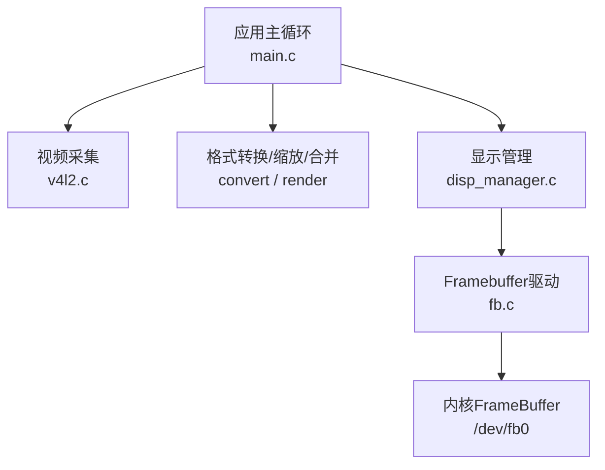
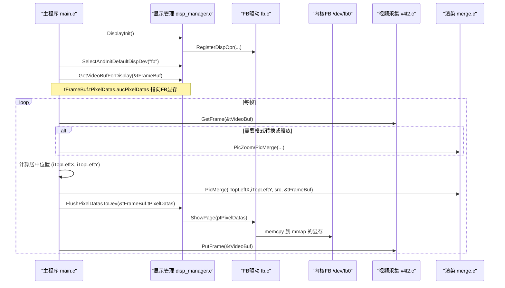
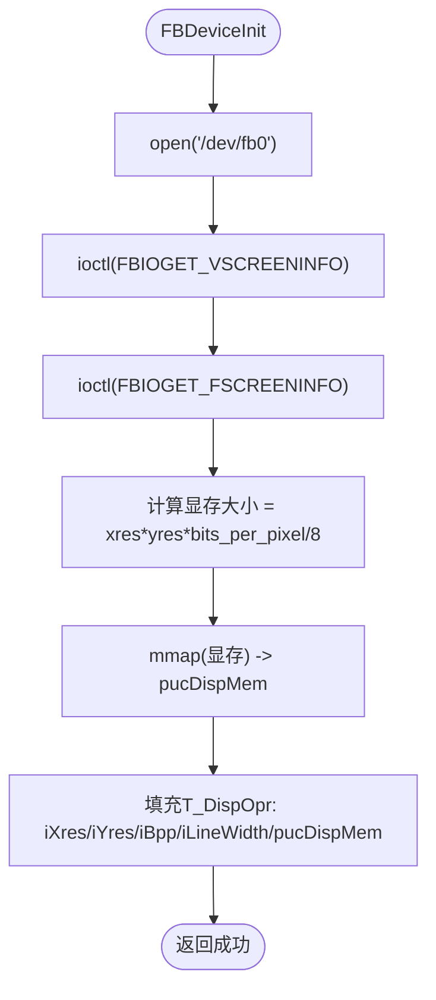
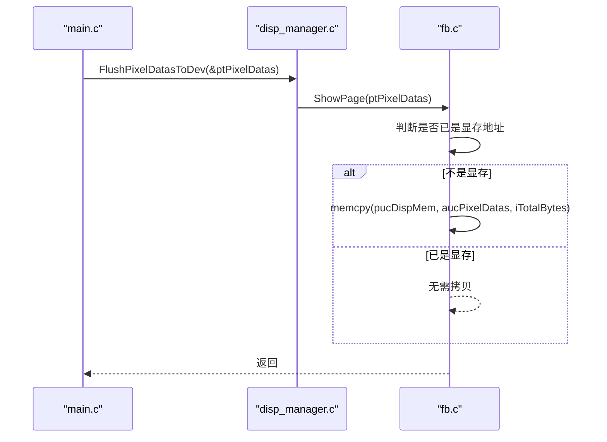
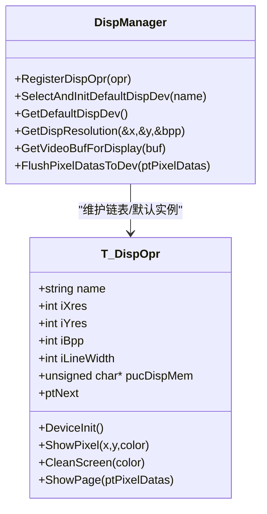
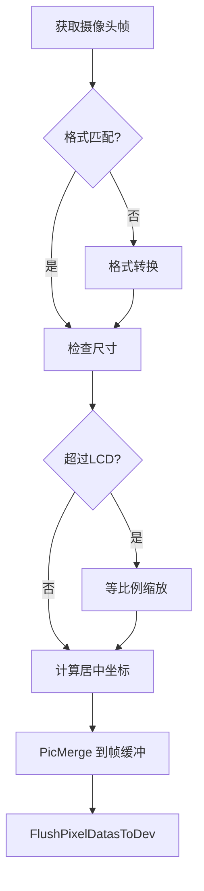
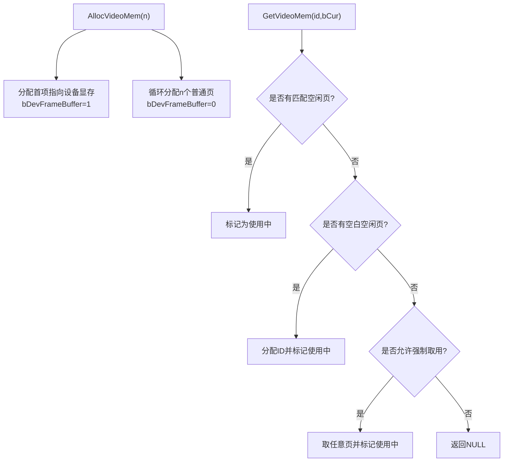
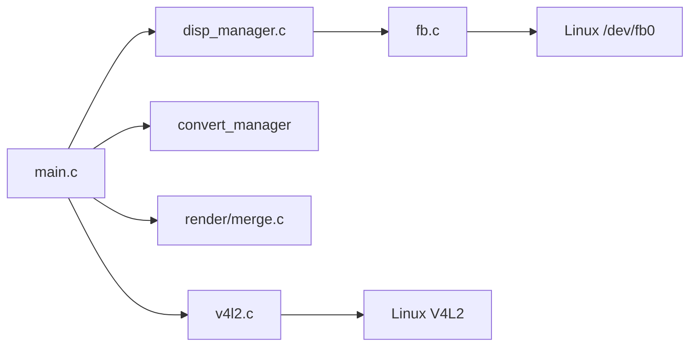
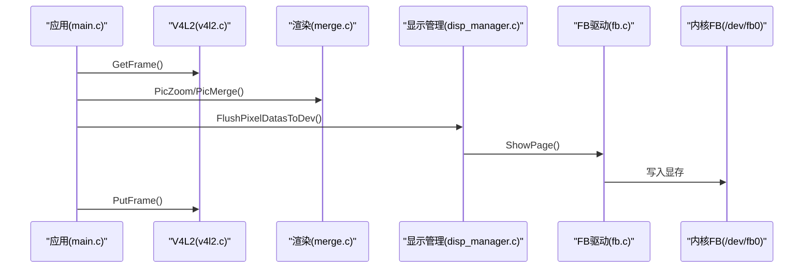
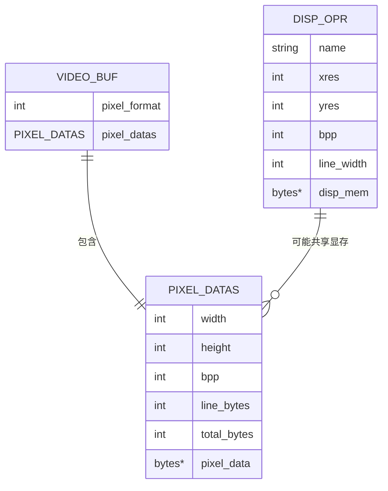

# 显示输出数据流

<cite>
**本文引用的文件**
- [main.c](file://video2lcd/main.c)
- [disp_manager.h](file://video2lcd/include/disp_manager.h)
- [disp_manager.c](file://video2lcd/display/disp_manager.c)
- [fb.c](file://video2lcd/display/fb.c)
- [config.h](file://video2lcd/include/config.h)
- [pic_operation.h](file://video2lcd/include/pic_operation.h)
- [merge.c](file://video2lcd/render/operation/merge.c)
- [v4l2.c](file://video2lcd/video/v4l2.c)
</cite>

## 目录
1. [简介](#简介)
2. [项目结构](#项目结构)
3. [核心组件](#核心组件)
4. [架构总览](#架构总览)
5. [详细组件分析](#详细组件分析)
6. [依赖关系分析](#依赖关系分析)
7. [性能考量](#性能考量)
8. [故障排查指南](#故障排查指南)
9. [结论](#结论)
10. [附录](#附录)

## 简介
本文件面向“像素数据到LCD显示”的完整数据流，重点说明：
- Framebuffer驱动的工作原理与内存映射机制
- 像素缓冲区管理与刷新流程（含 FlushPixelDatasToDev）
- 多显示设备支持与设备选择策略
- 分辨率适配与像素格式处理
- 时序图与内存布局图，帮助理解底层机制与优化要点

## 项目结构
本项目采用分层模块化设计：
- 视频采集层：基于V4L2从摄像头获取帧数据
- 转换与渲染层：格式转换、缩放、合并到目标缓冲
- 显示管理层：抽象显示设备接口，管理VideoMem与默认设备
- 显示驱动层：以Framebuffer为具体实现，直接操作/dev/fb0并mmap显存

图表来源
- [main.c:63-178](file://video2lcd/main.c#L63-L178)
- [v4l2.c:47-244](file://video2lcd/video/v4l2.c#L47-L244)
- [disp_manager.c:148-175](file://video2lcd/display/disp_manager.c#L148-L175)
- [fb.c:53-94](file://video2lcd/display/fb.c#L53-L94)

章节来源
- [main.c:63-178](file://video2lcd/main.c#L63-L178)
- [v4l2.c:47-244](file://video2lcd/video/v4l2.c#L47-L244)
- [disp_manager.c:148-175](file://video2lcd/display/disp_manager.c#L148-L175)
- [fb.c:53-94](file://video2lcd/display/fb.c#L53-L94)

## 核心组件
- 显示设备抽象接口 T_DispOpr：统一封装 DeviceInit/CleanScreen/ShowPage/ShowPixel 等能力，支持多设备注册与切换。
- 显示管理器 disp_manager：维护设备链表、默认设备、VideoMem池，提供 GetVideoBufForDisplay、FlushPixelDatasToDev 等高层API。
- Framebuffer驱动 fb.c：打开 /dev/fb0，ioctl获取屏幕信息，mmap映射显存，实现 ShowPage 将像素数据写入显存。
- 像素数据结构 T_PixelDatas：统一描述宽、高、BPP、行字节数、总字节数与像素指针，贯穿采集、转换、渲染、显示全链路。
- 图像合并 merge.c：将小图按指定坐标复制到大图指定区域，用于居中显示。
- V4L2采集 v4l2.c：枚举格式、设置分辨率、分配并mmap缓冲区、队列流转，输出 PT_VideoBuf。

章节来源
- [disp_manager.h:69-96](file://video2lcd/include/disp_manager.h#L69-L96)
- [disp_manager.c:148-175](file://video2lcd/display/disp_manager.c#L148-L175)
- [fb.c:37-94](file://video2lcd/display/fb.c#L37-L94)
- [pic_operation.h:10-17](file://video2lcd/include/pic_operation.h#L10-L17)
- [merge.c:20-45](file://video2lcd/render/operation/merge.c#L20-L45)
- [v4l2.c:47-244](file://video2lcd/video/v4l2.c#L47-L244)

## 架构总览
下图展示从摄像头采集到LCD显示的端到端数据流，以及关键函数调用链。

图表来源
- [main.c:63-178](file://video2lcd/main.c#L63-L178)
- [disp_manager.c:148-175](file://video2lcd/display/disp_manager.c#L148-L175)
- [fb.c:166-174](file://video2lcd/display/fb.c#L166-L174)
- [v4l2.c:267-326](file://video2lcd/video/v4l2.c#L267-L326)
- [merge.c:20-45](file://video2lcd/render/operation/merge.c#L20-L45)

## 详细组件分析

### Framebuffer驱动工作原理与内存映射
- 初始化流程：
  - 打开 /dev/fb0，通过 ioctl 获取可变/固定屏幕信息（分辨率、BPP、行字节数等）。
  - 计算显存大小并 mmap 映射到用户空间，得到 pucDispMem。
  - 填充 T_DispOpr 的分辨率、BPP、行字节数与显存指针，供上层使用。
- 画点与清屏：
  - 根据BPP（8/16/32）进行不同写入；16位时做RGB888到RGB565转换。
- 页面刷新：
  - ShowPage 将传入的 PT_PixelDatas 数据拷贝到显存（若源地址非显存则memcpy）。

图表来源
- [fb.c:53-94](file://video2lcd/display/fb.c#L53-L94)

章节来源
- [fb.c:53-94](file://video2lcd/display/fb.c#L53-L94)
- [fb.c:106-157](file://video2lcd/display/fb.c#L106-L157)
- [fb.c:183-240](file://video2lcd/display/fb.c#L183-L240)
- [fb.c:166-174](file://video2lcd/display/fb.c#L166-L174)
- [config.h:17-18](file://video2lcd/include/config.h#L17-L18)

### FlushPixelDatasToDev 的实现细节与硬件刷新
- 作用：将 PT_PixelDatas 描述的像素数据刷新到当前默认显示设备。
- 实现：直接调用默认设备的 ShowPage 回调。对于FB驱动，ShowPage 会将数据拷贝到已mmap的显存中，由硬件自动扫描显示。
- 注意：该实现不触发额外的页翻转或双缓冲切换，属于“立即写显存”的方式。

图表来源
- [disp_manager.c:172-175](file://video2lcd/display/disp_manager.c#L172-L175)
- [fb.c:166-174](file://video2lcd/display/fb.c#L166-L174)

章节来源
- [disp_manager.c:172-175](file://video2lcd/display/disp_manager.c#L172-L175)
- [fb.c:166-174](file://video2lcd/display/fb.c#L166-L174)

### 多显示设备支持与设备选择策略
- 设备注册：各显示驱动通过 RegisterDispOpr 将自身操作表加入全局链表。
- 设备选择：SelectAndInitDefaultDispDev 根据名称查找并初始化默认设备，同时执行清屏。
- 运行时查询：GetDefaultDispDev、GetDispResolution 可获取当前默认设备及其分辨率/BPP。
- 扩展性：新增显示设备只需实现 T_DispOpr 并注册即可无缝接入。

图表来源
- [disp_manager.h:69-96](file://video2lcd/include/disp_manager.h#L69-L96)
- [disp_manager.c:27-113](file://video2lcd/display/disp_manager.c#L27-L113)

章节来源
- [disp_manager.c:27-113](file://video2lcd/display/disp_manager.c#L27-L113)
- [disp_manager.h:99-154](file://video2lcd/include/disp_manager.h#L99-L154)

### 分辨率适配与像素格式处理
- 分辨率适配：
  - 主循环先获取LCD分辨率与BPP，再决定是否需要缩放。
  - 当输入图像尺寸大于LCD时，按比例缩放至不超过LCD宽高，保持纵横比。
- 像素格式处理：
  - 若摄像头输出格式与LCD不一致，则通过转换器转换为LCD所需格式。
  - 显示时，FB驱动根据BPP写入对应颜色格式（8/16/32），其中16位需做RGB888到RGB565转换。
- 合并显示：
  - 计算居中坐标后，将缩放后的图像合并到帧缓冲区的指定位置。

图表来源
- [main.c:129-178](file://video2lcd/main.c#L129-L178)
- [fb.c:125-153](file://video2lcd/display/fb.c#L125-L153)
- [merge.c:20-45](file://video2lcd/render/operation/merge.c#L20-L45)

章节来源
- [main.c:129-178](file://video2lcd/main.c#L129-L178)
- [fb.c:125-153](file://video2lcd/display/fb.c#L125-L153)
- [merge.c:20-45](file://video2lcd/render/operation/merge.c#L20-L45)

### 像素缓冲区管理与VideoMem
- VideoMem池：
  - AllocVideoMem 分配若干页缓冲，第一页可直接指向设备显存（bDevFrameBuffer=1），后续为普通内存页。
  - GetVideoMem 按ID与状态策略挑选空闲页，PutVideoMem 释放回池。
- 用途：
  - 在内存中准备图像，再一次性复制到显存，减少频繁访问显存的开销。
  - 当前项目主循环直接使用帧缓冲（GetVideoBufForDisplay）作为目标缓冲，未使用VideoMem池进行双缓冲。

图表来源
- [disp_manager.c:188-259](file://video2lcd/display/disp_manager.c#L188-L259)
- [disp_manager.c:272-322](file://video2lcd/display/disp_manager.c#L272-L322)

章节来源
- [disp_manager.c:188-259](file://video2lcd/display/disp_manager.c#L188-L259)
- [disp_manager.c:272-322](file://video2lcd/display/disp_manager.c#L272-L322)

## 依赖关系分析
- 模块耦合：
  - main.c 依赖 video_manager、convert_manager、render、disp_manager。
  - disp_manager 依赖 pic_operation（像素描述）、video_manager（部分接口）。
  - fb.c 依赖 disp_manager 接口与系统头文件（sys/mman、linux/fb）。
  - v4l2.c 依赖 video_manager 接口与系统V4L2 API。
- 外部依赖：
  - Linux内核提供的 /dev/fb0 与 V4L2 子系统。
- 潜在循环依赖：
  - 当前无直接循环依赖；显示与视频模块通过统一结构体解耦。

图表来源
- [main.c:63-178](file://video2lcd/main.c#L63-L178)
- [disp_manager.c:514-521](file://video2lcd/display/disp_manager.c#L514-L521)
- [fb.c:249-252](file://video2lcd/display/fb.c#L249-L252)
- [v4l2.c:387-401](file://video2lcd/video/v4l2.c#L387-L401)

章节来源
- [main.c:63-178](file://video2lcd/main.c#L63-L178)
- [disp_manager.c:514-521](file://video2lcd/display/disp_manager.c#L514-L521)
- [fb.c:249-252](file://video2lcd/display/fb.c#L249-L252)
- [v4l2.c:387-401](file://video2lcd/video/v4l2.c#L387-L401)

## 性能考量
- 零拷贝路径：
  - GetVideoBufForDisplay 直接返回指向FB显存的缓冲，避免额外复制。
  - ShowPage 在源地址即显存时跳过memcpy。
- 批量写入：
  - 合并阶段逐行memcpy，尽量利用行字节对齐，减少跨行寻址开销。
- 格式转换与缩放：
  - 仅在必要时执行，且保持纵横比以减少裁剪与黑边。
- 建议优化：
  - 引入双缓冲/页翻转（如DRM/KMS）以避免撕裂。
  - 对热点路径使用SIMD或平台优化库加速缩放/合并。
  - 合理设置NB_BUFFER，平衡吞吐与延迟。

[本节为通用指导，不直接分析具体文件]

## 故障排查指南
- 无法打开 /dev/fb0：
  - 检查设备节点是否存在及权限；确认内核启用FB驱动。
- ioctl 失败：
  - 检查返回值与错误码；确认设备支持请求的参数（分辨率/BPP）。
- 显示异常或花屏：
  - 核对BPP与像素格式转换逻辑；确保行字节数计算正确。
- 卡顿或丢帧：
  - 检查V4L2队列是否及时QBUF/DQBUF；确认缩放/转换耗时过高。
- 内存不足：
  - 评估VideoMem数量与单帧大小；必要时减少缓冲页数或降低分辨率。

章节来源
- [fb.c:53-94](file://video2lcd/display/fb.c#L53-L94)
- [fb.c:125-153](file://video2lcd/display/fb.c#L125-L153)
- [v4l2.c:267-326](file://video2lcd/video/v4l2.c#L267-L326)

## 结论
- 本项目通过统一的 T_DispOpr 抽象实现了多显示设备支持，并以FB驱动作为默认实现。
- 数据流清晰：V4L2采集 → 格式转换/缩放 → 合并到帧缓冲 → FlushPixelDatasToDev 写入显存。
- 通过直接mmap显存与按需复制，兼顾了易用性与性能。
- 未来可通过双缓冲/页翻转与更高效的图像处理算法进一步提升流畅度与画质。

[本节为总结，不直接分析具体文件]

## 附录

### 显示时序图（端到端）

图表来源
- [main.c:118-188](file://video2lcd/main.c#L118-L188)
- [v4l2.c:267-326](file://video2lcd/video/v4l2.c#L267-L326)
- [merge.c:20-45](file://video2lcd/render/operation/merge.c#L20-L45)
- [disp_manager.c:172-175](file://video2lcd/display/disp_manager.c#L172-L175)
- [fb.c:166-174](file://video2lcd/display/fb.c#L166-L174)

### 内存布局图（帧缓冲与像素数据）

图表来源
- [pic_operation.h:10-17](file://video2lcd/include/pic_operation.h#L10-L17)
- [disp_manager.h:69-96](file://video2lcd/include/disp_manager.h#L69-L96)
- [disp_manager.c:148-162](file://video2lcd/display/disp_manager.c#L148-L162)