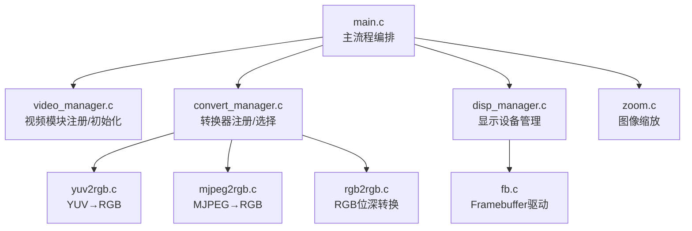
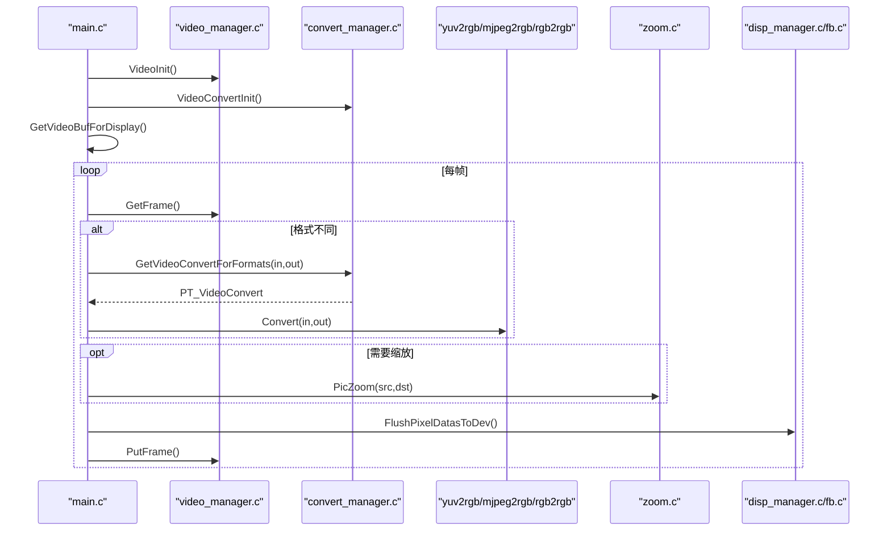
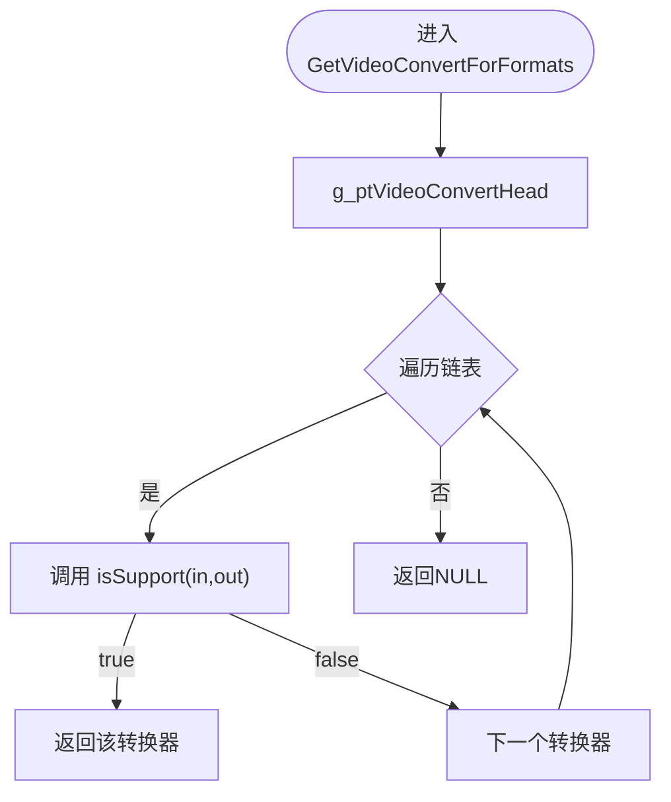
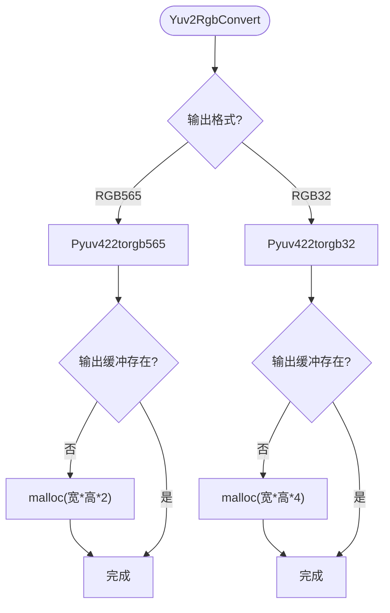
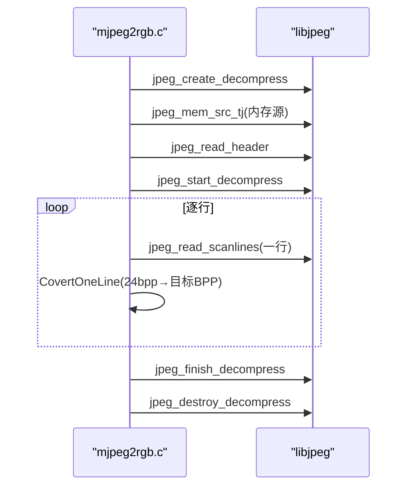
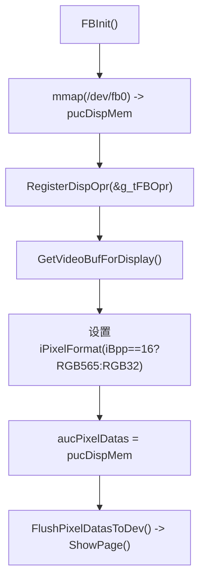
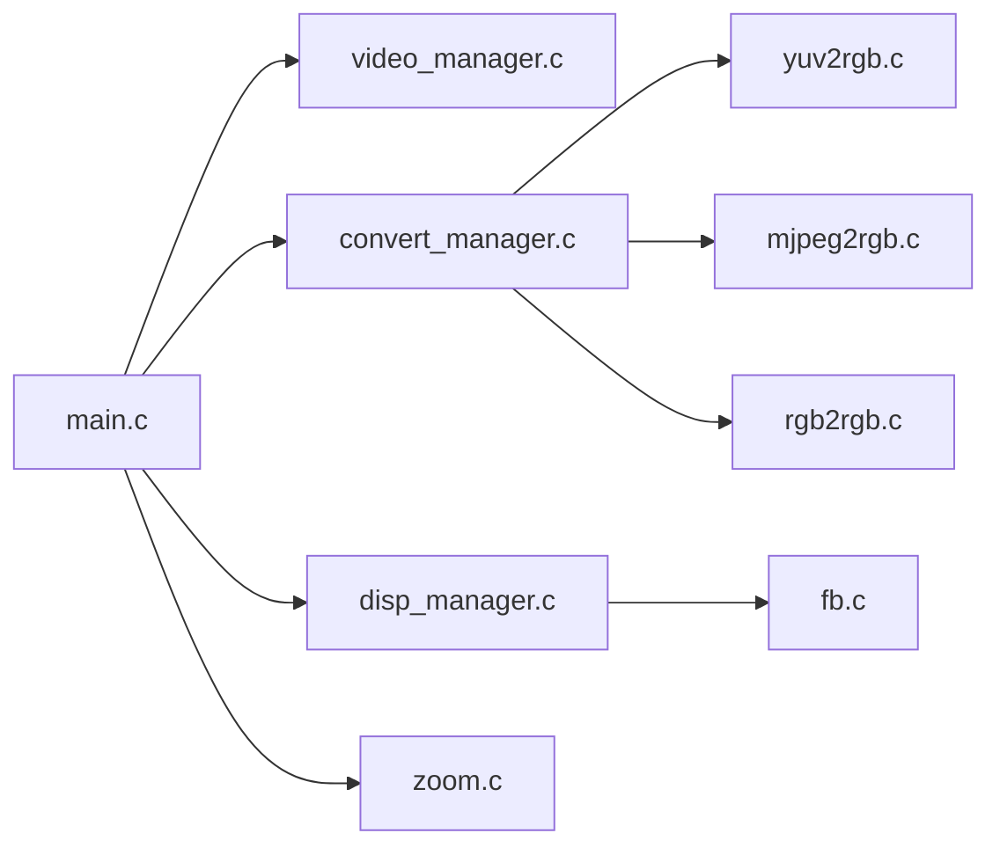

# 格式转换数据流

<cite>
**本文引用的文件**
- [main.c](file://video2lcd/main.c)
- [convert_manager.c](file://video2lcd/convert/convert_manager.c)
- [convert_manager.h](file://video2lcd/include/convert_manager.h)
- [yuv2rgb.c](file://video2lcd/convert/yuv2rgb.c)
- [mjpeg2rgb.c](file://video2lcd/convert/mjpeg2rgb.c)
- [rgb2rgb.c](file://video2lcd/convert/rgb2rgb.c)
- [color.h](file://video2lcd/convert/color.h)
- [disp_manager.c](file://video2lcd/display/disp_manager.c)
- [fb.c](file://video2lcd/display/fb.c)
- [video_manager.c](file://video2lcd/video/video_manager.c)
- [video_manager.h](file://video2lcd/include/video_manager.h)
- [pic_operation.h](file://video2lcd/include/pic_operation.h)
- [zoom.c](file://video2lcd/render/operation/zoom.c)
</cite>

## 目录
1. [简介](#简介)
2. [项目结构](#项目结构)
3. [核心组件](#核心组件)
4. [架构总览](#架构总览)
5. [详细组件分析](#详细组件分析)
6. [依赖关系分析](#依赖关系分析)
7. [性能考量](#性能考量)
8. [故障排查指南](#故障排查指南)
9. [结论](#结论)
10. [附录](#附录)

## 简介
本文件围绕“像素格式转换”的数据流，系统阐述从摄像头采集的多种输入格式（YUV、MJPEG、RGB）到LCD显示格式（RGB565/RGB32）的完整处理路径。重点说明：
- 格式转换器选择机制（匹配算法与注册过程）
- 各转换算法的实现细节（YUV→RGB颜色空间转换、MJPEG解码流程、RGB位深转换）
- 内存管理与零拷贝优化策略
- 关键流程图与性能对比建议

## 项目结构
本项目采用分层模块化设计：
- 视频采集层：通过V4L2抽象获取帧数据（video_manager.c + v4l2.c）
- 格式转换层：统一接口管理并动态选择具体转换器（convert_manager.* + yuv2rgb.c / mjpeg2rgb.c / rgb2rgb.c）
- 渲染与显示层：缩放、合并、写入framebuffer（render/operation/*, disp_manager.c, fb.c）
- 主流程编排：初始化设备、选择转换器、循环采集-转换-缩放-显示（main.c）

图表来源
- [main.c:63-93](file://video2lcd/main.c#L63-L93)
- [convert_manager.c:121-130](file://video2lcd/convert/convert_manager.c#L121-L130)
- [disp_manager.c:514-521](file://video2lcd/display/disp_manager.c#L514-L521)

章节来源
- [main.c:34-192](file://video2lcd/main.c#L34-L192)
- [convert_manager.c:1-131](file://video2lcd/convert/convert_manager.c#L1-L131)
- [disp_manager.c:1-524](file://video2lcd/display/disp_manager.c#L1-L524)

## 核心组件
- 视频设备抽象：VideoDevice/VideoOpr封装V4L2操作，提供GetFrame/PutFrame等接口
- 格式转换器抽象：T_VideoConvert定义isSupport/Convert/ConvertExit接口，支持多实现注册与选择
- 显示设备抽象：DispOpr封装FB设备能力，提供ShowPage/CleanScreen等
- 像素数据模型：PixelDatas统一描述宽高、色深、行字节、总字节与数据指针

章节来源
- [video_manager.h:14-56](file://video2lcd/include/video_manager.h#L14-L56)
- [convert_manager.h:23-46](file://video2lcd/include/convert_manager.h#L23-L46)
- [pic_operation.h:10-18](file://video2lcd/include/pic_operation.h#L10-L18)

## 架构总览
整体数据流遵循“采集→转换→缩放→合并→显示”的主干路径。主程序在启动时完成：
- 显示设备初始化与默认设备选择
- 视频设备初始化与打开
- 转换器模块初始化与注册
- 根据摄像头输出格式与LCD目标格式自动选择转换器

运行时每帧：
- 从摄像头取帧
- 若输入与LCD格式不一致则调用对应转换器
- 若尺寸大于LCD则进行等比缩放
- 将结果居中合并到帧缓冲区
- 刷新至LCD硬件

图表来源
- [main.c:63-178](file://video2lcd/main.c#L63-L178)
- [convert_manager.c:98-130](file://video2lcd/convert/convert_manager.c#L98-L130)
- [disp_manager.c:148-175](file://video2lcd/display/disp_manager.c#L148-L175)

## 详细组件分析

### 格式转换器选择机制
- 注册过程：各转换器在各自Init函数中调用RegisterVideoConvert将自己加入全局链表
- 选择算法：遍历已注册的转换器，调用其isSupport判断是否支持当前in/out格式对，返回首个匹配的转换器
- 初始化入口：VideoConvertInit依次调用Yuv2RgbInit/Mjpeg2RgbInit/Rgb2RgbInit完成注册

图表来源
- [convert_manager.c:98-111](file://video2lcd/convert/convert_manager.c#L98-L111)
- [convert_manager.c:121-130](file://video2lcd/convert/convert_manager.c#L121-L130)

章节来源
- [convert_manager.c:23-130](file://video2lcd/convert/convert_manager.c#L23-L130)
- [convert_manager.h:23-46](file://video2lcd/include/convert_manager.h#L23-L46)

### YUV→RGB 颜色空间转换
- 支持输入：V4L2_PIX_FMT_YUYV（YUV422 packed）
- 支持输出：RGB565或RGB32
- 实现要点：
  - 使用颜色宏/查找表进行YUV到R/G/B计算
  - 分别实现Pyuv422torgb565与Pyuv422torgb32两路路径
  - 输出缓冲按需分配，并在退出时释放
- 复杂度：O(W*H)，逐像素处理；内存占用为输出帧大小

图表来源
- [yuv2rgb.c:161-199](file://video2lcd/convert/yuv2rgb.c#L161-L199)
- [color.h:65-88](file://video2lcd/convert/color.h#L65-L88)

章节来源
- [yuv2rgb.c:1-233](file://video2lcd/convert/yuv2rgb.c#L1-L233)
- [color.h:1-88](file://video2lcd/convert/color.h#L1-L88)

### MJPEG→RGB 解码流程
- 支持输入：V4L2_PIX_FMT_MJPEG（每帧为完整JPEG）
- 支持输出：RGB565或RGB32
- 实现要点：
  - 使用libjpeg库进行解码，自定义错误管理器以恢复错误
  - 按行读取扫描线，转换为目标BPP（RGB565/RGB32）
  - 行缓冲与输出缓冲按需分配，结束时释放
- 复杂度：解码开销较大，约O(W*H)且受压缩率影响

图表来源
- [mjpeg2rgb.c:145-228](file://video2lcd/convert/mjpeg2rgb.c#L145-L228)
- [mjpeg2rgb.c:83-133](file://video2lcd/convert/mjpeg2rgb.c#L83-L133)

章节来源
- [mjpeg2rgb.c:1-261](file://video2lcd/convert/mjpeg2rgb.c#L1-L261)

### RGB→RGB 位深转换
- 支持输入：V4L2_PIX_FMT_RGB565
- 支持输出：RGB565或RGB32
- 实现要点：
  - RGB565→RGB565：直接memcpy零拷贝
  - RGB565→RGB32：逐像素提取分量并扩展为0x00RRGGBB
- 复杂度：复制O(N)，位深转换O(W*H)

章节来源
- [rgb2rgb.c:1-152](file://video2lcd/convert/rgb2rgb.c#L1-L152)

### 显示与零拷贝
- 帧缓冲区映射：fb.c通过mmap将/dev/fb0映射到用户空间，得到pucDispMem
- 显示路径：disp_manager.c的GetVideoBufForDisplay将LCD目标格式与分辨率填入VideoBuf，并将aucPixelDatas直接指向pucDispMem
- 零拷贝场景：当转换输出目标即为LCD帧缓冲地址时，无需额外拷贝即可显示（例如RGB32→RGB32且目标为fb）

图表来源
- [fb.c:53-94](file://video2lcd/display/fb.c#L53-L94)
- [disp_manager.c:148-175](file://video2lcd/display/disp_manager.c#L148-L175)

章节来源
- [fb.c:1-253](file://video2lcd/display/fb.c#L1-L253)
- [disp_manager.c:140-175](file://video2lcd/display/disp_manager.c#L140-L175)

### 缩放与合并
- 缩放：PicZoom使用最近邻插值，构建X坐标查找表，按行memcpy复制像素
- 合并：主流程计算左上角偏移后，将缩放后的图像数据合并到帧缓冲区指定区域
- 注意：缩放要求源与目标BPP一致

章节来源
- [zoom.c:27-86](file://video2lcd/render/operation/zoom.c#L27-L86)
- [main.c:141-178](file://video2lcd/main.c#L141-L178)

## 依赖关系分析
- main.c依赖video_manager、convert_manager、disp_manager以及render操作
- convert_manager依赖各具体转换器（yuv2rgb/mjpeg2rgb/rgb2rgb）
- 显示模块依赖fb驱动
- 像素数据模型贯穿所有模块

图表来源
- [main.c:63-93](file://video2lcd/main.c#L63-L93)
- [convert_manager.c:121-130](file://video2lcd/convert/convert_manager.c#L121-L130)
- [disp_manager.c:514-521](file://video2lcd/display/disp_manager.c#L514-L521)

章节来源
- [main.c:34-192](file://video2lcd/main.c#L34-L192)
- [convert_manager.c:1-131](file://video2lcd/convert/convert_manager.c#L1-L131)
- [disp_manager.c:1-524](file://video2lcd/display/disp_manager.c#L1-L524)

## 性能考量
- 转换路径选择
  - YUV→RGB：线性O(W*H)，适合实时流水线；可考虑SIMD/查表优化
  - MJPEG→RGB：解码开销大，CPU占用高；在高码率下可能成为瓶颈
  - RGB→RGB：同格式直接memcpy零拷贝最优；位深转换需逐像素处理
- 内存管理
  - 输出缓冲按需分配，避免重复malloc/free；可在应用层复用固定大小的转换缓冲
  - 尽量将转换目标设为LCD帧缓冲地址，减少一次内存拷贝
- 零拷贝技术
  - 当摄像头输出格式与LCD目标格式一致（如RGB565→RGB565），可直接写fb，零拷贝
  - 当输出为RGB32且LCD为RGB32时，同样可实现零拷贝
- 缩放策略
  - 仅当图像尺寸大于LCD时才缩放，避免不必要的计算
  - 最近邻插值速度快但质量一般；如需高质量可考虑双线性/双三次插值（代价更高）

[本节为通用性能讨论，不直接分析具体文件]

## 故障排查指南
- 无合适转换器
  - 现象：GetVideoConvertForFormats返回NULL
  - 排查：确认摄像头输出格式与LCD目标格式是否在任一转换器的isSupport范围内
- MJPEG解码失败
  - 现象：libjpeg错误导致返回-1
  - 排查：检查setjmp/longjmp错误恢复路径是否正确释放资源；确认输入数据是否为有效JPEG
- 显示异常
  - 现象：屏幕花屏或无显示
  - 排查：确认fb映射成功、像素格式与BPP匹配、ShowPage参数正确
- 内存泄漏
  - 现象：长期运行内存增长
  - 排查：确保每个转换器的ConvertExit释放输出缓冲；避免重复malloc未free

章节来源
- [mjpeg2rgb.c:155-173](file://video2lcd/convert/mjpeg2rgb.c#L155-L173)
- [yuv2rgb.c:207-215](file://video2lcd/convert/yuv2rgb.c#L207-L215)
- [rgb2rgb.c:128-136](file://video2lcd/convert/rgb2rgb.c#L128-L136)
- [fb.c:166-174](file://video2lcd/display/fb.c#L166-L174)

## 结论
本系统通过统一的转换器抽象与注册机制，实现了从YUV、MJPEG、RGB到LCD显示格式的灵活转换。核心优势包括：
- 可扩展：新增格式只需实现T_VideoConvert并注册
- 高效：尽可能利用零拷贝与就近内存布局减少拷贝
- 清晰：主流程职责明确，便于维护与优化

建议在后续优化中：
- 引入SIMD加速YUV→RGB与位深转换
- 对MJPEG解码进行多线程或硬件加速
- 预分配并复用转换缓冲，降低malloc/free开销
- 评估更高质量的缩放算法以满足特定需求

[本节为总结性内容，不直接分析具体文件]

## 附录
- 关键数据结构
  - T_VideoConvert：转换器接口（名称、支持判断、转换、释放、链表指针）
  - T_VideoBuf：视频帧载体（像素数据+像素格式）
  - T_PixelDatas：像素数据元信息（宽高、BPP、行字节、总字节、数据指针）

章节来源
- [convert_manager.h:23-46](file://video2lcd/include/convert_manager.h#L23-L46)
- [video_manager.h:52-56](file://video2lcd/include/video_manager.h#L52-L56)
- [pic_operation.h:10-18](file://video2lcd/include/pic_operation.h#L10-L18)