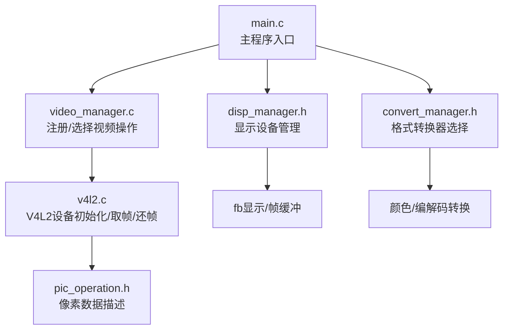
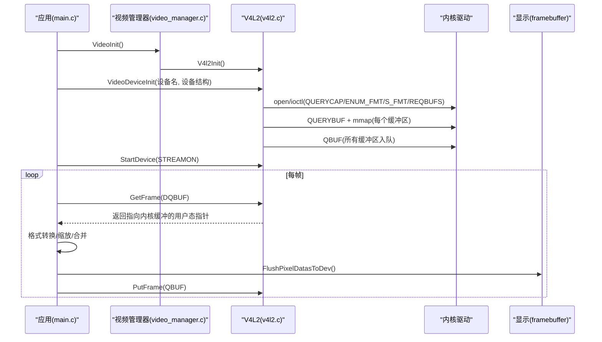
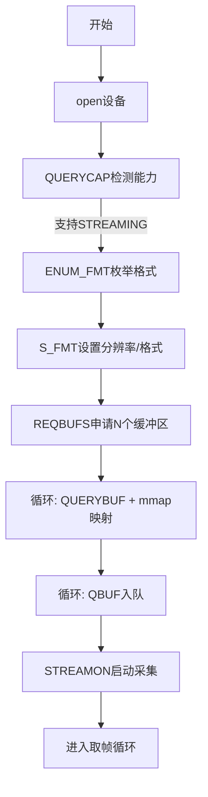
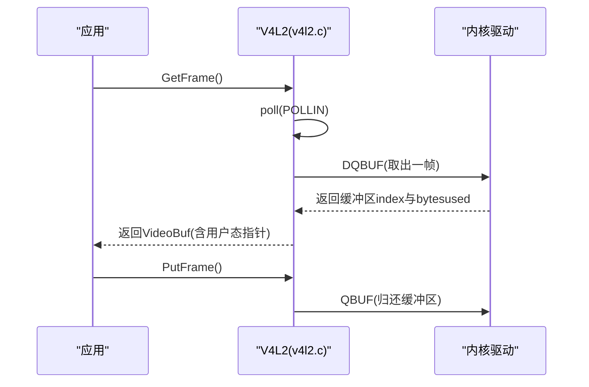
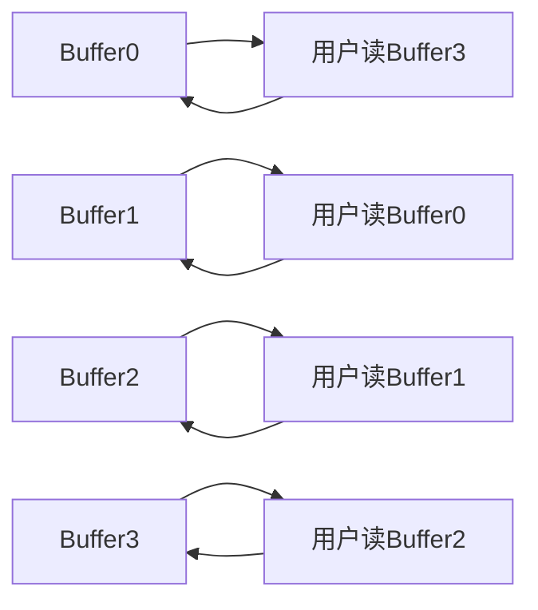
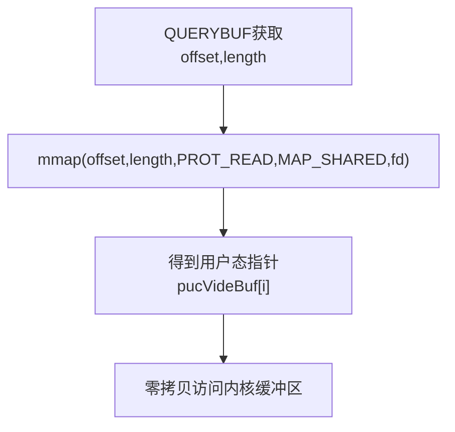
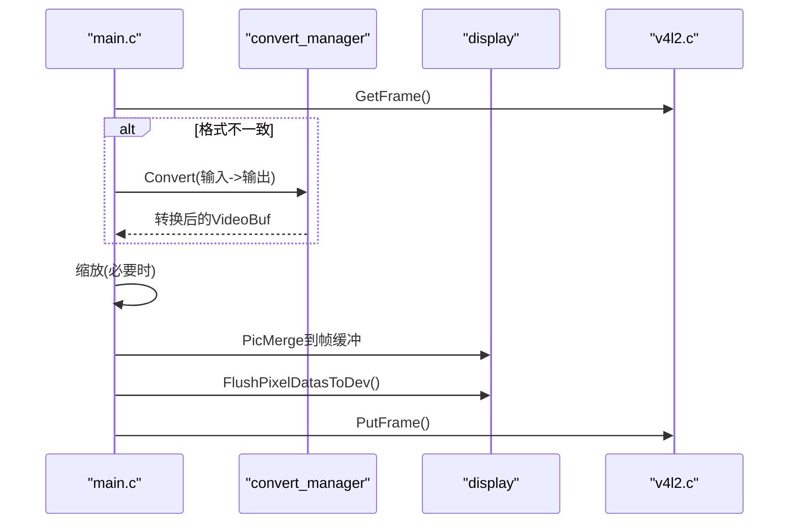
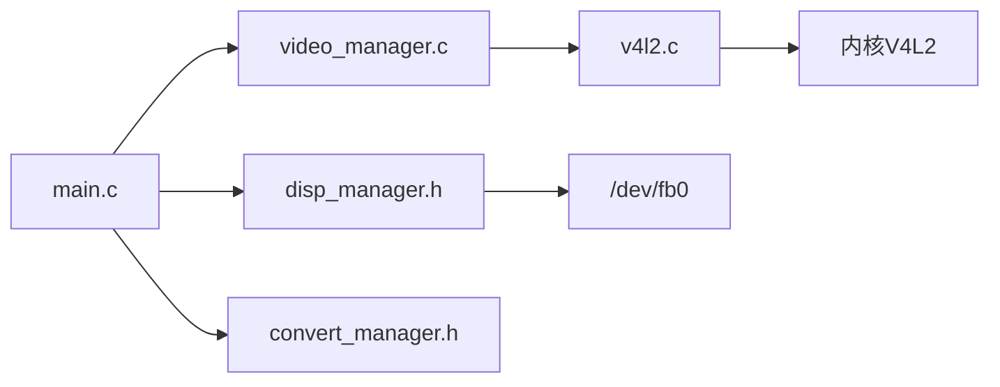

# 视频采集数据流

<cite>
**本文引用的文件**
- [v4l2.c](file://video2lcd/video/v4l2.c)
- [video_manager.c](file://video2lcd/video/video_manager.c)
- [video_manager.h](file://video2lcd/include/video_manager.h)
- [main.c](file://video2lcd/main.c)
- [config.h](file://video2lcd/include/config.h)
- [pic_operation.h](file://video2lcd/include/pic_operation.h)
- [convert_manager.h](file://video2lcd/include/convert_manager.h)
- [disp_manager.h](file://video2lcd/include/disp_manager.h)
- [V4L2关键机制深度解析.md](file://video2lcd/doc/V4L2关键机制深度解析.md)
</cite>

## 目录
1. [简介](#简介)
2. [项目结构](#项目结构)
3. [核心组件](#核心组件)
4. [架构总览](#架构总览)
5. [详细组件分析](#详细组件分析)
6. [依赖关系分析](#依赖关系分析)
7. [性能考量](#性能考量)
8. [故障排查指南](#故障排查指南)
9. [结论](#结论)
10. [附录](#附录)

## 简介
本文件面向嵌入式Linux相机项目，系统化梳理从V4L2设备获取图像数据的完整流程，重点解释：
- 视频缓冲区管理机制（内核与用户空间内存映射mmap）
- GetFrame与PutFrame的工作机制及缓冲区的循环使用策略
- 视频设备初始化过程（打开设备、格式设置、缓冲区分配等）
- 从硬件到应用层的数据流路径图，帮助理解实时视频采集的核心原理

## 项目结构
本项目采用分层模块化设计：
- video：V4L2驱动封装与视频操作接口实现
- display：显示设备管理（framebuffer）
- convert：像素格式转换（YUV/MJPEG/RGB互转）
- render：图像渲染与合成
- include：公共头文件与数据结构定义
- main：主程序入口，串联采集、转换、缩放、显示

图表来源
- [main.c:34-107](file://video2lcd/main.c#L34-L107)
- [video_manager.c:12-75](file://video2lcd/video/video_manager.c#L12-L75)
- [v4l2.c:47-249](file://video2lcd/video/v4l2.c#L47-L249)
- [disp_manager.h:116-233](file://video2lcd/include/disp_manager.h#L116-L233)
- [convert_manager.h:23-43](file://video2lcd/include/convert_manager.h#L23-L43)
- [pic_operation.h:10-17](file://video2lcd/include/pic_operation.h#L10-L17)

章节来源
- [main.c:34-107](file://video2lcd/main.c#L34-L107)
- [video_manager.c:12-75](file://video2lcd/video/video_manager.c#L12-L75)
- [v4l2.c:47-249](file://video2lcd/video/v4l2.c#L47-L249)

## 核心组件
- V4L2设备抽象：通过VideoOpr统一封装InitDevice/ExitDevice/GetFrame/PutFrame/StartDevice/StopDevice等操作，便于多驱动扩展。
- 视频设备状态：VideoDevice保存fd、像素格式、分辨率、缓冲区数量与大小、当前缓冲区索引以及映射后的用户态指针数组。
- 帧数据载体：VideoBuf封装一帧图像的像素数据描述T_PixelDatas和像素格式，作为模块间传递的统一结构。
- 显示与转换：DisplayManager提供framebuffer访问；ConvertManager根据输入输出格式自动选择合适转换器。

章节来源
- [video_manager.h:14-55](file://video2lcd/include/video_manager.h#L14-L55)
- [pic_operation.h:10-17](file://video2lcd/include/pic_operation.h#L10-L17)
- [convert_manager.h:23-43](file://video2lcd/include/convert_manager.h#L23-L43)
- [disp_manager.h:69-96](file://video2lcd/include/disp_manager.h#L69-L96)

## 架构总览
整体数据流：
- 应用层main负责协调：初始化显示、选择并初始化视频模块、启动采集、循环取帧、格式转换、缩放、合并到帧缓冲并刷新显示、归还缓冲区。
- 视频模块通过V4L2的Streaming模式进行零拷贝采集：内核分配缓冲区→mmap映射到用户空间→入队等待填充→poll等待就绪→DQBUF取出处理→QBUF归还。

图表来源
- [main.c:76-181](file://video2lcd/main.c#L76-L181)
- [v4l2.c:47-249](file://video2lcd/video/v4l2.c#L47-L249)
- [v4l2.c:267-326](file://video2lcd/video/v4l2.c#L267-L326)
- [v4l2.c:357-383](file://video2lcd/video/v4l2.c#L357-L383)
- [disp_manager.h:229-233](file://video2lcd/include/disp_manager.h#L229-L233)

## 详细组件分析

### V4L2设备初始化流程
- 打开设备：open("/dev/videoX")，获取文件描述符。
- 能力查询：VIDIOC_QUERYCAP判断是否为视频捕获设备，是否支持streaming/readwrite。
- 格式枚举与设置：VIDIOC_ENUM_FMT遍历支持的像素格式（MJPEG/YUYV/RGB565），VIDIOC_S_FMT设置分辨率与像素格式（可能由驱动调整）。
- 缓冲区申请：VIDIOC_REQBUFS申请多个内核缓冲区（NB_BUFFER个），memory设为MMAP。
- 映射与入队：对每个缓冲区调用VIDIOC_QUERYBUF获取length与offset，再mmap映射到用户空间；随后VIDIOC_QBUF将所有缓冲区入队，等待驱动填充。
- 启动采集：VIDIOC_STREAMON开始采集。

图表来源
- [v4l2.c:47-249](file://video2lcd/video/v4l2.c#L47-L249)
- [V4L2关键机制深度解析.md:117-172](file://video2lcd/doc/V4L2关键机制深度解析.md#L117-L172)

章节来源
- [v4l2.c:47-249](file://video2lcd/video/v4l2.c#L47-L249)
- [V4L2关键机制深度解析.md:117-172](file://video2lcd/doc/V4L2关键机制深度解析.md#L117-L172)

### GetFrame与PutFrame工作机制
- Streaming模式GetFrame：
  - poll等待POLLIN事件，表示有帧数据可用。
  - VIDIOC_DQBUF从内核队列取出一个已填充的缓冲区，记录其index为当前使用缓冲区。
  - 将VideoBuf的像素信息（宽高、bpp、行字节数、总字节数）与指向内核缓冲的用户态指针填充好返回。
- Streaming模式PutFrame：
  - VIDIOC_QBUF将处理完的缓冲区重新入队，供下一帧使用，形成环形缓冲轮转。
- ReadWrite模式GetFrame/PutFrame：
  - 直接read读取一帧到用户malloc的缓冲区，无需队列管理；PutFrame为空操作。

图表来源
- [v4l2.c:267-326](file://video2lcd/video/v4l2.c#L267-L326)

章节来源
- [v4l2.c:267-326](file://video2lcd/video/v4l2.c#L267-L326)

### 视频缓冲区的循环使用策略
- 环形缓冲：内核与用户各维护不同缓冲区，避免竞争。典型时序：
  - t1：内核写buffer0，用户读buffer3（上一轮）
  - t2：内核写buffer1，用户读buffer0
  - t3：内核写buffer2，用户读buffer1
  - t4：内核写buffer3，用户读buffer2
  - t5：内核写buffer0（覆盖旧数据），用户读buffer3
- 优势：流水线式连续采集，零拷贝，低延迟。

图表来源
- [V4L2关键机制深度解析.md:199-212](file://video2lcd/doc/V4L2关键机制深度解析.md#L199-L212)

章节来源
- [V4L2关键机制深度解析.md:199-212](file://video2lcd/doc/V4L2关键机制深度解析.md#L199-L212)

### 内核空间与用户空间的内存映射（mmap）
- 每个缓冲区通过VIDIOC_QUERYBUF获得length与offset，再用mmap映射到用户空间，得到用户态指针pucVideBuf[i]。
- 映射后用户空间指针直接指向内核缓冲区，实现零拷贝。
- 注意：每次mmap使用相同的设备fd，但offset不同，因此映射的是不同的内存区域。

图表来源
- [v4l2.c:161-195](file://video2lcd/video/v4l2.c#L161-L195)
- [V4L2关键机制深度解析.md:176-198](file://video2lcd/doc/V4L2关键机制深度解析.md#L176-L198)

章节来源
- [v4l2.c:161-195](file://video2lcd/video/v4l2.c#L161-L195)
- [V4L2关键机制深度解析.md:176-198](file://video2lcd/doc/V4L2关键机制深度解析.md#L176-L198)

### 主循环中的数据流与显示
- 取帧：GetFrame获取VideoBuf，包含指向内核缓冲的用户态指针。
- 格式转换：若摄像头输出格式与LCD不一致，通过ConvertManager选择合适的转换器进行转换。
- 缩放：当图像尺寸大于LCD时，按保持宽高比计算目标尺寸并执行缩放。
- 合并与显示：将处理后的图像合并到帧缓冲（居中显示），然后刷新到LCD。
- 归还缓冲区：PutFrame将缓冲区重新入队，继续下一帧采集。

图表来源
- [main.c:118-181](file://video2lcd/main.c#L118-L181)
- [convert_manager.h:23-43](file://video2lcd/include/convert_manager.h#L23-L43)
- [disp_manager.h:229-233](file://video2lcd/include/disp_manager.h#L229-L233)

章节来源
- [main.c:118-181](file://video2lcd/main.c#L118-L181)
- [convert_manager.h:23-43](file://video2lcd/include/convert_manager.h#L23-L43)
- [disp_manager.h:229-233](file://video2lcd/include/disp_manager.h#L229-L233)

## 依赖关系分析
- 模块耦合：
  - main依赖video_manager、disp_manager、convert_manager，完成端到端流程。
  - v4l2.c依赖系统V4L2 API与内核驱动，实现底层数据采集。
  - disp_manager提供framebuffer访问与帧缓冲管理。
  - convert_manager根据像素格式动态选择转换器。
- 外部依赖：
  - Linux内核V4L2子系统（videodev2.h）
  - framebuffer设备（/dev/fb0）

图表来源
- [main.c:34-107](file://video2lcd/main.c#L34-L107)
- [video_manager.c:12-75](file://video2lcd/video/video_manager.c#L12-L75)
- [v4l2.c:47-249](file://video2lcd/video/v4l2.c#L47-L249)
- [disp_manager.h:116-233](file://video2lcd/include/disp_manager.h#L116-L233)

章节来源
- [main.c:34-107](file://video2lcd/main.c#L34-L107)
- [video_manager.c:12-75](file://video2lcd/video/video_manager.c#L12-L75)
- [v4l2.c:47-249](file://video2lcd/video/v4l2.c#L47-L249)
- [disp_manager.h:116-233](file://video2lcd/include/disp_manager.h#L116-L233)

## 性能考量
- 零拷贝：通过mmap直接访问内核缓冲区，避免额外数据拷贝，降低CPU与内存带宽占用。
- 环形缓冲：多缓冲区轮转减少阻塞与等待，提升吞吐与实时性。
- 格式转换优化：仅在必要时进行格式转换，且尽量使用高效算法（如最近邻插值缩放）。
- I/O模型：使用poll等待数据就绪，避免忙轮询，提高能效。

[本节为通用指导，不直接分析具体文件]

## 故障排查指南
- 无法打开设备：检查设备路径与权限，确认/dev/videoX存在且可读写。
- 不支持的像素格式：通过VIDIOC_ENUM_FMT枚举并选择设备支持的格式；确保VIDIOC_S_FMT成功。
- 缓冲区映射失败：确认REQBUFS成功后，每个缓冲区的QUERYBUF与mmap均成功；检查offset与length是否正确。
- 取帧失败：检查poll是否返回就绪；DQBUF是否成功；确保至少有一个缓冲区已入队。
- 显示异常：确认帧缓冲获取与刷新函数调用正确；检查图像尺寸与LCD分辨率匹配情况。

章节来源
- [v4l2.c:47-249](file://video2lcd/video/v4l2.c#L47-L249)
- [v4l2.c:267-326](file://video2lcd/video/v4l2.c#L267-L326)
- [main.c:76-181](file://video2lcd/main.c#L76-L181)

## 结论
本项目通过V4L2的Streaming模式实现了高效的实时视频采集：
- 使用内核缓冲区与用户空间mmap映射实现零拷贝
- 通过多缓冲区环形轮转保证连续稳定的数据流
- GetFrame/PutFrame配合poll/DQBUF/QBUF完成取帧与还帧
- 结合格式转换、缩放与显示，形成完整的采集到显示链路

该设计在嵌入式环境中兼顾了性能与实时性，适合相机监控、图像处理等应用场景。

[本节为总结，不直接分析具体文件]

## 附录
- 配置项：调试输出宏、framebuffer设备路径等定义位于config.h。
- 数据结构：像素数据描述T_PixelDatas用于统一表示图像数据，被采集、转换、显示模块广泛使用。

章节来源
- [config.h:13-18](file://video2lcd/include/config.h#L13-L18)
- [pic_operation.h:10-17](file://video2lcd/include/pic_operation.h#L10-L17)