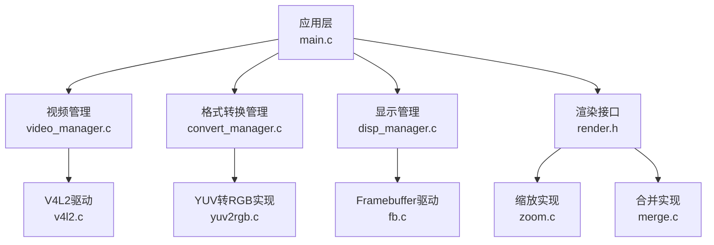
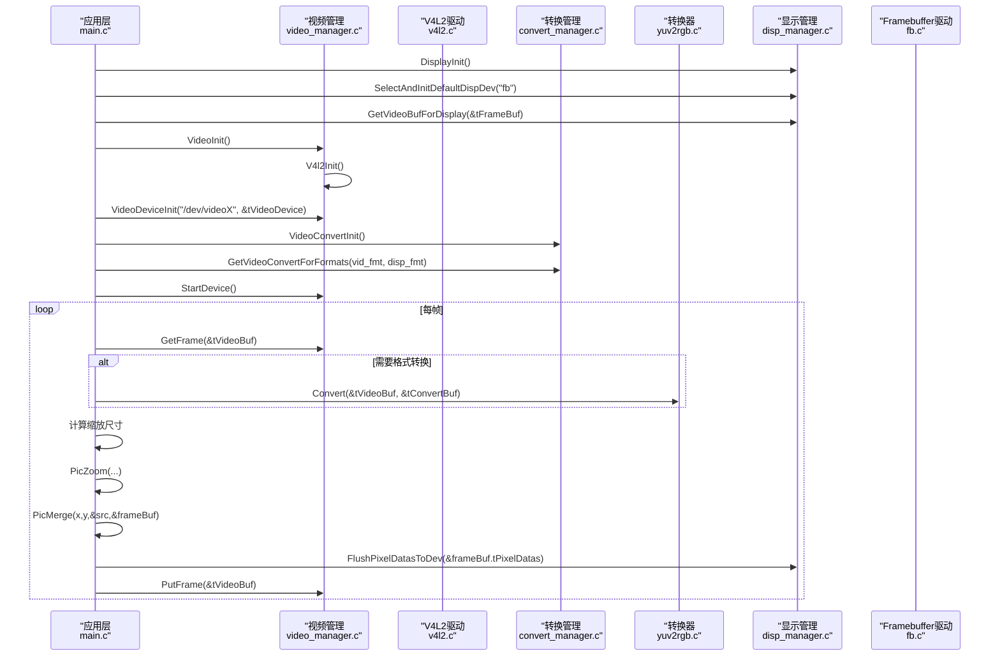
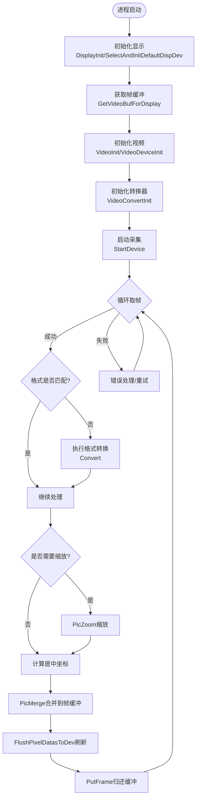
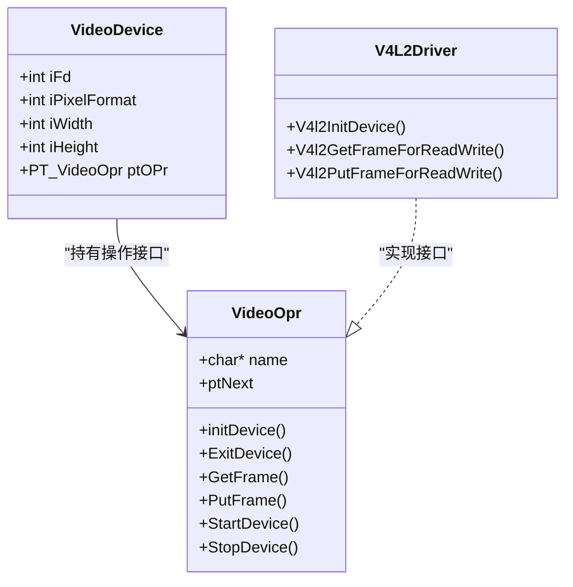
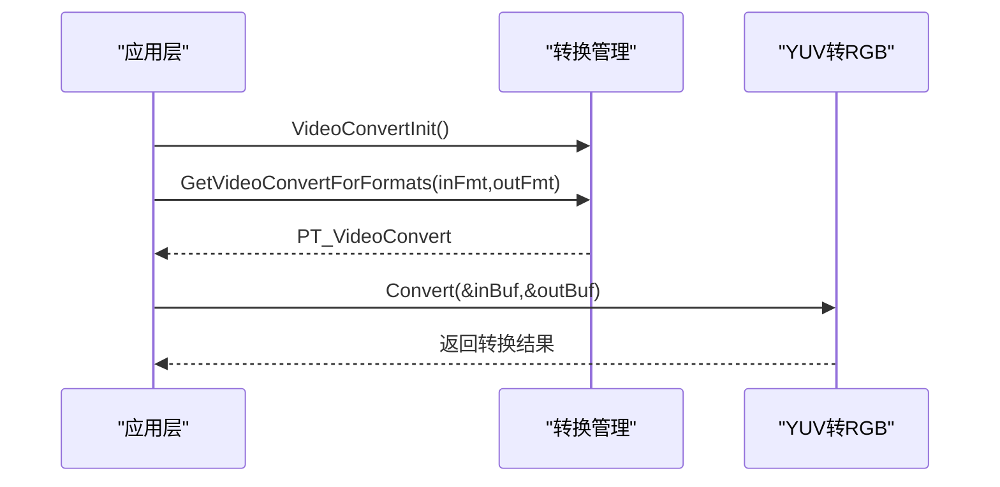
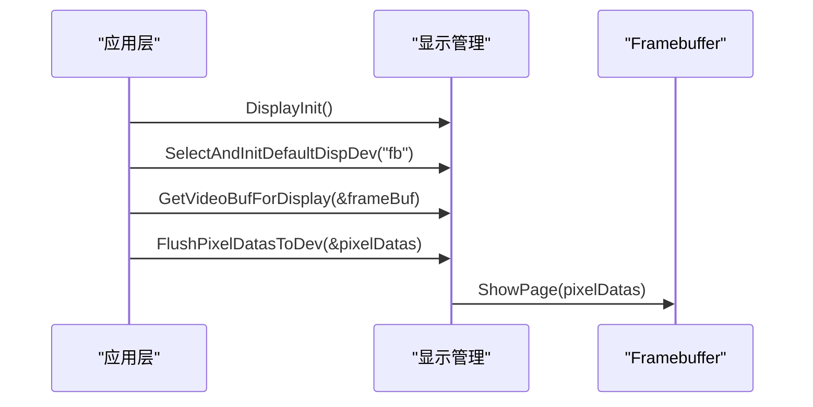
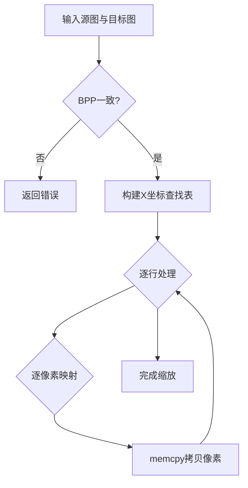
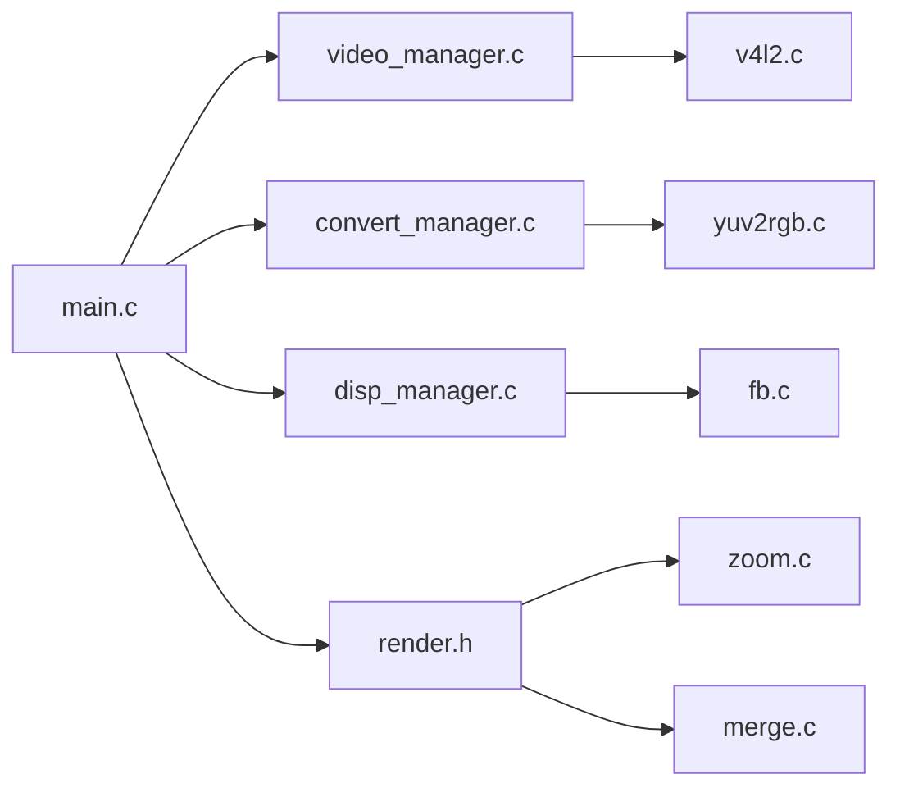

# 架构概览

<cite>
**本文引用的文件**
- [main.c](file://video2lcd/main.c)
- [config.h](file://video2lcd/include/config.h)
- [video_manager.h](file://video2lcd/include/video_manager.h)
- [convert_manager.h](file://video2lcd/include/convert_manager.h)
- [disp_manager.h](file://video2lcd/include/disp_manager.h)
- [render.h](file://video2lcd/include/render.h)
- [pic_operation.h](file://video2lcd/include/pic_operation.h)
- [video_manager.c](file://video2lcd/video/video_manager.c)
- [v4l2.c](file://video2lcd/video/v4l2.c)
- [convert_manager.c](file://video2lcd/convert/convert_manager.c)
- [yuv2rgb.c](file://video2lcd/convert/yuv2rgb.c)
- [disp_manager.c](file://video2lcd/display/disp_manager.c)
- [fb.c](file://video2lcd/display/fb.c)
- [zoom.c](file://video2lcd/render/operation/zoom.c)
- [merge.c](file://video2lcd/render/operation/merge.c)
</cite>

## 目录
1. [简介](#简介)
2. [项目结构](#项目结构)
3. [核心组件](#核心组件)
4. [架构总览](#架构总览)
5. [详细组件分析](#详细组件分析)
6. [依赖关系分析](#依赖关系分析)
7. [性能考虑](#性能考虑)
8. [故障排查指南](#故障排查指南)
9. [结论](#结论)
10. [附录](#附录)

## 简介
本系统为嵌入式Linux相机显示系统，采用分层与插件化设计：应用层负责流程编排；管理层提供设备抽象、格式转换与渲染能力；驱动层对接具体硬件（V4L2摄像头、Framebuffer LCD）。数据流从摄像头采集开始，经格式转换、图像缩放与合并后写入LCD帧缓冲并刷新显示。通过统一的接口抽象，系统可灵活替换不同摄像头驱动、显示设备与图像处理算法。

## 项目结构
- 应用层
  - main.c：主程序入口，协调视频采集、格式转换、图像缩放/合并与显示刷新。
- 管理层
  - video_manager：摄像头设备管理，统一封装V4L2操作接口。
  - convert_manager：格式转换器注册与选择，支持YUV/MJPEG/RGB等转换。
  - disp_manager：显示设备管理，封装Framebuffer等显示驱动，提供VideoMem管理与刷新。
  - render：图像渲染操作（缩放、合并）的通用接口与实现。
- 驱动层
  - v4l2.c：基于V4L2的视频采集驱动实现（streaming模式）。
  - fb.c：基于Framebuffer的显示驱动实现。
- 公共定义
  - config.h：调试宏与设备路径配置。
  - pic_operation.h：像素数据通用描述结构。
  - video_manager.h / convert_manager.h / disp_manager.h / render.h：各模块对外接口头文件。

图表来源
- [main.c:34-192](file://video2lcd/main.c#L34-L192)
- [video_manager.c:67-75](file://video2lcd/video/video_manager.c#L67-L75)
- [convert_manager.c:121-131](file://video2lcd/convert/convert_manager.c#L121-L131)
- [disp_manager.c:514-521](file://video2lcd/display/disp_manager.c#L514-L521)
- [v4l2.c:47-200](file://video2lcd/video/v4l2.c#L47-L200)
- [fb.c:53-94](file://video2lcd/display/fb.c#L53-L94)
- [zoom.c:27-86](file://video2lcd/render/operation/zoom.c#L27-L86)
- [merge.c:20-46](file://video2lcd/render/operation/merge.c#L20-L46)
- [yuv2rgb.c:161-199](file://video2lcd/convert/yuv2rgb.c#L161-L199)

章节来源
- [main.c:34-192](file://video2lcd/main.c#L34-L192)
- [config.h:13-18](file://video2lcd/include/config.h#L13-L18)

## 核心组件
- 应用层（main.c）
  - 初始化显示与视频子系统，获取LCD分辨率与帧缓冲指针。
  - 启动摄像头，循环获取帧，按需进行格式转换、缩放与合并，最终刷新到LCD。
- 视频管理（video_manager.h/.c, v4l2.c）
  - 通过VideoOpr函数指针抽象摄像头操作（初始化、启停、取放帧）。
  - V4L2驱动实现设备能力查询、格式枚举与设置、缓冲区申请与mmap映射、队列操作。
- 格式转换（convert_manager.h/.c, yuv2rgb.c）
  - VideoConvert链表维护多种转换器，按输入输出像素格式自动选择。
  - YUV转RGB实现支持RGB565/RGB32输出。
- 显示管理（disp_manager.h/.c, fb.c）
  - DispOpr函数指针抽象显示设备操作（初始化、清屏、画点、整页显示）。
  - Framebuffer驱动打开/dev/fb0，mmap显存，提供ShowPage将像素数据刷到屏幕。
- 渲染（render.h, zoom.c, merge.c）
  - PicZoom最近邻插值缩放；PicMerge将小图合并到大图指定位置。
- 公共数据结构（pic_operation.h）
  - T_PixelDatas统一描述图像尺寸、色深、行字节数与像素数据指针。

章节来源
- [video_manager.h:14-56](file://video2lcd/include/video_manager.h#L14-L56)
- [convert_manager.h:23-46](file://video2lcd/include/convert_manager.h#L23-L46)
- [disp_manager.h:84-175](file://video2lcd/include/disp_manager.h#L84-L175)
- [render.h:15-36](file://video2lcd/include/render.h#L15-L36)
- [pic_operation.h:10-18](file://video2lcd/include/pic_operation.h#L10-L18)

## 架构总览
系统采用“应用层-管理层-驱动层”的分层架构，并通过“插件式接口”解耦具体硬件与算法：
- 应用层仅依赖管理层提供的统一API，不感知底层设备细节。
- 管理层通过函数指针链表注册具体驱动或算法实现，运行时动态选择。
- 驱动层实现具体设备的初始化、IO与内存映射。

图表来源
- [main.c:63-192](file://video2lcd/main.c#L63-L192)
- [video_manager.c:67-75](file://video2lcd/video/video_manager.c#L67-L75)
- [convert_manager.c:121-131](file://video2lcd/convert/convert_manager.c#L121-L131)
- [disp_manager.c:148-175](file://video2lcd/display/disp_manager.c#L148-L175)
- [v4l2.c:47-200](file://video2lcd/video/v4l2.c#L47-L200)
- [fb.c:166-174](file://video2lcd/display/fb.c#L166-L174)
- [yuv2rgb.c:161-199](file://video2lcd/convert/yuv2rgb.c#L161-L199)

## 详细组件分析

### 应用层（main.c）
- 职责
  - 初始化显示与视频子系统，获取LCD分辨率与帧缓冲。
  - 启动摄像头，进入主循环：取帧→格式转换→缩放→合并→刷新→归还缓冲区。
- 关键流程
  - 显示初始化与默认设备选择。
  - 视频设备初始化与格式协商。
  - 转换器选择与调用。
  - 图像缩放与居中合并。
  - 刷新到LCD并归还视频缓冲。

图表来源
- [main.c:63-192](file://video2lcd/main.c#L63-L192)

章节来源
- [main.c:34-192](file://video2lcd/main.c#L34-L192)

### 视频管理（video_manager.c, v4l2.c）
- 职责
  - 通过VideoOpr函数指针抽象摄像头操作，支持多驱动注册与选择。
  - V4L2驱动实现设备能力查询、格式枚举与设置、缓冲区申请与mmap、队列操作。
- 关键点
  - 使用VIDIOC_*系列ioctl完成设备控制与数据传输。
  - Streaming模式下，缓冲区入队/出队轮转，用户空间直接访问内核映射内存。

图表来源
- [video_manager.h:14-56](file://video2lcd/include/video_manager.h#L14-L56)
- [v4l2.c:47-200](file://video2lcd/video/v4l2.c#L47-L200)

章节来源
- [video_manager.c:67-75](file://video2lcd/video/video_manager.c#L67-L75)
- [v4l2.c:47-200](file://video2lcd/video/v4l2.c#L47-L200)

### 格式转换（convert_manager.c, yuv2rgb.c）
- 职责
  - 维护VideoConvert链表，根据输入输出像素格式选择合适转换器。
  - YUV转RGB实现支持RGB565/RGB32输出。
- 关键点
  - isSupport判断是否支持目标转换。
  - Convert分配输出缓冲并执行转换。

图表来源
- [convert_manager.c:121-131](file://video2lcd/convert/convert_manager.c#L121-L131)
- [yuv2rgb.c:161-199](file://video2lcd/convert/yuv2rgb.c#L161-L199)

章节来源
- [convert_manager.c:23-131](file://video2lcd/convert/convert_manager.c#L23-L131)
- [yuv2rgb.c:25-199](file://video2lcd/convert/yuv2rgb.c#L25-L199)

### 显示管理（disp_manager.c, fb.c）
- 职责
  - 通过DispOpr函数指针抽象显示设备，支持多显示驱动注册与切换。
  - Framebuffer驱动打开/dev/fb0，mmap显存，提供ShowPage刷新。
- 关键点
  - GetVideoBufForDisplay根据BPP设置像素格式并指向显存。
  - FlushPixelDatasToDev调用ShowPage将像素数据输出到LCD。

图表来源
- [disp_manager.c:148-175](file://video2lcd/display/disp_manager.c#L148-L175)
- [fb.c:53-94](file://video2lcd/display/fb.c#L53-L94)
- [fb.c:166-174](file://video2lcd/display/fb.c#L166-L174)

章节来源
- [disp_manager.c:27-175](file://video2lcd/display/disp_manager.c#L27-L175)
- [fb.c:53-174](file://video2lcd/display/fb.c#L53-L174)

### 渲染（render.h, zoom.c, merge.c）
- 职责
  - PicZoom：最近邻插值缩放，保持宽高比。
  - PicMerge：将小图合并到大图指定位置。
- 关键点
  - 缩放前需确保目标缓冲已分配且BPP一致。
  - 合并时校验尺寸与BPP一致性，逐行复制。

图表来源
- [zoom.c:27-86](file://video2lcd/render/operation/zoom.c#L27-L86)
- [merge.c:20-46](file://video2lcd/render/operation/merge.c#L20-L46)

章节来源
- [render.h:15-36](file://video2lcd/include/render.h#L15-L36)
- [zoom.c:27-86](file://video2lcd/render/operation/zoom.c#L27-L86)
- [merge.c:20-46](file://video2lcd/render/operation/merge.c#L20-L46)

## 依赖关系分析
- 应用层依赖管理层API，不直接调用驱动。
- 管理层通过函数指针链表注册具体驱动或算法，运行时动态绑定。
- 驱动层实现具体设备IO与内存映射，向上暴露统一接口。

图表来源
- [main.c:34-192](file://video2lcd/main.c#L34-L192)
- [video_manager.c:67-75](file://video2lcd/video/video_manager.c#L67-L75)
- [convert_manager.c:121-131](file://video2lcd/convert/convert_manager.c#L121-L131)
- [disp_manager.c:514-521](file://video2lcd/display/disp_manager.c#L514-L521)
- [v4l2.c:47-200](file://video2lcd/video/v4l2.c#L47-L200)
- [fb.c:53-94](file://video2lcd/display/fb.c#L53-L94)
- [yuv2rgb.c:161-199](file://video2lcd/convert/yuv2rgb.c#L161-L199)
- [zoom.c:27-86](file://video2lcd/render/operation/zoom.c#L27-L86)
- [merge.c:20-46](file://video2lcd/render/operation/merge.c#L20-L46)

章节来源
- [video_manager.h:14-56](file://video2lcd/include/video_manager.h#L14-L56)
- [convert_manager.h:23-46](file://video2lcd/include/convert_manager.h#L23-L46)
- [disp_manager.h:84-175](file://video2lcd/include/disp_manager.h#L84-L175)

## 性能考虑
- 零拷贝数据通路：V4L2 streaming模式通过mmap将内核缓冲区映射到用户空间，避免额外拷贝。
- 批量刷新：将处理后的一帧像素数据一次性写入显存，减少IO次数。
- 缩放优化：使用坐标查找表减少重复计算，提升缩放效率。
- 内存复用：帧缓冲与VideoMem机制减少频繁分配开销。

[本节为通用性能建议，不直接分析具体文件]

## 故障排查指南
- 显示初始化失败
  - 检查Framebuffer设备路径与权限，确认/dev/fb0可打开。
  - 参考显示初始化与清屏逻辑定位问题。
- 视频设备初始化失败
  - 检查摄像头设备节点是否存在，V4L2能力查询与格式枚举是否成功。
  - 确认缓冲区申请与mmap映射是否成功。
- 格式转换失败
  - 确认输入输出像素格式是否在支持的范围内。
  - 检查转换器isSupport与Convert实现是否正确。
- 显示刷新异常
  - 检查像素数据BPP与LCD一致，确保ShowPage参数正确。
  - 核对帧缓冲地址与长度是否正确。

章节来源
- [fb.c:53-94](file://video2lcd/display/fb.c#L53-L94)
- [fb.c:166-174](file://video2lcd/display/fb.c#L166-L174)
- [v4l2.c:47-200](file://video2lcd/video/v4l2.c#L47-L200)
- [yuv2rgb.c:25-199](file://video2lcd/convert/yuv2rgb.c#L25-L199)

## 结论
本系统通过分层与插件化架构，实现了摄像头采集到LCD显示的完整链路。应用层专注流程编排，管理层提供统一接口抽象，驱动层对接具体硬件。数据流清晰、模块职责明确，便于扩展新设备与新算法。未来可在渲染层引入更多图像处理算法，在显示层支持多设备切换，进一步提升系统的灵活性与可维护性。

## 附录
- 关键数据结构
  - T_PixelDatas：统一描述图像尺寸、色深、行字节数与像素数据指针。
  - T_VideoDevice/T_VideoOpr：摄像头设备状态与操作接口。
  - T_VideoConvert：格式转换器接口。
  - T_DispOpr：显示设备操作接口。
- 关键流程
  - 显示初始化→视频初始化→转换器初始化→启动采集→循环处理→刷新显示→归还缓冲。

[本节为概念性总结，不直接分析具体文件]