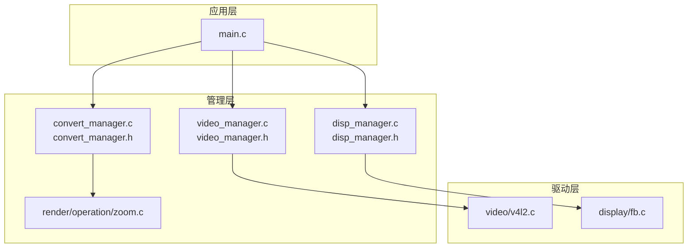
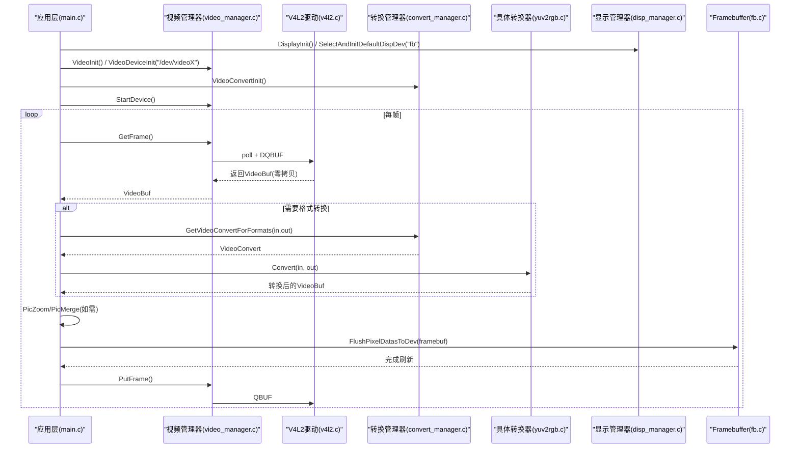
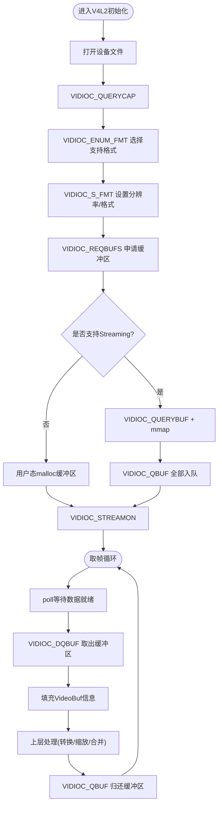
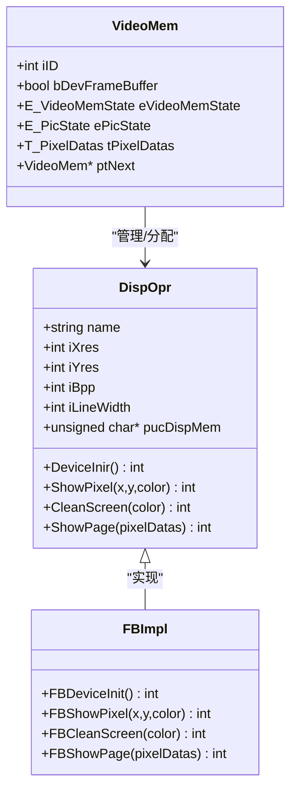
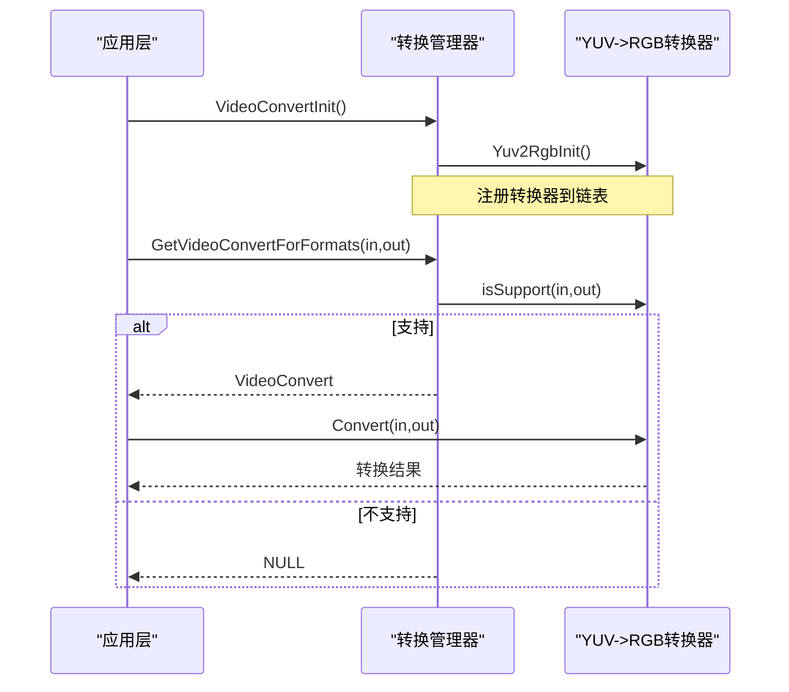
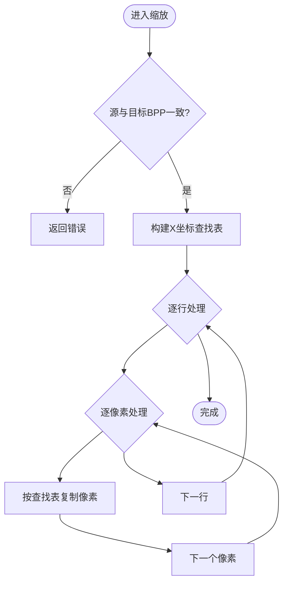
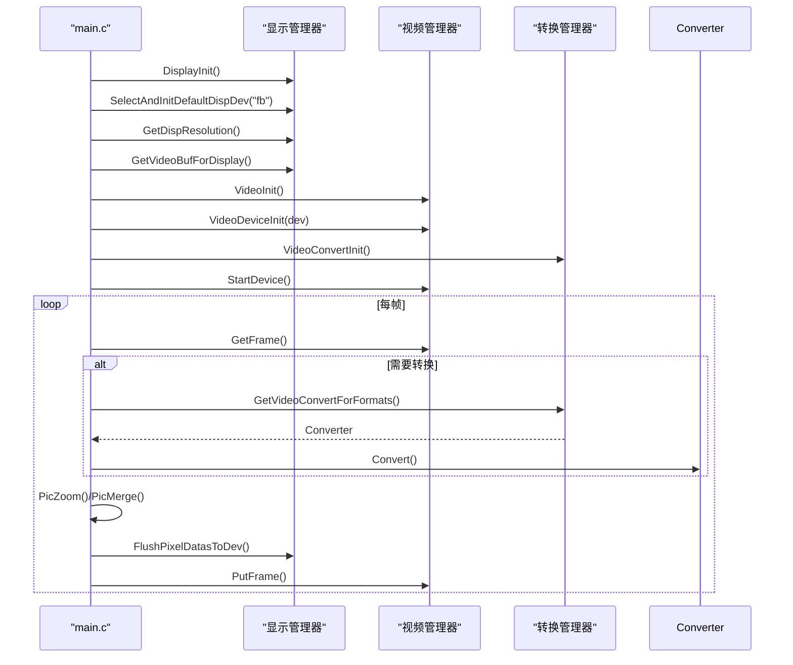
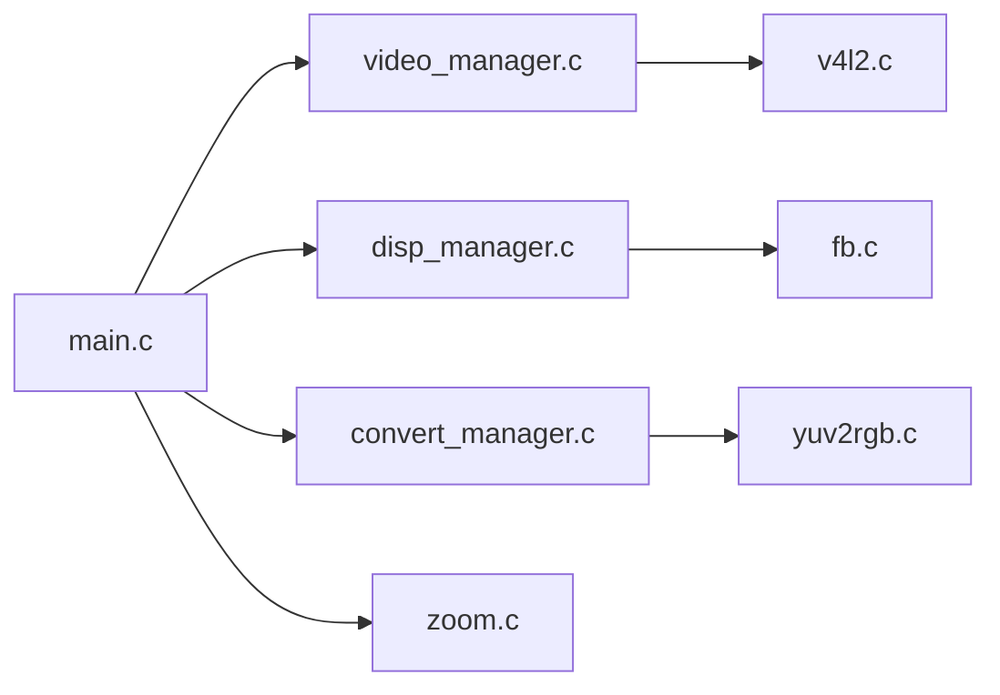

# 系统架构

<cite>
**本文引用的文件**
- [main.c](file://video2lcd/main.c)
- [video_manager.h](file://video2lcd/include/video_manager.h)
- [video_manager.c](file://video2lcd/video/video_manager.c)
- [v4l2.c](file://video2lcd/video/v4l2.c)
- [disp_manager.h](file://video2lcd/include/disp_manager.h)
- [disp_manager.c](file://video2lcd/display/disp_manager.c)
- [fb.c](file://video2lcd/display/fb.c)
- [convert_manager.h](file://video2lcd/include/convert_manager.h)
- [convert_manager.c](file://video2lcd/convert/convert_manager.c)
- [yuv2rgb.c](file://video2lcd/convert/yuv2rgb.c)
- [pic_operation.h](file://video2lcd/include/pic_operation.h)
- [zoom.c](file://video2lcd/render/operation/zoom.c)
- [config.h](file://video2lcd/include/config.h)
</cite>

## 目录
1. [简介](#简介)
2. [项目结构](#项目结构)
3. [核心组件](#核心组件)
4. [架构总览](#架构总览)
5. [详细组件分析](#详细组件分析)
6. [依赖关系分析](#依赖关系分析)
7. [性能考量](#性能考量)
8. [故障排查指南](#故障排查指南)
9. [结论](#结论)
10. [附录](#附录)

## 简介
本系统为嵌入式Linux相机显示系统，采用分层与插件化设计：应用层负责流程编排与用户交互；管理层提供设备管理、格式转换管理与渲染操作；驱动层对接V4L2摄像头与Framebuffer显示设备。系统从摄像头采集图像数据开始，经格式转换、缩放、合并到帧缓冲，最终刷新至LCD显示。整体遵循“接口抽象+动态注册”的插件式架构，并通过工厂模式、策略模式与单例模式等设计模式提升扩展性与可维护性。

## 项目结构
- 应用入口：main.c 编排初始化、采集、转换、缩放、合并与显示流程
- 视频模块：video_manager.h/.c 定义VideoDevice/VideoOpr接口；v4l2.c实现V4L2采集
- 显示模块：disp_manager.h/.c 定义DispOpr接口与VideoMem缓冲池；fb.c实现Framebuffer驱动
- 转换模块：convert_manager.h/.c 定义VideoConvert接口并管理转换器链表；yuv2rgb.c实现YUV->RGB转换
- 渲染模块：render/operation/zoom.c 实现图像缩放（最近邻插值）
- 公共数据结构：include/pic_operation.h 定义像素数据描述T_PixelDatas
- 配置：include/config.h 定义调试宏与设备路径

图表来源
- [main.c:34-192](file://video2lcd/main.c#L34-L192)
- [video_manager.c:1-75](file://video2lcd/video/video_manager.c#L1-L75)
- [disp_manager.c:1-524](file://video2lcd/display/disp_manager.c#L1-L524)
- [convert_manager.c:1-131](file://video2lcd/convert/convert_manager.c#L1-L131)
- [v4l2.c:1-401](file://video2lcd/video/v4l2.c#L1-L401)
- [fb.c:1-253](file://video2lcd/display/fb.c#L1-L253)
- [zoom.c:1-86](file://video2lcd/render/operation/zoom.c#L1-L86)

章节来源
- [main.c:34-192](file://video2lcd/main.c#L34-L192)
- [video_manager.h:14-56](file://video2lcd/include/video_manager.h#L14-L56)
- [disp_manager.h:15-236](file://video2lcd/include/disp_manager.h#L15-L236)
- [convert_manager.h:16-46](file://video2lcd/include/convert_manager.h#L16-L46)
- [config.h:1-21](file://video2lcd/include/config.h#L1-L21)

## 核心组件
- 视频设备管理器（VideoManager）
  - 职责：抽象摄像头设备操作接口，统一封装V4L2设备初始化、缓冲区管理、取帧/还帧、启停流
  - 关键结构：VideoDevice（设备状态）、VideoOpr（函数指针接口）、VideoBuf（帧数据载体）
- 显示设备管理器（DisplayManager）
  - 职责：抽象显示设备操作接口，管理默认显示设备、分辨率查询、VideoMem缓冲池分配与回收、显存映射
  - 关键结构：DispOpr（函数指针接口）、VideoMem（页面缓冲）、Layout（布局）
- 格式转换管理器（ConvertManager）
  - 职责：注册与管理多种格式转换器，根据输入输出像素格式选择合适转换器执行转换
  - 关键结构：VideoConvert（isSupport/Convert/ConvertExit）
- 渲染操作（Render）
  - 职责：提供图像缩放、合并等操作，支撑主循环中的尺寸适配与居中绘制
- 公共数据结构
  - T_PixelDatas：统一描述像素数据的宽、高、色深、行字节数、总字节数与数据指针

章节来源
- [video_manager.h:14-56](file://video2lcd/include/video_manager.h#L14-L56)
- [disp_manager.h:60-236](file://video2lcd/include/disp_manager.h#L60-L236)
- [convert_manager.h:16-46](file://video2lcd/include/convert_manager.h#L16-L46)
- [pic_operation.h:10-18](file://video2lcd/include/pic_operation.h#L10-L18)

## 架构总览
系统采用分层与插件化架构：
- 应用层（main.c）：编排初始化、获取设备能力、启动采集、循环处理帧、显示刷新
- 管理层：
  - VideoManager：通过VideoOpr接口屏蔽底层V4L2差异，支持多设备注册与选择
  - DisplayManager：通过DispOpr接口屏蔽不同显示设备差异，提供VideoMem缓冲池与显存访问
  - ConvertManager：通过VideoConvert接口动态选择并调用具体格式转换算法
- 驱动层：
  - V4L2：基于mmap的零拷贝流式采集，支持多缓冲队列
  - Framebuffer：直接映射LCD显存，支持整页复制与点绘

图表来源
- [main.c:63-189](file://video2lcd/main.c#L63-L189)
- [video_manager.c:67-75](file://video2lcd/video/video_manager.c#L67-L75)
- [v4l2.c:47-249](file://video2lcd/video/v4l2.c#L47-L249)
- [convert_manager.c:121-131](file://video2lcd/convert/convert_manager.c#L121-L131)
- [yuv2rgb.c:218-233](file://video2lcd/convert/yuv2rgb.c#L218-L233)
- [disp_manager.c:148-175](file://video2lcd/display/disp_manager.c#L148-L175)
- [fb.c:166-174](file://video2lcd/display/fb.c#L166-L174)

## 详细组件分析

### 视频设备与V4L2采集
- 设计要点
  - 通过VideoOpr接口抽象摄像头操作，支持多驱动注册与选择
  - V4L2使用mmap将内核缓冲区映射到用户空间，实现零拷贝高效采集
  - 支持Streaming与ReadWrite两种模式，优先使用Streaming
- 关键流程
  - 打开设备、查询能力、枚举格式、设置格式
  - 申请缓冲区、查询并mmap、入队、启动流
  - 取帧：poll等待、DQBUF取出、填充VideoBuf
  - 还帧：QBUF放回队列
- 错误处理
  - 各ioctl失败时打印日志并跳转清理资源

图表来源
- [v4l2.c:47-249](file://video2lcd/video/v4l2.c#L47-L249)
- [v4l2.c:267-326](file://video2lcd/video/v4l2.c#L267-L326)
- [v4l2.c:357-383](file://video2lcd/video/v4l2.c#L357-L383)

章节来源
- [video_manager.h:14-56](file://video2lcd/include/video_manager.h#L14-L56)
- [video_manager.c:1-75](file://video2lcd/video/video_manager.c#L1-L75)
- [v4l2.c:1-401](file://video2lcd/video/v4l2.c#L1-L401)

### 显示设备与Framebuffer
- 设计要点
  - 通过DispOpr接口抽象显示设备，支持多显示驱动注册与切换
  - 使用mmap将/dev/fb0映射到用户空间，获得显存指针pucDispMem
  - 提供GetVideoBufForDisplay直接指向显存，FlushPixelDatasToDev触发ShowPage
- 关键流程
  - 初始化：打开fb设备、获取屏幕信息、mmap显存
  - 清屏：按BPP写入背景色
  - 显示：整页memcpy或直接写显存
- 错误处理
  - 坐标越界、不支持的BPP时返回错误并打印日志

图表来源
- [disp_manager.h:60-236](file://video2lcd/include/disp_manager.h#L60-L236)
- [fb.c:37-94](file://video2lcd/display/fb.c#L37-L94)
- [fb.c:106-174](file://video2lcd/display/fb.c#L106-L174)
- [fb.c:183-253](file://video2lcd/display/fb.c#L183-L253)

章节来源
- [disp_manager.h:15-236](file://video2lcd/include/disp_manager.h#L15-L236)
- [disp_manager.c:1-524](file://video2lcd/display/disp_manager.c#L1-L524)
- [fb.c:1-253](file://video2lcd/display/fb.c#L1-L253)

### 格式转换与插件机制
- 设计要点
  - 通过VideoConvert接口抽象转换算法，支持YUV->RGB、MJPEG->RGB、RGB->RGB等
  - ConvertManager维护转换器链表，提供GetVideoConvertForFormats按输入输出格式自动选择
  - 每个转换器实现isSupport判断能力，Convert执行转换，ConvertExit释放资源
- 关键流程
  - 初始化：调用各转换器Init函数注册自身
  - 选择：遍历链表，调用isSupport匹配
  - 执行：调用Convert进行转换
- 错误处理
  - 无匹配转换器时返回NULL，上层需处理

图表来源
- [convert_manager.c:121-131](file://video2lcd/convert/convert_manager.c#L121-L131)
- [convert_manager.c:98-111](file://video2lcd/convert/convert_manager.c#L98-L111)
- [yuv2rgb.c:218-233](file://video2lcd/convert/yuv2rgb.c#L218-L233)
- [yuv2rgb.c:25-34](file://video2lcd/convert/yuv2rgb.c#L25-L34)

章节来源
- [convert_manager.h:16-46](file://video2lcd/include/convert_manager.h#L16-L46)
- [convert_manager.c:1-131](file://video2lcd/convert/convert_manager.c#L1-L131)
- [yuv2rgb.c:1-233](file://video2lcd/convert/yuv2rgb.c#L1-L233)

### 渲染与缩放
- 设计要点
  - 使用最近邻插值算法进行图像缩放，计算简单、速度快
  - 缩放前需确保源与目标BPP一致，否则返回错误
  - 主循环中根据LCD分辨率决定是否缩放，并计算居中位置
- 关键流程
  - 计算缩放后宽高以保持比例
  - 构建X坐标查找表，逐行复制像素
- 错误处理
  - BPP不匹配或内存分配失败时返回错误

图表来源
- [zoom.c:27-86](file://video2lcd/render/operation/zoom.c#L27-L86)

章节来源
- [zoom.c:1-86](file://video2lcd/render/operation/zoom.c#L1-L86)
- [main.c:141-179](file://video2lcd/main.c#L141-L179)

### 应用层主流程
- 设计要点
  - 先初始化显示与视频设备，再初始化转换模块
  - 获取LCD分辨率与帧缓冲，启动摄像头采集
  - 循环取帧、按需转换、缩放、合并到帧缓冲、刷新显示、归还缓冲区
- 关键流程
  - 初始化：DisplayInit、SelectAndInitDefaultDispDev、VideoInit、VideoDeviceInit、VideoConvertInit
  - 获取帧：GetFrame，必要时Convert，PicZoom/PicMerge，FlushPixelDatasToDev，PutFrame
- 错误处理
  - 任一阶段失败均打印日志并退出

图表来源
- [main.c:63-189](file://video2lcd/main.c#L63-L189)
- [disp_manager.c:148-175](file://video2lcd/display/disp_manager.c#L148-L175)
- [video_manager.c:67-75](file://video2lcd/video/video_manager.c#L67-L75)
- [convert_manager.c:121-131](file://video2lcd/convert/convert_manager.c#L121-L131)

章节来源
- [main.c:34-192](file://video2lcd/main.c#L34-L192)

## 依赖关系分析
- 模块耦合
  - main.c依赖video_manager、disp_manager、convert_manager、render接口
  - video_manager依赖v4l2实现；disp_manager依赖fb实现；convert_manager依赖具体转换器
- 外部依赖
  - Linux内核V4L2与Framebuffer子系统
  - 标准库malloc/free、mmap、poll等
- 潜在循环依赖
  - 当前结构清晰，未见循环依赖

图表来源
- [main.c:34-192](file://video2lcd/main.c#L34-L192)
- [video_manager.c:1-75](file://video2lcd/video/video_manager.c#L1-L75)
- [disp_manager.c:1-524](file://video2lcd/display/disp_manager.c#L1-L524)
- [convert_manager.c:1-131](file://video2lcd/convert/convert_manager.c#L1-L131)
- [v4l2.c:1-401](file://video2lcd/video/v4l2.c#L1-L401)
- [fb.c:1-253](file://video2lcd/display/fb.c#L1-L253)
- [yuv2rgb.c:1-233](file://video2lcd/convert/yuv2rgb.c#L1-L233)
- [zoom.c:1-86](file://video2lcd/render/operation/zoom.c#L1-L86)

章节来源
- [video_manager.h:14-56](file://video2lcd/include/video_manager.h#L14-L56)
- [disp_manager.h:60-236](file://video2lcd/include/disp_manager.h#L60-L236)
- [convert_manager.h:16-46](file://video2lcd/include/convert_manager.h#L16-L46)

## 性能考量
- 零拷贝技术
  - V4L2使用mmap将内核缓冲区映射到用户空间，避免内核态与用户态之间的数据拷贝
  - Framebuffer同样通过mmap直接访问显存，减少复制开销
- 缓冲区池设计
  - VideoMem链表管理多页缓冲，支持空闲/准备/当前显示状态，提高并发与复用效率
  - 首次分配设备framebuffer对应的VideoMem，后续分配普通内存缓冲用于加速显示
- 转换与缩放优化
  - 使用查找表与逐行复制减少计算量
  - 仅在必要时进行缩放，保持原始比例避免失真
- 建议
  - 增加线程安全与锁机制以支持多线程场景
  - 引入更高效的插值算法（如双线性）以提升画质
  - 对频繁分配的内存进行池化管理，减少malloc/free开销

[本节为通用性能讨论，无需特定文件引用]

## 故障排查指南
- 常见问题
  - 无法打开设备：检查设备路径与权限
  - 格式不支持：确认摄像头支持的像素格式与转换器支持范围
  - 显示异常：检查BPP与分辨率设置是否正确
- 定位方法
  - 启用调试输出，查看各阶段错误码与日志
  - 逐步注释流程代码，缩小问题范围
- 恢复措施
  - 重新初始化设备与缓冲区
  - 更换转换器或调整参数

章节来源
- [v4l2.c:47-249](file://video2lcd/video/v4l2.c#L47-L249)
- [fb.c:106-174](file://video2lcd/display/fb.c#L106-L174)
- [convert_manager.c:98-111](file://video2lcd/convert/convert_manager.c#L98-L111)

## 结论
本系统通过分层与插件化架构实现了摄像头数据采集到LCD显示的完整链路。VideoManager、DisplayManager与ConvertManager分别抽象了设备操作、显示管理与格式转换，支持多驱动与多算法的动态注册与选择。V4L2与Framebuffer的零拷贝机制显著提升了性能，VideoMem缓冲池设计进一步优化了显示效率。整体设计清晰、可扩展性强，适合在嵌入式平台上部署与维护。

[本节为总结性内容，无需特定文件引用]

## 附录
- 关键数据结构
  - T_PixelDatas：像素数据描述
  - T_VideoDevice/T_VideoOpr：视频设备与操作接口
  - T_DispOpr/T_VideoMem：显示设备与页面缓冲
  - T_VideoConvert：格式转换器接口
- 设计模式应用
  - 工厂模式：ConvertManager根据输入输出格式创建合适的转换器
  - 策略模式：不同转换算法通过VideoConvert接口实现，运行时选择
  - 单例模式：设备管理器维护全局链表头与默认设备实例

章节来源
- [pic_operation.h:10-18](file://video2lcd/include/pic_operation.h#L10-L18)
- [video_manager.h:14-56](file://video2lcd/include/video_manager.h#L14-L56)
- [disp_manager.h:60-236](file://video2lcd/include/disp_manager.h#L60-L236)
- [convert_manager.h:16-46](file://video2lcd/include/convert_manager.h#L16-L46)