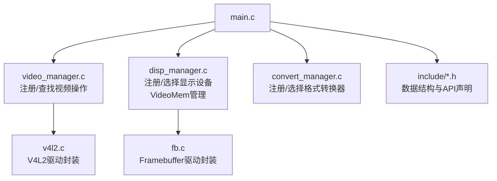
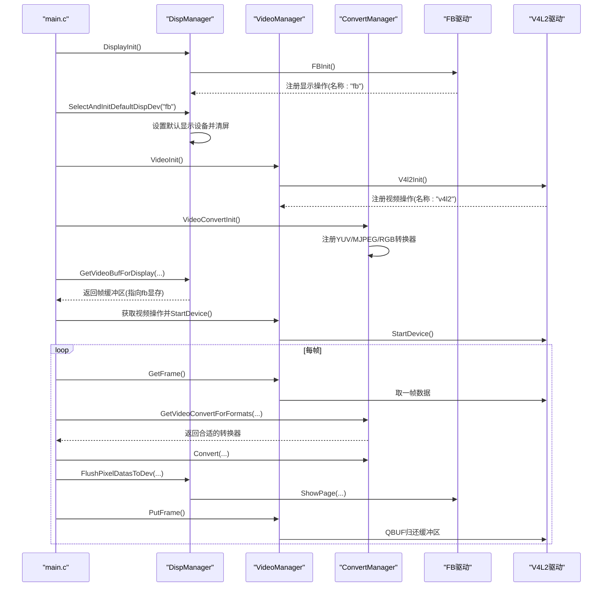
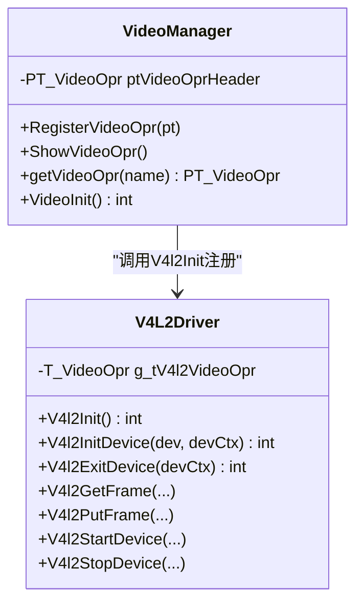
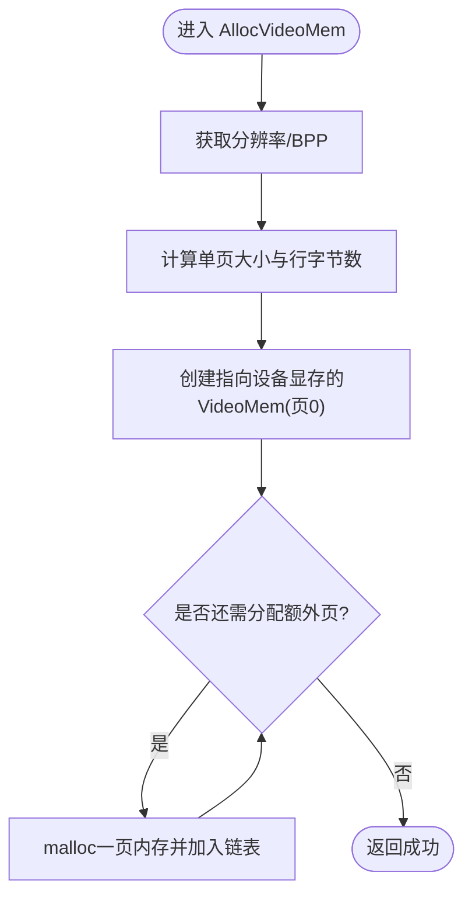
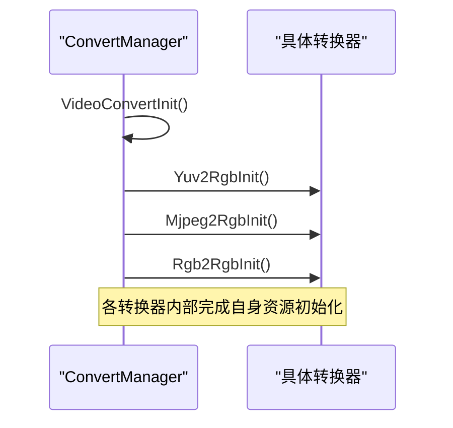
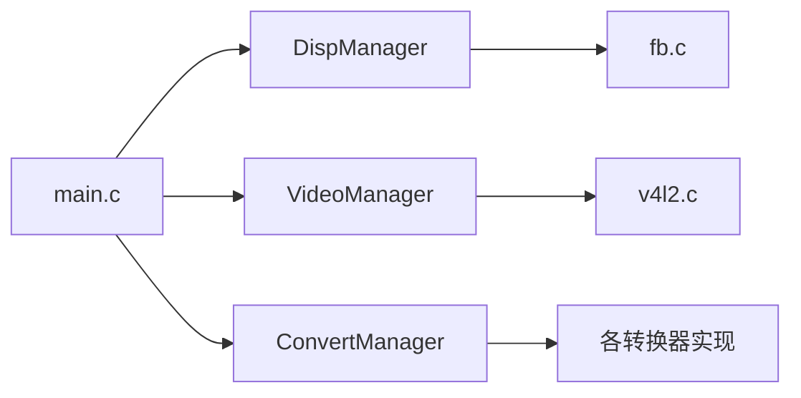

# 单例模式应用

<cite>
**本文引用的文件**
- [main.c](file://video2lcd/main.c)
- [video_manager.h](file://video2lcd/include/video_manager.h)
- [video_manager.c](file://video2lcd/video/video_manager.c)
- [v4l2.c](file://video2lcd/video/v4l2.c)
- [disp_manager.h](file://video2lcd/include/disp_manager.h)
- [disp_manager.c](file://video2lcd/display/disp_manager.c)
- [fb.c](file://video2lcd/display/fb.c)
- [convert_manager.h](file://video2lcd/include/convert_manager.h)
- [convert_manager.c](file://video2lcd/convert/convert_manager.c)
- [config.h](file://video2lcd/include/config.h)
</cite>

## 目录
1. [简介](#简介)
2. [项目结构](#项目结构)
3. [核心组件](#核心组件)
4. [架构总览](#架构总览)
5. [详细组件分析](#详细组件分析)
6. [依赖关系分析](#依赖关系分析)
7. [性能与线程安全考量](#性能与线程安全考量)
8. [故障排查指南](#故障排查指南)
9. [结论](#结论)
10. [附录：使用示例与生命周期管理](#附录使用示例与生命周期管理)

## 简介
本文件围绕嵌入式Linux相机项目中“管理器模块”的单例化设计进行系统化说明。重点解释 VideoManager、DispManager、ConvertManager 如何通过全局唯一实例（以静态链表头+默认实例指针的形式实现）来集中管理设备资源，避免重复初始化，并提供统一的访问入口。文档涵盖：
- 各管理器的单例机制与全局变量使用
- 初始化检查与生命周期管理（初始化、资源分配、清理）
- 多线程环境下的注意事项与一致性保障建议
- 在系统架构中的作用与收益（集中管理、避免重复初始化、统一接口等）
- 正确获取和使用单例实例的调用流程（以代码路径引用代替直接粘贴代码）

## 项目结构
本项目采用按功能域划分的模块化组织方式：
- video：视频采集（V4L2）与视频操作注册表
- display：显示设备（Framebuffer）与显示操作注册表、VideoMem缓冲池
- convert：格式转换器注册表与选择器
- include：公共头文件与配置宏
- main.c：主程序编排初始化、采集、转换、缩放、显示流程

图表来源
- [main.c:63-93](file://video2lcd/main.c#L63-L93)
- [video_manager.c:12-74](file://video2lcd/video/video_manager.c#L12-L74)
- [disp_manager.c:27-113](file://video2lcd/display/disp_manager.c#L27-L113)
- [convert_manager.c:23-130](file://video2lcd/convert/convert_manager.c#L23-L130)
- [v4l2.c:387-401](file://video2lcd/video/v4l2.c#L387-L401)
- [fb.c:249-252](file://video2lcd/display/fb.c#L249-L252)

章节来源
- [main.c:34-93](file://video2lcd/main.c#L34-L93)
- [video_manager.c:1-75](file://video2lcd/video/video_manager.c#L1-L75)
- [disp_manager.c:1-113](file://video2lcd/display/disp_manager.c#L1-L113)
- [convert_manager.c:1-131](file://video2lcd/convert/convert_manager.c#L1-L131)
- [v4l2.c:47-249](file://video2lcd/video/v4l2.c#L47-L249)
- [fb.c:53-94](file://video2lcd/display/fb.c#L53-L94)

## 核心组件
- VideoManager：维护一个全局的视频操作链表（ptVideoOprHeader），通过 RegisterVideoOpr 将具体驱动（如 V4L2）注册到链表中；提供 ShowVideoOpr、getVideoOpr 等工具函数；VideoInit 负责触发底层驱动注册。
- DispManager：维护显示操作链表（g_ptDispOprHead）、默认显示设备指针（g_ptDefaultDispOpr）以及 VideoMem 缓冲链表（g_ptVideoMemHead）。提供 DisplayInit、SelectAndInitDefaultDispDev、GetDefaultDispDev、GetVideoBufForDisplay、FlushPixelDatasToDev 等接口。
- ConvertManager：维护格式转换器链表（g_ptVideoConvertHead），支持 YUV->RGB、MJPEG->RGB、RGB->RGB 等转换器的注册与选择；VideoConvertInit 统一初始化各转换器。

这些管理器均以“静态全局变量 + 注册表”的方式实现“全局唯一实例”的效果：每个模块只维护一份全局状态，所有模块间通过统一 API 访问，从而避免重复初始化与资源竞争。

章节来源
- [video_manager.c:4-74](file://video2lcd/video/video_manager.c#L4-L74)
- [disp_manager.c:13-113](file://video2lcd/display/disp_manager.c#L13-L113)
- [convert_manager.c:13-130](file://video2lcd/convert/convert_manager.c#L13-L130)

## 架构总览
下图展示了从 main 启动到三个管理器协同工作的整体流程，体现单例化的注册与选择机制。

图表来源
- [main.c:63-93](file://video2lcd/main.c#L63-L93)
- [disp_manager.c:514-521](file://video2lcd/display/disp_manager.c#L514-L521)
- [fb.c:249-252](file://video2lcd/display/fb.c#L249-L252)
- [video_manager.c:67-74](file://video2lcd/video/video_manager.c#L67-L74)
- [v4l2.c:387-401](file://video2lcd/video/v4l2.c#L387-L401)
- [convert_manager.c:121-130](file://video2lcd/convert/convert_manager.c#L121-L130)

## 详细组件分析

### VideoManager 单例机制与生命周期
- 全局唯一性：通过静态全局链表头 ptVideoOprHeader 维护已注册的视频操作集合，确保进程内仅有一份注册表。
- 注册流程：RegisterVideoOpr 将驱动提供的 T_VideoOpr 结构体尾插到链表中；ShowVideoOpr/getVideoOpr 用于调试与查找。
- 初始化：VideoInit 调用 V4l2Init，后者构造 g_tV4l2VideoOpr 并注册到 VideoManager。
- 资源管理：V4L2 驱动内部负责打开设备、mmap 缓冲区、入队/出队、启停流；VideoManager 不持有具体设备句柄，仅暴露统一接口。

图表来源
- [video_manager.c:4-74](file://video2lcd/video/video_manager.c#L4-L74)
- [v4l2.c:387-401](file://video2lcd/video/v4l2.c#L387-L401)
- [v4l2.c:47-249](file://video2lcd/video/v4l2.c#L47-L249)

章节来源
- [video_manager.c:12-74](file://video2lcd/video/video_manager.c#L12-L74)
- [v4l2.c:47-249](file://video2lcd/video/v4l2.c#L47-L249)

### DispManager 单例机制与生命周期
- 全局唯一性：g_ptDispOprHead 为显示操作链表头；g_ptDefaultDispOpr 保存当前选中的默认显示设备；g_ptVideoMemHead 为 VideoMem 缓冲链表头。
- 注册与选择：RegisterDispOpr 将驱动（如 fb）注册到链表；SelectAndInitDefaultDispDev 根据名称选择并初始化默认设备；GetDefaultDispDev 返回默认设备指针。
- 帧缓冲与刷新：GetVideoBufForDisplay 填充帧缓冲区信息并指向 fb 显存；FlushPixelDatasToDev 调用默认设备的 ShowPage 完成刷新。
- VideoMem 管理：AllocVideoMem 分配多页缓冲（含设备显存映射页），GetVideoMem/PutVideoMem 管理缓冲的使用状态与图像生成状态，ClearVideoMem/ClearVideoMemRegion 支持整屏或区域清屏。

图表来源
- [disp_manager.c:188-259](file://video2lcd/display/disp_manager.c#L188-L259)

章节来源
- [disp_manager.c:27-113](file://video2lcd/display/disp_manager.c#L27-L113)
- [disp_manager.c:148-175](file://video2lcd/display/disp_manager.c#L148-L175)
- [disp_manager.c:188-337](file://video2lcd/display/disp_manager.c#L188-L337)
- [fb.c:53-94](file://video2lcd/display/fb.c#L53-L94)

### ConvertManager 单例机制与生命周期
- 全局唯一性：g_ptVideoConvertHead 为转换器链表头，保证进程内仅有一份转换器注册表。
- 注册与选择：RegisterVideoConvert 将具体转换器（YUV->RGB、MJPEG->RGB、RGB->RGB）注册到链表；GetVideoConvertForFormats 遍历链表，调用 isSupport 判断是否支持指定输入输出格式，返回匹配的转换器。
- 初始化：VideoConvertInit 依次调用各转换器的 Init 函数完成初始化。

图表来源
- [convert_manager.c:121-130](file://video2lcd/convert/convert_manager.c#L121-L130)

章节来源
- [convert_manager.c:23-130](file://video2lcd/convert/convert_manager.c#L23-L130)

## 依赖关系分析
- main.c 依赖三个管理器：先初始化显示（DisplayInit -> FBInit），再初始化视频（VideoInit -> V4l2Init），最后初始化转换（VideoConvertInit）。
- 视频采集流程中，main 通过 VideoManager 获取视频操作接口，调用 V4L2 驱动进行取帧/还帧/启停。
- 显示流程中，main 通过 DispManager 获取帧缓冲区并刷新到 fb。
- 转换流程中，main 通过 ConvertManager 选择合适的转换器执行像素格式转换。

图表来源
- [main.c:63-93](file://video2lcd/main.c#L63-L93)
- [disp_manager.c:514-521](file://video2lcd/display/disp_manager.c#L514-L521)
- [video_manager.c:67-74](file://video2lcd/video/video_manager.c#L67-L74)
- [convert_manager.c:121-130](file://video2lcd/convert/convert_manager.c#L121-L130)

章节来源
- [main.c:63-93](file://video2lcd/main.c#L63-L93)

## 性能与线程安全考量
- 性能特性
  - 单例注册表：避免重复初始化与重复分配，减少系统调用与内存开销。
  - 零拷贝/少拷贝：V4L2 使用 mmap 将内核缓冲区映射到用户空间，减少数据拷贝；DispManager 的 GetVideoBufForDisplay 直接指向 fb 显存，刷新时尽量复用或最小拷贝。
  - VideoMem 缓冲池：预分配多页缓冲，降低频繁 malloc/free 的开销，提升显示吞吐。
- 线程安全现状与建议
  - 当前实现未引入互斥锁保护全局链表与默认设备指针，适合单线程或外部同步的场景。
  - 若需多线程并发访问，建议在以下关键点加锁：
    - Register* 系列函数（注册时修改链表头/尾）
    - SelectAndInitDefaultDispDev（修改默认设备指针）
    - GetVideoMem/PutVideoMem（修改缓冲状态）
    - 任何对 g_ptDefaultDispOpr、g_ptVideoMemHead 的读写
  - 可考虑使用 pthread_mutex 或原子操作，确保初始化和状态变更的原子性。

[本节为通用指导，不直接分析具体文件]

## 故障排查指南
- 显示初始化失败
  - 现象：DisplayInit 返回错误
  - 可能原因：无法打开 /dev/fb0、ioctl 失败、mmap 失败
  - 定位参考：fb.c 的 FBDeviceInit 与 FBInit
- 视频初始化失败
  - 现象：VideoInit 或 V4l2InitDevice 返回错误
  - 可能原因：无法打开 /dev/videoX、不支持所需格式、REQBUFS/QBUF 失败
  - 定位参考：v4l2.c 的 V4l2InitDevice 与 V4l2Init
- 无合适转换器
  - 现象：GetVideoConvertForFormats 返回 NULL
  - 可能原因：未注册对应转换器或未调用 VideoConvertInit
  - 定位参考：convert_manager.c 的 VideoConvertInit 与 GetVideoConvertForFormats
- 显示刷新异常
  - 现象：FlushPixelDatasToDev 后屏幕无变化
  - 可能原因：未选择默认显示设备、ShowPage 参数不正确
  - 定位参考：disp_manager.c 的 SelectAndInitDefaultDispDev 与 FlushPixelDatasToDev

章节来源
- [fb.c:53-94](file://video2lcd/display/fb.c#L53-L94)
- [v4l2.c:47-249](file://video2lcd/video/v4l2.c#L47-L249)
- [convert_manager.c:98-130](file://video2lcd/convert/convert_manager.c#L98-L130)
- [disp_manager.c:100-113](file://video2lcd/display/disp_manager.c#L100-L113)
- [disp_manager.c:172-175](file://video2lcd/display/disp_manager.c#L172-L175)

## 结论
本项目通过“静态全局变量 + 注册表”的方式实现了 VideoManager、DispManager、ConvertManager 的全局唯一实例管理，达到集中管理设备资源、避免重复初始化、统一接口的目的。该设计简洁高效，适合嵌入式场景。对于多线程环境，应补充必要的同步机制以保证单例一致性与资源安全。

[本节为总结性内容，不直接分析具体文件]

## 附录：使用示例与生命周期管理

### 正确获取与使用单例实例的流程
- 显示模块
  - 初始化：调用 DisplayInit（内部调用 FBInit 注册 fb 驱动）
  - 选择默认设备：调用 SelectAndInitDefaultDispDev("fb")
  - 获取分辨率：调用 GetDispResolution
  - 获取帧缓冲：调用 GetVideoBufForDisplay
  - 刷新显示：调用 FlushPixelDatasToDev
- 视频模块
  - 初始化：调用 VideoInit（内部调用 V4l2Init 注册 v4l2 驱动）
  - 设备初始化：调用 VideoDeviceInit（由上层封装，内部使用 V4L2 接口）
  - 启停与取还帧：通过 tVideoDevice.ptOPr 指向的函数指针调用 StartDevice/GetFrame/PutFrame/StopDevice
- 转换模块
  - 初始化：调用 VideoConvertInit（注册并初始化各转换器）
  - 选择转换器：调用 GetVideoConvertForFormats(输入格式, 输出格式)
  - 执行转换：调用 Convert/ConvertExit

章节来源
- [main.c:63-93](file://video2lcd/main.c#L63-L93)
- [disp_manager.c:514-521](file://video2lcd/display/disp_manager.c#L514-L521)
- [video_manager.c:67-74](file://video2lcd/video/video_manager.c#L67-L74)
- [convert_manager.c:121-130](file://video2lcd/convert/convert_manager.c#L121-L130)

### 生命周期管理与资源清理
- 显示模块
  - 初始化：FBDeviceInit 打开 /dev/fb0、获取屏幕信息、mmap 显存
  - 资源释放：fb.c 未提供显式关闭接口，实际应用中应在退出时 close(fd)、munmap(pucDispMem)
- 视频模块
  - 初始化：V4l2InitDevice 打开设备、枚举格式、申请并映射缓冲区、入队
  - 资源释放：V4l2ExitDevice 释放 mmap 缓冲区并关闭 fd
- 转换模块
  - 初始化：各转换器内部完成自身资源准备
  - 资源释放：ConvertExit 由具体转换器实现，按需释放

章节来源
- [fb.c:53-94](file://video2lcd/display/fb.c#L53-L94)
- [v4l2.c:251-265](file://video2lcd/video/v4l2.c#L251-L265)
- [convert_manager.c:121-130](file://video2lcd/convert/convert_manager.c#L121-L130)