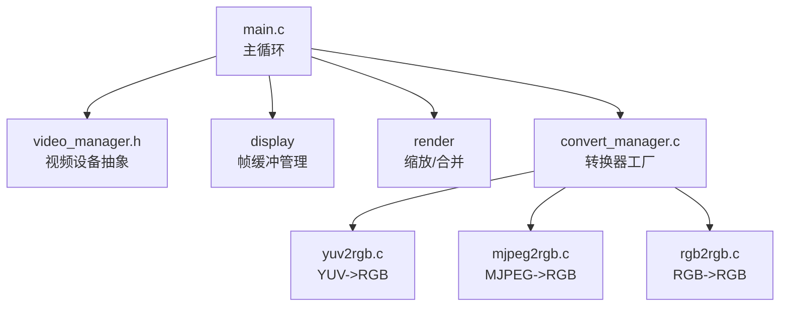
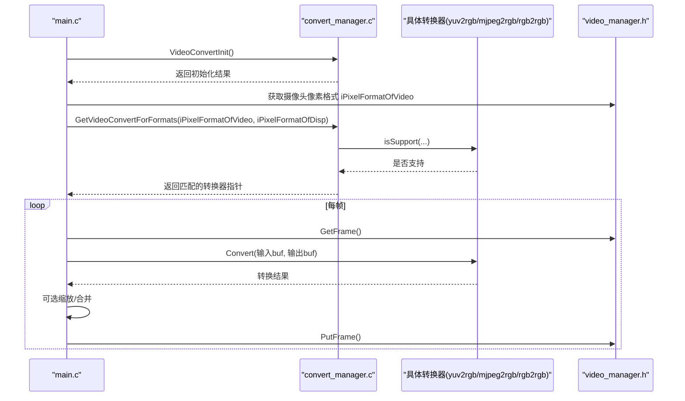
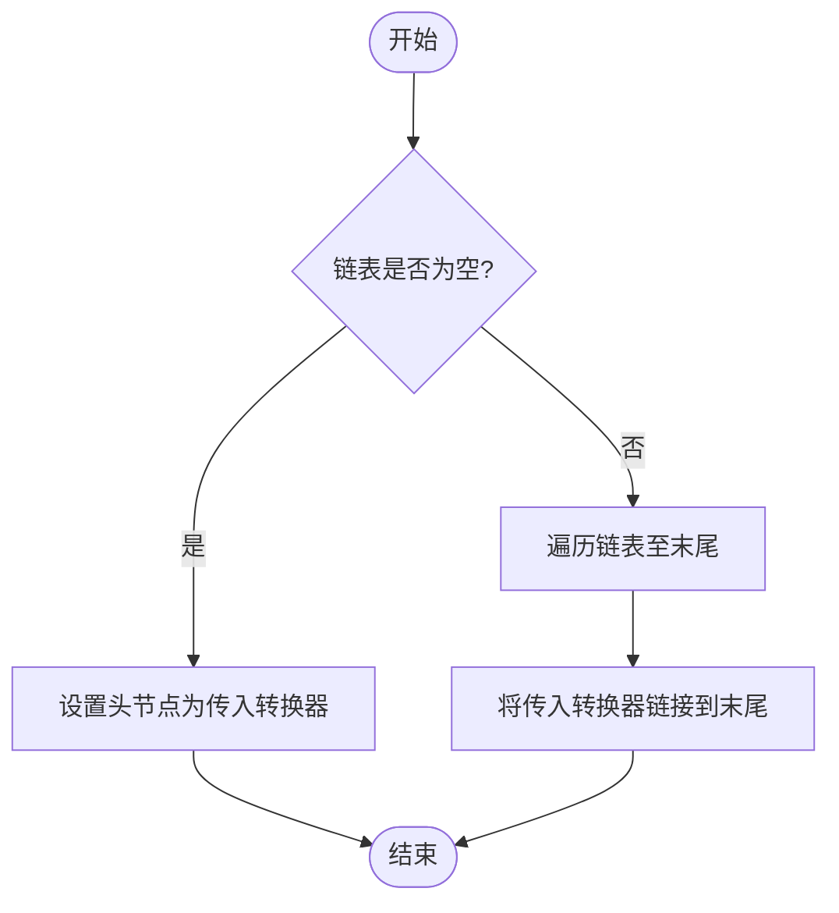
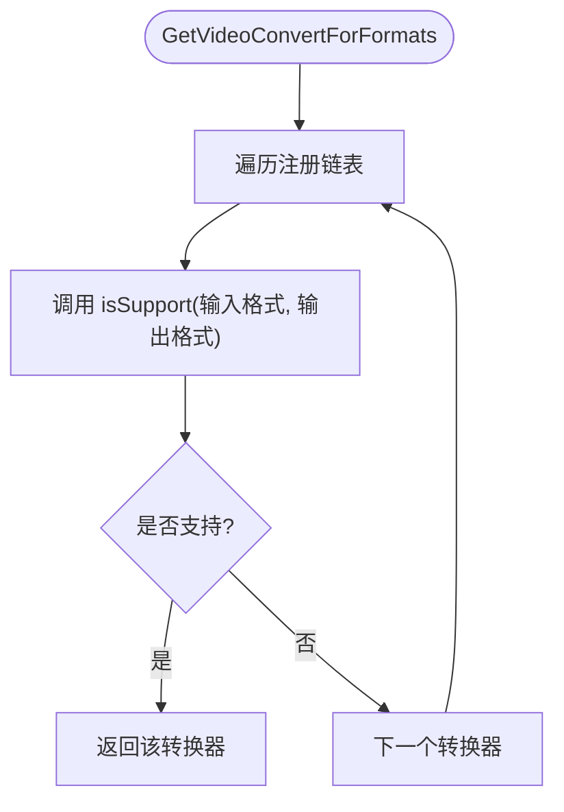
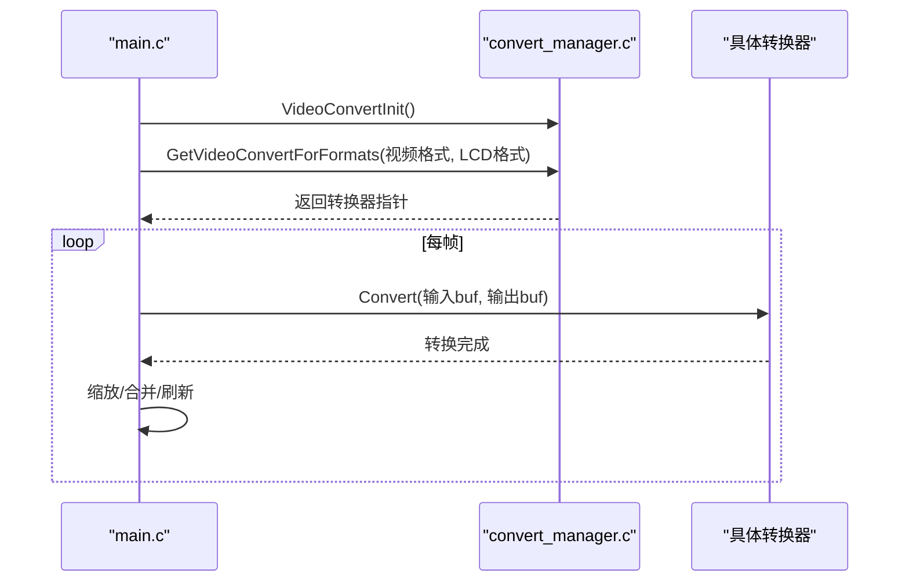
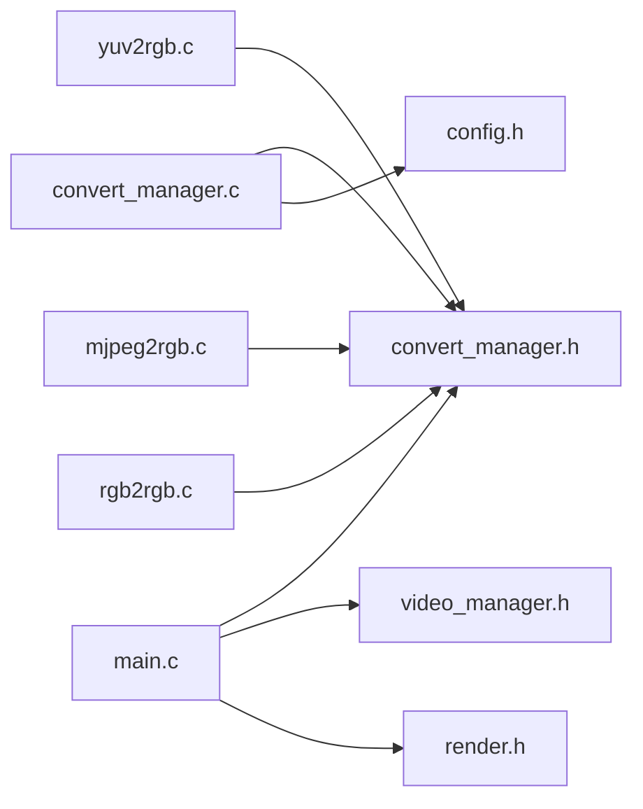

# 工厂模式应用

<cite>
**本文引用的文件**
- [convert_manager.h](file://video2lcd/include/convert_manager.h)
- [convert_manager.c](file://video2lcd/convert/convert_manager.c)
- [yuv2rgb.c](file://video2lcd/convert/yuv2rgb.c)
- [mjpeg2rgb.c](file://video2lcd/convert/mjpeg2rgb.c)
- [rgb2rgb.c](file://video2lcd/convert/rgb2rgb.c)
- [main.c](file://video2lcd/main.c)
- [video_manager.h](file://video2lcd/include/video_manager.h)
- [config.h](file://video2lcd/include/config.h)
</cite>

## 目录
1. [简介](#简介)
2. [项目结构](#项目结构)
3. [核心组件](#核心组件)
4. [架构总览](#架构总览)
5. [详细组件分析](#详细组件分析)
6. [依赖关系分析](#依赖关系分析)
7. [性能考虑](#性能考虑)
8. [故障排查指南](#故障排查指南)
9. [结论](#结论)
10. [附录：新增格式转换器的完整流程](#附录新增格式转换器的完整流程)

## 简介
本文件围绕嵌入式Linux相机项目中“视频格式转换器工厂”的实现进行深入说明。重点解释 ConvertManager（即 convert_manager）如何通过 RegisterVideoConvert 注册多种格式转换器，并通过 GetVideoConvertForFormats 根据输入输出像素格式自动选择合适的转换器实例。文档涵盖注册表管理机制、格式匹配算法、错误处理策略，并给出添加新格式转换器的完整步骤与使用示例路径。通过工厂模式，客户端代码无需关心具体转换实现，只需声明输入输出格式即可，从而显著提升可扩展性与可维护性。

## 项目结构
本项目采用分层与模块化组织：
- 显示模块：负责LCD帧缓冲的初始化与刷新
- 视频模块：封装V4L2设备操作，提供统一采集接口
- 渲染模块：提供图像缩放、合并等后处理
- 转换模块：基于工厂模式管理多种格式转换器（YUV->RGB、MJPEG->RGB、RGB->RGB）
- 主程序：协调各模块完成采集、转换、缩放、显示的全流程

图表来源
- [main.c:34-192](file://video2lcd/main.c#L34-L192)
- [convert_manager.c:1-131](file://video2lcd/convert/convert_manager.c#L1-L131)
- [video_manager.h:14-56](file://video2lcd/include/video_manager.h#L14-L56)

章节来源
- [main.c:34-192](file://video2lcd/main.c#L34-L192)
- [convert_manager.c:1-131](file://video2lcd/convert/convert_manager.c#L1-L131)
- [video_manager.h:14-56](file://video2lcd/include/video_manager.h#L14-L56)

## 核心组件
- 转换器接口与注册表
  - T_VideoConvert：定义转换器的统一接口（名称、支持判断、转换、释放）
  - 全局链表头 g_ptVideoConvertHead：保存所有已注册的转换器
- 工厂函数
  - RegisterVideoConvert：将转换器加入链表尾部
  - GetVideoConvertForFormats：遍历链表，调用 isSupport 选择第一个匹配的转换器
  - VideoConvertInit：初始化时依次调用各转换器的 Init 函数以完成注册
- 具体转换器
  - yuv2rgb：YUV422Packed -> RGB565/RGB32
  - mjpeg2rgb：MJPEG -> RGB565/RGB32（基于libjpeg解码）
  - rgb2rgb：RGB565 -> RGB565/RGB32（含位宽扩展）

章节来源
- [convert_manager.h:16-44](file://video2lcd/include/convert_manager.h#L16-L44)
- [convert_manager.c:13-44](file://video2lcd/convert/convert_manager.c#L13-L44)
- [convert_manager.c:98-131](file://video2lcd/convert/convert_manager.c#L98-L131)
- [yuv2rgb.c:217-232](file://video2lcd/convert/yuv2rgb.c#L217-L232)
- [mjpeg2rgb.c:247-260](file://video2lcd/convert/mjpeg2rgb.c#L247-L260)
- [rgb2rgb.c:138-151](file://video2lcd/convert/rgb2rgb.c#L138-L151)

## 架构总览
下图展示了从主程序到转换器工厂再到具体转换器的调用链，以及数据在缓冲区之间的流转。

图表来源
- [main.c:76-139](file://video2lcd/main.c#L76-L139)
- [convert_manager.c:98-111](file://video2lcd/convert/convert_manager.c#L98-L111)
- [video_manager.h:35-56](file://video2lcd/include/video_manager.h#L35-L56)

## 详细组件分析

### 转换器接口与注册表机制
- 数据结构
  - T_VideoConvert：包含 name、isSupport、Convert、ConvertExit、ptNext
  - 全局链表头 g_ptVideoConvertHead：用于集中管理所有转换器
- 注册过程
  - RegisterVideoConvert：若链表为空则直接赋值；否则遍历至末尾追加，保证插入顺序稳定
- 查找过程
  - GetVideoConvertForFormats：按链表顺序逐一调用 isSupport，返回首个支持的转换器
- 初始化编排
  - VideoConvertInit：依次调用各转换器的 Init 函数，完成批量注册

图表来源
- [convert_manager.c:23-44](file://video2lcd/convert/convert_manager.c#L23-L44)

章节来源
- [convert_manager.h:16-44](file://video2lcd/include/convert_manager.h#L16-L44)
- [convert_manager.c:23-44](file://video2lcd/convert/convert_manager.c#L23-L44)
- [convert_manager.c:98-111](file://video2lcd/convert/convert_manager.c#L98-L111)
- [convert_manager.c:121-131](file://video2lcd/convert/convert_manager.c#L121-L131)

### 格式匹配算法
- 每个转换器实现 isSupport 函数，仅当输入格式与期望输入一致且输出格式在允许集合内时返回真
- 工厂按注册顺序进行匹配，先注册者优先被选中
- 当前支持的组合：
  - YUV422Packed -> RGB565/RGB32（yuv2rgb）
  - MJPEG -> RGB565/RGB32（mjpeg2rgb）
  - RGB565 -> RGB565/RGB32（rgb2rgb）

图表来源
- [convert_manager.c:98-111](file://video2lcd/convert/convert_manager.c#L98-L111)
- [yuv2rgb.c:25-34](file://video2lcd/convert/yuv2rgb.c#L25-L34)
- [mjpeg2rgb.c:38-47](file://video2lcd/convert/mjpeg2rgb.c#L38-L47)
- [rgb2rgb.c:20-29](file://video2lcd/convert/rgb2rgb.c#L20-L29)

章节来源
- [convert_manager.c:98-111](file://video2lcd/convert/convert_manager.c#L98-L111)
- [yuv2rgb.c:25-34](file://video2lcd/convert/yuv2rgb.c#L25-L34)
- [mjpeg2rgb.c:38-47](file://video2lcd/convert/mjpeg2rgb.c#L38-L47)
- [rgb2rgb.c:20-29](file://video2lcd/convert/rgb2rgb.c#L20-L29)

### 具体转换器实现要点
- YUV->RGB（yuv2rgb.c）
  - 支持 RGB565 与 RGB32 两种输出
  - 内部根据目标位深分配内存并执行逐像素转换
  - 提供 ConvertExit 释放输出缓冲区
- MJPEG->RGB（mjpeg2rgb.c）
  - 使用 libjpeg 解码 JPEG 帧，行级转换为 RGB24，再转为目标位深
  - 自定义错误管理器 MyErrorMgr，结合 setjmp/longjmp 避免崩溃
  - 提供 ConvertExit 释放输出缓冲区
- RGB->RGB（rgb2rgb.c）
  - RGB565->RGB565 直接拷贝
  - RGB565->RGB32 逐像素提取分量并扩展为32位格式

章节来源
- [yuv2rgb.c:161-215](file://video2lcd/convert/yuv2rgb.c#L161-L215)
- [mjpeg2rgb.c:145-228](file://video2lcd/convert/mjpeg2rgb.c#L145-L228)
- [rgb2rgb.c:46-120](file://video2lcd/convert/rgb2rgb.c#L46-L120)

### 主程序中的工厂使用
- 初始化阶段：调用 VideoConvertInit 完成所有转换器注册
- 运行时：根据摄像头输出格式与LCD显示格式，调用 GetVideoConvertForFormats 获取转换器
- 每帧处理：如格式不一致则调用 Convert 进行转换，再进行缩放与合并显示

图表来源
- [main.c:76-139](file://video2lcd/main.c#L76-L139)
- [convert_manager.c:121-131](file://video2lcd/convert/convert_manager.c#L121-L131)

章节来源
- [main.c:76-139](file://video2lcd/main.c#L76-L139)

## 依赖关系分析
- main.c 依赖 video_manager.h、convert_manager.h、render.h 等
- convert_manager.c 依赖 config.h、convert_manager.h，并聚合多个转换器模块
- 各转换器模块依赖 convert_manager.h 提供的接口与类型定义

图表来源
- [main.c:1-10](file://video2lcd/main.c#L1-L10)
- [convert_manager.c:9-11](file://video2lcd/convert/convert_manager.c#L9-L11)
- [yuv2rgb.c:14-16](file://video2lcd/convert/yuv2rgb.c#L14-L16)
- [mjpeg2rgb.c:10-14](file://video2lcd/convert/mjpeg2rgb.c#L10-L14)
- [rgb2rgb.c:9-11](file://video2lcd/convert/rgb2rgb.c#L9-L11)

章节来源
- [main.c:1-10](file://video2lcd/main.c#L1-L10)
- [convert_manager.c:9-11](file://video2lcd/convert/convert_manager.c#L9-L11)

## 性能考虑
- 转换效率
  - RGB565->RGB565 直接 memcpy，零计算开销
  - RGB565->RGB32 需要逐像素位域提取与重组，存在一定CPU开销
  - YUV->RGB 涉及浮点或查表运算，注意缓存友好与SIMD优化空间
  - MJPEG->RGB 受限于libjpeg解码性能，建议控制分辨率与帧率
- 内存管理
  - 输出缓冲区按需分配，避免重复malloc/free造成碎片
  - 合理复用 tZoomBuf/tConvertBuf 等静态缓冲区，减少频繁分配
- 流水线
  - 将转换、缩放、合并尽量批量化，减少跨层数据拷贝
  - 对大帧图像可采用分块处理以降低峰值内存占用

[本节为通用性能建议，不直接分析具体文件]

## 故障排查指南
- 无合适转换器
  - 现象：GetVideoConvertForFormats 返回 NULL
  - 原因：未注册对应格式的转换器，或 isSupport 条件过于严格
  - 处理：检查 VideoConvertInit 是否调用成功，确认各 Init 函数返回值
  - 参考路径
    - [convert_manager.c:121-131](file://video2lcd/convert/convert_manager.c#L121-L131)
    - [main.c:91-99](file://video2lcd/main.c#L91-L99)
- 转换失败
  - 现象：Convert 返回非0
  - 原因：输入/输出格式不匹配、内存不足、解码异常
  - 处理：检查 isSupport 逻辑、输出缓冲区大小与分配、libjpeg错误回调
  - 参考路径
    - [yuv2rgb.c:161-199](file://video2lcd/convert/yuv2rgb.c#L161-L199)
    - [mjpeg2rgb.c:145-228](file://video2lcd/convert/mjpeg2rgb.c#L145-L228)
    - [rgb2rgb.c:46-120](file://video2lcd/convert/rgb2rgb.c#L46-L120)
- 资源泄漏
  - 现象：长期运行内存增长
  - 原因：未调用 ConvertExit 或未释放中间缓冲区
  - 处理：确保每次转换后调用 ConvertExit，或在适当时机释放临时内存
  - 参考路径
    - [yuv2rgb.c:207-215](file://video2lcd/convert/yuv2rgb.c#L207-L215)
    - [mjpeg2rgb.c:237-245](file://video2lcd/convert/mjpeg2rgb.c#L237-L245)
    - [rgb2rgb.c:128-136](file://video2lcd/convert/rgb2rgb.c#L128-L136)

章节来源
- [convert_manager.c:121-131](file://video2lcd/convert/convert_manager.c#L121-L131)
- [main.c:91-99](file://video2lcd/main.c#L91-L99)
- [yuv2rgb.c:161-215](file://video2lcd/convert/yuv2rgb.c#L161-L215)
- [mjpeg2rgb.c:145-245](file://video2lcd/convert/mjpeg2rgb.c#L145-L245)
- [rgb2rgb.c:46-136](file://video2lcd/convert/rgb2rgb.c#L46-L136)

## 结论
本项目通过统一的 T_VideoConvert 接口与链表式注册表实现了灵活的格式转换器工厂。ConvertManager 将“如何转换”与“何时转换”解耦：主程序仅需关注输入输出格式，由工厂自动选择最合适的转换器。该设计显著降低了耦合度，提升了可扩展性——新增一种格式只需实现 isSupport、Convert、ConvertExit 并注册即可接入系统。同时，清晰的错误处理与资源管理策略保障了系统的稳定性与可维护性。

[本节为总结性内容，不直接分析具体文件]

## 附录：新增格式转换器的完整流程
以下流程展示如何添加一个新的格式转换器（例如：NV12->RGB32），包括实现接口、注册与使用。

- 步骤1：实现转换器接口
  - 实现 isSupport：判断输入/输出格式是否在支持范围内
  - 实现 Convert：完成像素格式转换，必要时分配输出缓冲区
  - 实现 ConvertExit：释放输出缓冲区
  - 定义 T_VideoConvert 实例并命名
  - 参考路径
    - [convert_manager.h:16-29](file://video2lcd/include/convert_manager.h#L16-L29)
    - [yuv2rgb.c:217-232](file://video2lcd/convert/yuv2rgb.c#L217-L232)
    - [mjpeg2rgb.c:247-260](file://video2lcd/convert/mjpeg2rgb.c#L247-L260)
    - [rgb2rgb.c:138-151](file://video2lcd/convert/rgb2rgb.c#L138-L151)

- 步骤2：暴露初始化函数
  - 实现 XxxInit(void)，内部调用 RegisterVideoConvert(&g_tXxxConvert)
  - 参考路径
    - [yuv2rgb.c:227-232](file://video2lcd/convert/yuv2rgb.c#L227-L232)
    - [mjpeg2rgb.c:256-260](file://video2lcd/convert/mjpeg2rgb.c#L256-L260)
    - [rgb2rgb.c:147-151](file://video2lcd/convert/rgb2rgb.c#L147-L151)

- 步骤3：在工厂中注册
  - 在 VideoConvertInit 中增加对 XxxInit 的调用
  - 参考路径
    - [convert_manager.c:121-131](file://video2lcd/convert/convert_manager.c#L121-L131)

- 步骤4：在主程序中自动使用
  - 主程序调用 VideoConvertInit 后，通过 GetVideoConvertForFormats 自动选择新转换器
  - 参考路径
    - [main.c:91-99](file://video2lcd/main.c#L91-L99)

- 步骤5：测试与验证
  - 验证 isSupport 是否正确识别新格式
  - 验证 Convert 输出尺寸、位深、内存分配与释放
  - 验证主循环中转换、缩放、显示是否正常
  - 参考路径
    - [main.c:117-179](file://video2lcd/main.c#L117-L179)

章节来源
- [convert_manager.h:16-29](file://video2lcd/include/convert_manager.h#L16-L29)
- [convert_manager.c:121-131](file://video2lcd/convert/convert_manager.c#L121-L131)
- [yuv2rgb.c:217-232](file://video2lcd/convert/yuv2rgb.c#L217-L232)
- [mjpeg2rgb.c:247-260](file://video2lcd/convert/mjpeg2rgb.c#L247-L260)
- [rgb2rgb.c:138-151](file://video2lcd/convert/rgb2rgb.c#L138-L151)
- [main.c:91-99](file://video2lcd/main.c#L91-L99)
- [main.c:117-179](file://video2lcd/main.c#L117-L179)