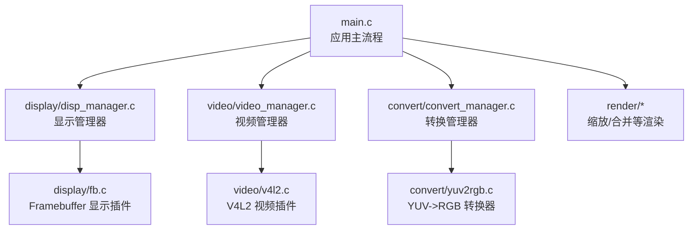
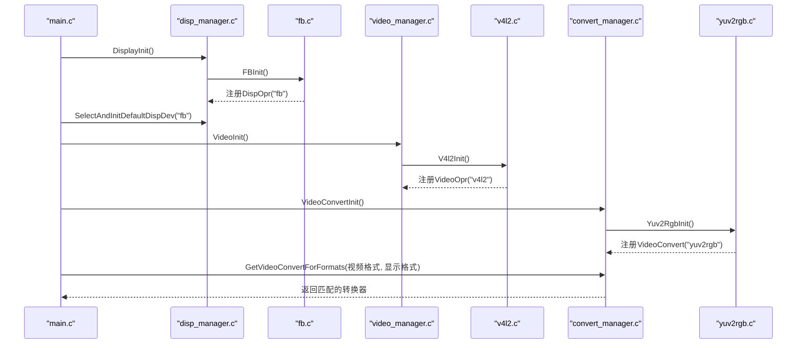
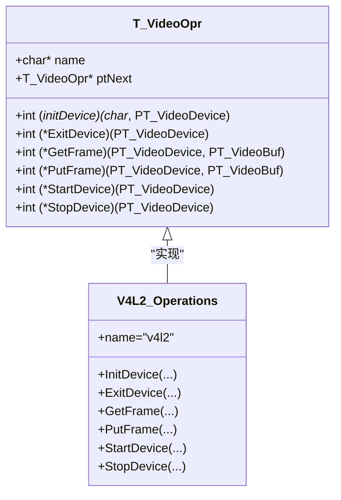
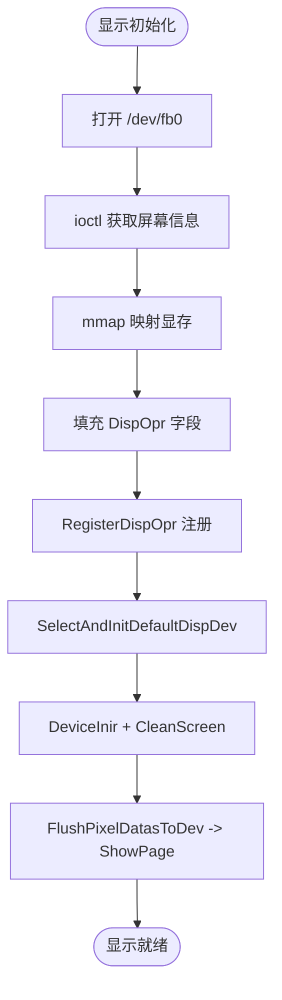
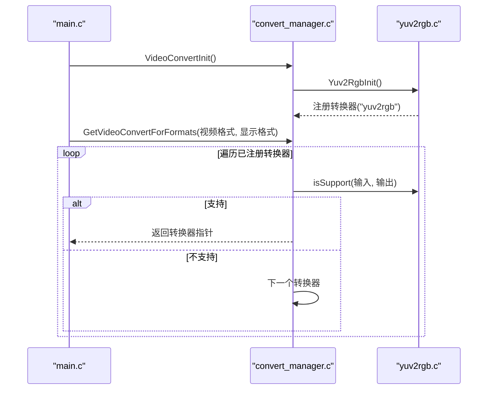
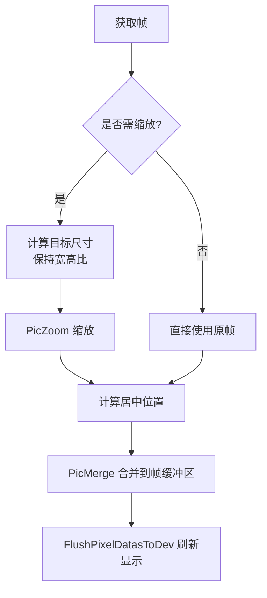
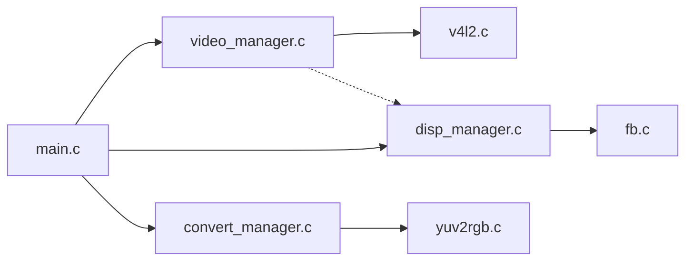

# 插件式架构

<cite>
**本文引用的文件**
- [main.c](file://video2lcd/main.c)
- [video_manager.h](file://video2lcd/include/video_manager.h)
- [video_manager.c](file://video2lcd/video/video_manager.c)
- [v4l2.c](file://video2lcd/video/v4l2.c)
- [disp_manager.h](file://video2lcd/include/disp_manager.h)
- [disp_manager.c](file://video2lcd/display/disp_manager.c)
- [fb.c](file://video2lcd/display/fb.c)
- [convert_manager.h](file://video2lcd/include/convert_manager.h)
- [convert_manager.c](file://video2lcd/convert/convert_manager.c)
- [yuv2rgb.c](file://video2lcd/convert/yuv2rgb.c)
- [pic_operation.h](file://video2lcd/include/pic_operation.h)
- [render.h](file://video2lcd/include/render.h)
- [zoom.c](file://video2lcd/render/operation/zoom.c)
- [config.h](file://video2lcd/include/config.h)
</cite>

## 目录
1. [简介](#简介)
2. [项目结构](#项目结构)
3. [核心组件](#核心组件)
4. [架构总览](#架构总览)
5. [详细组件分析](#详细组件分析)
6. [依赖关系分析](#依赖关系分析)
7. [性能考虑](#性能考虑)
8. [故障排查指南](#故障排查指南)
9. [结论](#结论)
10. [附录：开发指南](#附录开发指南)

## 简介
本项目采用“函数指针 + 结构体注册”的插件式架构，将视频采集、显示输出、格式转换等能力抽象为统一接口，并通过链表进行动态注册与发现。主程序在启动时完成各模块初始化与默认设备选择，运行时根据摄像头输出格式与显示设备像素格式自动选择合适的转换器，实现热插拔、模块化设计与易于维护的目标。

## 项目结构
- 顶层入口 main.c 负责编排流程：显示初始化与选择、视频设备初始化与选择、格式转换选择、采集-转换-缩放-合并-显示的循环。
- 视频子系统 video/ 提供 V4L2 驱动插件，通过 VideoOpr 接口注册到管理器。
- 显示子系统 display/ 提供 Framebuffer 显示插件，通过 DispOpr 接口注册到管理器。
- 转换子系统 convert/ 提供多种格式转换器（YUV->RGB、MJPEG->RGB、RGB->RGB），通过 VideoConvert 接口注册到管理器。
- 渲染子系统 render/ 提供图像缩放、合并等通用图像处理能力。
- 公共头 include/ 定义统一数据结构与接口，如 T_VideoDevice、T_VideoOpr、T_DispOpr、T_VideoConvert、T_PixelDatas 等。

图表来源
- [main.c:63-93](file://video2lcd/main.c#L63-L93)
- [video_manager.c:67-74](file://video2lcd/video/video_manager.c#L67-L74)
- [disp_manager.c:514-521](file://video2lcd/display/disp_manager.c#L514-L521)
- [convert_manager.c:121-130](file://video2lcd/convert/convert_manager.c#L121-L130)
- [v4l2.c:387-401](file://video2lcd/video/v4l2.c#L387-L401)
- [fb.c:249-252](file://video2lcd/display/fb.c#L249-L252)
- [yuv2rgb.c:218-232](file://video2lcd/convert/yuv2rgb.c#L218-L232)

章节来源
- [main.c:34-192](file://video2lcd/main.c#L34-L192)
- [video_manager.h:14-56](file://video2lcd/include/video_manager.h#L14-L56)
- [disp_manager.h:78-233](file://video2lcd/include/disp_manager.h#L78-L233)
- [convert_manager.h:16-46](file://video2lcd/include/convert_manager.h#L16-L46)

## 核心组件
- 视频设备插件接口与注册
  - 通过 T_VideoOpr 定义统一的视频操作接口（初始化、退出、取帧、还帧、启停），由具体驱动（如 V4L2）填充并调用 RegisterVideoOpr 注册到管理器。
  - 管理器维护一个全局链表，支持按名称查找与遍历。
- 显示设备插件接口与注册
  - 通过 T_DispOpr 定义统一的显示操作接口（初始化、清屏、画点、整页显示），由具体驱动（如 Framebuffer）填充并调用 RegisterDispOpr 注册到管理器。
  - 管理器维护默认设备指针，支持分辨率查询与显存访问。
- 格式转换器插件接口与注册
  - 通过 T_VideoConvert 定义统一的转换器接口（isSupport、Convert、ConvertExit），由具体转换器（如 YUV->RGB）填充并调用 RegisterVideoConvert 注册到管理器。
  - 管理器提供 GetVideoConvertForFormats 根据输入输出格式自动选择合适转换器。
- 统一数据载体
  - T_PixelDatas 描述任意图像数据的尺寸、色深、行字节数、总字节数与数据指针，被采集、转换、渲染、显示等模块共用。
  - T_VideoBuf 封装一帧视频数据及其像素格式。

章节来源
- [video_manager.h:14-56](file://video2lcd/include/video_manager.h#L14-L56)
- [video_manager.c:12-74](file://video2lcd/video/video_manager.c#L12-L74)
- [disp_manager.h:78-233](file://video2lcd/include/disp_manager.h#L78-L233)
- [disp_manager.c:27-175](file://video2lcd/display/disp_manager.c#L27-L175)
- [convert_manager.h:16-46](file://video2lcd/include/convert_manager.h#L16-L46)
- [convert_manager.c:23-130](file://video2lcd/convert/convert_manager.c#L23-L130)
- [pic_operation.h:6-18](file://video2lcd/include/pic_operation.h#L6-L18)

## 架构总览
系统以“管理器 + 插件”的方式组织：
- 管理器负责生命周期管理（注册、选择、初始化）、资源协调（缓冲区、显存）、以及基于策略的自动选择（如按格式选择转换器）。
- 插件通过实现统一接口并调用注册函数加入系统，无需修改上层逻辑即可扩展新设备或算法。

图表来源
- [main.c:63-93](file://video2lcd/main.c#L63-L93)
- [disp_manager.c:514-521](file://video2lcd/display/disp_manager.c#L514-L521)
- [fb.c:249-252](file://video2lcd/display/fb.c#L249-L252)
- [video_manager.c:67-74](file://video2lcd/video/video_manager.c#L67-L74)
- [v4l2.c:387-401](file://video2lcd/video/v4l2.c#L387-L401)
- [convert_manager.c:121-130](file://video2lcd/convert/convert_manager.c#L121-L130)
- [yuv2rgb.c:218-232](file://video2lcd/convert/yuv2rgb.c#L218-L232)

## 详细组件分析

### 视频设备插件（V4L2）
- 接口定义：T_VideoOpr 包含 name、initDevice、ExitDevice、GetFrame、PutFrame、StartDevice、StopDevice 及链表指针 ptNext。
- 插件实现：v4l2.c 构造 g_tV4l2VideoOpr，实现 V4L2 的设备能力查询、格式枚举、缓冲区申请与 mmap、流控制（STREAMON/OFF）、取帧/还帧（支持 streaming 与 read/write 两种模式）。
- 注册机制：V4l2Init 调用 RegisterVideoOpr 将自身挂入管理器链表；VideoInit 在启动阶段调用 V4l2Init。
- 生命周期：
  - 初始化：打开设备、查询能力、设置格式、分配并映射缓冲区、入队。
  - 运行：StartDevice 启用流；GetFrame 从队列取出缓冲并填充 T_VideoBuf；PutFrame 将缓冲放回队列。
  - 退出：ExitDevice 释放映射内存并关闭设备。

图表来源
- [video_manager.h:29-44](file://video2lcd/include/video_manager.h#L29-L44)
- [v4l2.c:387-401](file://video2lcd/video/v4l2.c#L387-L401)

章节来源
- [video_manager.h:14-56](file://video2lcd/include/video_manager.h#L14-L56)
- [video_manager.c:12-74](file://video2lcd/video/video_manager.c#L12-L74)
- [v4l2.c:47-249](file://video2lcd/video/v4l2.c#L47-L249)
- [v4l2.c:267-383](file://video2lcd/video/v4l2.c#L267-L383)
- [v4l2.c:387-401](file://video2lcd/video/v4l2.c#L387-L401)

### 显示设备插件（Framebuffer）
- 接口定义：T_DispOpr 包含 name、分辨率/BPP/行字节数、显存指针、DeviceInir、ShowPixel、CleanScreen、ShowPage 及链表指针 ptNext。
- 插件实现：fb.c 打开 /dev/fb0，获取屏幕信息并 mmap 显存，实现画点、清屏、整页显示（直接拷贝到显存）。
- 注册机制：FBInit 调用 RegisterDispOpr 将自身挂入管理器链表；DisplayInit 在启动阶段调用 FBInit。
- 生命周期：
  - 初始化：打开设备、获取可变/固定信息、mmap 显存、填充 DispOpr。
  - 运行：SelectAndInitDefaultDispDev 选择默认设备并执行 DeviceInir 与 CleanScreen；FlushPixelDatasToDev 调用 ShowPage 刷新显示。
  - 退出：由系统释放映射内存与设备句柄（当前代码未显式 close，可在扩展中补充）。

图表来源
- [fb.c:53-94](file://video2lcd/display/fb.c#L53-L94)
- [fb.c:166-174](file://video2lcd/display/fb.c#L166-L174)
- [fb.c:249-252](file://video2lcd/display/fb.c#L249-L252)
- [disp_manager.c:100-108](file://video2lcd/display/disp_manager.c#L100-L108)
- [disp_manager.c:172-175](file://video2lcd/display/disp_manager.c#L172-L175)

章节来源
- [disp_manager.h:78-233](file://video2lcd/include/disp_manager.h#L78-L233)
- [disp_manager.c:27-175](file://video2lcd/display/disp_manager.c#L27-L175)
- [fb.c:53-252](file://video2lcd/display/fb.c#L53-L252)

### 格式转换器插件（YUV->RGB）
- 接口定义：T_VideoConvert 包含 name、isSupport、Convert、ConvertExit 及链表指针 ptNext。
- 插件实现：yuv2rgb.c 实现 isSupportYuv2Rgb（检查输入为 YUYV，输出为 RGB565/RGB32），Convert 根据目标格式选择对应转换函数，ConvertExit 释放输出缓冲区。
- 注册机制：Yuv2RgbInit 调用 RegisterVideoConvert 将自身挂入管理器链表；VideoConvertInit 在启动阶段依次初始化所有转换器。
- 选择机制：GetVideoConvertForFormats 遍历已注册的转换器，调用 isSupport 匹配输入输出格式，返回合适的转换器。

图表来源
- [convert_manager.c:121-130](file://video2lcd/convert/convert_manager.c#L121-L130)
- [convert_manager.c:98-111](file://video2lcd/convert/convert_manager.c#L98-L111)
- [yuv2rgb.c:25-34](file://video2lcd/convert/yuv2rgb.c#L25-L34)
- [yuv2rgb.c:161-199](file://video2lcd/convert/yuv2rgb.c#L161-L199)
- [yuv2rgb.c:218-232](file://video2lcd/convert/yuv2rgb.c#L218-L232)

章节来源
- [convert_manager.h:16-46](file://video2lcd/include/convert_manager.h#L16-L46)
- [convert_manager.c:23-130](file://video2lcd/convert/convert_manager.c#L23-L130)
- [yuv2rgb.c:25-232](file://video2lcd/convert/yuv2rgb.c#L25-L232)

### 渲染与数据处理（缩放/合并）
- 缩放：PicZoom 使用最近邻插值，按目标尺寸计算源坐标映射表，逐行复制像素。
- 合并：PicMerge 将小图合并到大图的指定位置（用于居中显示）。
- 主流程：main.c 在获取帧后，若尺寸大于 LCD，则先缩放再合并到帧缓冲区，最后刷新显示。

图表来源
- [main.c:141-178](file://video2lcd/main.c#L141-L178)
- [render.h:15-36](file://video2lcd/include/render.h#L15-L36)
- [zoom.c:27-85](file://video2lcd/render/operation/zoom.c#L27-L85)

章节来源
- [main.c:117-189](file://video2lcd/main.c#L117-L189)
- [render.h:15-36](file://video2lcd/include/render.h#L15-L36)
- [zoom.c:27-85](file://video2lcd/render/operation/zoom.c#L27-L85)

## 依赖关系分析
- 管理器与插件解耦：管理器仅依赖统一接口（VideoOpr、DispOpr、VideoConvert），不感知具体实现细节。
- 插件自注册：每个插件在编译期构造静态结构体，并在初始化阶段调用注册函数加入管理器链表。
- 数据流：视频帧经 T_VideoBuf 传递，统一由 T_PixelDatas 描述，确保转换、渲染、显示模块间的数据一致性。
- 潜在耦合点：
  - v4l2.c 依赖 disp_manager 获取 LCD 分辨率以设置摄像头输出格式（可优化为回调或配置注入）。
  - yuv2rgb.c 依赖颜色转换宏（color.h），需保证头文件可用。

图表来源
- [video_manager.c:67-74](file://video2lcd/video/video_manager.c#L67-L74)
- [disp_manager.c:514-521](file://video2lcd/display/disp_manager.c#L514-L521)
- [convert_manager.c:121-130](file://video2lcd/convert/convert_manager.c#L121-L130)
- [v4l2.c:107-125](file://video2lcd/video/v4l2.c#L107-L125)

章节来源
- [video_manager.c:12-74](file://video2lcd/video/video_manager.c#L12-L74)
- [disp_manager.c:27-175](file://video2lcd/display/disp_manager.c#L27-L175)
- [convert_manager.c:23-130](file://video2lcd/convert/convert_manager.c#L23-L130)
- [v4l2.c:107-125](file://video2lcd/video/v4l2.c#L107-L125)

## 性能考虑
- 零拷贝采集：V4L2 使用 mmap 将内核缓冲区映射到用户空间，避免额外拷贝。
- 批量缓冲：多缓冲区队列减少阻塞等待，提高吞吐。
- 显示优化：直接 memcpy 到 framebuffer 显存，减少中间层开销。
- 转换效率：YUV->RGB 使用查表与向量化友好循环，尽量降低每像素运算成本。
- 缩放策略：最近邻插值速度快但质量一般，可按需替换为双线性/双三次插值。

[本节为通用指导，不直接分析具体文件]

## 故障排查指南
- 无法打开设备
  - 检查路径与权限：/dev/videoX、/dev/fb0 是否存在且可读写。
  - 参考错误日志：V4L2 打开失败、ioctl 失败、mmap 失败等。
- 格式不匹配
  - 确认摄像头支持的像素格式与显示器 BPP 一致或不一致时的转换器可用性。
  - 检查 isSupport 逻辑是否正确覆盖所需组合。
- 显示异常
  - 确认 SelectAndInitDefaultDispDev 成功选择了默认设备。
  - 检查 FlushPixelDatasToDev 是否被调用且参数正确。
- 内存泄漏
  - 转换器的 ConvertExit 是否释放了输出缓冲区。
  - 缩放临时表是否释放。

章节来源
- [v4l2.c:64-87](file://video2lcd/video/v4l2.c#L64-L87)
- [v4l2.c:137-145](file://video2lcd/video/v4l2.c#L137-L145)
- [v4l2.c:187-194](file://video2lcd/video/v4l2.c#L187-L194)
- [fb.c:56-81](file://video2lcd/display/fb.c#L56-L81)
- [yuv2rgb.c:207-215](file://video2lcd/convert/yuv2rgb.c#L207-L215)
- [zoom.c:50-56](file://video2lcd/render/operation/zoom.c#L50-L56)

## 结论
本项目的插件式架构通过统一的接口定义与链表注册机制，实现了视频采集、显示输出与格式转换的动态扩展。其优势包括：
- 热插拔支持：新增设备或转换器只需实现接口并注册，无需改动主流程。
- 模块化设计：各子系统职责清晰，便于独立开发与测试。
- 易于维护：接口稳定，内部实现可替换升级。
- 可扩展性：未来可轻松引入新的视频源、显示后端与转换算法。

[本节为总结，不直接分析具体文件]

## 附录：开发指南

### 如何开发新的视频设备驱动插件
- 步骤
  1. 在 video/ 下新建文件，实现 T_VideoOpr 的所有函数指针（initDevice、ExitDevice、GetFrame、PutFrame、StartDevice、StopDevice）。
  2. 构造静态实例并命名（name），实现设备特定逻辑。
  3. 提供 Init 函数，调用 RegisterVideoOpr 注册。
  4. 在 VideoInit 中调用该 Init 函数（或在管理器中扩展自动发现）。
- 注意事项
  - 正确处理缓冲区分配与释放，遵循 V4L2 流控制流程。
  - 兼容 streaming 与 read/write 两种模式（可选）。
  - 错误处理与日志输出要完善。

章节来源
- [video_manager.h:29-44](file://video2lcd/include/video_manager.h#L29-L44)
- [video_manager.c:12-74](file://video2lcd/video/video_manager.c#L12-L74)
- [v4l2.c:47-249](file://video2lcd/video/v4l2.c#L47-L249)
- [v4l2.c:387-401](file://video2lcd/video/v4l2.c#L387-L401)

### 如何开发新的显示设备驱动插件
- 步骤
  1. 在 display/ 下新建文件，实现 T_DispOpr 的所有函数指针（DeviceInir、ShowPixel、CleanScreen、ShowPage）。
  2. 构造静态实例并命名（name），实现设备特定逻辑（如打开设备、mmap 显存）。
  3. 提供 Init 函数，调用 RegisterDispOpr 注册。
  4. 在 DisplayInit 中调用该 Init 函数（或在管理器中扩展自动发现）。
- 注意事项
  - 正确设置 iXres、iYres、iBpp、iLineWidth、pucDispMem。
  - ShowPage 应高效地将像素数据写入显存。
  - 清屏与画点需适配不同 BPP。

章节来源
- [disp_manager.h:78-233](file://video2lcd/include/disp_manager.h#L78-L233)
- [disp_manager.c:27-175](file://video2lcd/display/disp_manager.c#L27-L175)
- [fb.c:53-252](file://video2lcd/display/fb.c#L53-L252)

### 如何开发新的格式转换器插件
- 步骤
  1. 在 convert/ 下新建文件，实现 T_VideoConvert 的所有函数指针（isSupport、Convert、ConvertExit）。
  2. 构造静态实例并命名（name），实现转换逻辑与资源管理。
  3. 提供 Init 函数，调用 RegisterVideoConvert 注册。
  4. 在 VideoConvertInit 中调用该 Init 函数（或在管理器中扩展自动发现）。
- 注意事项
  - isSupport 需准确判断输入输出格式组合。
  - Convert 需正确设置输出 T_PixelDatas 的尺寸、BPP、行字节数与总字节数。
  - ConvertExit 需释放输出缓冲区，避免泄漏。

章节来源
- [convert_manager.h:16-46](file://video2lcd/include/convert_manager.h#L16-L46)
- [convert_manager.c:23-130](file://video2lcd/convert/convert_manager.c#L23-L130)
- [yuv2rgb.c:25-232](file://video2lcd/convert/yuv2rgb.c#L25-L232)

### 统一接口规范与生命周期管理
- 统一接口
  - 视频：T_VideoOpr（初始化、退出、取帧、还帧、启停）。
  - 显示：T_DispOpr（初始化、画点、清屏、整页显示）。
  - 转换：T_VideoConvert（支持判断、转换、退出）。
- 生命周期
  - 初始化：各模块在启动阶段完成设备打开、资源分配与注册。
  - 运行：主循环调用统一接口进行数据采集、转换、渲染与显示。
  - 退出：释放资源、关闭设备、解除映射。

章节来源
- [video_manager.h:14-56](file://video2lcd/include/video_manager.h#L14-L56)
- [disp_manager.h:78-233](file://video2lcd/include/disp_manager.h#L78-L233)
- [convert_manager.h:16-46](file://video2lcd/include/convert_manager.h#L16-L46)
- [main.c:63-93](file://video2lcd/main.c#L63-L93)

### 配置文件与调试
- 配置项
  - DBG_PRINTF：控制调试输出开关。
  - FB_DEVICE_NAME：framebuffer 设备路径。
- 建议
  - 在生产环境关闭调试输出以提升性能。
  - 为关键路径添加错误码与日志，便于定位问题。

章节来源
- [config.h:13-19](file://video2lcd/include/config.h#L13-L19)