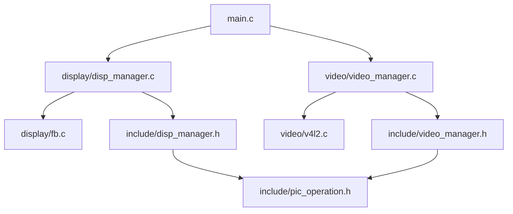
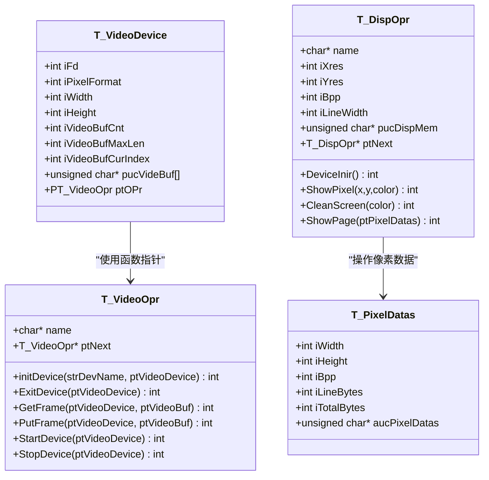
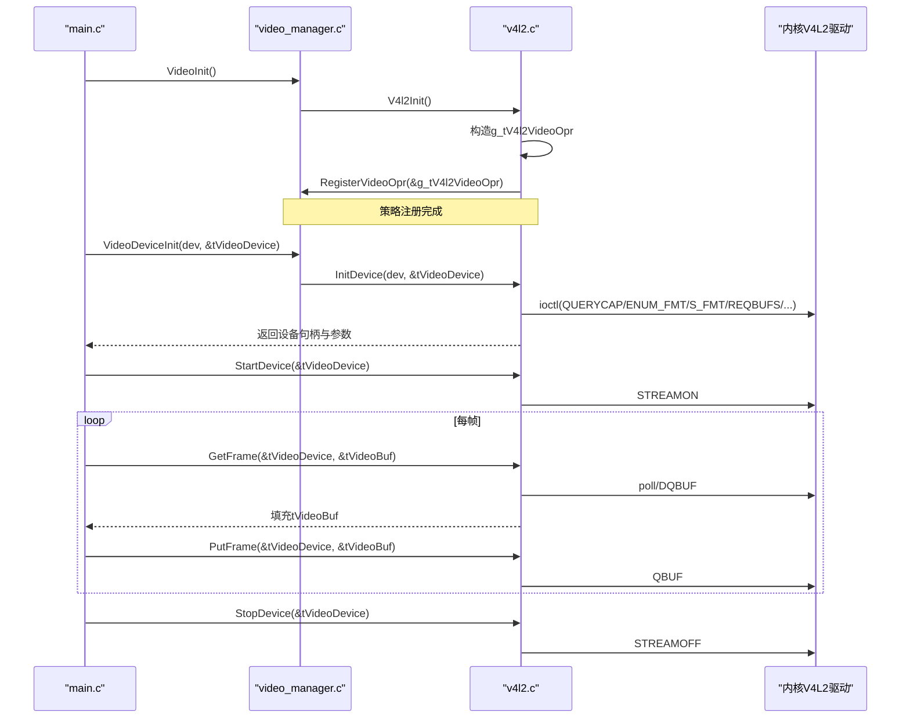
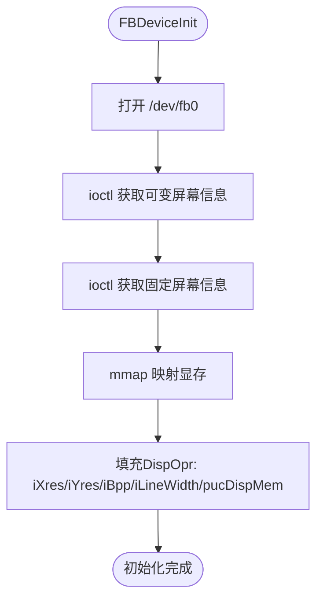
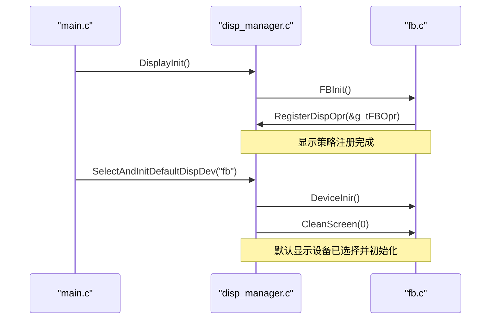
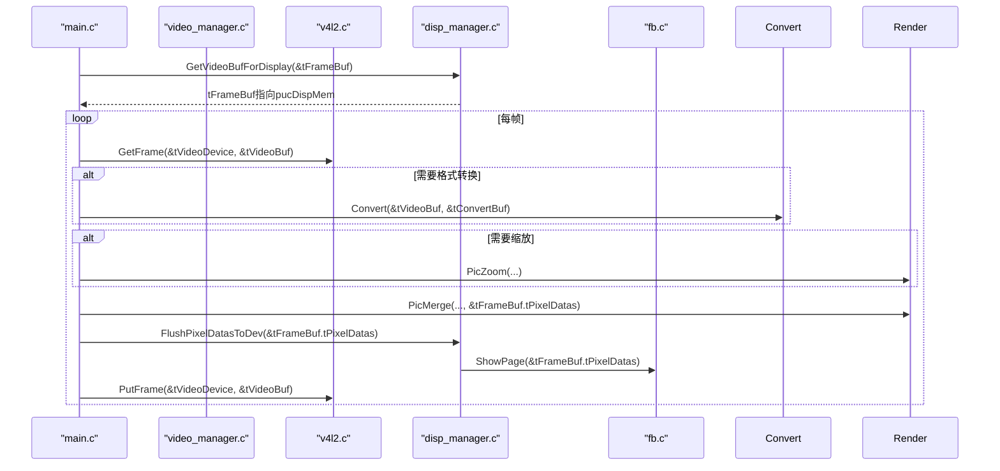
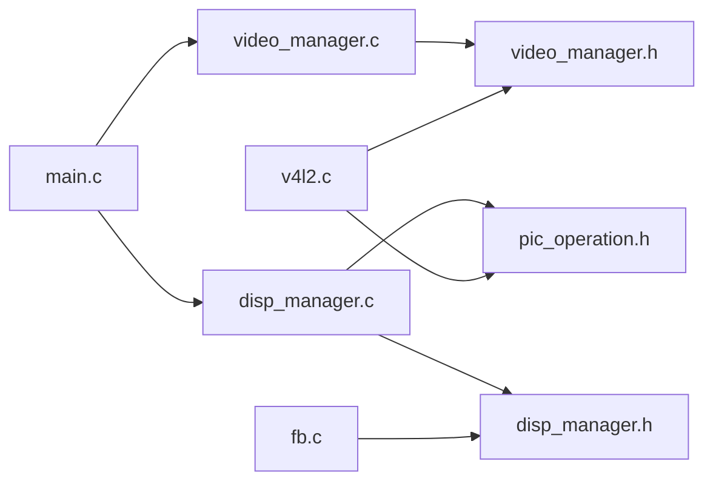

# 策略模式应用

<cite>
**本文引用的文件**
- [video_manager.h](file://video2lcd/include/video_manager.h)
- [disp_manager.h](file://video2lcd/include/disp_manager.h)
- [v4l2.c](file://video2lcd/video/v4l2.c)
- [fb.c](file://video2lcd/display/fb.c)
- [video_manager.c](file://video2lcd/video/video_manager.c)
- [disp_manager.c](file://video2lcd/display/disp_manager.c)
- [pic_operation.h](file://video2lcd/include/pic_operation.h)
- [config.h](file://video2lcd/include/config.h)
- [main.c](file://video2lcd/main.c)
</cite>

## 目录
1. [简介](#简介)
2. [项目结构](#项目结构)
3. [核心组件](#核心组件)
4. [架构总览](#架构总览)
5. [详细组件分析](#详细组件分析)
6. [依赖关系分析](#依赖关系分析)
7. [性能考虑](#性能考虑)
8. [故障排查指南](#故障排查指南)
9. [结论](#结论)
10. [附录：如何新增设备策略](#附录如何新增设备策略)

## 简介
本项目在视频采集与显示两个子系统上广泛采用“策略模式”思想：通过函数指针将不同设备的操作封装为统一接口，上层代码以一致的方式调用不同驱动（如V4L2摄像头、FrameBuffer显示器），从而实现高内聚、低耦合、易扩展、可测试的架构。

- 视频侧：VideoOpr结构体定义统一的摄像头操作接口（初始化、启动/停止、取帧/还帧等），V4L2实现具体策略并通过注册机制加入管理器链表。
- 显示侧：DispOpr结构体定义统一的显示操作接口（初始化、清屏、画点、整页显示等），FB实现具体策略并注册到管理器。
- 管理器：维护策略链表，提供按名称查找、默认设备选择、分辨率查询、显存缓冲管理等能力。

本文件重点解释VideoOpr与DispOpr如何通过函数指针抽象设备差异，并以V4L2与FB为例说明策略的具体实现与动态加载过程；同时给出新增设备策略的步骤与最佳实践。

## 项目结构
- include：公共头文件，定义策略接口与通用数据结构（VideoOpr、DispOpr、PixelDatas等）
- video：视频采集策略与视频管理器（V4L2实现、注册与管理）
- display：显示策略与显示管理器（FB实现、注册与管理）
- convert/render：图像格式转换与渲染（与本主题相关但非核心）
- main.c：主流程编排，串联显示初始化、视频初始化、循环采集与显示

图表来源
- [main.c:63-82](file://video2lcd/main.c#L63-L82)
- [disp_manager.c:514-521](file://video2lcd/display/disp_manager.c#L514-L521)
- [video_manager.c:67-74](file://video2lcd/video/video_manager.c#L67-L74)
- [fb.c:249-252](file://video2lcd/display/fb.c#L249-L252)
- [v4l2.c:398-401](file://video2lcd/video/v4l2.c#L398-L401)

章节来源
- [main.c:63-82](file://video2lcd/main.c#L63-L82)
- [disp_manager.c:514-521](file://video2lcd/display/disp_manager.c#L514-L521)
- [video_manager.c:67-74](file://video2lcd/video/video_manager.c#L67-L74)

## 核心组件
- VideoDevice：封装摄像头设备状态（fd、像素格式、分辨率、缓冲区数组）以及指向VideoOpr的函数指针ptOPr，用于统一调用不同视频设备策略。
- VideoOpr：定义摄像头操作的策略接口（name、initDevice、ExitDevice、GetFrame、PutFrame、StartDevice、StopDevice、ptNext），通过链表管理多个策略。
- DispOpr：定义显示设备的策略接口（name、分辨率/BPP/行字节数、显存指针、DeviceInir、ShowPixel、CleanScreen、ShowPage、ptNext）。
- PixelDatas：统一描述像素数据块（宽高、色深、行字节、总字节、数据指针），被视频与显示模块共用。

这些结构体共同构成“策略对象 + 管理器”的模式：策略对象持有函数指针表，管理器维护策略链表并提供注册、查找、默认设备选择等能力。

章节来源
- [video_manager.h:14-44](file://video2lcd/include/video_manager.h#L14-L44)
- [disp_manager.h:84-96](file://video2lcd/include/disp_manager.h#L84-L96)
- [pic_operation.h:10-17](file://video2lcd/include/pic_operation.h#L10-L17)

## 架构总览
下图展示了策略模式在视频与显示子系统中的整体协作：

图表来源
- [video_manager.h:14-44](file://video2lcd/include/video_manager.h#L14-L44)
- [disp_manager.h:84-96](file://video2lcd/include/disp_manager.h#L84-L96)
- [pic_operation.h:10-17](file://video2lcd/include/pic_operation.h#L10-L17)

## 详细组件分析

### 视频设备策略：V4L2实现
- 策略对象：g_tV4l2VideoOpr，填充了name与各函数指针（InitDevice、ExitDevice、GetFrame、PutFrame、StartDevice、StopDevice）。
- 初始化流程：打开设备、查询能力、枚举支持格式、设置格式、申请并映射缓冲区（mmap）、入队缓冲区、根据能力选择Streaming或ReadWrite路径。
- 取帧/还帧：
  - Streaming：poll等待数据就绪，DQBUF取出缓冲区，填充VideoBuf信息，处理后再QBUF归还。
  - ReadWrite：read读取一帧到用户缓冲区，填充VideoBuf信息。
- 启动/停止：STREAMON/STREAMOFF控制采集流。
- 注册：V4l2Init调用RegisterVideoOpr将策略加入管理器链表。

图表来源
- [v4l2.c:47-249](file://video2lcd/video/v4l2.c#L47-L249)
- [v4l2.c:267-326](file://video2lcd/video/v4l2.c#L267-L326)
- [v4l2.c:328-355](file://video2lcd/video/v4l2.c#L328-L355)
- [v4l2.c:357-383](file://video2lcd/video/v4l2.c#L357-L383)
- [v4l2.c:387-401](file://video2lcd/video/v4l2.c#L387-L401)
- [video_manager.c:12-27](file://video2lcd/video/video_manager.c#L12-L27)
- [main.c:76-107](file://video2lcd/main.c#L76-L107)

章节来源
- [v4l2.c:47-401](file://video2lcd/video/v4l2.c#L47-L401)
- [video_manager.c:12-74](file://video2lcd/video/video_manager.c#L12-L74)
- [main.c:76-107](file://video2lcd/main.c#L76-L107)

### 显示设备策略：FrameBuffer实现
- 策略对象：g_tFBOpr，包含name、DeviceInit、ShowPixel、CleanScreen、ShowPage等函数指针。
- 初始化：打开/dev/fb0，获取可变/固定屏幕信息，mmap映射显存，填充DispOpr的分辨率、BPP、行字节、显存指针。
- 显示逻辑：
  - ShowPixel：按BPP写入单点颜色（8/16/32位适配）。
  - CleanScreen：按BPP填充全屏背景色。
  - ShowPage：将传入的像素数据复制到显存（若不在同一地址则memcpy）。
- 注册：FBInit调用RegisterDispOpr将策略加入管理器链表。

图表来源
- [fb.c:53-94](file://video2lcd/display/fb.c#L53-L94)

章节来源
- [fb.c:53-252](file://video2lcd/display/fb.c#L53-L252)

### 管理器与插件机制
- 视频管理器：
  - RegisterVideoOpr：尾插法将策略加入链表。
  - getVideoOpr：按名称查找策略。
  - VideoInit：调用V4l2Init完成V4L2策略注册。
- 显示管理器：
  - RegisterDispOpr：尾插法将策略加入链表。
  - SelectAndInitDefaultDispDev：按名称选择并初始化默认显示设备，清屏。
  - GetDefaultDispDev：获取当前默认DispOpr。
  - DisplayInit：调用FBInit完成FB策略注册。
  - GetVideoBufForDisplay/FlushPixelDatasToDev：基于默认DispOpr提供帧缓冲与刷新能力。

图表来源
- [disp_manager.c:27-48](file://video2lcd/display/disp_manager.c#L27-L48)
- [disp_manager.c:100-108](file://video2lcd/display/disp_manager.c#L100-L108)
- [disp_manager.c:514-521](file://video2lcd/display/disp_manager.c#L514-L521)
- [fb.c:249-252](file://video2lcd/display/fb.c#L249-L252)
- [main.c:63-74](file://video2lcd/main.c#L63-L74)

章节来源
- [video_manager.c:12-74](file://video2lcd/video/video_manager.c#L12-L74)
- [disp_manager.c:27-138](file://video2lcd/display/disp_manager.c#L27-L138)
- [disp_manager.c:514-521](file://video2lcd/display/disp_manager.c#L514-L521)

### 数据流与处理逻辑
- 主循环中，main通过tVideoDevice.ptOPr->GetFrame获取一帧，必要时进行格式转换与缩放，然后合并到帧缓冲区，最后通过FlushPixelDatasToDev刷新到LCD。
- 帧缓冲区由GetVideoBufForDisplay提供，直接指向DispOpr.pucDispMem（FB显存），从而避免额外拷贝。

图表来源
- [main.c:117-189](file://video2lcd/main.c#L117-L189)
- [disp_manager.c:148-175](file://video2lcd/display/disp_manager.c#L148-L175)
- [fb.c:166-174](file://video2lcd/display/fb.c#L166-L174)

章节来源
- [main.c:117-189](file://video2lcd/main.c#L117-L189)
- [disp_manager.c:148-175](file://video2lcd/display/disp_manager.c#L148-L175)

## 依赖关系分析
- 视频侧依赖：
  - v4l2.c依赖video_manager.h（VideoOpr、VideoDevice、VideoBuf）和pic_operation.h（PixelDatas）。
  - video_manager.c维护VideoOpr链表，提供注册与查找。
- 显示侧依赖：
  - fb.c依赖disp_manager.h（DispOpr、VideoMem等）和系统fb头文件。
  - disp_manager.c维护DispOpr链表，提供注册、默认设备选择、分辨率查询、显存管理。
- 主程序依赖：
  - main.c组合显示与视频子系统，协调格式转换与渲染。

图表来源
- [v4l2.c:1-3](file://video2lcd/video/v4l2.c#L1-L3)
- [video_manager.c:1-3](file://video2lcd/video/video_manager.c#L1-L3)
- [fb.c:9-17](file://video2lcd/display/fb.c#L9-L17)
- [disp_manager.c:9-11](file://video2lcd/display/disp_manager.c#L9-L11)
- [main.c:1-8](file://video2lcd/main.c#L1-L8)

章节来源
- [v4l2.c:1-3](file://video2lcd/video/v4l2.c#L1-L3)
- [video_manager.c:1-3](file://video2lcd/video/video_manager.c#L1-L3)
- [fb.c:9-17](file://video2lcd/display/fb.c#L9-L17)
- [disp_manager.c:9-11](file://video2lcd/display/disp_manager.c#L9-L11)
- [main.c:1-8](file://video2lcd/main.c#L1-L8)

## 性能考虑
- 零拷贝优势：V4L2 streaming模式下通过mmap将内核缓冲区映射到用户空间，GetFrame/PutFrame仅操作索引与队列，减少数据拷贝。
- 直接写显存：GetVideoBufForDisplay返回的帧缓冲直接指向DispOpr.pucDispMem，PicMerge后FlushPixelDatasToDev调用ShowPage，仅在必要时memcpy，降低开销。
- 多缓冲策略：V4L2申请NB_BUFFER个缓冲区，提高吞吐；显示侧VideoMem管理支持预分配页面缓冲，提升UI渲染效率（未来配合LVGL）。
- 格式与分辨率自适应：V4L2根据设备能力与LCD分辨率设置格式；FB根据BPP适配颜色写入，避免运行时分支过多。

[本节为一般性指导，不直接分析具体文件]

## 故障排查指南
- 无法打开设备：检查设备路径与权限（如/dev/videoX、/dev/fb0），确认设备存在且未被占用。
- 不支持的像素格式：V4L2枚举时未找到匹配格式，需调整目标格式或更换设备；查看日志输出定位失败ioctl。
- mmap失败：检查内存映射长度与偏移是否正确，确保缓冲区数量与设备能力匹配。
- 显示异常：确认DispOpr已正确初始化（iXres/iYres/iBpp/iLineWidth/pucDispMem），ShowPage是否被调用，颜色格式是否与BPP匹配。
- 资源泄漏：确保ExitDevice关闭fd并munmap所有缓冲区；PutFrame归还缓冲区，避免队列堆积。

章节来源
- [v4l2.c:64-249](file://video2lcd/video/v4l2.c#L64-L249)
- [fb.c:53-94](file://video2lcd/display/fb.c#L53-L94)
- [disp_manager.c:100-138](file://video2lcd/display/disp_manager.c#L100-L138)

## 结论
通过VideoOpr与DispOpr的函数指针抽象，本项目实现了设备驱动的解耦与可扩展性：上层以统一接口调用不同设备策略，新增设备只需实现对应函数并注册到管理器。该设计显著提升了代码灵活性、可维护性与可测试性，便于在不同硬件平台上快速适配与替换。

[本节为总结性内容，不直接分析具体文件]

## 附录：如何新增设备策略

### 新增视频设备策略步骤
- 定义策略结构体：实现T_VideoOpr，填充name与函数指针（InitDevice、ExitDevice、GetFrame、PutFrame、StartDevice、StopDevice）。
- 实现设备初始化：打开设备、查询能力、设置格式、申请并映射缓冲区（或用户缓冲区），填充VideoDevice字段。
- 实现取帧/还帧：根据设备能力选择合适方式（streaming或read/write），填充VideoBuf的像素格式、尺寸、行字节、总字节与数据指针。
- 实现启动/停止：调用设备对应的流控制ioctl。
- 注册策略：在模块初始化时调用RegisterVideoOpr将策略加入管理器链表；或在VideoInit中调用新策略的Init函数。

参考路径
- [v4l2.c:387-401](file://video2lcd/video/v4l2.c#L387-L401)
- [video_manager.c:12-27](file://video2lcd/video/video_manager.c#L12-L27)
- [video_manager.c:67-74](file://video2lcd/video/video_manager.c#L67-L74)

### 新增显示设备策略步骤
- 定义策略结构体：实现T_DispOpr，填充name、分辨率/BPP/行字节、显存指针，以及DeviceInir、ShowPixel、CleanScreen、ShowPage函数指针。
- 实现初始化：打开设备、获取屏幕信息、mmap显存，填充DispOpr字段。
- 实现显示函数：按BPP适配颜色写入，ShowPage负责将像素数据输出到显存。
- 注册策略：在模块初始化时调用RegisterDispOpr将策略加入管理器链表；或在DisplayInit中调用新策略的Init函数。

参考路径
- [fb.c:37-43](file://video2lcd/display/fb.c#L37-L43)
- [fb.c:53-94](file://video2lcd/display/fb.c#L53-L94)
- [fb.c:166-174](file://video2lcd/display/fb.c#L166-L174)
- [fb.c:249-252](file://video2lcd/display/fb.c#L249-L252)
- [disp_manager.c:27-48](file://video2lcd/display/disp_manager.c#L27-L48)
- [disp_manager.c:514-521](file://video2lcd/display/disp_manager.c#L514-L521)

### 策略模式带来的灵活性与可测试性
- 灵活性：新增设备无需修改上层逻辑，仅需实现策略并注册；运行时可通过名称选择不同设备。
- 可测试性：可针对每个策略编写独立单元测试，模拟设备行为（如返回特定像素格式、尺寸），验证上层处理逻辑的正确性。
- 可维护性：设备相关细节集中在策略实现中，便于定位问题与优化性能。

[本节为概念性说明，不直接分析具体文件]