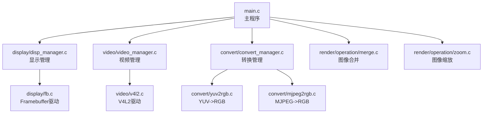
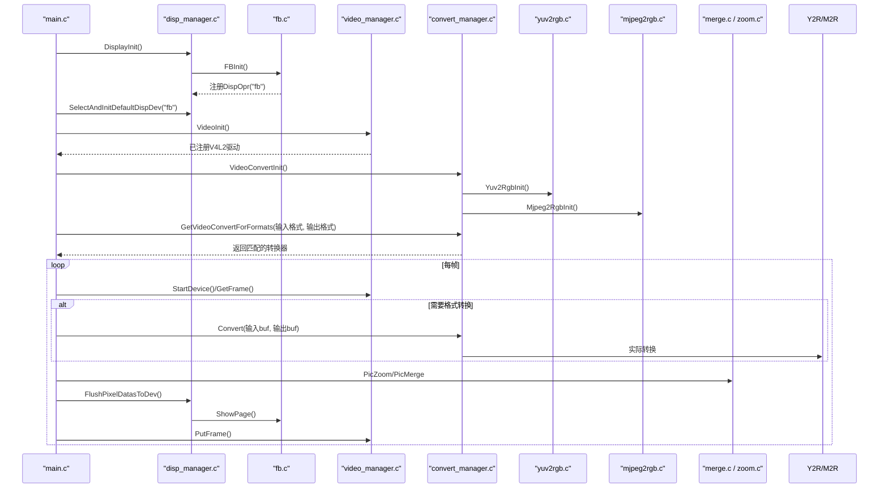
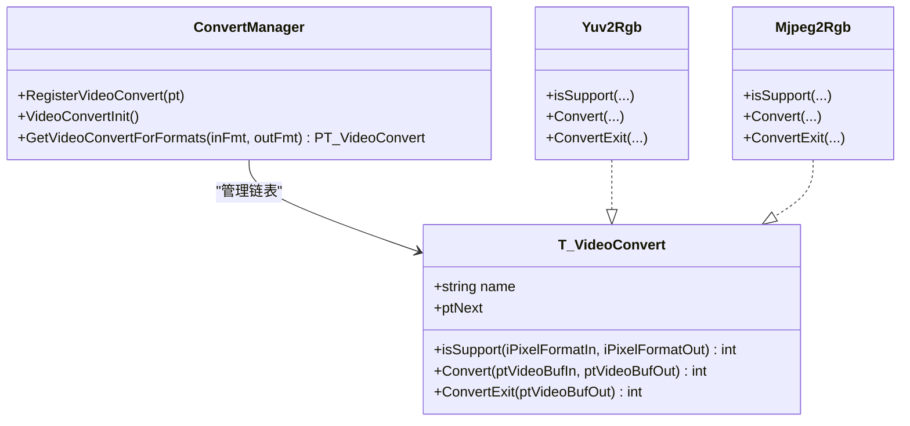
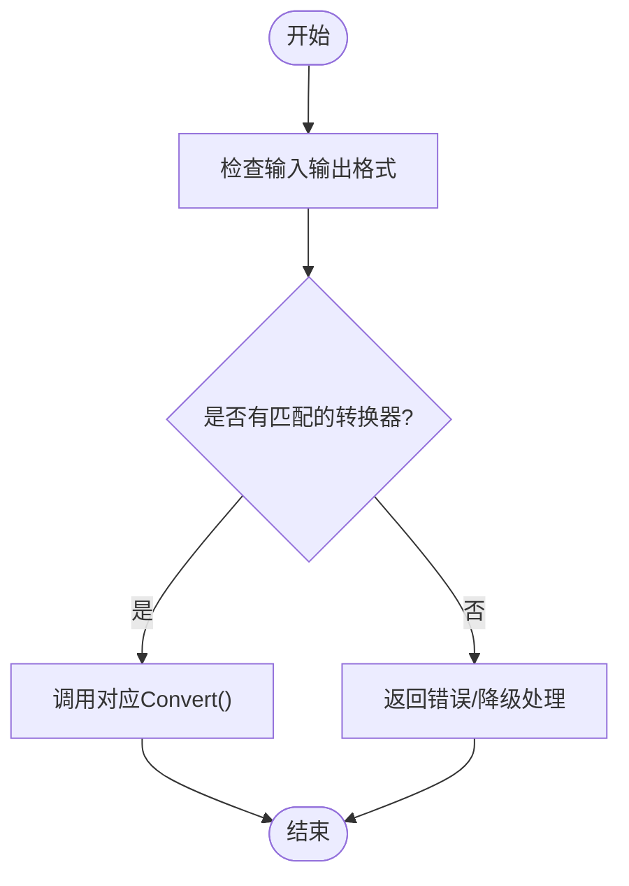
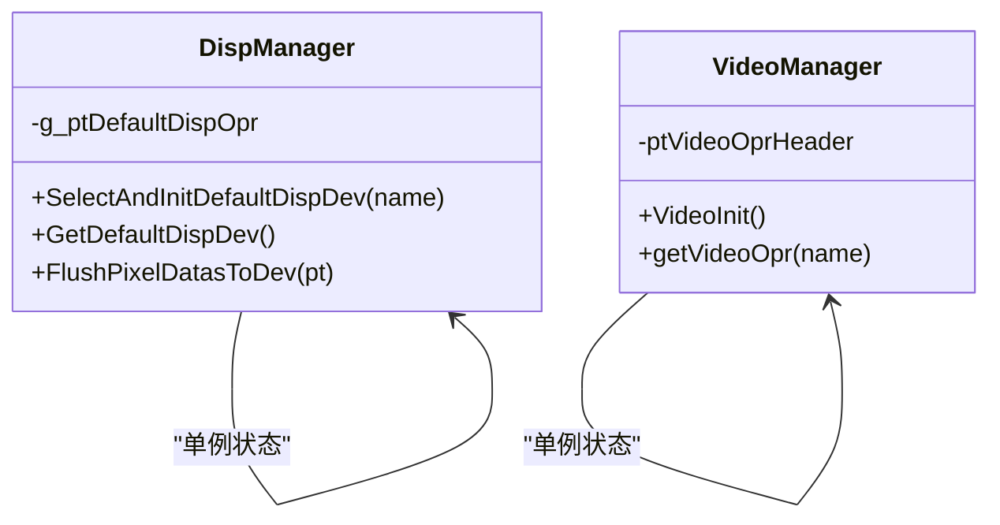
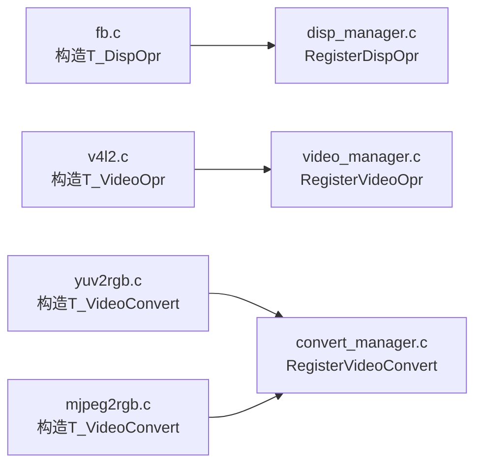
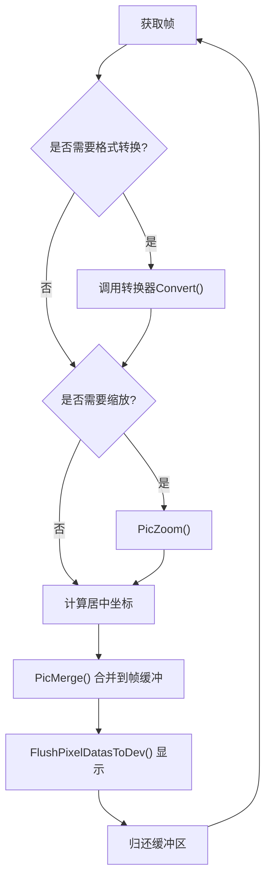
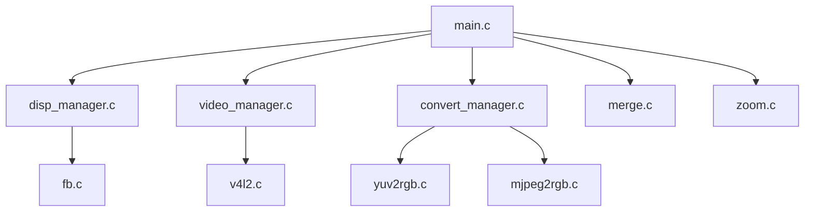

# 设计模式应用

<cite>
**本文引用的文件**
- [main.c](file://video2lcd/main.c)
- [convert_manager.c](file://video2lcd/convert/convert_manager.c)
- [convert_manager.h](file://video2lcd/include/convert_manager.h)
- [yuv2rgb.c](file://video2lcd/convert/yuv2rgb.c)
- [mjpeg2rgb.c](file://video2lcd/convert/mjpeg2rgb.c)
- [disp_manager.c](file://video2lcd/display/disp_manager.c)
- [disp_manager.h](file://video2lcd/include/disp_manager.h)
- [fb.c](file://video2lcd/display/fb.c)
- [video_manager.c](file://video2lcd/video/video_manager.c)
- [video_manager.h](file://video2lcd/include/video_manager.h)
- [merge.c](file://video2lcd/render/operation/merge.c)
- [zoom.c](file://video2lcd/render/operation/zoom.c)
- [pic_operation.h](file://video2lcd/include/pic_operation.h)
</cite>

## 目录
1. [简介](#简介)
2. [项目结构](#项目结构)
3. [核心组件](#核心组件)
4. [架构总览](#架构总览)
5. [详细组件分析](#详细组件分析)
6. [依赖关系分析](#依赖关系分析)
7. [性能考虑](#性能考虑)
8. [故障排查指南](#故障排查指南)
9. [结论](#结论)
10. [附录：代码示例路径](#附录代码示例路径)

## 简介
本文件面向嵌入式Linux相机项目中“设计模式”的应用，重点说明：
- 工厂模式在格式转换器创建中的应用（按输入输出像素格式动态选择并返回转换器）
- 策略模式在不同转换算法选择中的使用（YUV->RGB、MJPEG->RGB等算法可插拔）
- 单例模式在设备管理器中的实现（显示与视频操作接口通过全局唯一实例管理）
- 插件式架构如何通过函数指针和结构体注册机制实现设备的动态加载
这些模式有效降低了模块间耦合度，提升了可扩展性与可维护性。

## 项目结构
项目采用分层与模块化组织：
- 顶层入口 main.c 编排采集、转换、缩放、合并、显示的完整流程
- convert 子模块提供多种图像格式转换器的注册与选择
- display 子模块抽象显示设备操作，当前实现了 framebuffer 驱动
- video 子模块抽象摄像头设备操作，当前实现了 V4L2 驱动
- render/operation 提供图像缩放、合并等通用图像处理能力
- include 提供跨模块共享的数据结构与接口定义

图表来源
- [main.c:63-178](file://video2lcd/main.c#L63-L178)
- [disp_manager.c:514-521](file://video2lcd/display/disp_manager.c#L514-L521)
- [fb.c:249-252](file://video2lcd/display/fb.c#L249-L252)
- [video_manager.c:67-74](file://video2lcd/video/video_manager.c#L67-L74)
- [convert_manager.c:121-130](file://video2lcd/convert/convert_manager.c#L121-L130)
- [yuv2rgb.c:228-232](file://video2lcd/convert/yuv2rgb.c#L228-L232)
- [mjpeg2rgb.c:257-260](file://video2lcd/convert/mjpeg2rgb.c#L257-L260)
- [merge.c:20-46](file://video2lcd/render/operation/merge.c#L20-L46)
- [zoom.c:27-85](file://video2lcd/render/operation/zoom.c#L27-L85)

章节来源
- [main.c:34-192](file://video2lcd/main.c#L34-L192)

## 核心组件
- 显示设备管理：通过 DispOpr 函数指针表统一封装显示设备操作，支持多设备注册与默认设备选择；内部维护 VideoMem 链表用于缓冲管理。
- 视频设备管理：通过 VideoOpr 函数指针表统一封装摄像头设备操作，支持多驱动注册与默认驱动选择。
- 格式转换管理：通过 VideoConvert 函数指针表统一封装格式转换能力，支持多转换器注册与按格式自动选择。
- 图像处理：提供缩放、合并等基础操作，供上层流水线调用。

章节来源
- [disp_manager.h:84-96](file://video2lcd/include/disp_manager.h#L84-L96)
- [video_manager.h:35-44](file://video2lcd/include/video_manager.h#L35-L44)
- [convert_manager.h:23-29](file://video2lcd/include/convert_manager.h#L23-L29)
- [merge.c:20-46](file://video2lcd/render/operation/merge.c#L20-L46)
- [zoom.c:27-85](file://video2lcd/render/operation/zoom.c#L27-L85)

## 架构总览
系统以“采集 -> 转换 -> 缩放 -> 合并 -> 显示”的流水线为核心，各阶段通过统一的函数指针接口解耦，支持运行时动态选择具体实现。

图表来源
- [main.c:63-178](file://video2lcd/main.c#L63-L178)
- [disp_manager.c:514-521](file://video2lcd/display/disp_manager.c#L514-L521)
- [fb.c:249-252](file://video2lcd/display/fb.c#L249-L252)
- [video_manager.c:67-74](file://video2lcd/video/video_manager.c#L67-L74)
- [convert_manager.c:121-130](file://video2lcd/convert/convert_manager.c#L121-L130)
- [yuv2rgb.c:228-232](file://video2lcd/convert/yuv2rgb.c#L228-L232)
- [mjpeg2rgb.c:257-260](file://video2lcd/convert/mjpeg2rgb.c#L257-L260)
- [merge.c:20-46](file://video2lcd/render/operation/merge.c#L20-L46)
- [zoom.c:27-85](file://video2lcd/render/operation/zoom.c#L27-L85)

## 详细组件分析

### 工厂模式：格式转换器的创建与选择
- 目标：根据输入输出像素格式，动态选择合适的转换器，避免硬编码分支。
- 实现要点：
  - 每个转换器实现统一的 T_VideoConvert 接口（名称、isSupport、Convert、ConvertExit），并通过 RegisterVideoConvert 加入全局链表。
  - VideoConvertInit 集中初始化所有转换器。
  - GetVideoConvertForFormats 遍历链表，调用 isSupport 判断是否匹配，返回第一个支持的转换器。
- 效果：新增转换器只需实现接口并注册，无需修改上层逻辑，符合开闭原则。

图表来源
- [convert_manager.h:23-29](file://video2lcd/include/convert_manager.h#L23-L29)
- [convert_manager.c:23-44](file://video2lcd/convert/convert_manager.c#L23-L44)
- [convert_manager.c:98-111](file://video2lcd/convert/convert_manager.c#L98-L111)
- [convert_manager.c:121-130](file://video2lcd/convert/convert_manager.c#L121-L130)
- [yuv2rgb.c:218-232](file://video2lcd/convert/yuv2rgb.c#L218-L232)
- [mjpeg2rgb.c:248-260](file://video2lcd/convert/mjpeg2rgb.c#L248-L260)

章节来源
- [convert_manager.c:23-130](file://video2lcd/convert/convert_manager.c#L23-L130)
- [convert_manager.h:31-43](file://video2lcd/include/convert_manager.h#L31-L43)
- [yuv2rgb.c:25-34](file://video2lcd/convert/yuv2rgb.c#L25-L34)
- [mjpeg2rgb.c:38-47](file://video2lcd/convert/mjpeg2rgb.c#L38-L47)

### 策略模式：不同转换算法的选择
- 目标：将“如何转换”从“何时转换”中分离，允许运行时选择具体算法。
- 实现要点：
  - 每种转换算法实现独立的 isSupport 与 Convert，由管理器统一调度。
  - 主流程仅关心输入输出格式，不感知具体算法细节。
- 效果：新增算法不影响既有流程，便于扩展与维护。

图表来源
- [main.c:129-139](file://video2lcd/main.c#L129-L139)
- [convert_manager.c:98-111](file://video2lcd/convert/convert_manager.c#L98-L111)
- [yuv2rgb.c:161-199](file://video2lcd/convert/yuv2rgb.c#L161-L199)
- [mjpeg2rgb.c:145-228](file://video2lcd/convert/mjpeg2rgb.c#L145-L228)

章节来源
- [main.c:129-139](file://video2lcd/main.c#L129-L139)
- [convert_manager.c:98-111](file://video2lcd/convert/convert_manager.c#L98-L111)

### 单例模式：设备管理器的全局唯一实例
- 目标：确保显示与视频操作接口在全局范围内唯一且可访问。
- 实现要点：
  - 显示管理：全局保存默认 DispOpr 指针 g_ptDefaultDispOpr，通过 SelectAndInitDefaultDispDev 设置一次后复用。
  - 视频管理：全局保存 VideoOpr 链表头 ptVideoOprHeader，通过 VideoInit 完成注册。
- 效果：上层无需传递上下文即可调用设备相关功能，简化调用链。

图表来源
- [disp_manager.c:13-18](file://video2lcd/display/disp_manager.c#L13-L18)
- [disp_manager.c:100-113](file://video2lcd/display/disp_manager.c#L100-L113)
- [video_manager.c:4-4](file://video2lcd/video/video_manager.c#L4-L4)
- [video_manager.c:67-74](file://video2lcd/video/video_manager.c#L67-L74)

章节来源
- [disp_manager.c:13-18](file://video2lcd/display/disp_manager.c#L13-L18)
- [disp_manager.c:100-113](file://video2lcd/display/disp_manager.c#L100-L113)
- [video_manager.c:4-4](file://video2lcd/video/video_manager.c#L4-L4)

### 插件式架构：函数指针与结构体注册机制
- 目标：通过统一接口与注册表，实现设备驱动的动态加载与切换。
- 实现要点：
  - 显示：T_DispOpr 包含 DeviceInit、ShowPixel、CleanScreen、ShowPage 等函数指针；fb.c 构造实例并调用 RegisterDispOpr 注册。
  - 视频：T_VideoOpr 包含 initDevice、GetFrame、PutFrame、StartDevice 等函数指针；v4l2.c 实现并注册。
  - 转换：T_VideoConvert 包含 isSupport、Convert、ConvertExit；各转换器实现并注册。
- 效果：新增设备或算法仅需实现接口并注册，无需改动上层流程。

图表来源
- [fb.c:37-43](file://video2lcd/display/fb.c#L37-L43)
- [fb.c:249-252](file://video2lcd/display/fb.c#L249-L252)
- [disp_manager.c:27-48](file://video2lcd/display/disp_manager.c#L27-L48)
- [video_manager.c:12-27](file://video2lcd/video/video_manager.c#L12-L27)
- [convert_manager.c:23-44](file://video2lcd/convert/convert_manager.c#L23-L44)
- [yuv2rgb.c:218-232](file://video2lcd/convert/yuv2rgb.c#L218-L232)
- [mjpeg2rgb.c:248-260](file://video2lcd/convert/mjpeg2rgb.c#L248-L260)

章节来源
- [disp_manager.c:27-48](file://video2lcd/display/disp_manager.c#L27-L48)
- [video_manager.c:12-27](file://video2lcd/video/video_manager.c#L12-L27)
- [convert_manager.c:23-44](file://video2lcd/convert/convert_manager.c#L23-L44)

### 数据流与处理逻辑
- 采集：通过 VideoDevice.ptOPr->GetFrame 获取原始帧。
- 转换：若输入输出格式不一致，调用 GetVideoConvertForFormats 选择的转换器进行转换。
- 缩放：当图像尺寸大于LCD分辨率时，执行等比例缩放。
- 合并：计算居中位置，将缩放后的图像合并到帧缓冲区。
- 显示：调用 FlushPixelDatasToDev 刷新至硬件。

图表来源
- [main.c:118-189](file://video2lcd/main.c#L118-L189)
- [convert_manager.c:98-111](file://video2lcd/convert/convert_manager.c#L98-L111)
- [zoom.c:27-85](file://video2lcd/render/operation/zoom.c#L27-L85)
- [merge.c:20-46](file://video2lcd/render/operation/merge.c#L20-L46)
- [disp_manager.c:172-175](file://video2lcd/display/disp_manager.c#L172-L175)

章节来源
- [main.c:118-189](file://video2lcd/main.c#L118-L189)

## 依赖关系分析
- main.c 依赖 disp_manager、video_manager、convert_manager 提供的统一接口。
- disp_manager 依赖 fb.c 的具体实现；video_manager 依赖 v4l2.c 的具体实现。
- convert_manager 依赖 yuv2rgb.c、mjpeg2rgb.c 等具体转换器。
- 渲染模块 merge.c、zoom.c 被 main.c 直接调用，作为通用图像处理工具。

图表来源
- [main.c:63-178](file://video2lcd/main.c#L63-L178)
- [disp_manager.c:514-521](file://video2lcd/display/disp_manager.c#L514-L521)
- [video_manager.c:67-74](file://video2lcd/video/video_manager.c#L67-L74)
- [convert_manager.c:121-130](file://video2lcd/convert/convert_manager.c#L121-L130)

章节来源
- [main.c:63-178](file://video2lcd/main.c#L63-L178)

## 性能考虑
- 最近邻插值缩放：计算简单、速度快，适合嵌入式实时场景，但可能出现锯齿。
- 行缓冲解码：MJPEG->RGB 使用逐行读取与转换，减少内存占用。
- 直接映射显存：Framebuffer 通过 mmap 映射到用户空间，避免额外拷贝。
- 批量复制：合并时使用 memcpy 逐行复制，提升带宽利用率。

[本节为通用性能讨论，不直接分析具体文件]

## 故障排查指南
- 无合适转换器：当 GetVideoConvertForFormats 返回 NULL 时，检查输入输出格式组合是否被任何转换器支持。
- 显示未初始化：若 GetDispResolution 失败，确认是否调用了 SelectAndInitDefaultDispDev。
- 帧获取失败：GetFrame 返回错误时，检查摄像头设备状态与缓冲区队列。
- JPEG 解码异常：MJPEG->RGB 使用 setjmp/longjmp 恢复错误，注意释放资源。

章节来源
- [main.c:91-99](file://video2lcd/main.c#L91-L99)
- [disp_manager.c:125-138](file://video2lcd/display/disp_manager.c#L125-L138)
- [mjpeg2rgb.c:155-173](file://video2lcd/convert/mjpeg2rgb.c#L155-L173)

## 结论
本项目通过工厂模式、策略模式与单例模式，结合函数指针与结构体注册的插件式架构，实现了：
- 低耦合：上层流程不依赖具体设备与算法实现
- 高扩展：新增设备或算法仅需实现接口并注册
- 易维护：统一接口降低理解成本，便于调试与替换
这些设计使系统在嵌入式环境下具备良好的实时性与可维护性。

[本节为总结性内容，不直接分析具体文件]

## 附录：代码示例路径
- 工厂模式（转换器选择）
  - [convert_manager.c:98-111](file://video2lcd/convert/convert_manager.c#L98-L111)
  - [convert_manager.c:121-130](file://video2lcd/convert/convert_manager.c#L121-L130)
- 策略模式（转换算法）
  - [yuv2rgb.c:161-199](file://video2lcd/convert/yuv2rgb.c#L161-L199)
  - [mjpeg2rgb.c:145-228](file://video2lcd/convert/mjpeg2rgb.c#L145-L228)
- 单例模式（设备管理）
  - [disp_manager.c:13-18](file://video2lcd/display/disp_manager.c#L13-L18)
  - [disp_manager.c:100-113](file://video2lcd/display/disp_manager.c#L100-L113)
  - [video_manager.c:4-4](file://video2lcd/video/video_manager.c#L4-L4)
- 插件式架构（函数指针注册）
  - [fb.c:37-43](file://video2lcd/display/fb.c#L37-L43)
  - [fb.c:249-252](file://video2lcd/display/fb.c#L249-L252)
  - [disp_manager.c:27-48](file://video2lcd/display/disp_manager.c#L27-L48)
  - [video_manager.c:12-27](file://video2lcd/video/video_manager.c#L12-L27)
  - [convert_manager.c:23-44](file://video2lcd/convert/convert_manager.c#L23-L44)
- 数据处理流程
  - [main.c:118-189](file://video2lcd/main.c#L118-L189)
  - [merge.c:20-46](file://video2lcd/render/operation/merge.c#L20-L46)
  - [zoom.c:27-85](file://video2lcd/render/operation/zoom.c#L27-L85)