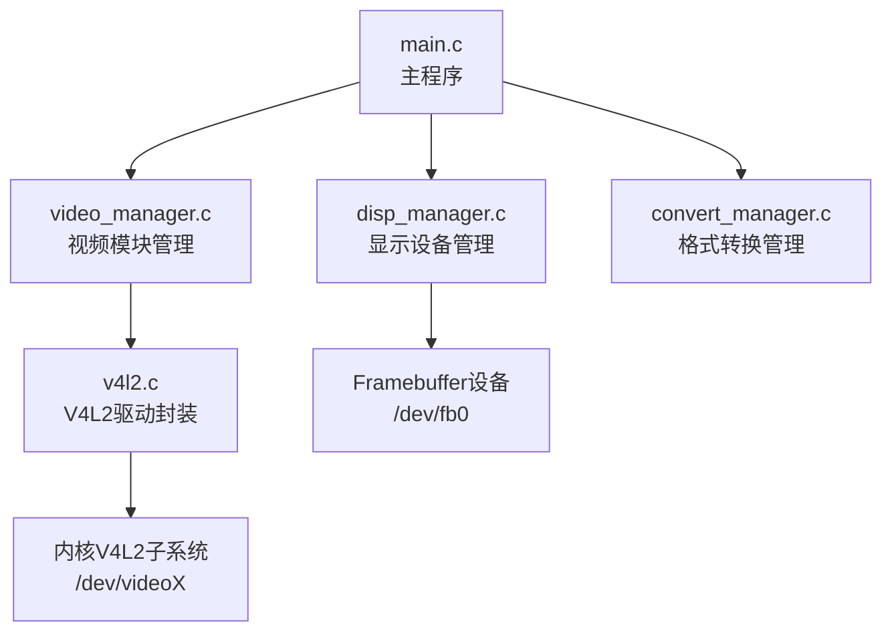
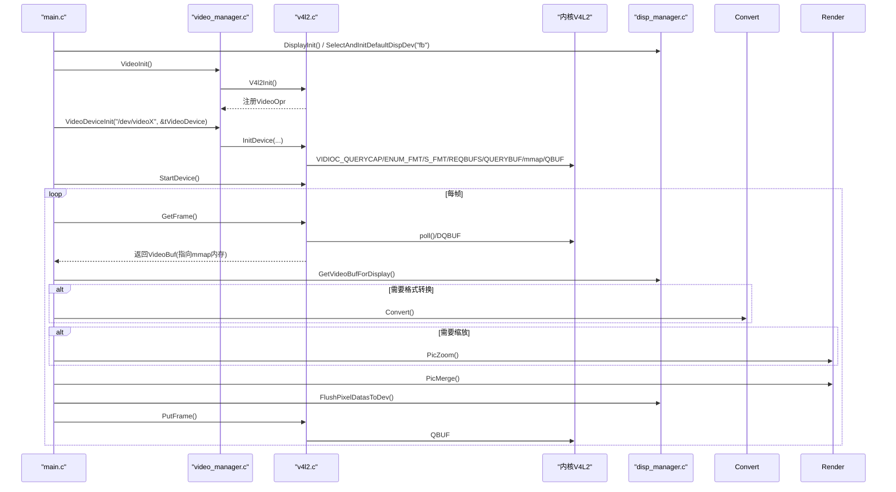
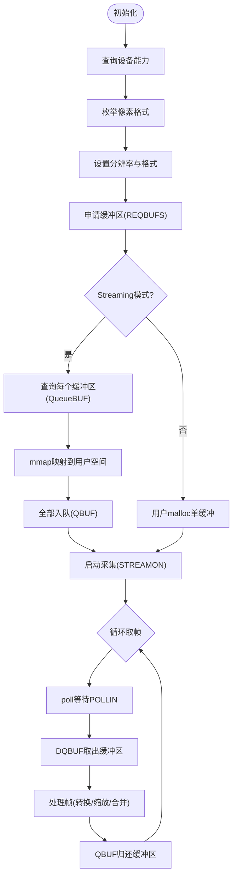
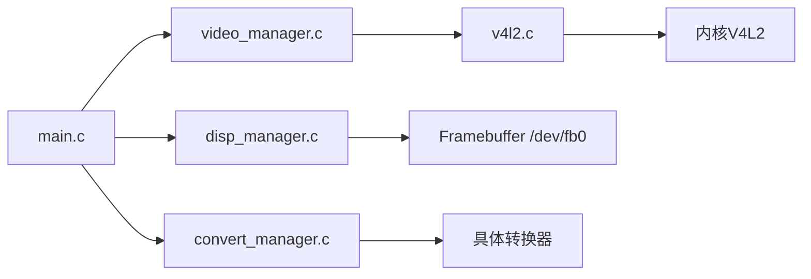

# V4L2驱动实现

<cite>
**本文引用的文件**
- [v4l2.c](file://video2lcd/video/v4l2.c)
- [video_manager.c](file://video2lcd/video/video_manager.c)
- [video_manager.h](file://video2lcd/include/video_manager.h)
- [main.c](file://video2lcd/main.c)
- [config.h](file://video2lcd/include/config.h)
- [pic_operation.h](file://video2lcd/include/pic_operation.h)
- [convert_manager.c](file://video2lcd/convert/convert_manager.c)
- [disp_manager.c](file://video2lcd/display/disp_manager.c)
- [V4L2关键机制深度解析.md](file://video2lcd/doc/V4L2关键机制深度解析.md)
</cite>

## 目录
1. [简介](#简介)
2. [项目结构](#项目结构)
3. [核心组件](#核心组件)
4. [架构总览](#架构总览)
5. [详细组件分析](#详细组件分析)
6. [依赖关系分析](#依赖关系分析)
7. [性能考虑](#性能考虑)
8. [故障排查指南](#故障排查指南)
9. [结论](#结论)
10. [附录：关键流程与示例路径](#附录：关键流程与示例路径)

## 简介
本仓库实现了一个基于V4L2（Video for Linux 2）的嵌入式相机采集与显示系统。其核心目标是通过V4L2接口从摄像头设备获取图像帧，进行必要的格式转换与缩放后，渲染到LCD屏幕。文档将深入解释V4L2设备打开、格式设置、缓冲区分配、mmap零拷贝、双缓冲/多缓冲队列管理、像素格式与分辨率配置、流控制与错误处理，并给出性能优化建议与常见问题诊断方法。

## 项目结构
- video/v4l2.c：V4L2驱动封装，实现设备初始化、格式枚举与设置、缓冲区申请与映射、流启停、取帧/还帧等。
- video/video_manager.c：视频操作模块注册与管理，提供统一接口抽象。
- include/video_manager.h：定义VideoDevice、VideoOpr、VideoBuf等核心数据结构。
- main.c：主程序，串联显示初始化、视频初始化、循环采集、格式转换、缩放、合并与刷新。
- convert/convert_manager.c：格式转换器注册与选择，支持YUV/MJPEG/RGB等转换。
- display/disp_manager.c：显示设备管理，封装Framebuffer操作，提供帧缓冲管理与刷新。
- include/config.h、include/pic_operation.h：全局配置与像素数据通用描述结构。
- doc/V4L2关键机制深度解析.md：对V4L2关键机制的逐行解读笔记。

图表来源
- [main.c:34-192](file://video2lcd/main.c#L34-L192)
- [video_manager.c:12-75](file://video2lcd/video/video_manager.c#L12-L75)
- [v4l2.c:47-401](file://video2lcd/video/v4l2.c#L47-L401)
- [disp_manager.c:100-175](file://video2lcd/display/disp_manager.c#L100-L175)

章节来源
- [main.c:34-192](file://video2lcd/main.c#L34-L192)
- [video_manager.c:12-75](file://video2lcd/video/video_manager.c#L12-L75)
- [v4l2.c:47-401](file://video2lcd/video/v4l2.c#L47-L401)
- [disp_manager.c:100-175](file://video2lcd/display/disp_manager.c#L100-L175)

## 核心组件
- V4L2驱动封装（v4l2.c）
  - 设备能力查询、格式枚举与设置、缓冲区申请与映射、流启停、取帧/还帧。
  - 支持Streaming模式（mmap + 多缓冲轮转）与ReadWrite模式（read读取）。
- 视频模块管理（video_manager.c）
  - 通过链表注册多个视频操作模块，提供统一调用入口。
- 显示设备管理（disp_manager.c）
  - 注册Framebuffer显示设备，提供分辨率查询、帧缓冲获取、刷新等。
- 格式转换管理（convert_manager.c）
  - 注册多种格式转换器，按输入输出格式自动选择合适转换器。
- 主程序（main.c）
  - 协调显示、视频、转换、渲染，完成采集→转换→缩放→合并→显示的完整流水线。

章节来源
- [v4l2.c:47-401](file://video2lcd/video/v4l2.c#L47-L401)
- [video_manager.c:12-75](file://video2lcd/video/video_manager.c#L12-L75)
- [disp_manager.c:100-175](file://video2lcd/display/disp_manager.c#L100-L175)
- [convert_manager.c:23-131](file://video2lcd/convert/convert_manager.c#L23-L131)
- [main.c:34-192](file://video2lcd/main.c#L34-L192)

## 架构总览
系统采用“模块化+函数指针”的C语言面向对象设计，通过统一的VideoOpr接口抽象不同视频源，结合Display与Convert模块形成完整的采集-处理-显示链路。

图表来源
- [main.c:63-181](file://video2lcd/main.c#L63-L181)
- [video_manager.c:67-75](file://video2lcd/video/video_manager.c#L67-L75)
- [v4l2.c:47-401](file://video2lcd/video/v4l2.c#L47-L401)
- [disp_manager.c:100-175](file://video2lcd/display/disp_manager.c#L100-L175)

## 详细组件分析

### V4L2驱动封装（v4l2.c）
- 设备打开与能力查询
  - open设备节点，VIDIOC_QUERYCAP判断是否支持视频采集与streaming/readwrite能力。
- 格式枚举与设置
  - VIDIOC_ENUM_FMT遍历支持的像素格式，匹配内部支持列表；VIDIOC_S_FMT设置分辨率与像素格式。
- 缓冲区申请与映射（Streaming模式）
  - VIDIOC_REQBUFS申请N个缓冲区；VIDIOC_QUERYBUF查询每个缓冲区的length与offset；mmap映射到用户空间，实现零拷贝。
  - 将所有缓冲区VIDIOC_QBUF入队，等待驱动填充。
- 取帧与还帧
  - poll等待数据就绪，VIDIOC_DQBUF取出已填充的缓冲区，填充VideoBuf元信息（宽高、bpp、行字节、总字节、数据指针）。
  - 处理完成后VIDIOC_QBUF归还缓冲区，进入下一帧。
- ReadWrite模式
  - 不使用内核缓冲，用户malloc单缓冲，read直接读取一帧数据。
- 流控制
  - VIDIOC_STREAMON启动采集，VIDIOC_STREAMOFF停止采集。

图表来源
- [v4l2.c:47-401](file://video2lcd/video/v4l2.c#L47-L401)

章节来源
- [v4l2.c:47-401](file://video2lcd/video/v4l2.c#L47-L401)

### 视频模块管理（video_manager.c）
- 使用链表尾插法注册多个VideoOpr模块，支持动态扩展。
- 提供ShowVideoOpr列出所有模块，getVideoOpr按名称查找。
- VideoInit负责初始化具体模块（当前仅V4L2）。

章节来源
- [video_manager.c:12-75](file://video2lcd/video/video_manager.c#L12-L75)

### 显示设备管理（disp_manager.c）
- 注册Framebuffer显示设备，SelectAndInitDefaultDispDev选择默认设备并清屏。
- GetDispResolution获取LCD分辨率与BPP；GetVideoBufForDisplay获取帧缓冲（直接指向显存）。
- FlushPixelDatasToDev调用底层ShowPage刷新到LCD。
- 提供VideoMem管理（预分配页面缓冲），用于未来复杂UI场景。

章节来源
- [disp_manager.c:100-175](file://video2lcd/display/disp_manager.c#L100-L175)
- [disp_manager.c:188-337](file://video2lcd/display/disp_manager.c#L188-L337)

### 格式转换管理（convert_manager.c）
- 注册多种转换器（YUV→RGB、MJPEG→RGB、RGB→RGB）。
- GetVideoConvertForFormats根据输入输出格式自动选择合适转换器。
- VideoConvertInit初始化各转换器。

章节来源
- [convert_manager.c:23-131](file://video2lcd/convert/convert_manager.c#L23-L131)

### 主程序（main.c）
- 初始化显示与视频模块，获取LCD分辨率与帧缓冲。
- 启动V4L2设备，循环取帧，必要时进行格式转换与缩放。
- 计算居中位置，合并到帧缓冲，刷新到LCD，归还V4L2缓冲区。

章节来源
- [main.c:34-192](file://video2lcd/main.c#L34-L192)

## 依赖关系分析
- main.c依赖video_manager.c、disp_manager.c、convert_manager.c，以及v4l2.c提供的VideoOpr。
- v4l2.c依赖内核V4L2接口（ioctl、mmap、poll），并通过video_manager.c暴露统一接口。
- disp_manager.c依赖Framebuffer设备（/dev/fb0），为上层提供帧缓冲访问。
- convert_manager.c依赖具体转换器实现（yuv2rgb、mjpeg2rgb、rgb2rgb）。

图表来源
- [main.c:34-192](file://video2lcd/main.c#L34-L192)
- [video_manager.c:12-75](file://video2lcd/video/video_manager.c#L12-L75)
- [v4l2.c:47-401](file://video2lcd/video/v4l2.c#L47-L401)
- [disp_manager.c:100-175](file://video2lcd/display/disp_manager.c#L100-L175)
- [convert_manager.c:23-131](file://video2lcd/convert/convert_manager.c#L23-L131)

章节来源
- [main.c:34-192](file://video2lcd/main.c#L34-L192)
- [video_manager.c:12-75](file://video2lcd/video/video_manager.c#L12-L75)
- [v4l2.c:47-401](file://video2lcd/video/v4l2.c#L47-L401)
- [disp_manager.c:100-175](file://video2lcd/display/disp_manager.c#L100-L175)
- [convert_manager.c:23-131](file://video2lcd/convert/convert_manager.c#L23-L131)

## 性能考虑
- 缓冲区预分配与多缓冲轮转
  - 使用Streaming模式与多缓冲（如4个）实现环形队列，减少阻塞与拷贝开销。
  - mmap建立用户空间与内核空间的零拷贝通道，避免read/write带来的额外拷贝。
- 异步I/O与事件驱动
  - 使用poll等待数据就绪，避免忙等；仅在数据可用时DQBUF取帧。
- 格式转换与缩放的优化
  - 仅在必要时进行格式转换与缩放；尽量保持原始分辨率以减少缩放成本。
  - 利用最近邻插值等轻量算法进行缩放，平衡质量与性能。
- 显示刷新优化
  - 直接写入Framebuffer显存，减少中间缓冲；按需局部刷新或整屏刷新。
- 资源管理
  - 正确释放mmap映射与文件描述符，避免内存泄漏与句柄泄露。

[本节为通用性能指导，不直接分析具体文件]

## 故障排查指南
- 设备无法打开
  - 检查设备节点是否存在与权限；确认open成功。
  - 参考：[v4l2.c:64-70](file://video2lcd/video/v4l2.c#L64-L70)
- 不支持视频采集或所需格式
  - 检查VIDIOC_QUERYCAP与VIDIOC_ENUM_FMT返回值；确认isSupportThisFormat匹配。
  - 参考：[v4l2.c:71-103](file://video2lcd/video/v4l2.c#L71-L103)
- 设置格式失败
  - 检查VIDIOC_S_FMT参数；注意驱动可能调整分辨率与格式。
  - 参考：[v4l2.c:105-126](file://video2lcd/video/v4l2.c#L105-L126)
- 缓冲区申请或映射失败
  - 检查VIDIOC_REQBUFS与VIDIOC_QUERYBUF返回值；确认mmap参数正确。
  - 参考：[v4l2.c:127-195](file://video2lcd/video/v4l2.c#L127-L195)
- 取帧阻塞或失败
  - 检查poll返回值与VIDIOC_DQBUF；确保至少有一个缓冲区已入队。
  - 参考：[v4l2.c:267-306](file://video2lcd/video/v4l2.c#L267-L306)
- 流启停失败
  - 检查VIDIOC_STREAMON/STREAMOFF返回值。
  - 参考：[v4l2.c:357-383](file://video2lcd/video/v4l2.c#L357-L383)
- 显示问题
  - 确认DisplayInit与SelectAndInitDefaultDispDev成功；检查GetVideoBufForDisplay与FlushPixelDatasToDev。
  - 参考：[disp_manager.c:100-175](file://video2lcd/display/disp_manager.c#L100-L175)

章节来源
- [v4l2.c:64-383](file://video2lcd/video/v4l2.c#L64-L383)
- [disp_manager.c:100-175](file://video2lcd/display/disp_manager.c#L100-L175)

## 结论
本项目以V4L2为核心，实现了从摄像头采集到LCD显示的完整链路。通过模块化设计与函数指针抽象，系统具备良好的可扩展性与可维护性。Streaming模式配合mmap与多缓冲轮转，实现了高效的零拷贝数据传输；结合格式转换与缩放，能够适配不同像素格式与分辨率。文档提供了详细的流程分析与故障排查指引，有助于快速定位与解决问题。

[本节为总结性内容，不直接分析具体文件]

## 附录：关键流程与示例路径
- V4L2初始化与流控制
  - 设备打开与能力查询：[v4l2.c:64-87](file://video2lcd/video/v4l2.c#L64-L87)
  - 格式枚举与设置：[v4l2.c:89-126](file://video2lcd/video/v4l2.c#L89-L126)
  - 缓冲区申请与映射：[v4l2.c:127-195](file://video2lcd/video/v4l2.c#L127-L195)
  - 流启停：[v4l2.c:357-383](file://video2lcd/video/v4l2.c#L357-L383)
- 取帧与还帧（Streaming模式）
  - 取帧：[v4l2.c:267-306](file://video2lcd/video/v4l2.c#L267-L306)
  - 还帧：[v4l2.c:309-326](file://video2lcd/video/v4l2.c#L309-L326)
- 取帧与还帧（ReadWrite模式）
  - 取帧：[v4l2.c:328-349](file://video2lcd/video/v4l2.c#L328-L349)
  - 还帧：[v4l2.c:352-355](file://video2lcd/video/v4l2.c#L352-L355)
- 主程序流程
  - 显示初始化与视频初始化：[main.c:63-87](file://video2lcd/main.c#L63-L87)
  - 循环采集与处理：[main.c:117-189](file://video2lcd/main.c#L117-L189)
- 显示与帧缓冲
  - 获取帧缓冲与刷新：[disp_manager.c:148-175](file://video2lcd/display/disp_manager.c#L148-L175)
- 格式转换
  - 转换器注册与选择：[convert_manager.c:23-131](file://video2lcd/convert/convert_manager.c#L23-L131)

章节来源
- [v4l2.c:64-383](file://video2lcd/video/v4l2.c#L64-L383)
- [main.c:63-189](file://video2lcd/main.c#L63-L189)
- [disp_manager.c:148-175](file://video2lcd/display/disp_manager.c#L148-L175)
- [convert_manager.c:23-131](file://video2lcd/convert/convert_manager.c#L23-L131)