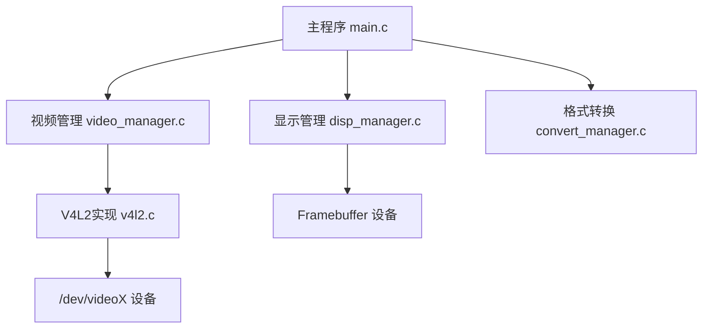
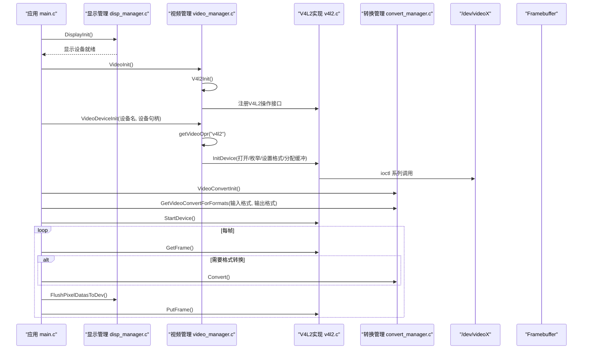
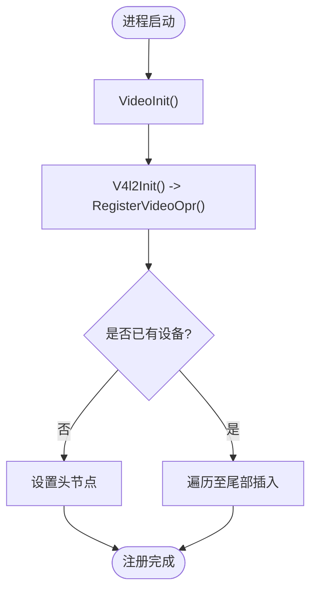
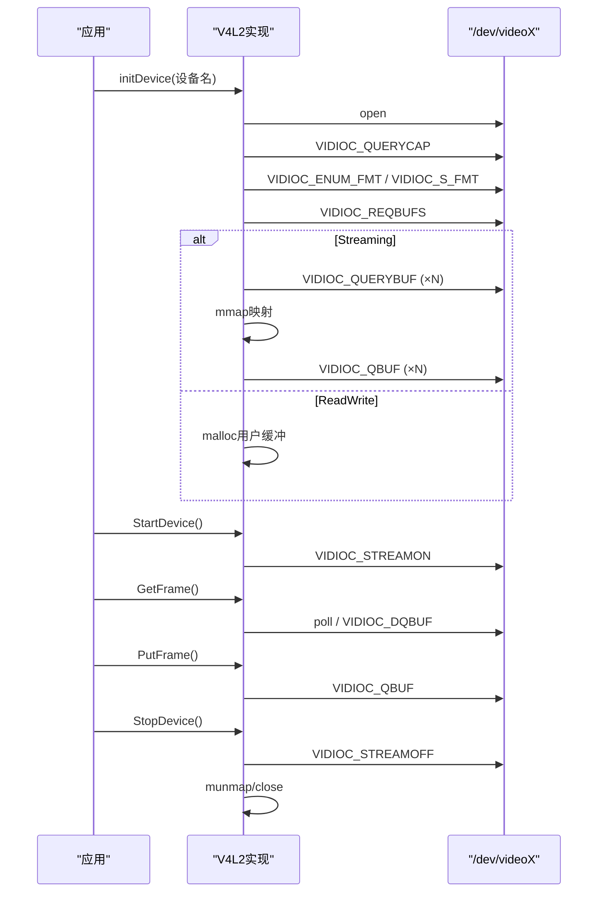
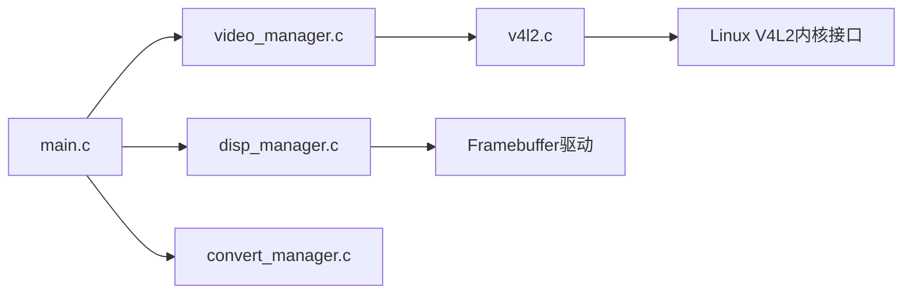

# 视频设备管理器

<cite>
**本文引用的文件**
- [video_manager.h](file://video2lcd/include/video_manager.h)
- [video_manager.c](file://video2lcd/video/video_manager.c)
- [v4l2.c](file://video2lcd/video/v4l2.c)
- [main.c](file://video2lcd/main.c)
- [disp_manager.c](file://video2lcd/display/disp_manager.c)
- [convert_manager.c](file://video2lcd/convert/convert_manager.c)
- [config.h](file://video2lcd/include/config.h)
- [pic_operation.h](file://video2lcd/include/pic_operation.h)
</cite>

## 更新摘要
**所做更改**
- 增强了视频管理子系统，新增了VideoDeviceInit()函数提供统一的摄像头设备初始化接口
- 实现了自动V4L2驱动选择和插件式架构改进
- 更新了T_VideoBuf结构体重组，采用统一的像素数据载体设计
- 新增了API函数包括RegisterVideoOpr()、getVideoOpr()和VideoDeviceInit()
- 完善了设备抽象层的设计，支持多设备管理和动态发现

## 目录
1. [简介](#简介)
2. [项目结构](#项目结构)
3. [核心组件](#核心组件)
4. [架构总览](#架构总览)
5. [详细组件分析](#详细组件分析)
6. [依赖关系分析](#依赖关系分析)
7. [性能考量](#性能考量)
8. [故障排查指南](#故障排查指南)
9. [结论](#结论)
10. [附录：API使用示例与调试技巧](#附录api使用示例与调试技巧)

## 简介
本仓库实现了一个面向嵌入式Linux的视频采集与显示系统，核心目标是提供"视频设备管理器"，通过统一的接口抽象不同视频设备的差异，支持插件式注册、多设备枚举与管理、完整的生命周期管理（初始化、配置、启动、停止、销毁），以及健壮的错误处理机制。系统以V4L2为后端驱动，结合Framebuffer显示、像素格式转换与图像缩放/合成，形成从采集到显示的完整流水线。

**更新** 本次更新增强了视频管理子系统，引入了VideoDeviceInit()统一初始化接口，改进了插件式架构，并重新组织了T_VideoBuf数据结构以提升系统的可扩展性和维护性。

## 项目结构
- 视频层：video_manager.c 提供设备操作接口的注册与查找；v4l2.c 实现V4L2驱动的封装与具体采集流程。
- 显示层：disp_manager.c 提供显示设备注册、默认设备选择、帧缓冲管理与刷新。
- 转换层：convert_manager.c 提供多种像素格式转换器的注册与自动选择。
- 公共数据模型：pic_operation.h 定义统一的像素数据结构；config.h 提供全局配置与调试宏。
- 应用入口：main.c 串联显示初始化、视频初始化、设备选择、格式转换、采集循环与显示刷新。

**图表来源**
- [main.c:34-111](file://video2lcd/main.c#L34-L111)
- [disp_manager.c:514-521](file://video2lcd/display/disp_manager.c#L514-L521)
- [video_manager.c:67-74](file://video2lcd/video/video_manager.c#L67-L74)
- [v4l2.c:47-249](file://video2lcd/video/v4l2.c#L47-L249)

**章节来源**
- [main.c:34-111](file://video2lcd/main.c#L34-L111)
- [disp_manager.c:514-521](file://video2lcd/display/disp_manager.c#L514-L521)
- [video_manager.c:67-74](file://video2lcd/video/video_manager.c#L67-L74)
- [v4l2.c:47-249](file://video2lcd/video/v4l2.c#L47-L249)

## 核心组件
- **设备抽象层**
  - VideoDevice：描述一个摄像头设备的状态（文件描述符、像素格式、分辨率、缓冲区数组等）。
  - VideoOpr：统一的操作接口（init/exit/get/put/start/stop），通过函数指针实现多态。
  - VideoBuf：统一的一帧数据载体，包含像素数据与格式信息。
- **设备注册与管理**
  - RegisterVideoOpr：尾插法将设备操作结构体加入链表。
  - getVideoOpr：按名称查找已注册的设备操作接口。
  - ShowVideoOpr：列出所有已注册设备。
  - **新增** VideoDeviceInit：统一设备初始化接口，自动选择并绑定V4L2驱动。
- **V4L2实现**
  - 打开设备、查询能力、枚举并设置像素格式、申请并映射缓冲区、入队、启动/停止采集、取帧/还帧。
- **显示管理**
  - 注册显示设备、选择默认设备、获取分辨率与帧缓冲、刷新显示。
- **格式转换**
  - 注册转换器、根据输入输出格式自动选择转换器。

**章节来源**
- [video_manager.h:14-68](file://video2lcd/include/video_manager.h#L14-L68)
- [video_manager.c:12-97](file://video2lcd/video/video_manager.c#L12-L97)
- [v4l2.c:47-405](file://video2lcd/video/v4l2.c#L47-L405)
- [disp_manager.c:27-175](file://video2lcd/display/disp_manager.c#L27-L175)
- [convert_manager.c:23-130](file://video2lcd/convert/convert_manager.c#L23-L130)

## 架构总览
系统采用"插件式"架构：各模块（视频、显示、转换）通过统一的注册接口将自身能力暴露给上层，运行时由管理器动态发现与选择。视频采集遵循V4L2标准流程，支持Streaming与ReadWrite两种模式；显示基于Framebuffer，提供帧缓冲管理与刷新；格式转换在采集与显示之间进行适配。

**更新** 新的VideoDeviceInit()函数提供了统一的设备初始化接口，简化了上层调用，同时保持了插件式架构的灵活性。

**图表来源**
- [main.c:63-111](file://video2lcd/main.c#L63-L111)
- [video_manager.c:67-97](file://video2lcd/video/video_manager.c#L67-L97)
- [v4l2.c:47-405](file://video2lcd/video/v4l2.c#L47-L405)
- [disp_manager.c:514-521](file://video2lcd/display/disp_manager.c#L514-L521)
- [convert_manager.c:121-130](file://video2lcd/convert/convert_manager.c#L121-L130)

## 详细组件分析

### 设备抽象层设计
- **目标**：隐藏不同视频设备差异，统一Get/Put/Start/Stop等操作。
- **关键结构**
  - VideoDevice：保存设备FD、像素格式、分辨率、缓冲区计数与长度、当前索引、缓冲区数组、操作接口指针。
  - VideoOpr：name、initDevice、ExitDevice、GetFrame、PutFrame、StartDevice、StopDevice、ptNext。
  - **更新** VideoBuf：采用统一的T_PixelDatas结构，包含像素数据指针、尺寸、色深、行字节数、总字节数和像素格式标识。
- **设计要点**
  - 通过函数指针实现C语言的多态，便于扩展新设备类型。
  - 统一的数据载体VideoBuf贯穿采集、转换、渲染链路，提升了数据传递的一致性和效率。

**章节来源**
- [video_manager.h:14-68](file://video2lcd/include/video_manager.h#L14-L68)
- [pic_operation.h:10-17](file://video2lcd/include/pic_operation.h#L10-L17)

### 设备注册机制与插件式架构
- **注册方式**
  - RegisterVideoOpr：尾插法将VideoOpr加入全局链表，支持多个设备驱动同时存在。
  - ShowVideoOpr：遍历链表打印设备名称，用于调试与枚举。
  - getVideoOpr：按名称查找对应操作接口，供上层按需选择。
  - **新增** VideoDeviceInit：统一设备初始化接口，自动查找并绑定指定名称的设备驱动。
- **插件原理**
  - 每个设备驱动（如V4L2）构造自己的T_VideoOpr实例，并在初始化时调用RegisterVideoOpr完成注册。
  - 上层通过VideoInit触发各模块的初始化与注册，实现"热插拔"式的设备发现。

**图表来源**
- [video_manager.c:12-27](file://video2lcd/video/video_manager.c#L12-L27)
- [v4l2.c:397-405](file://video2lcd/video/v4l2.c#L397-L405)

**章节来源**
- [video_manager.c:12-97](file://video2lcd/video/video_manager.c#L12-L97)
- [v4l2.c:387-405](file://video2lcd/video/v4l2.c#L387-L405)

### 多设备支持与设备发现
- **设备枚举**
  - ShowVideoOpr：列出所有已注册设备名称。
  - getVideoOpr：按名称获取设备操作接口。
- **设备选择策略**
  - 主程序通过命令行参数指定设备路径，调用VideoDeviceInit完成具体设备初始化。
  - **更新** VideoDeviceInit函数自动查找名为"v4l2"的设备驱动，简化了设备选择过程。
  - 若需动态切换设备，可在运行期通过getVideoOpr选择不同设备并重新初始化。

**章节来源**
- [video_manager.c:35-97](file://video2lcd/video/video_manager.c#L35-L97)
- [main.c:76-87](file://video2lcd/main.c#L76-L87)

### 视频设备生命周期管理
- **初始化**
  - open设备文件描述符。
  - VIDIOC_QUERYCAP：确认设备能力（视频捕获、Streaming/Readwrite）。
  - VIDIOC_ENUM_FMT + VIDIOC_S_FMT：枚举支持的像素格式并设置分辨率。
  - VIDIOC_REQBUFS：申请内核缓冲区数量。
  - Streaming模式：VIDIOC_QUERYBUF + mmap映射用户空间；VIDIOC_QBUF：将所有缓冲区入队。
  - ReadWrite模式：分配用户缓冲区，后续read读取。
- **启动**
  - VIDIOC_STREAMON：开始采集。
- **取帧与还帧**
  - Streaming：poll等待数据就绪 → VIDIOC_DQBUF取出 → 处理 → VIDIOC_QBUF放回。
  - ReadWrite：read读取一帧。
- **停止与销毁**
  - VIDIOC_STREAMOFF：停止采集。
  - munmap释放映射；close关闭设备。

**图表来源**
- [v4l2.c:47-249](file://video2lcd/video/v4l2.c#L47-L249)
- [v4l2.c:267-326](file://video2lcd/video/v4l2.c#L267-L326)
- [v4l2.c:357-383](file://video2lcd/video/v4l2.c#L357-L383)

**章节来源**
- [v4l2.c:47-249](file://video2lcd/video/v4l2.c#L47-L249)
- [v4l2.c:267-326](file://video2lcd/video/v4l2.c#L267-L326)
- [v4l2.c:357-383](file://video2lcd/video/v4l2.c#L357-L383)

### 错误处理机制
- **异常检测**
  - open失败、ioctl失败、mmap失败、poll错误、DQBUF/QBUF失败等均有日志输出与错误返回。
- **资源泄漏防护**
  - err_exit分支确保close设备描述符。
  - ExitDevice中循环munmap每个缓冲区并置空指针，避免重复释放。
- **恢复策略**
  - 对可恢复错误（如poll超时或队列问题），上层可选择重试或重启采集流程。
  - 对于不可恢复错误（设备不支持所需格式），应提示并退出。

**章节来源**
- [v4l2.c:64-103](file://video2lcd/video/v4l2.c#L64-L103)
- [v4l2.c:137-142](file://video2lcd/video/v4l2.c#L137-L142)
- [v4l2.c:187-194](file://video2lcd/video/v4l2.c#L187-L194)
- [v4l2.c:246-249](file://video2lcd/video/v4l2.c#L246-L249)
- [v4l2.c:251-265](file://video2lcd/video/v4l2.c#L251-L265)

### 显示与转换集成
- **显示**
  - DisplayInit注册显示设备；SelectAndInitDefaultDispDev选择并初始化默认设备；GetVideoBufForDisplay获取帧缓冲；FlushPixelDatasToDev刷新显示。
- **转换**
  - VideoConvertInit初始化各转换器；GetVideoConvertForFormats根据输入输出格式自动选择合适转换器；Convert执行实际转换。

**章节来源**
- [disp_manager.c:514-521](file://video2lcd/display/disp_manager.c#L514-L521)
- [disp_manager.c:148-175](file://video2lcd/display/disp_manager.c#L148-L175)
- [convert_manager.c:121-130](file://video2lcd/convert/convert_manager.c#L121-L130)
- [convert_manager.c:98-111](file://video2lcd/convert/convert_manager.c#L98-L111)

## 依赖关系分析
- **模块耦合**
  - main.c依赖display、video、convert三个管理器。
  - video_manager.c依赖v4l2.c提供的V4L2操作接口。
  - v4l2.c依赖内核V4L2接口与系统调用（open/ioctl/mmap/poll/read）。
  - disp_manager.c依赖fb驱动与系统内存映射。
- **外部依赖**
  - Linux内核头文件videodev2.h。
  - 系统库sys/types.h、sys/stat.h、fcntl.h、sys/mman.h、poll.h。
- **潜在循环依赖**
  - 无直接循环依赖；各管理器通过统一接口解耦。

**图表来源**
- [main.c:34-111](file://video2lcd/main.c#L34-L111)
- [video_manager.c:67-97](file://video2lcd/video/video_manager.c#L67-L97)
- [v4l2.c:1-9](file://video2lcd/video/v4l2.c#L1-L9)
- [disp_manager.c:514-521](file://video2lcd/display/disp_manager.c#L514-L521)

**章节来源**
- [main.c:34-111](file://video2lcd/main.c#L34-L111)
- [video_manager.c:67-97](file://video2lcd/video/video_manager.c#L67-L97)
- [v4l2.c:1-9](file://video2lcd/video/v4l2.c#L1-L9)
- [disp_manager.c:514-521](file://video2lcd/display/disp_manager.c#L514-L521)

## 性能考量
- **零拷贝优势**
  - Streaming模式下通过mmap将内核缓冲区映射到用户空间，避免额外拷贝，提升吞吐。
- **缓冲区轮转**
  - 多缓冲区（NB_BUFFER）减少阻塞，提高采集效率。
- **格式转换优化**
  - 仅在必要时进行格式转换；选择合适的转换器以减少CPU开销。
- **显示优化**
  - 直接写入Framebuffer显存，减少中间缓冲；必要时使用VideoMem预分配加速。

[本节为通用指导，不直接分析具体文件]

## 故障排查指南
- **常见问题定位**
  - 无法打开设备：检查设备路径与权限。
  - 不支持格式：确认设备支持的像素格式，调整S_FMT设置。
  - 缓冲区映射失败：检查mmap参数与偏移量。
  - poll/DQBUF错误：检查设备状态与队列是否正确入队。
- **调试技巧**
  - 启用DBG_PRINTF输出关键步骤日志。
  - 使用ShowVideoOpr/ShowDispOpr/ShowVideoConvert查看已注册模块。
  - 逐步验证：先显示初始化，再视频初始化，最后采集循环。

**章节来源**
- [config.h:13-15](file://video2lcd/include/config.h#L13-L15)
- [video_manager.c:35-41](file://video2lcd/video/video_manager.c#L35-L41)
- [disp_manager.c:58-68](file://video2lcd/display/disp_manager.c#L58-L68)
- [convert_manager.c:54-64](file://video2lcd/convert/convert_manager.c#L54-L64)

## 结论
本项目通过统一的设备抽象与插件式注册机制，实现了灵活可扩展的视频设备管理。V4L2后端提供了高效的采集流程，显示与转换模块无缝集成，形成完整的采集到显示流水线。良好的错误处理与资源管理保障了系统的稳定性。

**更新** 本次更新引入的VideoDeviceInit()统一初始化接口进一步简化了设备管理，提高了代码的可维护性和可扩展性。未来可进一步扩展多设备并发、动态热插拔与更丰富的格式支持。

[本节为总结性内容，不直接分析具体文件]

## 附录：API使用示例与调试技巧
- **注册新设备类型**
  - 实现T_VideoOpr结构体，填充init/exit/get/put/start/stop函数指针。
  - 在模块初始化中调用RegisterVideoOpr完成注册。
  - 参考路径：[v4l2.c:387-405](file://video2lcd/video/v4l2.c#L387-L405)
- **查询设备信息**
  - 使用ShowVideoOpr列出已注册设备名称。
  - 使用getVideoOpr按名称获取设备操作接口。
  - 参考路径：[video_manager.c:35-58](file://video2lcd/video/video_manager.c#L35-L58)
- **执行设备操作**
  - **更新** 初始化：VideoInit → VideoDeviceInit → StartDevice。
  - 采集循环：GetFrame → 可选Convert → FlushPixelDatasToDev → PutFrame。
  - 停止：StopDevice → ExitDevice。
  - 参考路径：[main.c:76-189](file://video2lcd/main.c#L76-L189)
- **兼容性测试方法**
  - 准备不同像素格式（YUYV/MJPEG/RGB565）的摄像头或模拟源。
  - 验证VIDIOC_ENUM_FMT与VIDIOC_S_FMT的设置结果。
  - 对比Streaming与ReadWrite模式的性能与稳定性。
- **调试技巧**
  - 开启DBG_PRINTF，观察关键ioctl与系统调用返回值。
  - 使用strace跟踪系统调用，定位内核交互问题。
  - 通过Show*系列函数确认模块注册状态。

**章节来源**
- [v4l2.c:387-405](file://video2lcd/video/v4l2.c#L387-L405)
- [video_manager.c:35-97](file://video2lcd/video/video_manager.c#L35-L97)
- [main.c:76-189](file://video2lcd/main.c#L76-L189)
- [config.h:13-15](file://video2lcd/include/config.h#L13-L15)