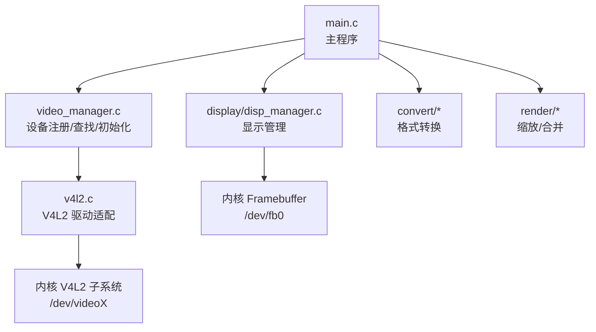
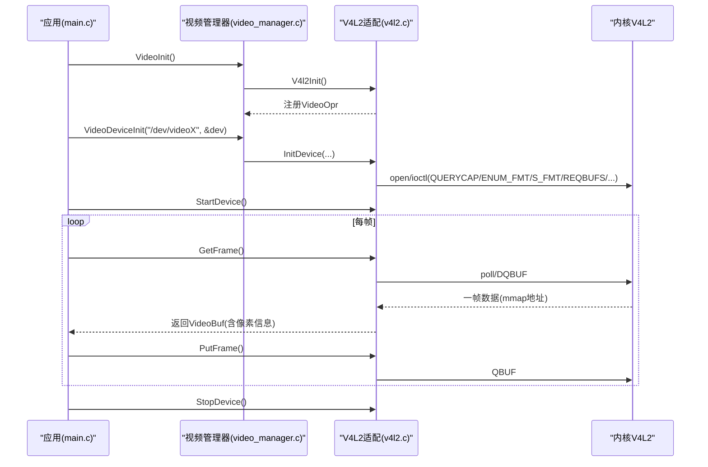
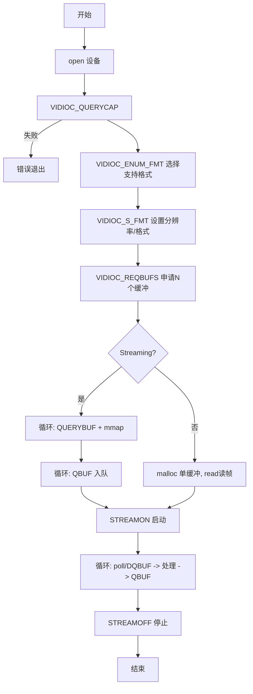
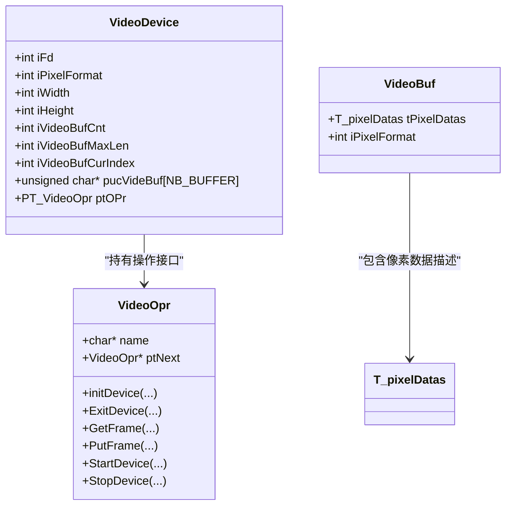
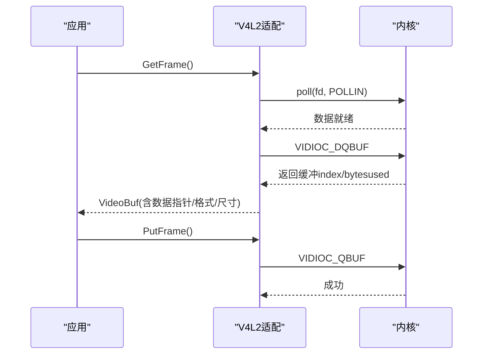
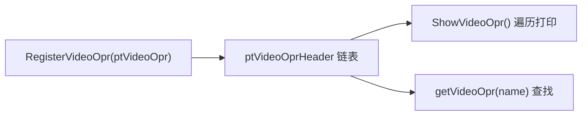
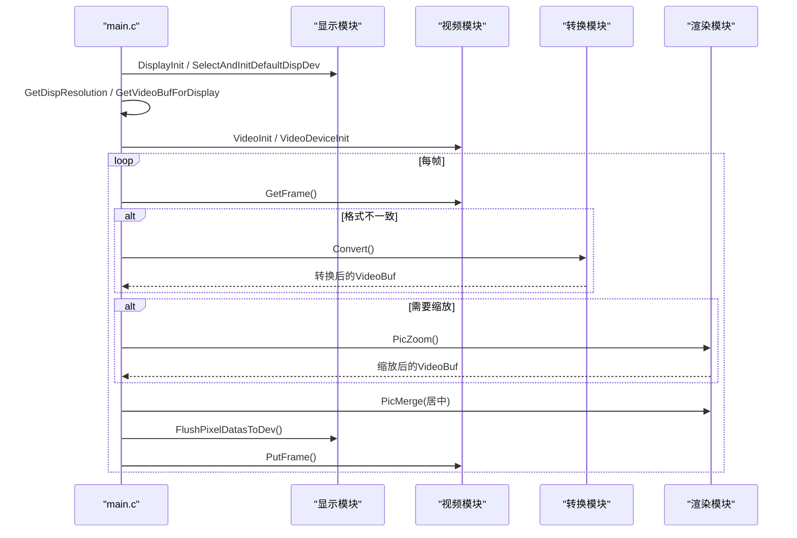
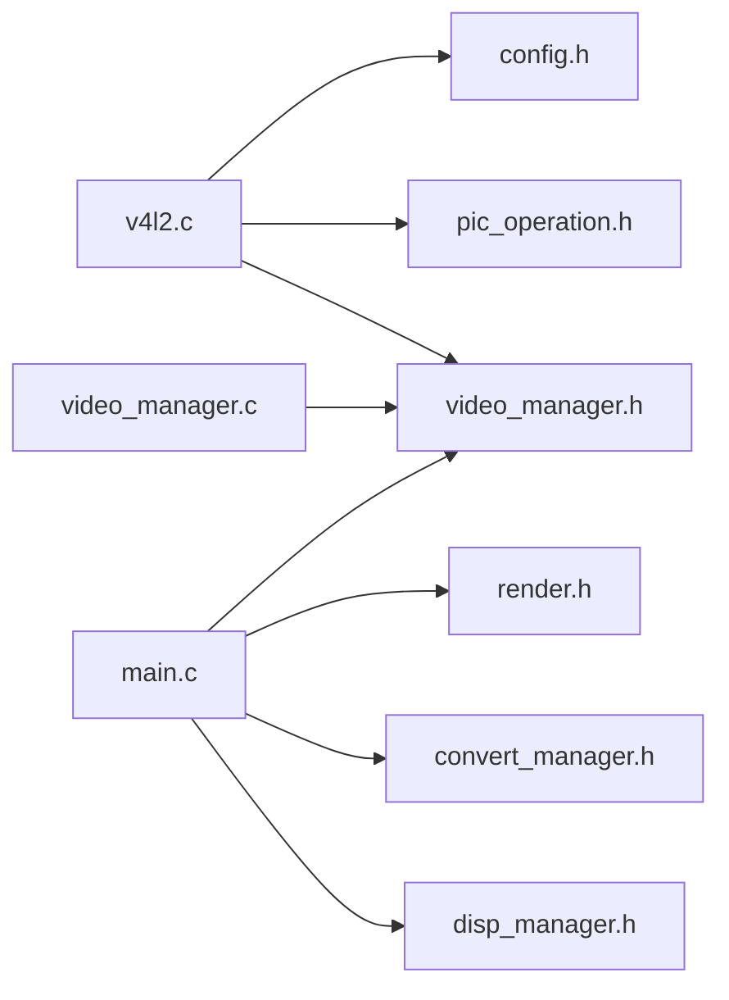

# 视频采集模块

<cite>
**本文引用的文件**
- [video2lcd/video/v4l2.c](file://video2lcd/video/v4l2.c)
- [video2lcd/video/video_manager.c](file://video2lcd/video/video_manager.c)
- [video2lcd/include/video_manager.h](file://video2lcd/include/video_manager.h)
- [video2lcd/main.c](file://video2lcd/main.c)
- [video2lcd/include/config.h](file://video2lcd/include/config.h)
- [video2lcd/include/pic_operation.h](file://video2lcd/include/pic_operation.h)
- [video2lcd/doc/V4L2关键机制深度解析.md](file://video2lcd/doc/V4L2关键机制深度解析.md)
</cite>

## 目录
1. [简介](#简介)
2. [项目结构](#项目结构)
3. [核心组件](#核心组件)
4. [架构总览](#架构总览)
5. [详细组件分析](#详细组件分析)
6. [依赖关系分析](#依赖关系分析)
7. [性能考虑](#性能考虑)
8. [故障排查指南](#故障排查指南)
9. [结论](#结论)
10. [附录：使用示例与最佳实践](#附录使用示例与最佳实践)

## 简介
本模块实现基于 V4L2 的视频设备抽象层，提供统一的摄像头设备初始化、缓冲区管理、流控制、帧获取/归还等能力。通过“操作接口注册表”机制，将不同驱动（当前为 V4L2）以统一接口暴露给上层应用；同时结合显示与转换模块，完成从采集到显示的完整链路。文档重点说明：
- V4L2 接口的使用：设备能力查询、格式枚举与设置、缓冲申请与映射、流启停、轮询取帧与归还。
- 视频设备管理器：设备操作函数注册、查找、多设备支持扩展点。
- 缓冲区管理：mmap 零拷贝、环形缓冲、双缓冲思想、读写模式兼容。
- 帧流程：获取帧、处理、归还帧的时序与错误处理。
- 分辨率与像素格式：如何根据 LCD 分辨率设置 V4L2 输出格式，以及如何处理不同像素格式。
- 性能优化与常见问题解决方案。

## 项目结构
本项目采用分层模块化设计：
- video：V4L2 驱动适配与视频设备管理器（注册/查找/初始化）。
- display：LCD framebuffer 显示管理。
- convert：像素格式转换（如 YUYV/MJPEG/RGB565 到目标格式）。
- render：图像缩放、合并等渲染操作。
- include：公共头文件（配置、数据结构、接口定义）。
- main.c：主程序，串联采集、转换、缩放、显示全流程。

图表来源
- [video2lcd/main.c:63-82](file://video2lcd/main.c#L63-L82)
- [video2lcd/video/video_manager.c:12-74](file://video2lcd/video/video_manager.c#L12-L74)
- [video2lcd/video/v4l2.c:47-249](file://video2lcd/video/v4l2.c#L47-L249)

章节来源
- [video2lcd/main.c:1-192](file://video2lcd/main.c#L1-L192)
- [video2lcd/video/video_manager.c:1-75](file://video2lcd/video/video_manager.c#L1-L75)
- [video2lcd/video/v4l2.c:1-401](file://video2lcd/video/v4l2.c#L1-L401)

## 核心组件
- 视频设备描述结构体 VideoDevice：封装 fd、像素格式、分辨率、缓冲区数组、当前索引及操作函数指针。
- 视频操作接口 VideoOpr：抽象 init/exit/getframe/putframe/start/stop 等函数指针，支持多驱动注册。
- V4L2 适配器 v4l2.c：实现具体 V4L2 的设备初始化、缓冲管理、流控制、帧获取/归还。
- 设备管理器 video_manager.c：维护 VideoOpr 链表，提供注册、查找、初始化入口。
- 主程序 main.c：串联显示、视频、转换、渲染，形成采集到显示的闭环。

章节来源
- [video2lcd/include/video_manager.h:14-56](file://video2lcd/include/video_manager.h#L14-L56)
- [video2lcd/video/video_manager.c:12-74](file://video2lcd/video/video_manager.c#L12-L74)
- [video2lcd/video/v4l2.c:387-401](file://video2lcd/video/v4l2.c#L387-L401)

## 架构总览
系统采用“设备抽象 + 驱动插件”的架构：
- 上层通过 VideoOpr 接口调用，不感知底层是 V4L2 还是其他驱动。
- V4L2 驱动在启动时向管理器注册自身操作集，后续由管理器统一调度。
- 数据流：内核 V4L2 驱动 → mmap 用户空间缓冲区 → 应用层处理（可选转换/缩放）→ 写入 framebuffer → LCD 显示。

图表来源
- [video2lcd/main.c:76-107](file://video2lcd/main.c#L76-L107)
- [video2lcd/video/video_manager.c:67-74](file://video2lcd/video/video_manager.c#L67-L74)
- [video2lcd/video/v4l2.c:47-249](file://video2lcd/video/v4l2.c#L47-L249)
- [video2lcd/video/v4l2.c:267-326](file://video2lcd/video/v4l2.c#L267-L326)

## 详细组件分析

### V4L2 设备初始化与流控制
- 打开设备并查询能力：检查是否支持视频采集、streaming/readwrite。
- 枚举支持的像素格式，选择项目支持列表中的格式。
- 设置分辨率与像素格式：优先使用 LCD 分辨率，若驱动不支持会回退。
- 申请缓冲区：
  - Streaming 模式：REQBUFS 分配 N 个内核缓冲，逐个 QUERYBUF 后 mmap 映射，再 QBUF 入队。
  - ReadWrite 模式：仅分配一个用户态缓冲区，read 读取。
- 启动/停止流：STREAMON/STREAMOFF。

图表来源
- [video2lcd/video/v4l2.c:47-249](file://video2lcd/video/v4l2.c#L47-L249)
- [video2lcd/video/v4l2.c:357-383](file://video2lcd/video/v4l2.c#L357-L383)

章节来源
- [video2lcd/video/v4l2.c:47-249](file://video2lcd/video/v4l2.c#L47-L249)
- [video2lcd/video/v4l2.c:357-383](file://video2lcd/video/v4l2.c#L357-L383)

### 缓冲区管理机制
- 环形缓冲：N 个缓冲区轮转使用，避免阻塞等待，提高吞吐。
- mmap 零拷贝：用户空间直接访问内核分配的缓冲，减少一次内存拷贝。
- 双缓冲思想：至少两个缓冲可保证“写一帧/读一帧”并行，降低丢帧概率。
- 长度计算：length = 宽 × 高 × 每像素字节数（MJPEG 压缩格式长度由驱动决定）。

图表来源
- [video2lcd/include/video_manager.h:14-56](file://video2lcd/include/video_manager.h#L14-L56)
- [video2lcd/include/pic_operation.h:10-17](file://video2lcd/include/pic_operation.h#L10-L17)

章节来源
- [video2lcd/include/video_manager.h:14-56](file://video2lcd/include/video_manager.h#L14-L56)
- [video2lcd/include/pic_operation.h:1-18](file://video2lcd/include/pic_operation.h#L1-L18)
- [video2lcd/doc/V4L2关键机制深度解析.md:117-221](file://video2lcd/doc/V4L2关键机制深度解析.md#L117-L221)

### 帧获取与归还流程
- 获取帧（Streaming）：poll 等待可读，DQBUF 取出缓冲，填充 VideoBuf（像素格式、尺寸、行字节、总字节、数据指针），记录当前缓冲索引。
- 归还帧（Streaming）：QBUF 将缓冲重新入队，供下一帧使用。
- 获取帧（ReadWrite）：read 读取一帧到用户缓冲，填充 VideoBuf。
- 错误处理：poll/IOCTL 失败时打印日志并返回错误码，上层需重试或退出。

图表来源
- [video2lcd/video/v4l2.c:267-326](file://video2lcd/video/v4l2.c#L267-L326)

章节来源
- [video2lcd/video/v4l2.c:267-326](file://video2lcd/video/v4l2.c#L267-L326)

### 设备管理器与多设备支持
- 注册机制：V4L2 驱动在启动时构造 VideoOpr 结构体并通过 RegisterVideoOpr 尾插法加入全局链表。
- 查找机制：getVideoOpr 按名称匹配，返回对应操作集。
- 多设备支持：可通过注册多个 VideoOpr（不同名称）实现多驱动或多设备实例；当前代码已预留 ptNext 链式结构。

图表来源
- [video2lcd/video/video_manager.c:12-58](file://video2lcd/video/video_manager.c#L12-L58)

章节来源
- [video2lcd/video/video_manager.c:12-58](file://video2lcd/video/video_manager.c#L12-L58)

### 分辨率与像素格式处理
- 分辨率：优先使用 LCD 分辨率（通过显示模块获取），设置到 V4L2；若驱动不支持，会以实际值回写。
- 像素格式：枚举设备支持格式，选择项目支持列表（YUYV/MJPEG/RGB565）之一；若都不支持则初始化失败。
- 帧内参数：根据像素格式计算 bpp、行字节、总字节，确保上层正确处理。

章节来源
- [video2lcd/video/v4l2.c:89-125](file://video2lcd/video/v4l2.c#L89-L125)
- [video2lcd/video/v4l2.c:296-304](file://video2lcd/video/v4l2.c#L296-L304)
- [video2lcd/doc/V4L2关键机制深度解析.md:68-114](file://video2lcd/doc/V4L2关键机制深度解析.md#L68-L114)

### 主程序工作流（采集到显示）
- 初始化显示：DisplayInit、SelectAndInitDefaultDispDev、获取 LCD 分辨率与帧缓冲。
- 初始化视频：VideoInit 注册 V4L2 驱动，VideoDeviceInit 打开设备并完成初始化。
- 循环处理：GetFrame → 可选格式转换 → 可选缩放 → PicMerge 居中绘制 → Flush 刷新 → PutFrame 归还。

图表来源
- [video2lcd/main.c:63-189](file://video2lcd/main.c#L63-L189)

章节来源
- [video2lcd/main.c:63-189](file://video2lcd/main.c#L63-L189)

## 依赖关系分析
- 头文件依赖：
  - v4l2.c 依赖 config.h、video_manager.h、pic_operation.h 及系统头文件（sys/types.h、fcntl.h、sys/mman.h、poll.h）。
  - video_manager.c 依赖 config.h、video_manager.h。
  - main.c 依赖 config.h、disp_manager.h、video_manager.h、convert_manager.h、render.h。
- 运行时依赖：
  - 内核 V4L2 子系统（/dev/videoX）。
  - 内核 Framebuffer（/dev/fb0）。

图表来源
- [video2lcd/video/v4l2.c:1-8](file://video2lcd/video/v4l2.c#L1-L8)
- [video2lcd/video/video_manager.c:1-3](file://video2lcd/video/video_manager.c#L1-L3)
- [video2lcd/main.c:1-9](file://video2lcd/main.c#L1-L9)

章节来源
- [video2lcd/video/v4l2.c:1-8](file://video2lcd/video/v4l2.c#L1-L8)
- [video2lcd/video/video_manager.c:1-3](file://video2lcd/video/video_manager.c#L1-L3)
- [video2lcd/main.c:1-9](file://video2lcd/main.c#L1-L9)

## 性能考虑
- 使用 mmap 零拷贝：避免用户态与内核态之间的额外拷贝，显著降低 CPU 占用与延迟。
- 多缓冲环形队列：N 个缓冲（默认 NB_BUFFER=4）允许采集与处理并行，减少丢帧。
- 合理选择像素格式：YUYV/RGB565 为未压缩格式，适合快速处理；MJPEG 压缩可降低带宽但解码开销增加。
- 仅在必要时进行格式转换与缩放：当输入与显示格式一致且尺寸合适时，跳过转换/缩放以提升性能。
- 使用 poll 非阻塞等待：避免忙轮询，降低功耗。

[本节为通用性能建议，不直接分析具体文件]

## 故障排查指南
- 无法打开设备：检查设备路径是否正确（/dev/videoX），权限是否足够。
- 不支持任何格式：确认设备输出的像素格式是否在支持列表中（YUYV/MJPEG/RGB565）。
- 设置格式失败：可能分辨率不被支持，查看 ioctl 返回值并使用驱动回写的实际分辨率。
- 缓冲映射失败：检查 REQBUFS 数量与 QUERYBUF 返回值，确认 mmap 偏移与长度正确。
- poll/DQBUF 失败：检查设备是否处于 STREAMON 状态，确认之前 QBUF 全部成功。
- 显示异常：确认帧缓冲映射与刷新流程正确，PicMerge 坐标计算无误。

章节来源
- [video2lcd/video/v4l2.c:64-123](file://video2lcd/video/v4l2.c#L64-L123)
- [video2lcd/video/v4l2.c:137-218](file://video2lcd/video/v4l2.c#L137-L218)
- [video2lcd/video/v4l2.c:273-326](file://video2lcd/video/v4l2.c#L273-L326)
- [video2lcd/main.c:76-107](file://video2lcd/main.c#L76-L107)

## 结论
该视频采集模块通过清晰的抽象层与 V4L2 适配，实现了稳定高效的视频采集与显示链路。其优势包括：
- 统一的设备操作接口，便于扩展新驱动。
- 完善的缓冲区管理与零拷贝优化，提升性能。
- 灵活的格式与分辨率处理，兼容多种设备。
- 完整的错误处理与调试输出，便于问题定位。

[本节总结性内容，不直接分析具体文件]

## 附录：使用示例与最佳实践
- 基本步骤（概念性示例，非代码片段）：
  1) 初始化显示模块，获取 LCD 分辨率与帧缓冲。
  2) 初始化视频模块，注册 V4L2 驱动。
  3) 打开指定视频设备，完成设备初始化（能力查询、格式设置、缓冲申请与映射）。
  4) 启动流（STREAMON）。
  5) 循环：获取帧（poll/DQBUF）→ 可选格式转换 → 可选缩放 → 居中绘制 → 刷新显示 → 归还帧（QBUF）。
  6) 停止流（STREAMOFF），释放资源。
- 最佳实践：
  - 始终检查每个 ioctl/read/mmap 的返回值，及时报错与清理。
  - 使用多缓冲策略，确保采集与处理流水线化。
  - 根据设备能力选择合适的像素格式，平衡质量与性能。
  - 在嵌入式平台上注意内存与 CPU 限制，避免不必要的拷贝与复杂算法。

[本节为概念性指导，不直接分析具体文件]