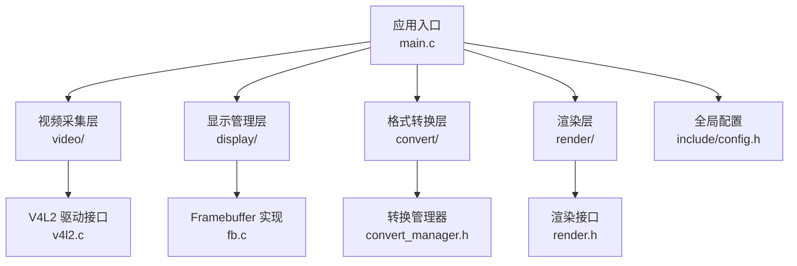
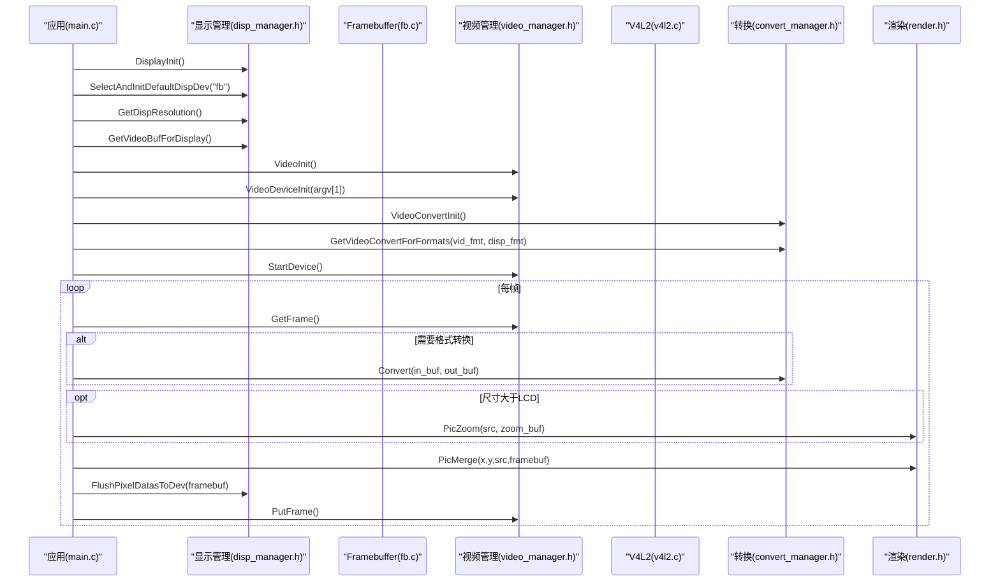
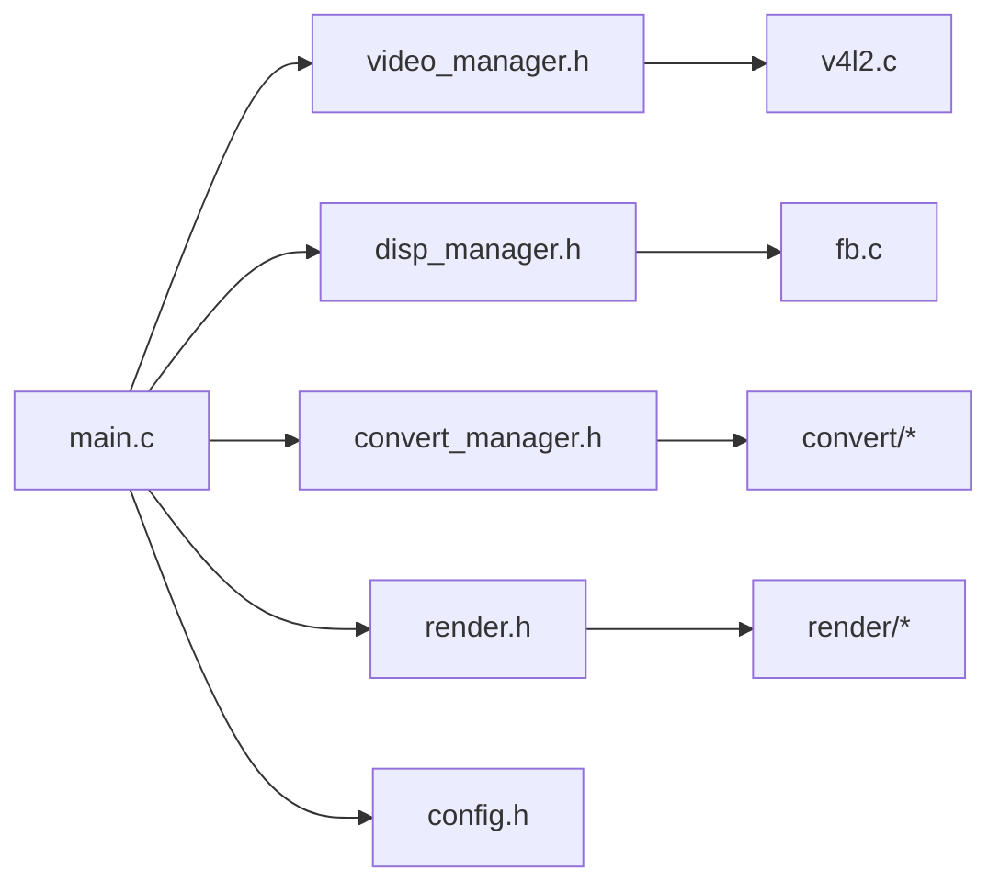

# 部署与配置

<cite>
**本文引用的文件**
- [Makefile](file://video2lcd/Makefile)
- [Makefile.build](file://video2lcd/Makefile.build)
- [main.c](file://video2lcd/main.c)
- [config.h](file://video2lcd/include/config.h)
- [disp_manager.h](file://video2lcd/include/disp_manager.h)
- [video_manager.h](file://video2lcd/include/video_manager.h)
- [convert_manager.h](file://video2lcd/include/convert_manager.h)
- [render.h](file://video2lcd/include/render.h)
- [v4l2.c](file://video2lcd/video/v4l2.c)
- [fb.c](file://video2lcd/display/fb.c)
- [video/Makefile](file://video2lcd/video/Makefile)
- [display/Makefile](file://video2lcd/display/Makefile)
- [render/Makefile](file://video2lcd/render/Makefile)
- [convert/Makefile](file://video2lcd/convert/Makefile)
</cite>

## 目录
1. [简介](#简介)
2. [项目结构](#项目结构)
3. [核心组件](#核心组件)
4. [架构总览](#架构总览)
5. [详细组件分析](#详细组件分析)
6. [依赖分析](#依赖分析)
7. [性能考虑](#性能考虑)
8. [故障排查指南](#故障排查指南)
9. [结论](#结论)
10. [附录](#附录)

## 简介
本指南面向在嵌入式Linux平台上部署和运行“视频采集并显示到LCD”的项目（目标产物为 video2lcd）。文档覆盖：
- 交叉编译环境搭建、编译器与工具链配置、目标平台设置与依赖库移植
- 构建系统选项（顶层与子模块 Makefile、编译标志、链接选项）
- 运行时配置（设备路径、调试开关、像素格式与分辨率等）
- 不同嵌入式平台的部署步骤与注意事项
- 生产环境最佳实践（服务化、日志、监控）
- 部署后验证测试与常见问题排查

## 项目结构
项目采用分层模块化设计，顶层 Makefile 负责统一编译与链接，各功能模块独立维护其子 Makefile。关键目录与职责：
- video：V4L2 摄像头采集抽象与实现
- display：显示设备抽象与 Framebuffer 实现
- convert：视频格式转换（YUV/MJPEG/RGB 等）
- render：图像渲染（缩放、合并）
- include：公共头文件与全局配置
- main.c：应用主流程，串联采集、转换、渲染与显示

图表来源
- [main.c:34-192](file://video2lcd/main.c#L34-L192)
- [video/Makefile:1-3](file://video2lcd/video/Makefile#L1-L3)
- [display/Makefile:1-2](file://video2lcd/display/Makefile#L1-L2)
- [convert/Makefile:1-7](file://video2lcd/convert/Makefile#L1-L7)
- [render/Makefile:1-2](file://video2lcd/render/Makefile#L1-L2)
- [config.h:13-18](file://video2lcd/include/config.h#L13-L18)

章节来源
- [Makefile:1-54](file://video2lcd/Makefile#L1-L54)
- [Makefile.build:1-46](file://video2lcd/Makefile.build#L1-L46)
- [main.c:34-192](file://video2lcd/main.c#L34-L192)

## 核心组件
- 视频采集（V4L2）：通过 VideoOpr 抽象与 V4L2 具体实现，支持 streaming 模式下的缓冲区申请、mmap、队列管理与帧获取/归还。
- 显示管理（DispOpr + FB）：抽象显示设备操作，FB 实现打开 /dev/fb0、映射显存、清屏与整页刷新。
- 格式转换：根据输入输出像素格式选择合适转换器（YUV→RGB、MJPEG→RGB、RGB→RGB），由转换管理器注册与查找。
- 渲染：提供图像缩放与合并能力，将处理后的帧居中绘制到帧缓冲。
- 配置：集中定义调试宏与设备路径（如 framebuffer 设备名）。

章节来源
- [video_manager.h:14-56](file://video2lcd/include/video_manager.h#L14-L56)
- [disp_manager.h:84-233](file://video2lcd/include/disp_manager.h#L84-L233)
- [convert_manager.h:23-43](file://video2lcd/include/convert_manager.h#L23-L43)
- [render.h:15-36](file://video2lcd/include/render.h#L15-L36)
- [config.h:13-18](file://video2lcd/include/config.h#L13-L18)

## 架构总览
应用启动后，依次完成显示初始化、视频设备初始化、格式匹配与转换、循环采集-转换-缩放-合并-刷新，最终将画面输出至 LCD。

图表来源
- [main.c:63-178](file://video2lcd/main.c#L63-L178)
- [disp_manager.h:117-233](file://video2lcd/include/disp_manager.h#L117-L233)
- [video_manager.h:35-56](file://video2lcd/include/video_manager.h#L35-L56)
- [v4l2.c:47-200](file://video2lcd/video/v4l2.c#L47-L200)
- [convert_manager.h:23-43](file://video2lcd/include/convert_manager.h#L23-L43)
- [render.h:15-36](file://video2lcd/include/render.h#L15-L36)

## 详细组件分析

### 构建系统与交叉编译
- 交叉编译工具链：通过 CROSS_COMPILE 前缀指定 arm-linux- 工具链（gcc、ld、ar、strip 等），便于在 x86 主机上生成 ARM 目标二进制。
- 编译选项：CFLAGS 包含警告、优化等级与调试信息，并自动添加 include 目录；LDFLAGS 链接数学库与 JPEG 库。
- 递归构建：顶层 Makefile 调用 Makefile.build，遍历 obj-y 中的子目录，收集 built-in.o 并最终链接为目标可执行文件。
- 清理：clean 移除 .o 与目标文件；distclean 额外移除依赖文件。

构建要点
- 确保已安装并正确配置交叉工具链，且 PATH 中包含 arm-linux-gcc 等命令。
- 若目标平台缺少 libjpeg，需移植或静态链接。
- 如需调整优化级别或调试信息，修改顶层 CFLAGS/LDFLAGS。

章节来源
- [Makefile:1-54](file://video2lcd/Makefile#L1-L54)
- [Makefile.build:1-46](file://video2lcd/Makefile.build#L1-L46)

### 运行时配置
- 设备路径：framebuffer 设备名由 config.h 的 FB_DEVICE_NAME 控制，默认 /dev/fb0。
- 调试输出：DBG_PRINTF 宏控制调试打印，可按需关闭以减小体积或降低开销。
- 命令行参数：程序要求传入摄像头设备路径（如 /dev/video0），用于打开并初始化 V4L2 设备。
- 分辨率与像素格式：由显示设备与摄像头协商决定，代码中优先使用显示端分辨率作为期望值，并通过 V4L2 设置格式。

章节来源
- [config.h:13-18](file://video2lcd/include/config.h#L13-L18)
- [main.c:57-87](file://video2lcd/main.c#L57-L87)
- [v4l2.c:105-125](file://video2lcd/video/v4l2.c#L105-L125)

### 视频采集（V4L2）
- 设备能力查询与格式枚举：确认设备为捕获设备，并选择支持的像素格式（MJPEG/YUYV/RGB565）。
- 格式设置：按显示端分辨率与所选格式设置输出，驱动可能回写实际值。
- 缓冲区管理：申请多个缓冲区（NB_BUFFER），mmap 映射到用户空间，入队后进入采集队列。
- 数据获取：poll 等待数据就绪，DQBUF 取帧，处理后 QBUF 归还。

章节来源
- [v4l2.c:31-200](file://video2lcd/video/v4l2.c#L31-L200)
- [video_manager.h:14-56](file://video2lcd/include/video_manager.h#L14-L56)

### 显示管理（Framebuffer）
- 设备初始化：打开 /dev/fb0，获取可变与固定屏幕信息，计算屏幕大小并 mmap 显存。
- 显示操作：支持画点、清屏、整页刷新；根据 bpp 适配颜色写入。
- 帧缓冲访问：上层通过 DispOpr 抽象获取显存指针，直接写入或拷贝像素数据。

章节来源
- [fb.c:53-174](file://video2lcd/display/fb.c#L53-L174)
- [disp_manager.h:84-233](file://video2lcd/include/disp_manager.h#L84-L233)

### 格式转换与渲染
- 转换管理器：根据输入输出像素格式选择合适转换器（YUV→RGB、MJPEG→RGB、RGB→RGB），统一接口便于扩展。
- 渲染操作：PicZoom 进行最近邻插值缩放，PicMerge 将小图合并到大图（帧缓冲），实现居中显示。

章节来源
- [convert_manager.h:23-43](file://video2lcd/include/convert_manager.h#L23-L43)
- [render.h:15-36](file://video2lcd/include/render.h#L15-L36)
- [main.c:129-178](file://video2lcd/main.c#L129-L178)

## 依赖分析
- 外部库：math（-lm）、JPEG 解码（-ljpeg）。
- 内核接口：V4L2（/dev/videoX）、Framebuffer（/dev/fb0）。
- 头文件依赖：各模块通过 include 目录共享数据结构与接口定义。

图表来源
- [main.c:4-8](file://video2lcd/main.c#L4-L8)
- [video_manager.h:1-56](file://video2lcd/include/video_manager.h#L1-L56)
- [disp_manager.h:1-236](file://video2lcd/include/disp_manager.h#L1-L236)
- [convert_manager.h:1-46](file://video2lcd/include/convert_manager.h#L1-L46)
- [render.h:1-40](file://video2lcd/include/render.h#L1-L40)
- [v4l2.c:1-200](file://video2lcd/video/v4l2.c#L1-L200)
- [fb.c:1-200](file://video2lcd/display/fb.c#L1-L200)
- [config.h:1-21](file://video2lcd/include/config.h#L1-L21)

章节来源
- [Makefile:17-22](file://video2lcd/Makefile#L17-L22)
- [video/Makefile:1-3](file://video2lcd/video/Makefile#L1-L3)
- [display/Makefile:1-2](file://video2lcd/display/Makefile#L1-L2)
- [convert/Makefile:1-7](file://video2lcd/convert/Makefile#L1-L7)
- [render/Makefile:1-2](file://video2lcd/render/Makefile#L1-L2)

## 性能考虑
- 缓冲区策略：V4L2 使用多缓冲区（NB_BUFFER）减少阻塞与抖动；合理设置数量平衡内存与吞吐。
- 零拷贝：mmap 映射内核缓冲区，避免用户态与内核态间复制。
- 显示优化：整页刷新（FBShowPage）一次性拷贝帧缓冲，减少多次写入开销。
- 缩放算法：最近邻插值速度快但质量一般；可根据需求替换为更高质量插值算法。
- 调试开销：生产环境建议关闭 DBG_PRINTF 以减少 I/O 与 CPU 占用。

章节来源
- [v4l2.c:127-200](file://video2lcd/video/v4l2.c#L127-L200)
- [fb.c:159-174](file://video2lcd/display/fb.c#L159-L174)
- [render.h:15-25](file://video2lcd/include/render.h#L15-L25)
- [config.h:13-15](file://video2lcd/include/config.h#L13-L15)

## 故障排查指南
常见问题与定位方法
- 无法打开摄像头设备
  - 现象：VideoDeviceInit 失败
  - 检查：设备节点是否存在（/dev/videoX）、权限是否正确、是否被其他进程占用
  - 参考：[v4l2.c:64-87](file://video2lcd/video/v4l2.c#L64-L87)
- 不支持的像素格式
  - 现象：GetVideoConvertForFormats 返回空
  - 检查：摄像头输出格式与显示格式是否匹配，必要时启用对应转换器
  - 参考：[main.c:91-99](file://video2lcd/main.c#L91-L99)、[convert_manager.h:31-43](file://video2lcd/include/convert_manager.h#L31-L43)
- 无法打开 framebuffer
  - 现象：DisplayInit/FBDeviceInit 失败
  - 检查：/dev/fb0 是否存在、权限、config.h 中 FB_DEVICE_NAME 是否正确
  - 参考：[fb.c:53-81](file://video2lcd/display/fb.c#L53-L81)、[config.h:17-18](file://video2lcd/include/config.h#L17-L18)
- 显示异常或花屏
  - 现象：画面错位、颜色错误
  - 检查：bpp 与颜色格式转换逻辑、行字节数与总字节数计算
  - 参考：[fb.c:125-153](file://video2lcd/display/fb.c#L125-L153)、[main.c:141-178](file://video2lcd/main.c#L141-L178)
- 性能瓶颈
  - 现象：卡顿、掉帧
  - 检查：缓冲区数量、缩放频率、调试输出是否开启
  - 参考：[v4l2.c:127-200](file://video2lcd/video/v4l2.c#L127-L200)、[config.h:13-15](file://video2lcd/include/config.h#L13-L15)

章节来源
- [v4l2.c:64-200](file://video2lcd/video/v4l2.c#L64-L200)
- [fb.c:53-174](file://video2lcd/display/fb.c#L53-L174)
- [main.c:91-178](file://video2lcd/main.c#L91-L178)
- [config.h:13-18](file://video2lcd/include/config.h#L13-L18)

## 结论
本项目通过清晰的模块划分与抽象接口，实现了从 V4L2 采集到 Framebuffer 显示的完整链路。借助统一的构建系统与可配置的运行时参数，可在多种嵌入式平台上快速部署与调优。生产环境中建议关闭调试输出、合理设置缓冲区与刷新策略，并结合系统服务化与日志监控提升稳定性。

## 附录

### 交叉编译环境搭建
- 安装交叉工具链：确保 arm-linux-gcc、arm-linux-ld、arm-linux-ar 等可用。
- 设置环境变量：CROSS_COMPILE=arm-linux-，或通过脚本导出 CC、LD、AR 等。
- 依赖库移植：
  - libjpeg：为目标平台编译静态库或动态库，并在 LDFLAGS 中指定路径或使用 -static 链接。
  - math 库：通常随工具链提供，无需额外移植。
- 构建命令：
  - 进入 video2lcd 目录，执行 make 生成 video2lcd 可执行文件。
  - 清理：make clean 或 make distclean。

章节来源
- [Makefile:1-22](file://video2lcd/Makefile#L1-L22)
- [Makefile.build:1-46](file://video2lcd/Makefile.build#L1-L46)

### 构建系统配置选项
- 顶层 Makefile
  - CROSS_COMPILE：指定交叉工具链前缀
  - CFLAGS：-Wall -O2 -g，-I include
  - LDFLAGS：-lm -ljpeg
  - obj-y：列出参与构建的源文件或子目录
- 子模块 Makefile
  - 每个子目录通过 obj-y += *.o 或 subdir/ 声明参与构建
  - 顶层 Makefile.build 递归调用子目录构建并汇总 built-in.o

章节来源
- [Makefile:17-34](file://video2lcd/Makefile#L17-L34)
- [video/Makefile:1-3](file://video2lcd/video/Makefile#L1-L3)
- [display/Makefile:1-2](file://video2lcd/display/Makefile#L1-L2)
- [convert/Makefile:1-7](file://video2lcd/convert/Makefile#L1-L7)
- [render/Makefile:1-2](file://video2lcd/render/Makefile#L1-L2)

### 运行时配置文件与参数
- config.h
  - DBG_PRINTF：调试输出开关
  - FB_DEVICE_NAME：framebuffer 设备路径
- 命令行参数
  - 第一个参数为摄像头设备路径（如 /dev/video0）
- 分辨率与格式
  - 优先使用显示端分辨率，V4L2 设置格式时可能被驱动回写为实际值

章节来源
- [config.h:13-18](file://video2lcd/include/config.h#L13-L18)
- [main.c:57-87](file://video2lcd/main.c#L57-L87)
- [v4l2.c:105-125](file://video2lcd/video/v4l2.c#L105-L125)

### 不同嵌入式平台部署步骤与注意事项
- 通用步骤
  - 准备目标文件系统，确保存在 /dev/videoX 与 /dev/fb0
  - 将编译好的 video2lcd 复制到目标板
  - 赋予执行权限，运行 ./video2lcd /dev/video0
- 注意事项
  - 权限：确保对 /dev/videoX 与 /dev/fb0 有读写权限
  - 依赖：目标板需具备 libjpeg（动态或静态）
  - 分辨率：若显示异常，检查显示端分辨率与摄像头输出格式匹配情况
  - 性能：适当调整 NB_BUFFER 与关闭调试输出

章节来源
- [main.c:57-87](file://video2lcd/main.c#L57-L87)
- [fb.c:53-81](file://video2lcd/display/fb.c#L53-L81)
- [v4l2.c:64-125](file://video2lcd/video/v4l2.c#L64-L125)

### 生产环境最佳实践
- 服务化
  - 使用 systemd 或 init.d 脚本托管进程，设置开机自启与崩溃重启
- 日志
  - 生产环境关闭 DBG_PRINTF，或将日志重定向到文件/串口
- 监控
  - 结合系统监控（CPU、内存、IO）评估采集与显示性能
  - 定期巡检设备节点状态与进程存活

章节来源
- [config.h:13-15](file://video2lcd/include/config.h#L13-L15)
- [main.c:117-189](file://video2lcd/main.c#L117-L189)

### 部署后验证测试
- 基础验证
  - 运行程序，观察 LCD 是否正常显示摄像头画面
  - 切换不同摄像头设备节点，验证兼容性
- 压力测试
  - 长时间运行，观察是否有内存泄漏或卡顿
  - 调整分辨率与格式组合，验证稳定性
- 回归测试
  - 在不同硬件平台重复上述步骤，确保跨平台一致性

章节来源
- [main.c:117-189](file://video2lcd/main.c#L117-L189)
- [v4l2.c:127-200](file://video2lcd/video/v4l2.c#L127-L200)
- [fb.c:159-174](file://video2lcd/display/fb.c#L159-L174)