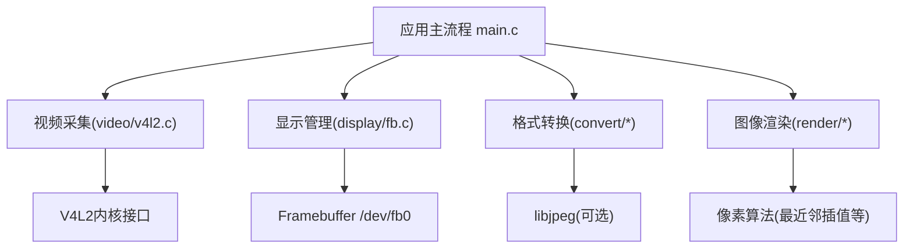
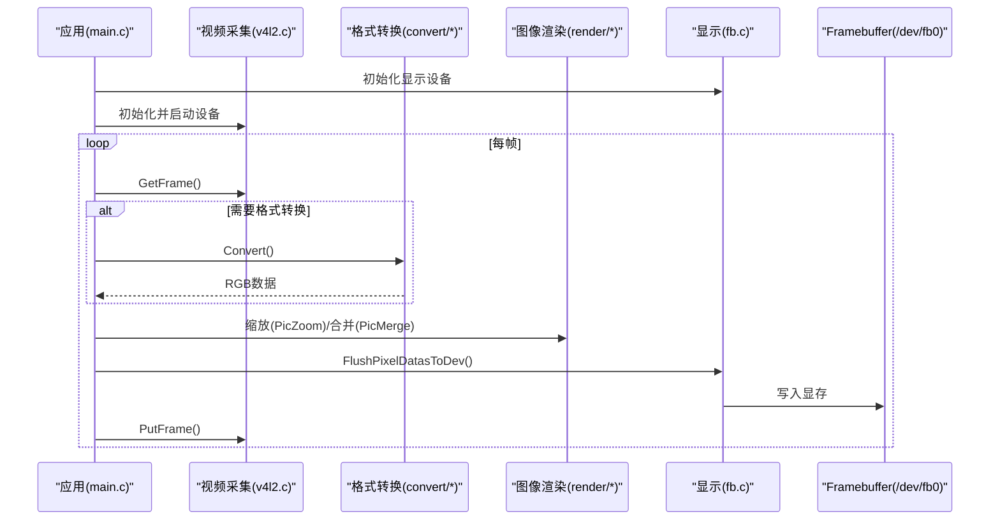
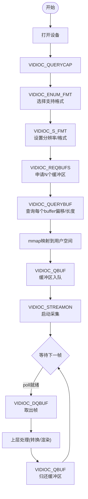
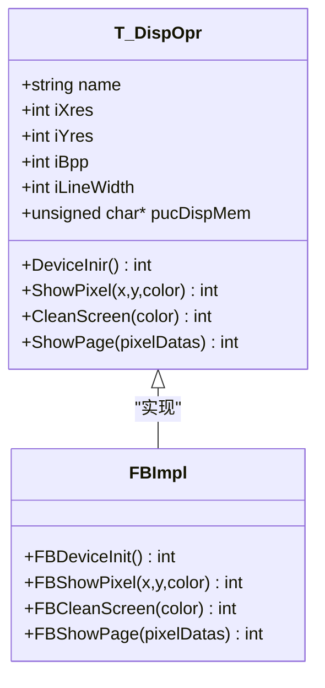
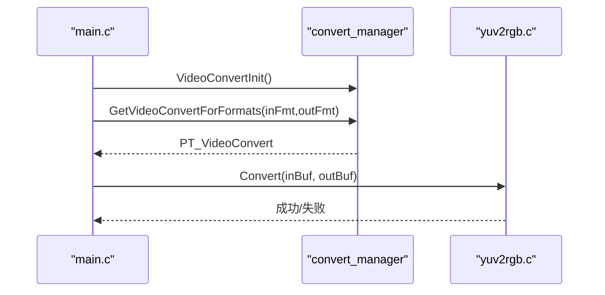
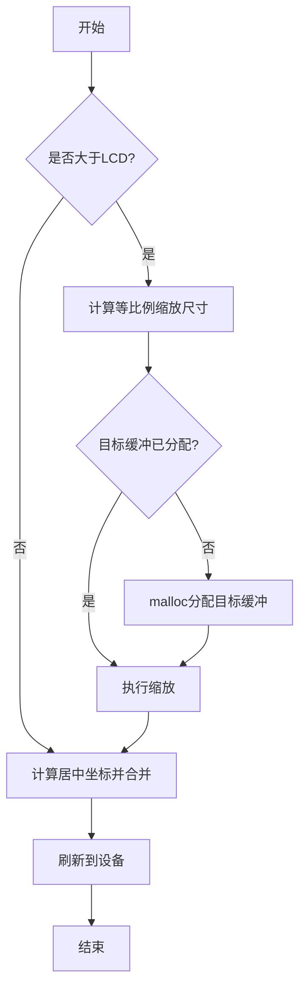
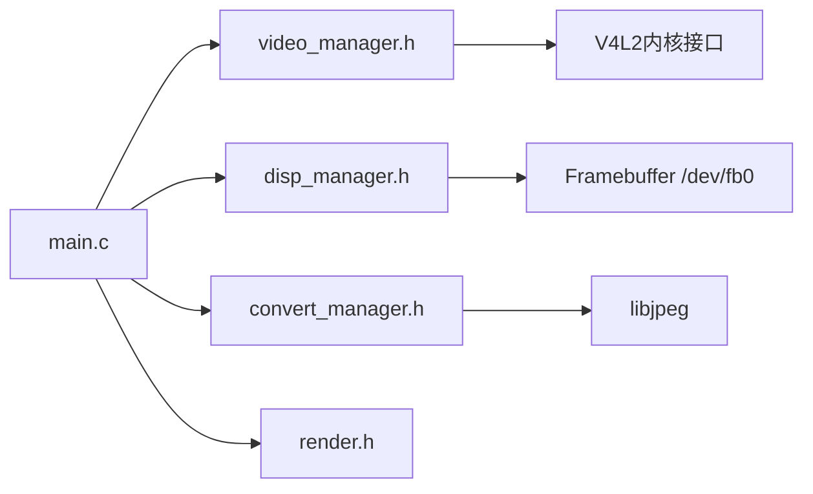

# 项目概述

<cite>
**本文引用的文件**
- [main.c](file://video2lcd/main.c)
- [config.h](file://video2lcd/include/config.h)
- [Makefile](file://video2lcd/Makefile)
- [video_manager.h](file://video2lcd/include/video_manager.h)
- [disp_manager.h](file://video2lcd/include/disp_manager.h)
- [convert_manager.h](file://video2lcd/include/convert_manager.h)
- [render.h](file://video2lcd/include/render.h)
- [v4l2.c](file://video2lcd/video/v4l2.c)
- [fb.c](file://video2lcd/display/fb.c)
- [yuv2rgb.c](file://video2lcd/convert/yuv2rgb.c)
- [pic_operation.h](file://video2lcd/include/pic_operation.h)
- [嵌入式Linux相机项目学习笔记.md](file://video2lcd/doc/嵌入式Linux相机项目学习笔记.md)
</cite>

## 目录
1. [简介](#简介)
2. [项目结构](#项目结构)
3. [核心组件](#核心组件)
4. [架构总览](#架构总览)
5. [详细组件分析](#详细组件分析)
6. [依赖关系分析](#依赖关系分析)
7. [性能与优化](#性能与优化)
8. [故障排查指南](#故障排查指南)
9. [结论](#结论)
10. [附录：技术栈与编译环境](#附录：技术栈与编译环境)

## 简介
本项目是一个面向嵌入式Linux的高性能实时视频处理与显示系统，目标是将摄像头采集的原始图像数据通过格式转换、图像处理（缩放、合并）后，实时渲染到LCD屏幕。系统采用模块化与插件式架构，围绕V4L2视频采集、Framebuffer显示、格式转换引擎和图像渲染四大模块构建，强调零拷贝或最小拷贝路径、低延迟与高吞吐。

主要能力包括：
- 摄像头数据采集：基于V4L2的流式采集，支持YUV/MJPEG等常见格式
- 格式转换：将摄像头输出格式转换为LCD所需的RGB格式（如RGB565/RGB32）
- 图像处理：按LCD分辨率进行等比例缩放与居中合并
- LCD显示：通过Framebuffer直接映射显存，实现高效刷新

适用场景：
- 工业视觉监控、车载影像预览、机器人视觉前端、便携式设备实时取景等对延迟敏感且资源受限的嵌入式平台。

## 项目结构
项目采用分层与模块化组织，顶层入口为main.c，各功能模块独立成目录并通过统一接口头文件解耦：
- video：视频采集抽象与V4L2驱动封装
- display：显示设备抽象与Framebuffer实现
- convert：格式转换管理器与各转换器（YUV->RGB、MJPEG->RGB、RGB->RGB）
- render：图像渲染操作（缩放、合并）
- include：公共接口与数据结构定义
- doc：开发文档与学习总结

图表来源
- [main.c:34-192](file://video2lcd/main.c#L34-L192)
- [v4l2.c:47-200](file://video2lcd/video/v4l2.c#L47-L200)
- [fb.c:53-174](file://video2lcd/display/fb.c#L53-L174)
- [yuv2rgb.c:25-199](file://video2lcd/convert/yuv2rgb.c#L25-L199)

章节来源
- [main.c:34-192](file://video2lcd/main.c#L34-L192)
- [Makefile:1-54](file://video2lcd/Makefile#L1-L54)

## 核心组件
- 视频采集模块（V4L2）
  - 提供统一的VideoOpr接口，封装设备打开、格式协商、缓冲区申请与mmap、流式采集循环（DQBUF/QBUF）
  - 支持多格式枚举与选择，适配不同摄像头能力
- 显示管理模块（Framebuffer）
  - 提供DispOpr接口，封装/dev/fb0打开、屏幕信息获取、显存mmap、清屏、画点、整页刷新
  - 支持双缓冲策略，避免画面撕裂
- 格式转换引擎
  - 以VideoConvert为抽象，注册多种转换器（YUV->RGB、MJPEG->RGB、RGB->RGB），运行时根据输入输出格式自动选择
  - 使用libjpeg解码MJPEG，内置YUV422到RGB565/RGB32的高效转换
- 图像渲染模块
  - PicZoom实现最近邻插值缩放，PicMerge实现小图到大图的区域合并
  - 用于将摄像头帧缩放到LCD分辨率并居中显示

章节来源
- [video_manager.h:14-56](file://video2lcd/include/video_manager.h#L14-L56)
- [disp_manager.h:69-96](file://video2lcd/include/disp_manager.h#L69-L96)
- [convert_manager.h:23-43](file://video2lcd/include/convert_manager.h#L23-L43)
- [render.h:15-36](file://video2lcd/include/render.h#L15-L36)

## 架构总览
系统遵循“采集—转换—渲染—显示”的数据流水线，所有模块通过统一的结构体与函数指针接口耦合，便于扩展与维护。

图表来源
- [main.c:63-178](file://video2lcd/main.c#L63-L178)
- [v4l2.c:152-200](file://video2lcd/video/v4l2.c#L152-L200)
- [fb.c:166-174](file://video2lcd/display/fb.c#L166-L174)
- [yuv2rgb.c:161-199](file://video2lcd/convert/yuv2rgb.c#L161-L199)

## 详细组件分析

### 视频采集模块（V4L2）
- 设计要点
  - 通过VideoOpr抽象出initDevice/StartDevice/GetFrame/PutFrame/StopDevice等通用操作，屏蔽底层差异
  - 标准五步初始化：QUERYCAP→ENUM_FMT→S_FMT→REQBUFS→QUERYBUF+QBUF
  - 优先使用Streaming模式，配合poll等待数据就绪，减少CPU占用
- 关键流程
  - 打开设备、查询能力、枚举并选择支持的像素格式
  - 设置分辨率与格式，分配多个缓冲区并mmap映射到用户空间
  - 入队缓冲区后进入采集循环：DQBUF取帧→处理→QBUF归还

图表来源
- [v4l2.c:47-200](file://video2lcd/video/v4l2.c#L47-L200)
- [嵌入式Linux相机项目学习笔记.md:125-195](file://video2lcd/doc/嵌入式Linux相机项目学习笔记.md#L125-L195)

章节来源
- [v4l2.c:47-200](file://video2lcd/video/v4l2.c#L47-L200)
- [video_manager.h:14-56](file://video2lcd/include/video_manager.h#L14-L56)

### 显示管理模块（Framebuffer）
- 设计要点
  - 通过DispOpr抽象显示设备操作，支持多设备注册与切换
  - 打开/dev/fb0，获取屏幕分辨率与BPP，mmap映射显存
  - 提供清屏、画点、整页刷新能力；结合双缓冲避免闪烁
- 关键流程
  - 初始化时计算屏幕大小、行字节数、像素宽度
  - 刷新时将待显示像素数据复制到显存或直接写入（若目标即显存）

图表来源
- [disp_manager.h:69-96](file://video2lcd/include/disp_manager.h#L69-L96)
- [fb.c:37-174](file://video2lcd/display/fb.c#L37-L174)

章节来源
- [fb.c:53-174](file://video2lcd/display/fb.c#L53-L174)
- [disp_manager.h:117-175](file://video2lcd/include/disp_manager.h#L117-L175)

### 格式转换引擎
- 设计要点
  - VideoConvert抽象isSupport/Convert/ConvertExit接口，支持动态注册与匹配
  - 当前实现包含YUV->RGB（YUV422Packed到RGB565/RGB32）、MJPEG->RGB（依赖libjpeg）、RGB->RGB
  - 运行时根据输入输出像素格式选择合适转换器
- 关键实现
  - YUV转RGB采用查表/宏展开加速，批量处理两个像素以减少重复计算
  - 输出格式按需分配内存，填充宽高、BPP、行字节与总字节数

图表来源
- [convert_manager.h:23-43](file://video2lcd/include/convert_manager.h#L23-L43)
- [yuv2rgb.c:25-199](file://video2lcd/convert/yuv2rgb.c#L25-L199)
- [main.c:91-139](file://video2lcd/main.c#L91-L139)

章节来源
- [convert_manager.h:23-43](file://video2lcd/include/convert_manager.h#L23-L43)
- [yuv2rgb.c:25-199](file://video2lcd/convert/yuv2rgb.c#L25-L199)

### 图像渲染模块
- 设计要点
  - PicZoom：最近邻插值缩放，保持纵横比，避免拉伸变形
  - PicMerge：将缩放后的图像合并到帧缓冲区的指定位置（居中）
- 关键流程
  - 计算缩放尺寸，必要时分配目标缓冲区
  - 将源像素数据按目标尺寸重采样
  - 计算左上角坐标，将结果写入帧缓冲区

图表来源
- [main.c:141-178](file://video2lcd/main.c#L141-L178)
- [render.h:15-36](file://video2lcd/include/render.h#L15-L36)

章节来源
- [main.c:141-178](file://video2lcd/main.c#L141-L178)
- [render.h:15-36](file://video2lcd/include/render.h#L15-L36)

## 依赖关系分析
- 模块间耦合
  - main.c作为编排者，依赖video_manager、disp_manager、convert_manager、render四个子系统
  - 各子系统通过统一结构体（T_VideoDevice、T_DispOpr、T_VideoConvert、T_PixelDatas）交互，降低耦合度
- 外部依赖
  - V4L2内核接口：/dev/videoX，ioctl系列调用
  - Framebuffer内核接口：/dev/fb0，ioctl与mmap
  - libjpeg：用于MJPEG解码（链接阶段-ljpeg）
- 编译与工具链
  - 交叉编译工具链前缀arm-linux-
  - 优化选项-O2，调试-g，包含include目录

图表来源
- [Makefile:1-54](file://video2lcd/Makefile#L1-L54)
- [main.c:4-8](file://video2lcd/main.c#L4-L8)

章节来源
- [Makefile:1-54](file://video2lcd/Makefile#L1-L54)
- [main.c:4-8](file://video2lcd/main.c#L4-L8)

## 性能与优化
- 零拷贝/最小拷贝路径
  - V4L2 Streaming模式通过mmap将内核缓冲区映射到用户空间，避免read/write额外拷贝
  - 显示端直接写映射的显存或通过一次memcpy整页刷新，减少中间拷贝
- 高效格式转换
  - YUV422到RGB的批量处理，利用宏与位运算加速
  - 仅在必要时分配输出缓冲，复用内存以降低分配开销
- 渲染优化
  - 仅当源图像大于LCD时才进行缩放，减少不必要的计算
  - 居中合并只更新必要区域，避免全屏覆盖
- 双缓冲防闪烁
  - 在普通内存中准备图像，再一次性刷新到显存，避免半帧显示导致的撕裂

[本节为通用性能讨论，不直接分析具体文件]

## 故障排查指南
- 无法打开摄像头设备
  - 检查设备节点是否存在（/dev/videoX），权限是否正确
  - 确认设备支持所选像素格式与分辨率
- 格式协商失败
  - 确保VIDIOC_S_FMT参数正确，注意内核可能调整实际值
  - 参考五步初始化流程逐项核对
- 缓冲区映射失败
  - 检查REQBUFS返回的实际数量，确保后续QUERYBUF索引有效
  - 确认mmap返回值非MAP_FAILED
- 显示异常或黑屏
  - 检查Framebuffer映射是否成功，屏幕分辨率与BPP是否匹配
  - 确认刷新函数被调用且数据长度正确
- 转换错误
  - 确认输入输出格式组合有对应转换器支持
  - 检查输出缓冲是否已分配足够内存

章节来源
- [v4l2.c:47-200](file://video2lcd/video/v4l2.c#L47-L200)
- [fb.c:53-174](file://video2lcd/display/fb.c#L53-L174)
- [yuv2rgb.c:25-199](file://video2lcd/convert/yuv2rgb.c#L25-L199)

## 结论
本项目以模块化与插件式设计为基础，围绕V4L2与Framebuffer构建了完整的嵌入式实时视频处理链路。通过零拷贝采集、高效格式转换与智能渲染策略，系统在资源受限平台上实现了低延迟、高吞吐的视频显示能力。其清晰的接口抽象与可扩展的转换器机制，使得未来接入更多摄像头与显示设备变得简单而稳健。

[本节为总结性内容，不直接分析具体文件]

## 附录：技术栈与编译环境
- 内核接口
  - V4L2：/dev/videoX，ioctl系列（QUERYCAP/ENUM_FMT/S_FMT/REQBUFS/QUERYBUF/QBUF/DQBUF/STREAMON/OFF）
  - Framebuffer：/dev/fb0，ioctl（FBIOGET_VSCREENINFO/FBIOGET_FSCREENINFO）与mmap
- 第三方库
  - libjpeg：用于MJPEG解码（链接-ljpeg）
- 编译环境
  - 交叉编译器：arm-linux-gcc
  - 优化与调试：-O2 -g
  - 包含路径：-I $(pwd)/include
  - 目标产物：video2lcd

章节来源
- [Makefile:1-54](file://video2lcd/Makefile#L1-L54)
- [config.h:17-18](file://video2lcd/include/config.h#L17-L18)